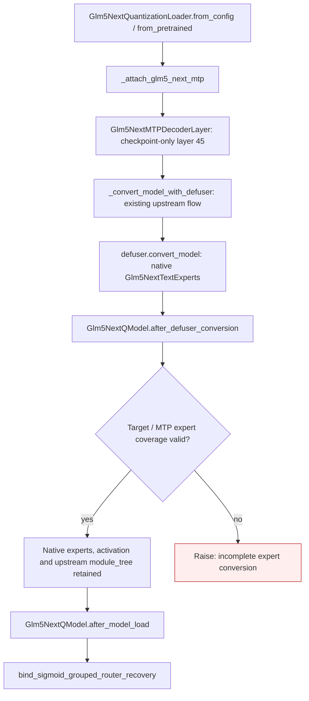
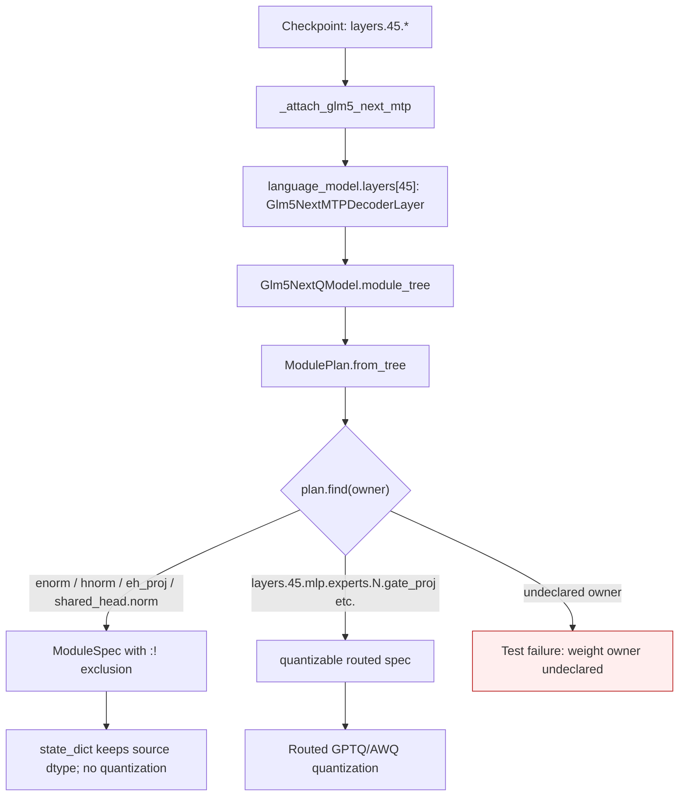

# Integrate flash target and mtp recovery and export

Carry the existing GLM-5 Next and GLM MoE DSA model bindings, original token-ID capture, bounded replay frontiers, transformed mask/position handling, native expert conversion, and target/MTP route recovery. Keep upstream target-layer module_tree semantics, including role metadata and dense low-rank/shared-expert policy, and declare the checkpoint-only MTP envelope explicitly. The native expert container and activation hook stay owned by Transformers/Defuser. The fork-only converter and expert forward implementation are removed; coverage validation uses the existing after_defuser_conversion hook.

This page describes the shipped API and conditional calls carried from the working fork. It is a structural call map, with no invented execution ordering between public entry points. Solid edges name calls present in the source; dashed edges expose class entry points. Rejected states and propagated failures are marked separately.

| Before this extraction layer | Carried implementation |
|---|---|
| Previous stack layer: `gptqmodel/models/definitions/glm5_next.py:13` | `gptqmodel/models/definitions/glm5_next.py:254`: `Glm5NextQModel` |
| Previous stack layer: `gptqmodel/models/definitions/glm_moe_dsa.py:11` | `gptqmodel/models/definitions/glm_moe_dsa.py:19`: `GlmMoeDsaQModel` |

The previous stack layer supplies dependencies. Standalone store/policy APIs are connected by the later processor, looper and model layers rather than being enabled implicitly here.

Validation for this extraction is limited to Python parsing, dependency inspection and whitespace checks. Existing regression/oracle tests are carried with the feature; no new model quantization, accelerator work, hardware benchmark or broad runtime revalidation was performed. The author reports successful prior use in the fork. This draft seeks initial feedback on value and scope before further refactoring or validation.

This is an extension of existing GLM support. The upstream target-layer module tree, role metadata, dense shared experts, processor-loading policy and Defuser dispatch remain authoritative; the checkpoint-only MTP envelope is declared on top of them. The added loader exposes MTP layer 45; the added post-conversion hook checks that ordinary Defuser conversion covered both target and MTP experts.

Two tiny CPU integration checks passed in 6.47 seconds: native expert object/forward preservation and lazy source materialization. No model quantization was run. The previous custom converter/container is deliberately retained only in the fork remainder.

## GLM-5.3 MTP checkpoint ownership

The public GLM-5.3 checkpoint stores a non-mHC MTP block at
`model.language_model.layers.45`. Transformers instantiates only the 45 target
layers from `num_hidden_layers`, and `_attach_glm5_next_mtp` appends
`Glm5NextMTPDecoderLayer` so the loader sees the checkpoint namespace. That
block owns four envelope tensors beyond the target-layer schema:

| Checkpoint key (layer 45) | Owner | Representation |
|---|---|---|
| `enorm.weight` | `enorm` | RMSNorm, dense |
| `hnorm.weight` | `hnorm` | RMSNorm, dense |
| `eh_proj.weight` | `eh_proj` | linear projection, dense |
| `shared_head.norm.weight` | `shared_head.norm` | RMSNorm, dense |

`eh_proj` merges the normalized embedding (`enorm`) with the normalized target
state (`hnorm`), and `shared_head.norm` normalizes the MTP output before the
shared target head. None of the four is a quantized projection, so each carries
an explicit `:!` exclusion tag in `Glm5NextQModel.module_tree`. Layer 45's
routed `gate_proj`/`up_proj`/`down_proj` remain governed by the existing
`experts:routed` block, which already allows the extra expert index set.

| Mechanism | Before | After |
|---|---|---|
| `Glm5NextQModel.module_tree` (`glm5_next.py:288-339`) | Only target-layer leaves; MTP envelope absent | Adds `enorm:!`, `hnorm:!`, `eh_proj:!`, `shared_head.norm:!` |
| `plan.find("enorm")` and the other three owners | `None` | Resolves to a dense spec with an explicit exclusion tag |
| `test_registered_module_plans` GLM blocks | 14 ordered blocks | 18 ordered blocks, matching the MTP forward order |
| `test_flash_model_tree_consumption` GLM case (`layer_count`, `weight_owner_count`) | `45`, `37` | `46`, `41`; the layer assertion now adds the checkpoint-only MTP count to `num_hidden_layers` |

The tree is `layer_modules_strict = False`, so target layers 0-44 not owning
these leaves is tolerated; the MTP block owns them exactly once. The extra
owners are dense by design and are not quantized, so the registry inventory and
the real-model ownership test both check the tags rather than a bare count.
