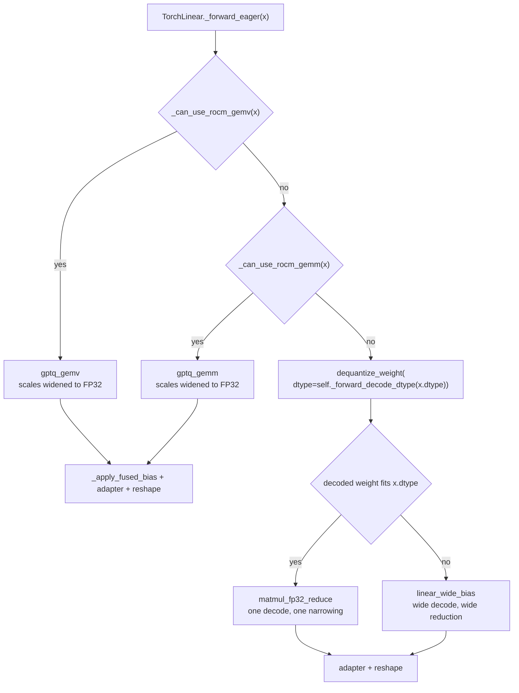
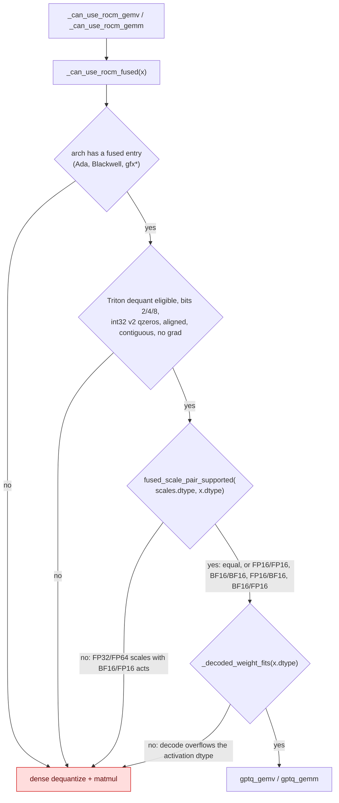

<!-- SPDX-FileCopyrightText: 2026 ModelCloud.ai
SPDX-License-Identifier: Apache-2.0 -->

# GPTQ fused decode with a mixed scale/activation dtype

`TorchLinear` dispatches single-token decode to `gptq_gemv` and the 2..64-token
band to `gptq_gemm` on Ada, Blackwell and the registered ROCm families. Both
kernels load the packed codes, widen every scale to FP32, form
`(code - zero) * scale`, and round that product once to the activation dtype.
The stored scale operand therefore never had to *be* the activation dtype, but
the shared gate required exact equality anyway. A GPTQ checkpoint stores FP16
scales, so every BF16 model failed `self.scales.dtype == x.dtype` and paid the
dense dequantize + matmul fallback even where a fused launch entry existed
(#5740).

## What changed

`_can_use_rocm_fused` now asks `fused_scale_pair_supported(self.scales.dtype,
x.dtype)` instead of comparing the dtypes. The helper admits the pair when the
dtypes are equal (previous behaviour, including FP32/FP64) or when both are half
dtypes (FP16/BF16). Any other mixed pair — for example FP32 scales with BF16
activations — still takes the dense path because the fused kernels were not
measured for it. Range safety stays a separate predicate:
`_decoded_weight_fits(x.dtype)` still rejects a decode that would overflow the
activation dtype (#5606).

The dense fallback changed with it. It used to decode in the scale dtype (FP16)
and then narrow the whole matrix to the activation dtype (BF16) on every
forward. It now asks `dequantize_weight` for a decode dtype that is already the
activation dtype whenever every decoded weight fits it, so the weight is rounded
once instead of twice and no full-matrix cast is needed. A decode that does not
fit keeps the range-safe wide dtype and the existing `linear_wide_bias`
epilogue.

## Shipped flow



`TritonV2Linear.forward` reaches the same gate: it asks
`_can_use_rocm_gemv`/`_can_use_rocm_gemm` and delegates to
`TorchLinear._forward_eager` when either accepts, so the mixed pair is fused for
that backend too (`tritonv2.py:171-174`).

## Gate detail and failure paths



The fallback is the previous code path, unchanged: `dequantize_weight` keeps the
range-safe dtype from `decode_dtype_for_scales` (#5606), and the epilogue
promotes to FP32 when the reconstructed weight does not fit the activation
dtype. No environment switch selects a path, and an unmeasured scale dtype can
never reach a fused launch.

## Before and after

| Mechanism | Before (`origin/main`) | After |
| --- | --- | --- |
| Fused gate scale check | `self.scales.dtype == x.dtype` at `torch.py:736` | `fused_scale_pair_supported(...)` at `torch.py:779`, helper at `torch.py:143` |
| Range guard | `_decoded_weight_fits(x.dtype)` at `torch.py:740` | unchanged, still after the pair check at `torch.py:783` |
| Dense fallback decode | `dequantize_weight(num_itr=num_itr)` at `torch.py:586`, then a full-matrix `weights.to(dtype=x.dtype)` cast at `torch.py:614` | `dequantize_weight(num_itr=num_itr, dtype=self._forward_decode_dtype(x.dtype))` at `torch.py:621` |
| Public decode signature | `dequantize_weight(self, num_itr=1)` at `torch.py:430` | `dequantize_weight(self, num_itr=1, dtype=None)` at `torch.py:455`, matching the base class |
| Triton decode | `_dequantize_weight_triton()` used `_decode_dtype()` at `torch.py:1166` | `_dequantize_weight_triton(dtype=None)` resolves the request at `torch.py:1205-1209` |
| Cached 2/4/8-bit decode | `_dequantize_weight_cached_248(num_itr)` used `_decode_dtype()` at `torch.py:1255` | accepts `dtype` and resolves it at `torch.py:1321-1334` |
| Request resolution | not present | `_resolve_decode_dtype` at `torch.py:1272`, `_forward_decode_dtype` at `torch.py:1287` |

## Failure contract

- **Unmeasured scale dtype.** FP32/FP64 scales with a half activation keep the
  dense path. The output is finite and matches the FP64 oracle; only the fused
  kernels are skipped.
- **Decode overflow.** If any decoded weight leaves the activation dtype's
  finite range, `_decoded_weight_fits` is false, the fused gate closes, and the
  dense path keeps the reduction wide (`linear_wide_bias`). A caller-requested
  decode dtype is also ignored in that case, so `dequantize_weight(dtype=...)`
  cannot reintroduce the overflow.
- **No silent widening of the fused kernels.** The pair rule never admits a
  scale dtype the kernels were not measured with; adding one requires measuring
  it first and extending `fused_scale_pair_supported`.

## Validation

On an RTX 4090 (SM 8.9), CUDA 4, torch 2.15.0+cu132, Triton 3.9.0, 4-bit
gs=128, BF16 activations with FP16 scales, `triton.testing.do_bench` median
(warmup 25, rep 100). Before is `origin/main`; after is this change.

| K x N | M | Before (ms) | After (ms) | Change |
| --- | ---: | ---: | ---: | ---: |
| 4096 x 4096 | 1 | 0.1157 | 0.0348 | -69.9% (3.32x) |
| 4096 x 4096 | 8 | 0.0952 | 0.0276 | -71.0% (3.45x) |
| 4096 x 4096 | 128 | 0.1175 | 0.0799 | -32.0% (1.47x) |
| 4096 x 11008 | 1 | 0.4277 | 0.0529 | -87.6% (8.08x) |
| 4096 x 11008 | 8 | 0.4700 | 0.0475 | -89.9% (9.89x) |
| 4096 x 11008 | 128 | 0.4721 | 0.2461 | -47.9% (1.92x) |
| 11008 x 4096 | 1 | 0.4668 | 0.0563 | -87.9% (8.29x) |
| 11008 x 4096 | 8 | 0.4291 | 0.0604 | -85.9% (7.10x) |
| 11008 x 4096 | 128 | 0.4729 | 0.2580 | -45.4% (1.83x) |

`M=128` is outside both fused bands; its change comes from the single-rounding
dense decode. Fused-vs-dense FP32 reduction error is at most `5.7e-4` across
these shapes, and the visible BF16 output differs by at most one BF16 ulp
(bit-equal on `M=1`).

```bash
CUDA_DEVICE_ORDER=PCI_BUS_ID CUDA_VISIBLE_DEVICES=4 PYTHONPATH=$PWD \
  /root/venv/bin/python -m pytest -q \
  tests/kernels/test_gptq_bf16_fp16_scales_5740.py
```

Introduced in PR #5921 for [issue #5740](https://github.com/ModelCloud/GPTQModel/issues/5740).
The fused launch tables and their contracts are documented in
[GPTQ Triton decode and small-M dispatch](triton-dispatch.md).
