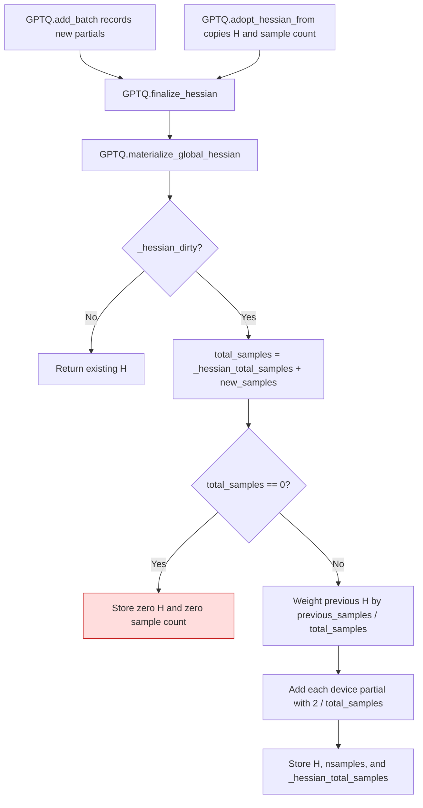
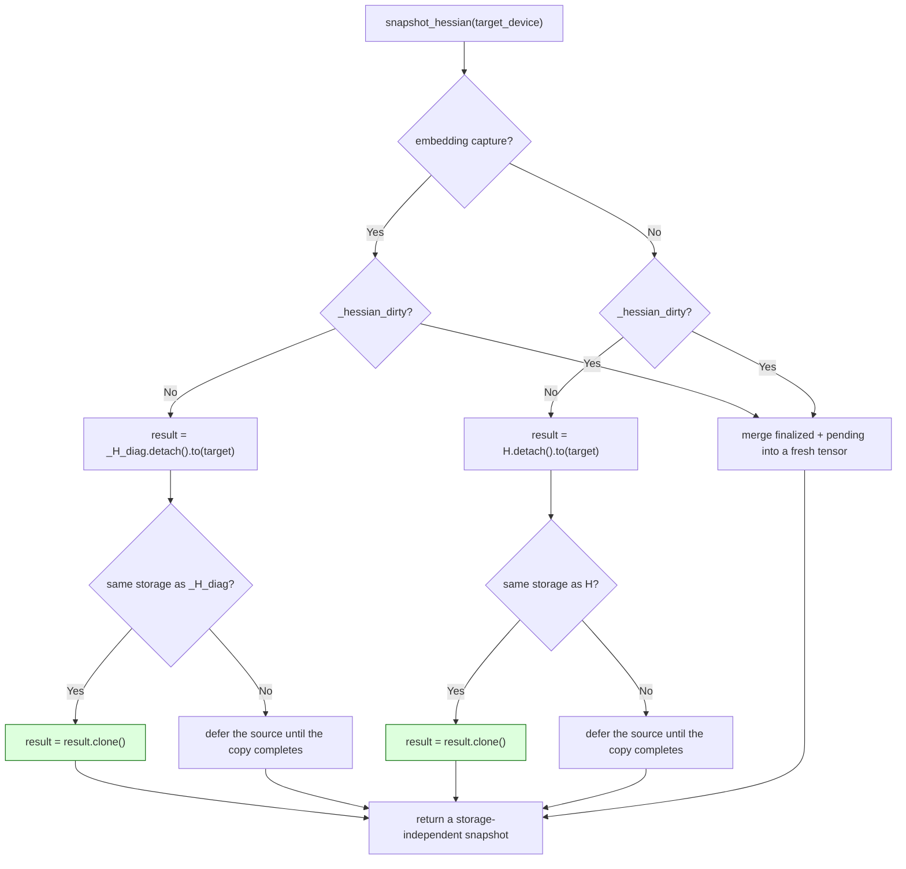

<!-- SPDX-FileCopyrightText: 2026 ModelCloud.ai
SPDX-License-Identifier: Apache-2.0 -->

# GPTQ Hessian accumulation

`GPTQ.add_batch` records new Hessian partials. `GPTQ.materialize_global_hessian`
combines those partials with the already normalized `H` when capture resumes
after a previous finalization. `GPTQ.finalize_hessian` returns that accumulated
matrix to the quantizer. `GPTQ.adopt_hessian_from` copies the leader's sample
count as well as its matrix. This flow was corrected in PR #3721.

| Mechanism | Before | After |
| --- | --- | --- |
| Sample count | `gptqmodel/quantization/gptq.py:1141` counted only new partials | `materialize_global_hessian` includes `_hessian_total_samples` |
| Adopted sample count | `gptqmodel/quantization/gptq.py:1290` copied `H` and `nsamples` but omitted `_hessian_total_samples` | `adopt_hessian_from` copies the cumulative count |
| Reused output | `gptqmodel/quantization/gptq.py:1155` zeroed the previous `H` | Previous normalized `H` contributes with its sample weight |
| Normalization | `gptqmodel/quantization/gptq.py:1219` scaled only the new sum | Each new partial contributes `2 / total_samples` before final storage |

When there are no prior or new samples, `materialize_global_hessian` stores a
zero matrix. When no new samples are dirty, it returns the existing normalized
matrix. The regression is `tests/test_gptq_hessian_accumulation.py`.

## Snapshot ownership

`snapshot_hessian` is the read path for the durable EXL3 capture frontier: a
writer may hold the returned tensor while capture continues. The value must
therefore own its storage, because `materialize_global_hessian` mutates `self.H`
in place on the next finalization and the embedding path accumulates into
`self._H_diag` the same way.

`Tensor.to(device=..., dtype=torch.float32)` is a no-op that returns the same
storage when the source already has the requested device and dtype, and
`.detach()` shares storage rather than copying it. Both fast paths therefore
aliased the live capture:

| Mechanism | Before | After |
| --- | --- | --- |
| Matrix fast path (`gptqmodel/quantization/gptq.py:1449`) | `H.detach().to(device, float32)` returned a view of `H` | clone when the move is a no-op |
| Embedding fast path (`gptqmodel/quantization/gptq.py:1398`) | `_H_diag.detach().to(device, float32)` returned a view of `_H_diag` | clone when the move is a no-op |
| Merge path | already built a fresh tensor | unchanged |

Measured on CPU (torch 2.16.0.dev20261102+cu130), same-device FP32 snapshots:

| Capture | Snapshot at first call | Snapshot after `add_batch` + `finalize_hessian` | Live value after |
| --- | --- | --- | --- |
| `nn.Linear(2, 2)` | `[[2, 0], [0, 0]]` | `[[2, 0], [0, 0]]` (was `[[1, 0], [0, 4]]`) | `[[1, 0], [0, 4]]` |
| `nn.Embedding(5, 3)` | `[0.667, 1.333, 0, 0]` | `[0.667, 1.333, 0, 0]` (was `[0.4, 0.8, 0.4, 0.4]`) | `[0.4, 0.8, 0.4, 0.4]` |

The snapshot is also writable: a caller may keep, transform, or release it
without the capture observing the change. Tests:
`tests/test_gptq_hessian_accumulation.py::test_gptq_snapshot_hessian_survives_later_finalization`,
`::test_gptq_snapshot_hessian_embedding_survives_later_finalization`, and
`::test_gptq_snapshot_hessian_is_writable_without_touching_the_capture`.
