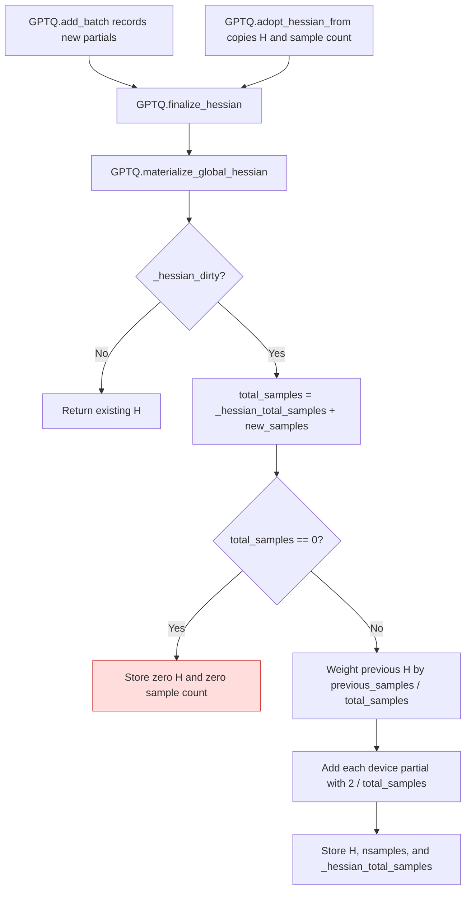
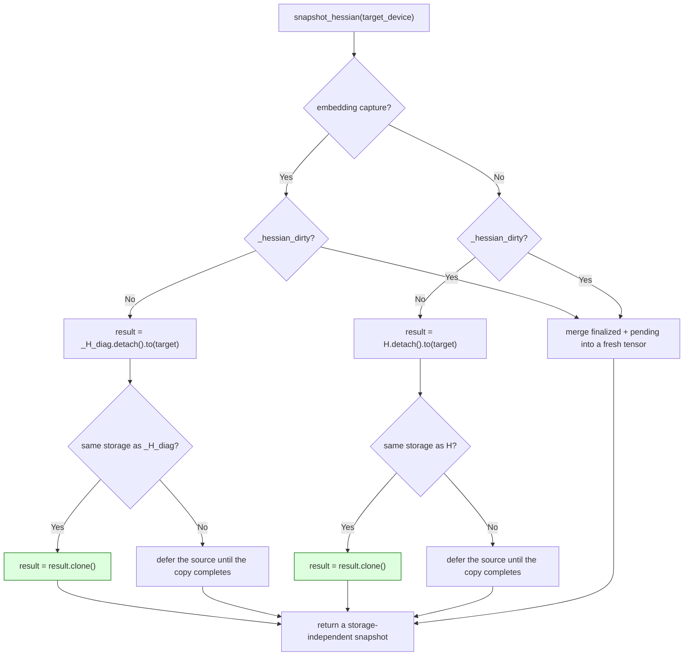
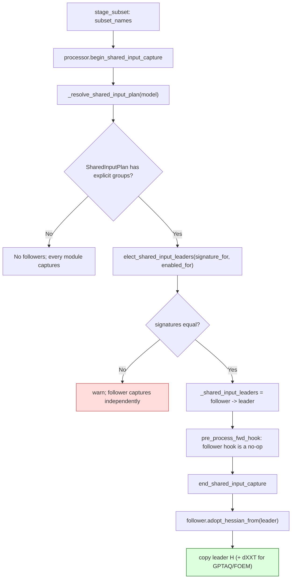

<!-- SPDX-FileCopyrightText: 2026 ModelCloud.ai
SPDX-License-Identifier: Apache-2.0 -->

# GPTQ Hessian accumulation

`GPTQ.add_batch` records new Hessian partials. `GPTQ.materialize_global_hessian`
combines those partials with the already normalized `H` when capture resumes
after a previous finalization. `GPTQ.finalize_hessian` returns that accumulated
matrix to the quantizer. `GPTQ.adopt_hessian_from` copies the leader's sample
count as well as its matrix. This flow was corrected in PR #3721.

| Mechanism | Before | After |
| --- | --- | --- |
| Sample count | `gptqmodel/quantization/gptq.py:1141` counted only new partials | `materialize_global_hessian` includes `_hessian_total_samples` |
| Adopted sample count | `gptqmodel/quantization/gptq.py:1290` copied `H` and `nsamples` but omitted `_hessian_total_samples` | `adopt_hessian_from` copies the cumulative count |
| Reused output | `gptqmodel/quantization/gptq.py:1155` zeroed the previous `H` | Previous normalized `H` contributes with its sample weight |
| Normalization | `gptqmodel/quantization/gptq.py:1219` scaled only the new sum | Each new partial contributes `2 / total_samples` before final storage |

When there are no prior or new samples, `materialize_global_hessian` stores a
zero matrix. When no new samples are dirty, it returns the existing normalized
matrix. The regression is `tests/test_gptq_hessian_accumulation.py`.

## Snapshot ownership

`snapshot_hessian` is the read path for the durable EXL3 capture frontier: a
writer may hold the returned tensor while capture continues. The value must
therefore own its storage, because `materialize_global_hessian` mutates `self.H`
in place on the next finalization and the embedding path accumulates into
`self._H_diag` the same way.

`Tensor.to(device=..., dtype=torch.float32)` is a no-op that returns the same
storage when the source already has the requested device and dtype, and
`.detach()` shares storage rather than copying it. Both fast paths therefore
aliased the live capture:

| Mechanism | Before | After |
| --- | --- | --- |
| Matrix fast path (`gptqmodel/quantization/gptq.py:1449`) | `H.detach().to(device, float32)` returned a view of `H` | clone when the move is a no-op |
| Embedding fast path (`gptqmodel/quantization/gptq.py:1398`) | `_H_diag.detach().to(device, float32)` returned a view of `_H_diag` | clone when the move is a no-op |
| Merge path | already built a fresh tensor | unchanged |

Measured on CPU (torch 2.16.0.dev20261102+cu130), same-device FP32 snapshots:

| Capture | Snapshot at first call | Snapshot after `add_batch` + `finalize_hessian` | Live value after |
| --- | --- | --- | --- |
| `nn.Linear(2, 2)` | `[[2, 0], [0, 0]]` | `[[2, 0], [0, 0]]` (was `[[1, 0], [0, 4]]`) | `[[1, 0], [0, 4]]` |
| `nn.Embedding(5, 3)` | `[0.667, 1.333, 0, 0]` | `[0.667, 1.333, 0, 0]` (was `[0.4, 0.8, 0.4, 0.4]`) | `[0.4, 0.8, 0.4, 0.4]` |

The snapshot is also writable: a caller may keep, transform, or release it
without the capture observing the change. Tests:
`tests/test_gptq_hessian_accumulation.py::test_gptq_snapshot_hessian_survives_later_finalization`,
`::test_gptq_snapshot_hessian_embedding_survives_later_finalization`, and
`::test_gptq_snapshot_hessian_is_writable_without_touching_the_capture`.

## Shared-input dedup for calibrated quantizers

`SharedInputPlan` already groups sibling projections that read the same
activation (`:in=<tag>`). `GPTQProcessor` turned that plan into a leader/
follower capture; `SharedInputCaptureMixin` gives QQQ, VPTQ, MACaQ and EXL3 the
same election, and GPTAQ/FOEM now participate in `GPTQProcessor`'s election
instead of being excluded.

The quantizer owns the copy because each keeps a different statistic:
`QQQ` a token-normalized float32 mean (`gptqmodel/quantization/qqq.py:705`),
`VPTQ` a float64 mean (`gptqmodel/quantization/vptq.py:414`), `MACaQ` a
float64 sum (`gptqmodel/quantization/macaq.py:740`), and `GPTAQ`/`FOEM` an
`H` plus `dXXT` (`gptqmodel/quantization/gptaq.py:310`,
`gptqmodel/quantization/foem.py:384`). `EXL3Processor` exposes its plain
`GPTQ` capture tasks through `_shared_input_task_enabled`
(`gptqmodel/looper/exllamav3_processor.py:2298`) and excludes `w3` aliases
already deduplicated by `share_hessian_state_from`.

| Mechanism | Before | After |
| --- | --- | --- |
| QQQ / VPTQ / MACaQ election | no plan; every sibling accumulated `H` | `SharedInputCaptureMixin.begin_shared_input_capture` (`gptqmodel/looper/shared_input.py:153`) |
| EXL3 election | plain `GPTQ` capture per projection | same mixin over `tasks[name]["capture"]` |
| GPTAQ / FOEM election | excluded by `type(task) is GPTQ` | `_hessian_capture_signature` (`gptqmodel/looper/gptq_processor.py:435`) admits them with `dXXT` |
| QQQ GSQ | n/a | excluded: its moments, not `H`, drive quantization |
| Follower capture | one `add_batch`/`addmm_` per sibling | hook is a no-op; leader copy is bitwise equal |

Measured on the synthetic 2-layer Llama fixture used by
`tests/test_shared_input_hessian_dedup_methods.py`, `batch_size=2`:

| Method | Captures per layer before | Captures per layer after | Checkpoint vs `origin/main` |
| --- | --- | --- | --- |
| QQQ | 7 (`q,k,v,o,g,u,d`) | 4 (`q,o,g,d`) | bitwise equal, 36 tensors |
| VPTQ | 7 | 4 | bitwise equal, 49 tensors |
| MACaQ | 7 | 4 | bitwise equal, 35 tensors |
| GPTAQ | 7 `H` + `dXXT` | 4 | bitwise equal, 63 tensors |
| FOEM | 7 `H` + `dXXT` | 4 | bitwise equal, 63 tensors |

The two follower matrices per group are the same storage the independent path
would have held (leader statistic plus the follower's private copy), so peak
allocated memory does not grow with the group size. CUDA peak measured on the
same fixture stayed within 0.02% of `origin/main` for every method (allocator
noise; no directional regression).
