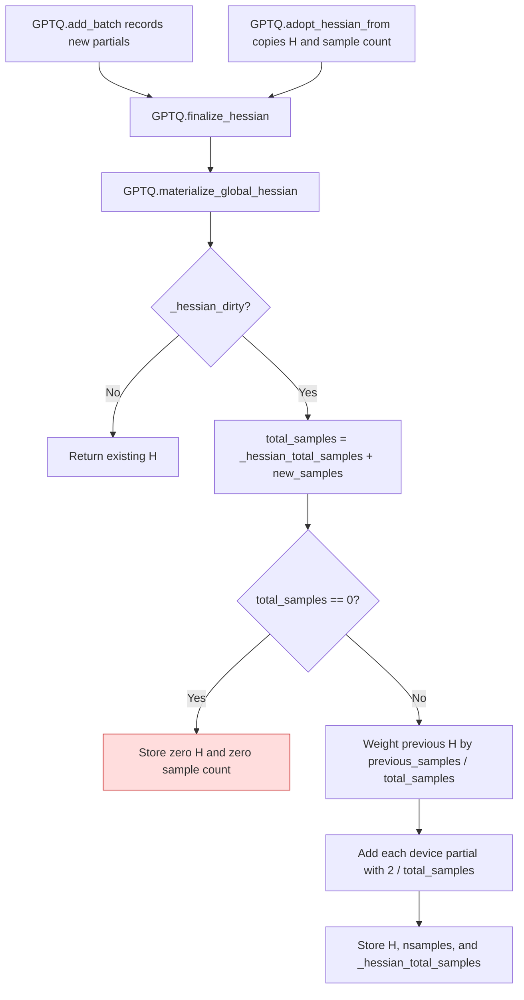

<!-- SPDX-FileCopyrightText: 2026 ModelCloud.ai
SPDX-License-Identifier: Apache-2.0 -->

# GPTQ Hessian accumulation

`GPTQ.add_batch` records new Hessian partials. `GPTQ.materialize_global_hessian`
combines those partials with the already normalized `H` when capture resumes
after a previous finalization. `GPTQ.finalize_hessian` returns that accumulated
matrix to the quantizer. `GPTQ.adopt_hessian_from` copies the leader's sample
count as well as its matrix. This flow was corrected in PR #3721.

| Mechanism | Before | After |
| --- | --- | --- |
| Sample count | `gptqmodel/quantization/gptq.py:1141` counted only new partials | `materialize_global_hessian` includes `_hessian_total_samples` |
| Adopted sample count | `gptqmodel/quantization/gptq.py:1290` copied `H` and `nsamples` but omitted `_hessian_total_samples` | `adopt_hessian_from` copies the cumulative count |
| Reused output | `gptqmodel/quantization/gptq.py:1155` zeroed the previous `H` | Previous normalized `H` contributes with its sample weight |
| Normalization | `gptqmodel/quantization/gptq.py:1219` scaled only the new sum | Each new partial contributes `2 / total_samples` before final storage |

When there are no prior or new samples, `materialize_global_hessian` stores a
zero matrix. When no new samples are dirty, it returns the existing normalized
matrix. The regression is `tests/test_gptq_hessian_accumulation.py`.
