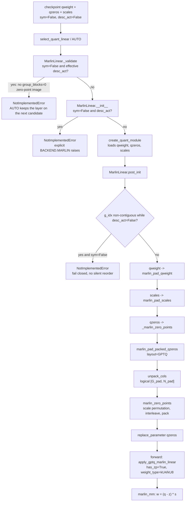

<!-- SPDX-FileCopyrightText: 2026 ModelCloud.ai
SPDX-License-Identifier: Apache-2.0 -->

# Asymmetric GPTQ Marlin: kU4/kU8 selection and zero-point layout

Asymmetric GPTQ checkpoints (`sym=False`) store a per-group integer zero point
and dequantize with `w = (q - z) * s`. The Marlin runtime already shipped the
native integer zero-point kernels (`kU4`/`kU8`), but `MarlinLinear` declared
`SUPPORTS_SYM = [True]`, so AUTO never offered Marlin for these checkpoints and
fell through to ExLlamaV2 (FP16) or TritonV2 (BF16). This page documents the
contract that now admits `sym=False`, the load-time zero-point layout, the one
combination that stays on the fallbacks (activation order), and the measured
selection change.

## Contract

| Surface | Value | Owner |
| --- | --- | --- |
| Checkpoint `qzeros` | GPTQ packed int32 words, `[G, N / pack_factor]`; v1 stores `zero - 1` | checkpoint |
| `module.qzeros` after `post_init()` | Marlin-permuted packed int32 words, `[G_pad, N_pad / pack_factor]` | `MarlinLinear._marlin_zero_points` (`gptqmodel/nn_modules/qlinear/marlin.py:550-574`) |
| `weight_type` | `uint4` / `uint8` for `sym=False`; `uint4b8` / `uint8b128` for `sym=True` | `MarlinLinear.TYPE_MAP` (`marlin.py:139-144`) |
| Launch | `has_zp=True`; `marlin_mm` requires `q_type` in `{kU4, kU8}` | `apply_gptq_marlin_linear` (`marlin.py:627-640`), `gptqmodel_ext/marlin/gptq_marlin.cu:857-869` |
| Dequantized weight | `(q - z) * s`, zero point read from the packed table | `gptq_marlin.cu` mainloop |
| Symmetric layer | `qzeros` replaced by an empty tensor; the kernel never reads it | `MarlinLinear.post_init` (`marlin.py:521-524`) |
| Activation order | symmetric only: `generate_kernels.py` emits no `group_blocks == 0` image for `kU4`/`kU8` | `MarlinLinear._validate` (`marlin.py:343-354`) |

The kernel inventory that defines the boundary is `SCALAR_TYPES`
(`gptqmodel_ext/marlin/generate_kernels.py:36-39`) plus the activation-order
filter that keeps `group_blocks == 0` for `kU4B8`/`kU8B128` only
(`generate_kernels.py:118-122`). `marlin_mm` then asserts the matching
`has_zp`/`q_type` pair at launch (`gptq_marlin.cu:857-869`).

## New flow

`marlin_pad_packed_qzeros` (`gptqmodel/utils/marlin.py:620-647`) is now shared
with the AWQ path: both formats pack consecutive output lanes along N, so one
helper zero-pads the words to `N_pad`/`G_pad`, and `marlin_pad_awq_qzeros`
(`utils/marlin.py:649-662`) only adds the `layout="AWQ"` error label. The GPTQ
path then calls `unpack_cols` (`utils/marlin.py:1286`) and `marlin_zero_points`
(`utils/marlin.py:1313-1332`) without AWQ's dequantizer-interleave undo,
because GPTQ words are already in natural lane order. This mirrors the AWQ
Marlin conversion at `gptqmodel/nn_modules/qlinear/marlin_awq.py:346-361`.

Symmetric layers keep the old behavior: `post_init` stores an empty `qzeros`
(`marlin.py:521-524`), the `uint4b8`/`uint8b128` scalar type carries the
implicit `2 ** (bits - 1)` zero point, and the kernel never reads the table.

## Before the fix

| Mechanism | Before | After |
| --- | --- | --- |
| Declared symmetry | `SUPPORTS_SYM = [True]` (`marlin.py:100`) | `[True, False]` (`marlin.py:100`) |
| Scalar type map | `(4, True)`, `(8, True)` only (`marlin.py:139-144`) | adds `(4, False)` / `(8, False)` (`marlin.py:139-144`) |
| Checkpoint format | `REQUIRES_FORMAT_V2 = False` (`marlin.py:119`) | `True`; v1 `zero - 1` words are converted once (`marlin.py:115-119`) |
| Constructor guard | none | `NotImplementedError` for `sym=False` + `desc_act` (`marlin.py:172-181`) |
| `_validate` | no asymmetric branch | rejects `sym=False` + effective act-order (`marlin.py:343-354`) |
| `post_init` g_idx | flips any non-contiguous index to act-order (`marlin.py:414-441`) | fails closed for `sym=False` (`marlin.py:419-428`) and re-checks effective act-order (`marlin.py:443-448`) |
| `post_init` qzeros | always `marlin_make_empty_g_idx` | symmetric: empty; asymmetric: `_marlin_zero_points` (`marlin.py:521-530`, `:550-574`) |
| AWQ zero padding | private `marlin_pad_awq_qzeros` | delegates to shared `marlin_pad_packed_qzeros` (`utils/marlin.py:620-662`) |

### AUTO candidate order

Measured with `select_quant_linear(..., backend=BACKEND.AUTO, multi_select=True)`
on the sm_89 device profile; the "before" order is reproduced by restoring
`SUPPORTS_SYM = [True]`.

| Checkpoint (`bits=4`, `group_size=128`, `desc_act=False`) | dtype | Before | After |
| --- | --- | --- | --- |
| `sym=False` | FP16 | `ExllamaV2Linear` → `TritonV2Linear` → `TorchLinear` | `MarlinLinear` → `ExllamaV2Linear` → `TritonV2Linear` → `TorchLinear` |
| `sym=False` | BF16 | `TritonV2Linear` → `TorchLinear` → `ExllamaV2Linear` | `MarlinLinear` → `TritonV2Linear` → `TorchLinear` → `ExllamaV2Linear` |
| `sym=True` (control) | FP16 / BF16 | `MarlinLinear` first | unchanged |

## Failure paths

| Situation | Before | After |
| --- | --- | --- |
| `sym=False` + `desc_act=True` (`group_size > 1`) | Marlin was never a candidate (`SUPPORTS_SYM = [True]`); no explanation tied to the kernel inventory | `_validate` returns `NotImplementedError` mentioning activation order; AUTO logs `per-module selections -> [ExllamaV2Linear=...]`, an explicit `BACKEND.MARLIN` raises |
| Non-contiguous checkpoint `g_idx` with `desc_act=False` and `sym=False` | symmetric-only path would flip the layer to act-order and reach a kernel that does not exist | `post_init` raises before rewriting any tensor, so a permuted weight is never decoded with the wrong order |
| `sym=False` + `group_size=-1` + `desc_act=True` | n/a | accepted: one channelwise group makes `desc_act` a no-op (`marlin.py:168-170`) |
| Explicit `BACKEND.MARLIN` on a rejected layer | surfaced the symmetric-only validation error | surfaces the actionable activation-order message |

The real-model check on `ruikangliu/DeepSeek-R1-Distill-Qwen-1.5B-quantized.gptq-gptqmodel-w4g128`
(`sym=False`, `desc_act=True`, g128) loads 196 layers as `ExllamaV2Linear` with
`BACKEND.AUTO`, and raises the activation-order `NotImplementedError` with
`BACKEND.MARLIN`.

## Numerics

`tests/kernels/test_marlin_asymmetric_oracle_5737.py` dequantizes the same
packed codes, zero points and scales in float64 and multiplies the same
activations, so the drift below is the kernel's rounding only. Each cell is
`max_abs_drift` on a 256×128 synthetic layer (`rtol=2e-3` plus four output-dtype
ULPs of absolute slack).

| Case | FP16 | BF16 |
| --- | ---: | ---: |
| 4-bit, channelwise | 2.33e-04 | 1.86e-03 |
| 4-bit, g32 | 5.09e-04 | 2.98e-03 |
| 4-bit, g128 | 2.74e-04 | 2.67e-03 |
| 8-bit, channelwise | 3.72e-03 | 5.96e-02 |
| 8-bit, g32 | 7.68e-03 | 8.32e-02 |
| 8-bit, g128 | 5.59e-03 | 5.67e-02 |

The portable Torch path agrees at 2.74e-04 (4-bit g128 FP16), the v1→v2
conversion at 3.30e-04, and the tile-padded `n=96` case at 3.94e-04. The
packed-storage assertion confirms `post_init` leaves `qzeros` as int32 words in
Marlin's layout, not as logical codes.

On the real asymmetric Llama-3.2-1B checkpoint, the FP16 Marlin prefill logits
differ from TritonV2 by at most 1.95e-02 (mean 3.24e-03), comparable to the
ExLlamaV2↔TritonV2 drift of 1.76e-02, and all four backends pick the same
greedy token. BF16 shows the expected wider drift (Marlin↔TritonV2 1.56e-01,
mean 2.46e-02) with the same top-1.

## Measured impact

Hardware: RTX 4090 (sm_89), CUDA 1, torch 2.15.0+cu132, transformers 5.23.0.
Model: `Llama-3.2-1B-Instruct-GPTQ-bit4-g128-symFasle-descFalse` (112 quantized
linear layers, 4-bit, g128, `sym=False`, `desc_act=False`). "Before" is the
AUTO-selected backend for that dtype; "after" is the new AUTO selection
(`MarlinLinear`). Values are medians of three process-isolated runs; layer
numbers sum the 112 modules of 20-iteration CUDA-event averages, decode is 64
single-token steps after a 128-token prefill and 8 warmup steps.

| Workload | dtype | Before | After | Change |
| --- | --- | ---: | ---: | ---: |
| Quantized layers, M=1 | FP16 | 2.54 ms | 2.39 ms | −6.1% |
| Quantized layers, M=64 | FP16 | 3.91 ms | 2.36 ms | −39.7% |
| End-to-end decode | FP16 | 128.0 tok/s (7.81 ms/token) | 132.8 tok/s (7.53 ms/token) | +3.7% |
| Prefill, 128 tokens | FP16 | 9.10 ms | 7.85 ms | −13.7% |
| Quantized layers, M=1 | BF16 | 9.27 ms | 2.34 ms | −74.8% (3.97×) |
| Quantized layers, M=64 | BF16 | 8.81 ms | 2.60 ms | −70.5% (3.39×) |
| End-to-end decode | BF16 | 61.7 tok/s (16.22 ms/token) | 132.7 tok/s (7.54 ms/token) | +115.1% (2.15×) |
| Prefill, 128 tokens | BF16 | 17.33 ms | 8.28 ms | −52.3% (2.10×) |

Run-to-run GPU clock variance reached ~25% on one FP16 run, so single-digit
percentages should be treated as noise; the M=64 and BF16 gaps were stable
across all repetitions.

## Evidence and limits

- `tests/kernels/test_marlin_asymmetric_selection_5737.py` pins the declared
  contract, `TYPE_MAP`, `_validate` acceptance/rejection, AUTO ordering for
  symmetric and asymmetric FP16/BF16, the constructor guard, and channelwise
  normalization.
- `tests/kernels/test_marlin_asymmetric_oracle_5737.py` runs the float64 oracle
  for 4/8-bit × channelwise/g32/g128 × FP16/BF16 on sm_89, plus portable Torch
  agreement, v1→v2 conversion, tile-padded shapes and packed storage.
- The shipped JIT smoke suite (`tests/test_marlin_jit.py`) passes 64 tests with
  the asymmetric kernel templates in place.
- Only 4-bit g128 `sym=False` is measured end-to-end on a real model; 8-bit and
  the other group sizes are covered by the synthetic oracle. The latency table
  is sm_89 only; Ampere/Hopper/Blackwell clocks and the `kU4`/`kU8` kernel
  instantiations are shared, but their exact ratios are not measured here.

Introduced in [PR #NNNN](https://github.com/ModelCloud/GPTQModel/pull/NNNN) for issue #5737.
