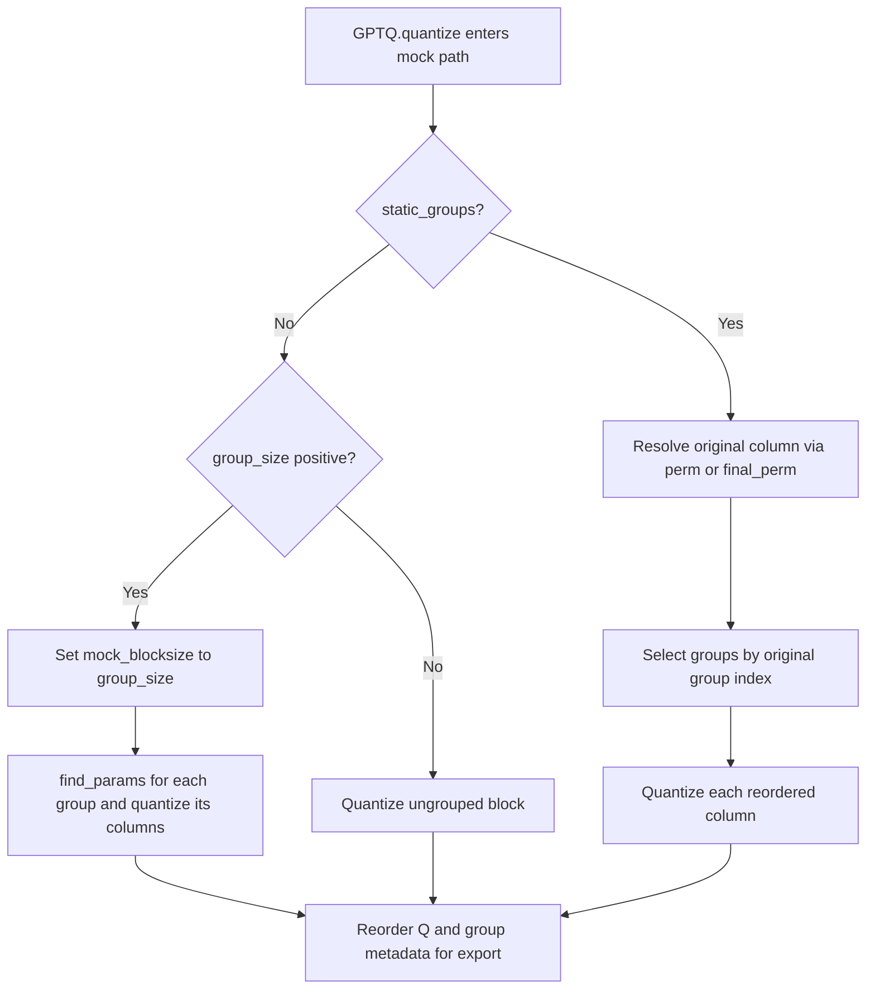
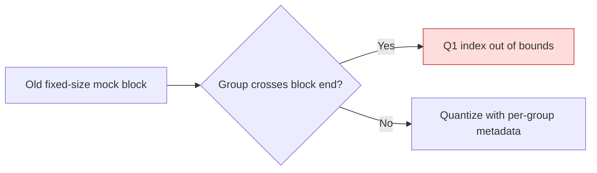

<!-- SPDX-FileCopyrightText: 2026 ModelCloud.ai
SPDX-License-Identifier: Apache-2.0 -->

# GPTQ mock quantization group flow

`GPTQ.quantize` selects the mock path when its configuration requests it or a
loss recovery retries without a Hessian inverse. For dynamic groups, it uses
group-sized blocks so every parameter set and output slice cover the same
columns. For static groups, it resolves each reordered column back to its
original group before quantizing. Corrected in PR #3720.

| Mechanism | Before | After |
| --- | --- | --- |
| Dynamic group boundary | `gptqmodel/quantization/gptq.py:2210` used the requested block size, while `:2223` extended a group past it | `mock_blocksize` is the group size for dynamic groups |
| Static group lookup | `gptqmodel/quantization/gptq.py:2232` used the current column unless `desc_act` was enabled | The group-aware `final_perm` is also resolved to the original column |
| Output and metadata | A crossing group could overrun `Q1` before export | Each group writes only its own columns and one metadata entry |

The boundary and group-aware regressions live in
`tests/test_gptq_mock_group_order.py`. A final short group remains within its
last block; no extra scale or zero-point entry is emitted.
The packed roundtrip in `tests/test_gptq_static_group_order.py` also runs in
mock mode after PR #3719, checking the combined group reordering, metadata,
packed words, and decoded weight against an independent affine oracle.
