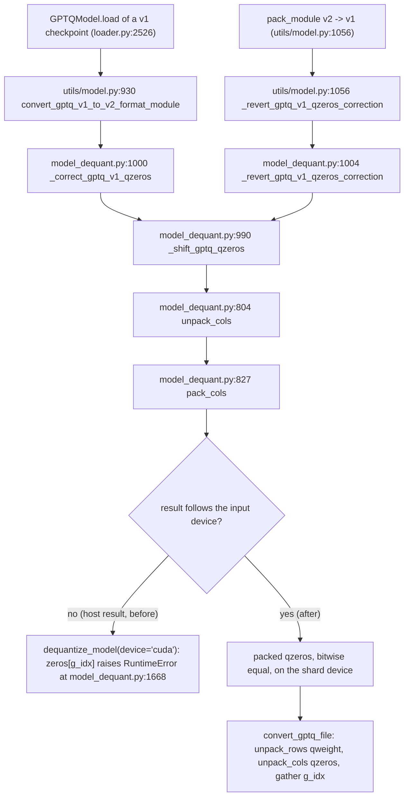

<!-- SPDX-FileCopyrightText: 2026 ModelCloud.ai
SPDX-License-Identifier: Apache-2.0 -->

# GPTQ qzeros conversion: packed helpers stay on the input device

GPTQ zero points are stored packed, and two format conversions rewrite them:
v1 -> v2 on load, and v2 -> v1 while packing a checkpoint for saving. Both go
through `_shift_gptq_qzeros` (`gptqmodel/utils/model_dequant.py:990`), which
decodes every packed field with `unpack_cols` (`:804`), shifts the logical
values, and re-encodes them with `pack_cols` (`:827`). The same unpackers feed
the dense dequantizer: `unpack_rows` (`:855`) for `qweight` and `unpack_cols`
for `qzeros`, whose rows are then gathered with the checkpoint's `g_idx`.

The helpers used to allocate their result with `torch.empty(...)` and no
`device`, then fill it with a Python loop of `pack_factor` strided writes. On a
CUDA shard that moved every qzeros tensor GPU -> host loop -> GPU, and it also
broke the dense dequantizer: `convert_gptq_file` gathers the host-resident
zeros with a device-resident `g_idx` (`:1668`) and raised
`RuntimeError: indices should be either on cpu or on the same device as the
indexed tensor (cpu)`.

The helpers now decode/encode all packed fields with one broadcast shift on the
input's device. Field bits, result dtype (`int32` for unpack, `pack_dtype` for
pack) and shapes are unchanged, so the conversion remains bitwise identical to
the loop implementation.

## Conversion flow

## Before / after

| Step | Before | After |
|---|---|---|
| `unpack_cols` / `unpack_rows` allocation | `torch.empty(...)`, host (`model_dequant.py:804`, `:855`) | `packed.device`, one broadcast shift |
| `pack_cols` accumulation | `torch.zeros(..., device=values.device)` + `pack_factor` strided `|=` (`:827`) | one reshape + shift + OR-reduce |
| v1 -> v2 on a CUDA shard | device -> host loop -> device | device only |
| `dequantize_model(..., device="cuda")` | `RuntimeError` at `:1668` | same bytes as the CPU path |

Measured on one RTX 4090 (sm_89), torch 2.16.0.dev20261102+cu130: a CUDA
`[32, 1376]` v1 -> v2 conversion takes 587 ms before and 0.097 ms after; a CPU
conversion of 56 x `[32, 3584]` qzeros takes 156.9 ms before and 74.6 ms after.
`tests/test_qzero_pack_device.py` asserts `torch.equal` against the loop oracle
for cpu/cuda, bits 2/4/8 and `int8`/`int16`/`int32` words.
