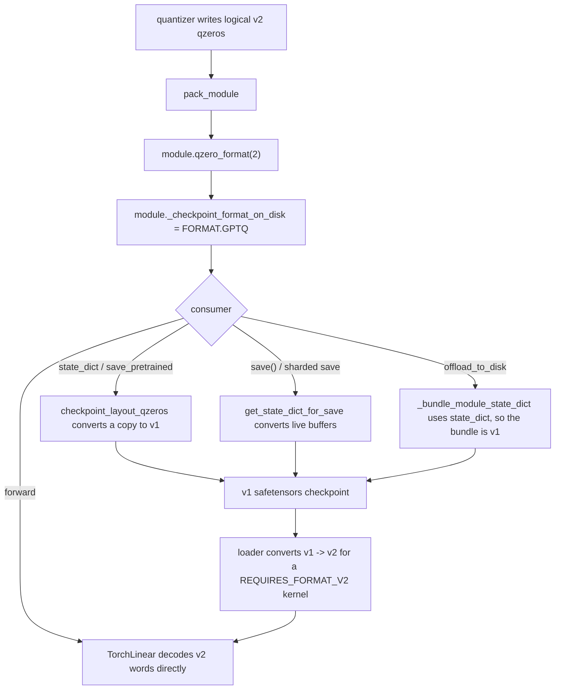
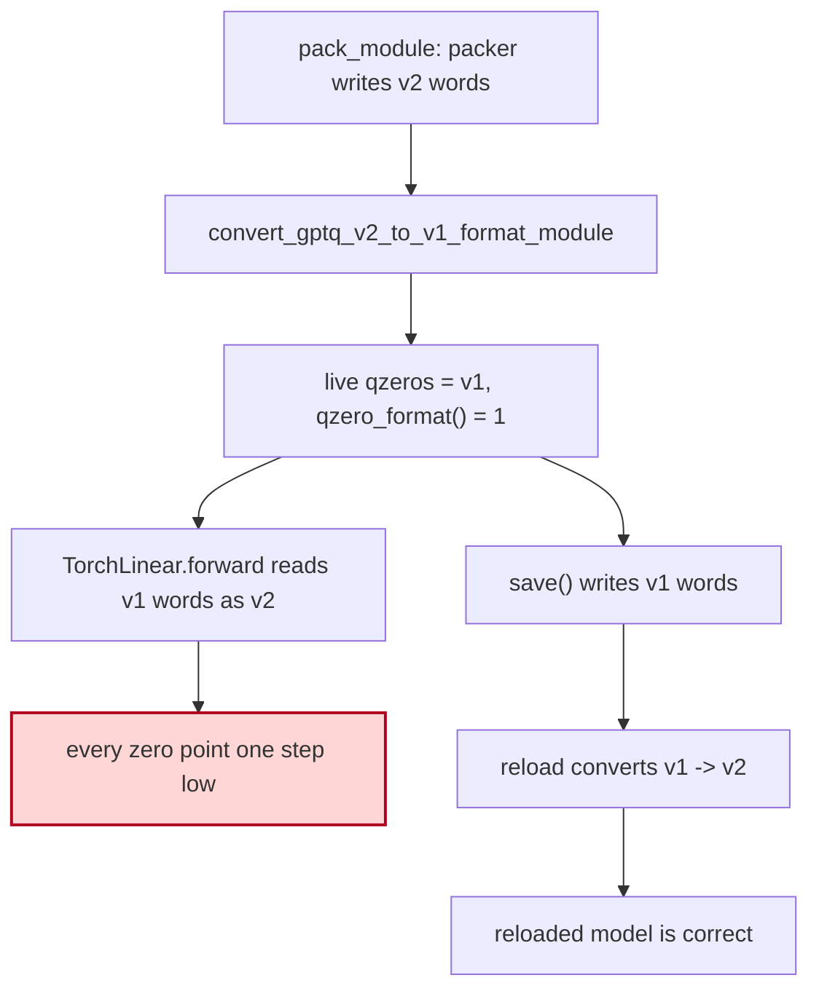

<!-- SPDX-FileCopyrightText: 2026 ModelCloud.ai
SPDX-License-Identifier: Apache-2.0 -->

# GPTQ qzeros: runtime layout vs checkpoint layout

GPTQ has two zero-point conventions. A **v1** checkpoint stores each logical
zero point minus one; the **v2** (internal) layout stores the logical value.
Kernels that declare `REQUIRES_FORMAT_V2` decode the stored fields directly, so
they need v2 words in memory even when the published checkpoint is v1.

The two layouts used to be conflated at pack time: `pack_module`
(`gptqmodel/utils/model.py`) converted the freshly packed v2 words to v1 for a
`FORMAT.GPTQ` export and left them there. The saved checkpoint was correct, but
every in-process forward after `quantize()` decoded v1 words as v2, so each
zero point was one step low. Generation, PPL, lm-eval, and norm tuning measured
a broken model (issue #4063). This page describes the split that keeps the live
module and the file independently correct.

## Contract

| Surface | Layout | Owner |
| --- | --- | --- |
| Live packed buffer read by a `REQUIRES_FORMAT_V2` kernel | v2 (logical) | `module.qzeros`, `module.qzero_format() == 2` |
| Published checkpoint / `state_dict()` / `save_pretrained()` | the export format: v1 for `FORMAT.GPTQ`, v2 for `FORMAT.GPTQ_V2` | `module._checkpoint_format_on_disk` |
| Disk-offload bundle | the checkpoint format (it is written from `state_dict()`) | `_bundle_module_state_dict` |
| Reload of a v1 checkpoint | converted v1 -> v2 in memory | `convert_gptq_v1_to_v2_format` |

`pack_module` now sets `_checkpoint_format_on_disk = FORMAT.GPTQ` and leaves
the packed v2 words in the live buffer. Two serialization surfaces convert a
**copy** and never mutate the live buffer:

- `GPTQQuantLinear.checkpoint_layout_qzeros` backs
  `_write_checkpoint_layout_qzeros`, which `state_dict()` calls through
  `_save_to_state_dict`.
- `get_state_dict_for_save` (and `_collect_state_dict_with_offload`) applies the
  same conversion to live `qzeros` buffers, so `save()` and sharded/leaf saves
  emit the same bytes as `state_dict()`.

## Before the fix

Measured on a tiny FP16 Llama with `RTNConfig(bits=4, group_size=128,
offload_to_disk=False)`: the live module reported `qzero_format() == 1` while
`REQUIRES_FORMAT_V2` was true, in-memory logits differed from the reloaded
checkpoint, and the live `qzeros` no longer matched the reloaded buffer. After
the fix both are v2, the serialized words satisfy `(v1 + 1) & 0xF == v2`, and
in-memory logits are bit-identical to the reloaded model.

## Failure and ambiguity contract

| Situation | Before | After |
| --- | --- | --- |
| `FORMAT.GPTQ` export, kernel requires v2 | live buffer left in v1; in-process inference wrong | live buffer stays v2; serialization converts a copy |
| `FORMAT.GPTQ_V2` export, kernel requires v2 | packer words are v2 but the format marker could stay at the v1 default | unchanged contract; no checkpoint conversion |
| Kernel does not require v2 | no conversion (packer words stay v2) | unchanged |
| `state_dict()` / `save_pretrained()` | live buffer written unchanged | checkpoint-layout copy written |
| Loaded v1 checkpoint with a v2 kernel | v1 -> v2 conversion on load | unchanged |
| Live module is a v1 checkpoint converted by `convert_gptq_v2_to_v1_format` | v1 in memory | unchanged; that public API deliberately converts the model |

## Not in scope

This page does not change planar (`FORMAT.GPTQ_P`) packing or the
`convert_gptq_v1_to_v2_format` / `convert_gptq_v2_to_v1_format` public HF
interop helpers. It also does not retain a second in-memory qzeros copy: the
converted tensor exists only for the duration of a serialization call.
