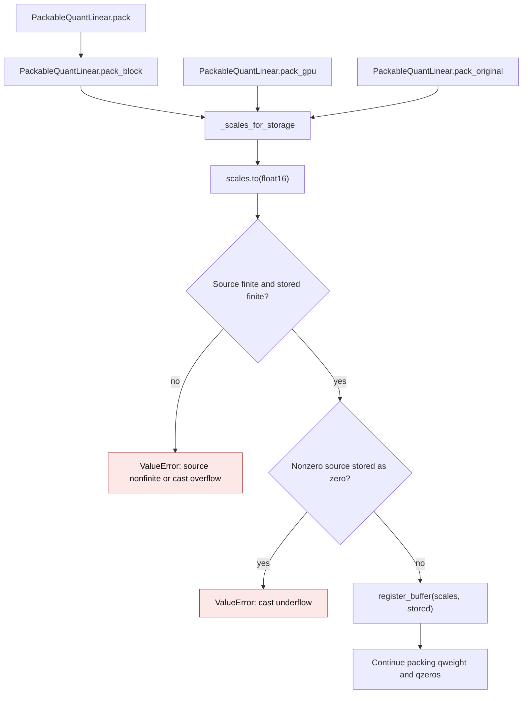

# GPTQ scale storage range

The shared `PackableQuantLinear` packers write GPTQ scales as FP16 checkpoint
buffers. They compute packed codes using the source scales, so a cast that turns
a scale into infinity or zero would leave the saved codes and scales
inconsistent. `_scales_for_storage` validates the actual FP16 cast before any
of the three packers registers its scale buffer. This guard was introduced in
PR #3803.

This contract applies to `PackableQuantLinear.pack_block`, `pack_gpu`, and
`pack_original`. Other quantization methods and AWQ Torch have their own scale
storage contracts; see [AWQ runtime dtype precision](awq-runtime-dtype-precision.md).

## Packing flow

The value comparison is made on the cast result. A finite FP32 source of
`65520` rounds to FP16 infinity, while the preceding FP32 value rounds to
`65504`. At the lower boundary, `2**-25` rounds to zero and the next higher
FP32 value rounds to the smallest FP16 subnormal, `2**-24`. Exact zero scales
retain the prior behavior; the quantizer's `_replace_zero_scale` handles them
before packing. Ordinary finite FP16 rounding remains part of the GPTQ
checkpoint layout.

## Before and after

| Path | Before PR #3803 | Current behavior |
| --- | --- | --- |
| `pack_block` | `qlinear/__init__.py:1373` cast scales to FP16 without a range check | Calls `_scales_for_storage` before registering scales |
| `pack_gpu` | `qlinear/__init__.py:1674` cast scales to FP16 without a range check | Calls the same guard before copying scales to CPU |
| `pack_original` | `qlinear/__init__.py:1828` cast scales to FP16 without a range check | Calls the same guard before packing codes |
| Invalid source or cast | Could save a zero or infinite scale and silently corrupt dequantization | Raises `ValueError` with the tensor name and counts for nonfinite input, overflow, and underflow |

`tests/test_quant_scale_overflow.py` checks the FP32 steps around both cast
boundaries, finite rounding, nonfinite input, and all three pack entry points.
The error is local to the packer; the model packing workflow propagates it
after any configured packer fallback also encounters the same guard.
