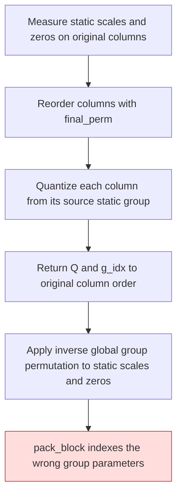
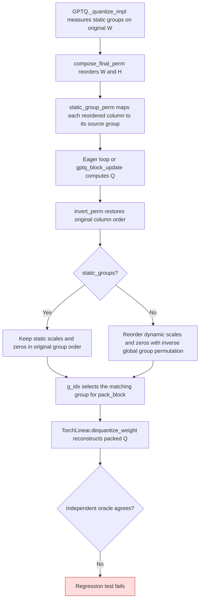

<!-- SPDX-FileCopyrightText: 2026 ModelCloud.ai
SPDX-License-Identifier: Apache-2.0 -->

# GPTQ static-group ordering

With `static_groups=True`, `GPTQ._quantize_impl` measures each group's scale and
zero point on the original weight columns. Group Aware Reordering then permutes
columns for the GPTQ update. The returned weight and `g_idx` use original column
order, so the static scale and zero arrays must also retain original group order.
This alignment was corrected in PR #3719.

## Previous flow

## Current flow

| Mechanism | Previous | Current |
| --- | --- | --- |
| Static group lookup | `gptqmodel/quantization/gptq.py:2388` selected the source group after `final_perm` | Both eager and fused updates retain that mapping |
| Returned metadata | `gptqmodel/quantization/gptq.py:2500` inverted the static scales and zeros despite original-order `g_idx` | `gptqmodel/quantization/gptq.py:2500` preserves static order; dynamic groups still invert |
| Detection | The 2×4 test checked returned Q only | `tests/test_gptq_static_group_order.py` checks Q, scale, zero, `g_idx`, packed words, and dequantization against an independent affine oracle |

The packed roundtrip test uses 32 input and output channels, two different
16-column affine groups, a global group swap, and a local column permutation.
The CUDA fused/eager parity case uses a forced group swap when CUDA and the
fused extension are available.
