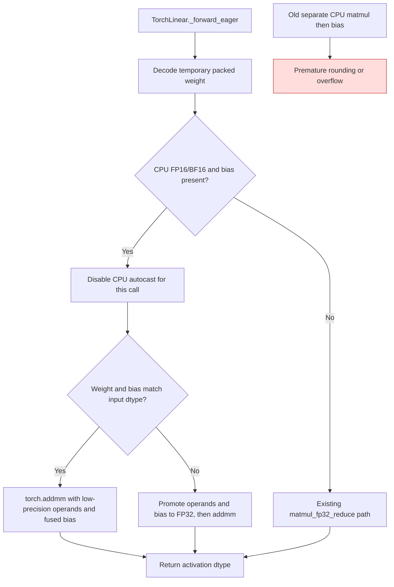

<!-- SPDX-FileCopyrightText: 2026 ModelCloud.ai
SPDX-License-Identifier: Apache-2.0 -->

# GPTQ Torch CPU bias epilogue

`TorchLinear._forward_eager` reconstructs a temporary weight from packed GPTQ
codes, multiplies the activation, and adds the stored bias. For CPU FP16 and
BF16 input, a separate matmul can round or overflow before a bias cancels the
dot product. The biased CPU path now uses one fused epilogue.

| Condition | Before | After |
| --- | --- | --- |
| CPU FP16 dot near 65504 | Product rounded to `inf` before a negative bias was added | Fused `addmm` returns the finite 32 result |
| CPU BF16 dot near a rounding boundary | Product could round before a cancelling bias | Fused epilogue retains the one-unit residual |
| FP32 checkpoint bias with low-precision input | Bias was cast to the input dtype, possibly overflowing | The biased operation promotes to FP32 before one final cast |
| CUDA/ROCm or unbiased CPU | Existing reduction and dispatch | Unchanged |

The packed regression uses 512 input channels and 32 outputs. Independent
Torch FP32 references produce 32 for an FP16 65536 dot plus -65504 bias, -1
for a BF16 511 dot plus -512 bias, and zero when an FP32 -65536 bias cancels an
FP16 65536 dot. It covers ordinary and BF16-autocast contexts, repeated calls,
checkpoint-buffer stability, temporary-weight release, and input gradients.
Only packed checkpoint buffers remain after forward.
