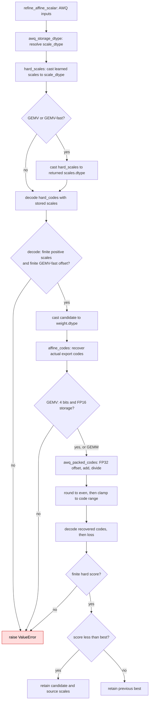

<!-- SPDX-FileCopyrightText: 2026 ModelCloud.ai
SPDX-License-Identifier: Apache-2.0 -->

# GSQ AWQ code recovery

GPT-QModel scores an AWQ GSQ candidate using the codes its packer will write
and the scales and offsets its checkpoint will store. This keeps candidate
selection aligned with exported weights, including rounding boundaries and
saturation. The contract is shared by `affine_codes`, `awq_gemv_codes`, and
`awq_packed_codes`; it was introduced in PR #4159.

## Arithmetic and storage

`awq_packed_codes` casts the weight, source scale, and zero point to FP32,
multiplies the source scale by the zero point, adds that offset to the weight,
and divides by the stored scale. Each operation uses FP32 rounding. The result
is rounded to the nearest even integer and clamped to `[0, 2**bits - 1]`.

`awq_storage_dtype` preserves requested FP16/BF16 scales for native GEMM;
other native GEMM sources and both GEMV formats store FP16. Callers pass the
storage dtype for the selected packer. This describes native GEMM/GEMV
`pack()` arithmetic; it does not change inference backend selection.

The source scale used in the offset can differ from the stored divisor.
GEMV-fast additionally stores `-stored_scale * zero` rounded to FP16. Its
export score decodes that stored offset instead of recomputing an exact
unrounded affine zero.

## Hard candidate selection

Baseline scoring uses the same code recovery and stored-scale decoder. If no
candidate improves the score, the original tensors are returned. Row chunks
use the same rule and combine their normalized scores by teacher energy.

## Before and after

| Mechanism and previous location | Previous behavior | Current contract |
| --- | --- | --- |
| `gsq_scalar.py:60` at `ad21f0d` | GEMM formed the offset and sum in the weight dtype. | The offset, sum and division follow the packer's FP32 arithmetic. |
| `gemv.py:26` at `ad21f0d` | GEMV used source-dtype multiplication and returned unclamped codes. | Shared FP32 recovery clamps just as native packing does. |
| `gsq_scalar.py:423` at `ad21f0d` | An overflowing AWQ code raised instead of saturating. | Finite out-of-grid codes saturate; invalid stored scales/offsets still raise. |
| `gsq_scalar.py:466` at `3c44f63` | Hard GEMV scales were scored as FP16, then rounded again to BF16 when returned. | The returned source dtype is applied before recovering and scoring candidate codes. |

## Numerical boundaries

For FP16 `weight=0.050018310546875`, `scale=0.0999755859375`, and `zero=8`,
FP16 intermediate arithmetic predicted code 8; native FP32 packing writes
code 9. Finite operands `weight=30000`, `scale=5000`, and `zero=8` recover
code 14 without an FP16 intermediate overflow.

FP64 without intermediate rounding is not a byte oracle for a format that
specifies FP32 arithmetic. With FP32 `weight=0.04996337369084358`, source
`scale=0.1`, and `zero=1`, native FP32 arithmetic reaches the half step and
writes code 2; a raw FP64 quotient would select code 1. The test oracle uses
independent FP64 operations with explicit FP32 rounding after every specified
operation.

`tests/test_gsq_awq_code_recovery.py` compares every predicted code with both
the independent oracle and the actual unpacked native payload. It covers
threshold neighbors, both saturation endpoints, signed zero, wider source
scales, FP16/BF16/FP32 inputs, learned scales, and row chunking. The final
normalized hard score is checked against an FP64 reconstruction from packed
weights and stored metadata with `rtol=atol=1e-6`.
