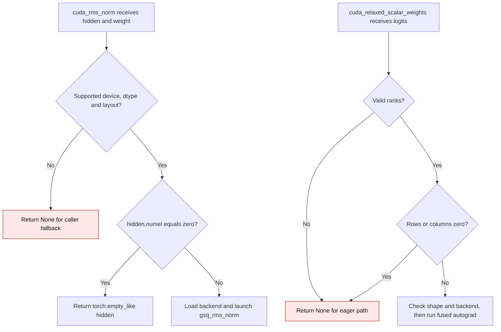

# GSQ CUDA empty-geometry dispatch

The optional GSQ CUDA kernels use grid sizes derived from activation rows or
weight elements. CUDA rejects a launch with zero blocks. The wrappers handle an
empty geometry before loading a compiled backend or launching a kernel.

| Path | Before | Current |
| --- | --- | --- |
| Cached Llama RMSNorm | `cuda_rms_norm` sent an empty activation to a zero-block launch (`01f11d3:gptqmodel/quantization/gsq_cuda_relaxation.py:422-439`). | `hidden.numel() == 0` returns an empty tensor with the same shape, dtype and device before backend loading (`gptqmodel/quantization/gsq_cuda_relaxation.py:422-434`). |
| Scalar relaxation | `cuda_relaxed_scalar_weights` accepted zero rows or columns and `_GSQCudaRelaxation.forward` launched zero blocks (`01f11d3:gptqmodel/quantization/gsq_cuda_relaxation.py:488-506`). | Empty geometry returns `None`, so `GSQScalarTrainingModule.forward` uses its existing Torch path with autograd (`gptqmodel/quantization/gsq_cuda_relaxation.py:492-501`; `gptqmodel/quantization/gsq_training.py:265-289`). |

On NVIDIA GB10 with Torch 2.15.0+cu132, both paths previously raised
`CUDA_ERROR_INVALID_VALUE` for empty geometry. The focused tests cover zero
batch, zero sequence length and zero feature width, alongside nonempty BF16 and
FP32 oracle comparisons. Nonempty math and launch geometry are unchanged.

Introduced in #3647.
