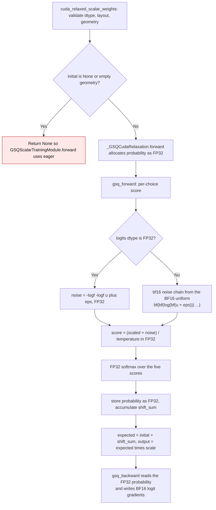

# GSQ fused relaxation precision contract

The staged GSQ relaxation has two implementations of the same equations: the
eager Torch autograd function `_ScalarRelaxation` in
`gptqmodel/quantization/gsq_training.py`, and the optional fused kernel
`_GSQCudaRelaxation` in `gptqmodel/quantization/gsq_cuda_relaxation.py`. The
fused kernel is compiled at runtime with NVRTC on NVIDIA and HIPRTC on AMD, and
is what production training runs when the platform allows it.

The two paths must produce the same number, so the fused kernel reproduces the
eager dtype decisions rather than choosing `float` because it happens to be
convenient. Eager's decisions come from the dtypes it actually hands to each
operation, not from the model dtype:

| Stage | Eager dtype source | Contract |
| --- | --- | --- |
| Gumbel draw `-log(-log(u + 1e-8) + 1e-8)` | `uniform` tensor | `uniform`'s dtype (BF16 for a BF16 model) |
| Exponent `(logits * multiplier + noise) / temperature` | `_ScalarRelaxation._compute_dtype` | FP32 for FP16/BF16 logits, logits dtype otherwise |
| `softmax(0)` probability | exponent | the exponent's dtype, saved for backward |
| `expected` and output | FP32 `initial`/`scales` | FP32 |
| Logit gradient | `_compute_dtype(expected.dtype)` | FP32 for a half-precision model |

The BF16 branch above is deliberate. Eager computes `torch.log` on a BF16
`uniform` tensor, so `torch.log` rounds its result back to BF16 at each of the
two stages; `bf(bf(log(bf(u + eps))) ...)` reproduces exactly that rounding.
Removing it would make the fused path *more* precise than eager and break the
equality test in the other direction. Everything at or below the exponent,
however, must stay FP32.

## Before and after

Before #4357 the kernel applied `bf()` to the whole BF16 expression, including
the exponent, and stored the probability in a BF16 buffer.

| Element | Before (`bf(bf(bf(scaled) + noise) / temperature)`, BF16 probability) | After |
| --- | --- | --- |
| Exponent | rounded to BF16 (`27c6b7bd5:gptqmodel/quantization/gsq_cuda_relaxation.py:100`) | FP32, matching `_ScalarRelaxation._compute_dtype` |
| Probability buffer | `torch.empty_like(logits)`, BF16 for a BF16 model (`27c6b7bd5:gptqmodel/quantization/gsq_cuda_relaxation.py:459`) | `torch.empty(logits.shape, dtype=torch.float32, device=...)` |
| Backward probability read | `load_choice(probability, ..., fp32)`, so BF16 | direct `float` load |
| `expected` / output | BF16 probability fed an FP32 reduction | FP32 probability |

Measured on the `test_cuda_gsq_relaxation_matches_eager_forward_and_gradients`
geometry (3-bit, group size 32, 8x256 weights, BF16 logits, temperature 0.7,
multiplier 125): 218 of 2048 elements exceeded the `1e-4` forward tolerance with
a maximum absolute difference of `5.932e-4`. With the fix the forward difference
is `7.9e-9`, the logit gradient difference is `0`, and the scale gradient
difference is `9.5e-7`, all against the eager oracle.

## Failure and fallback contract

| Situation | Behaviour |
| --- | --- |
| No NVRTC/HIPRTC or unsupported geometry | `cuda_relaxed_scalar_weights` returns `None`; eager runs |
| `KernelConfig.gsq_disable_cuda_relaxation` | eager runs, and the HIPRTC backend is skipped too |
| `KernelConfig.gsq_disable_hip_relaxation` on AMD | eager runs while the CUDA backend stays eligible elsewhere |
| Empty rows or columns | `None`, so eager keeps its autograd contract |

## Tests

`tests/test_gsq_cuda_relaxation.py` holds the contract. The parameterized
`test_cuda_gsq_relaxation_matches_eager_forward_and_gradients` covers BF16 and
FP32 logits with several group sizes and sampling schedules, and now asserts that
both the eager and fused saved probabilities are FP32.
`test_cuda_bf16_relaxation_matches_eager_probability_and_exponent` pins the BF16
case directly: the fused probability must match an independent FP32 Torch oracle
that derives the BF16 noise chain from `uniform` itself, and the test also
demonstrates that re-rounding that probability to BF16 exceeds `1e-4`, so the
assertion cannot silently pass if the rounding returns.
