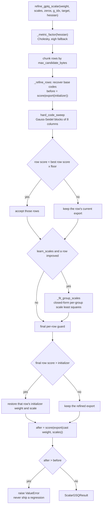

# Per-linear GSQ scalar refinement

`GPTQConfig(gsq=GSQConfig(enabled=True))` refines the integer codes and, with
`learn_scales=True`, the stored scale table of an existing GPTQ checkpoint. It
does not change the checkpoint format: the output is still GPTQ scales,
zero-points, `g_idx` and packed codes.

This page describes the search that decides whether a candidate replaces the
initializer, and why the Gumbel-Softmax relaxation no longer drives it.

## What the flow is

The candidate is always scored as the *export*: the weight is cast to the model
dtype, the packer's own arithmetic recovers integer codes from it, the scales
are cast to the checkpoint scale dtype, and the decoded weight is measured
against the teacher under the calibration Gram.

Row chunks are independent; the diagram shows one chunk. `best_rows` starts at
the initializer's per-row score, so every accept decision is against what the
checkpoint would otherwise contain.

## Why the relaxation was removed from the code path

The previous version optimized `sum(p * codes)`, the expectation of a code
mixture under Gumbel-softmax logits, then exported `argmax(logits)`. Those two
objects differ, and the difference is not a small perturbation:

| Step | Old behavior | New behavior |
| --- | --- | --- |
| Candidate codes | `argmax` of logits trained on a soft mixture | block coordinate search on the exact export |
| Score | relaxed objective | exported weight, teacher Gram, per row |
| Acceptance | one score for the whole chunk | per output row |
| Scales | `scale_delta.exp()` trained by Adam | closed-form group least squares |
| Steps run | `config.steps` (100 by default) | capped at 2 rounds or 8 sweeps |

Measured on a real Qwen2.5-0.5B decoder projection with real activations, the
relaxed phase produced a hard export that never beat the GPTQ initializer, so
the "keep the baseline unless a hard candidate improves" guard returned GPTQ
weights unchanged while paying for the full schedule. That is issue #4592:
`gsq_diagnostics["before"] == gsq_diagnostics["after"]` and a bit-identical
checkpoint.

A second, separate effect kept the feature a no-op even after code movement
became possible: the code search must move whole blocks together. Hessian
off-diagonals couple adjacent input columns, so a single-column improvement is a
partial step under the full Gram. The sweep advances blocks Gauss-Seidel with a
frozen-linearization gradient, then accepts the *complete* candidate array per
row, which is what makes the move real.

## Failure and ambiguity contract

| Situation | Behavior |
| --- | --- |
| `gsq_diagnostics["after"] > before` | `ValueError`; a regression is never written |
| non-finite teacher, objective, or gradient | `ValueError` |
| candidate bank exceeds `max_candidate_bytes` for one row | `ValueError` |
| teacher row energy below `float32` epsilon | that chunk uses the unnormalized quadratic |
| a row did not improve | that row keeps its initializer weight and scale |
| `learn_scales=False` | scale refit is skipped; codes are still searched |

## Measured effect

Qwen2.5-0.5B-Instruct, 4-bit, group size 128, GPTQ initializer, 512 C4-style
calibration rows, wikitext-2 test windows of 512 tokens. `n=150` windows,
paired per-window NLL against plain GPTQ.

| Run | quantize time | peak VRAM | PPL | mean NLL delta vs plain |
| --- | --- | --- | --- | --- |
| plain GPTQ | 45.9 s | 0.57 GiB | 20.3597 | - |
| `GSQConfig(enabled=True)` | 60.8 s | 0.77 GiB | 20.3512 | -0.00042 (t = -0.21) |
| `GSQConfig(enabled=True, learn_scales=True)` | 80.4 s | 0.77 GiB | 19.9827 | **-0.01869 (t = -8.66)** |

Per-projection layer-output error on real activations (relative squared error
against the dense projection output), same run:

| Projection | plain | `enabled` | `enabled` + `learn_scales` |
| --- | --- | --- | --- |
| `q_proj` | 0.000810 | 0.000748 | 0.000726 |
| `o_proj` | 0.003056 | 0.002971 | 0.002948 |
| `gate_proj` | 0.004065 | 0.004023 | 0.002875 |
| `down_proj` | 0.000530 | 0.000311 | 0.000210 |

Code-only refinement is within noise at model scale, which is why the observed
gain comes from `learn_scales=True`; the code search is still what makes the
scale refit start from a better code assignment.

## Constraints the search respects

- `_HARD_SWEEP_WINDOW = 1` limits each column to its immediate neighbours. Wider
  windows lower the calibration score further but measured worse on held-out
  activations, because the calibration Gram overfits at layer scale.
- `_HARD_ACCEPT_MARGIN = 0.05` requires a row to beat its current score by 5%,
  so a marginal Gram gain does not replace a row.
- The history still has one entry per configured step; a converged search
  repeats its final score, so consumers reading `history[-1]` are unaffected.
