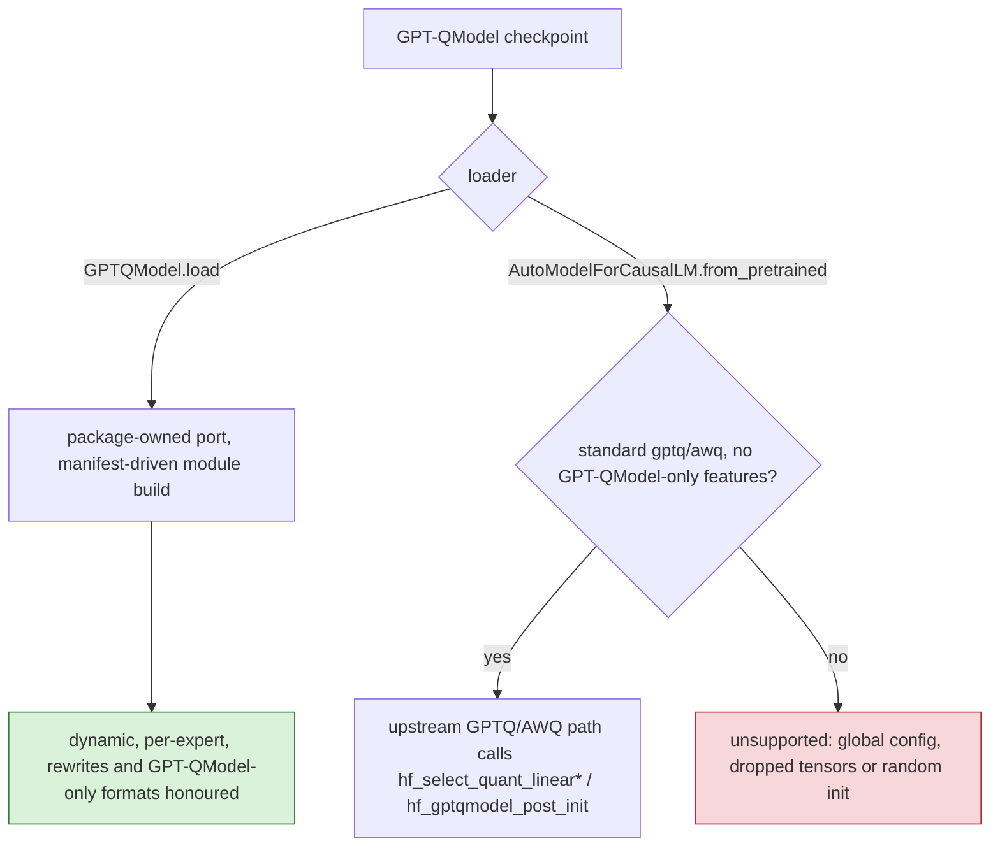
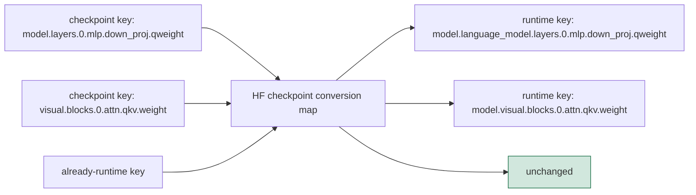
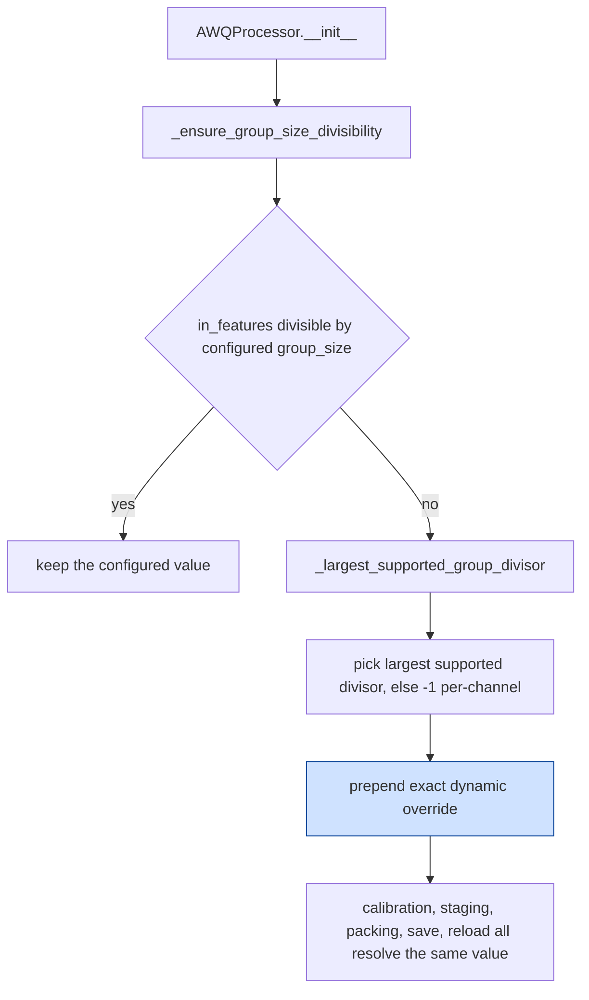
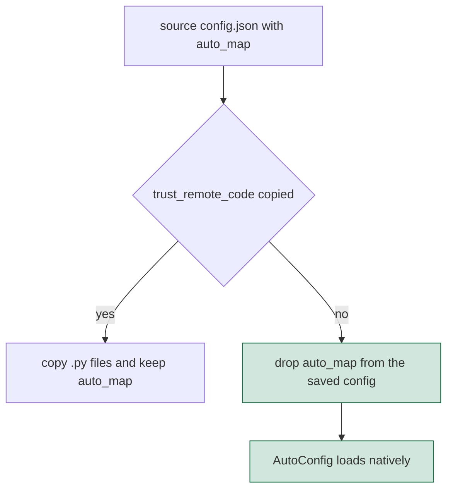
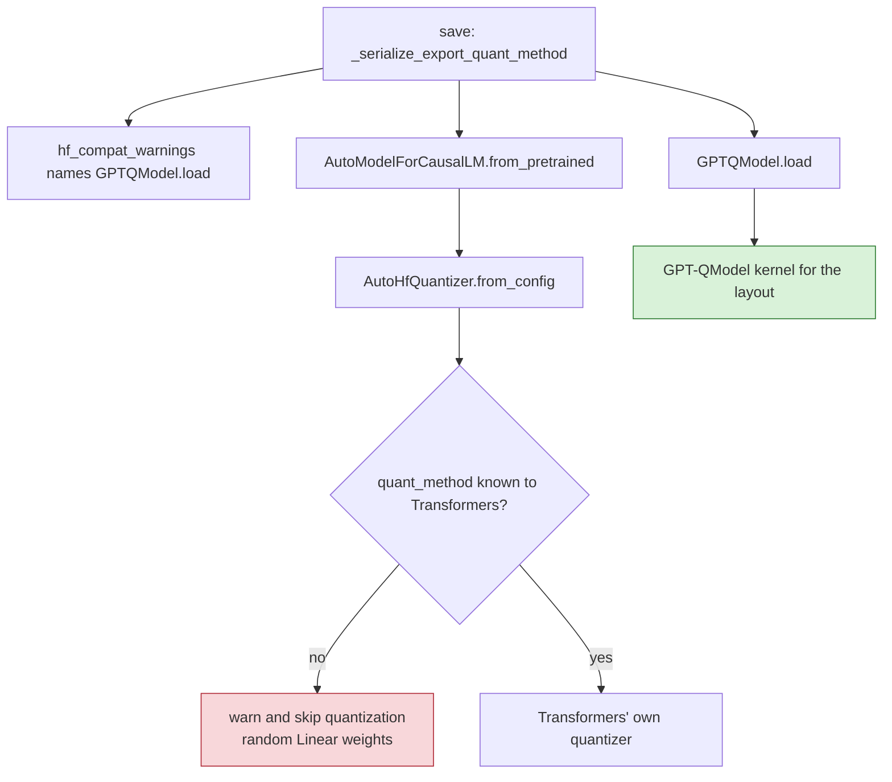
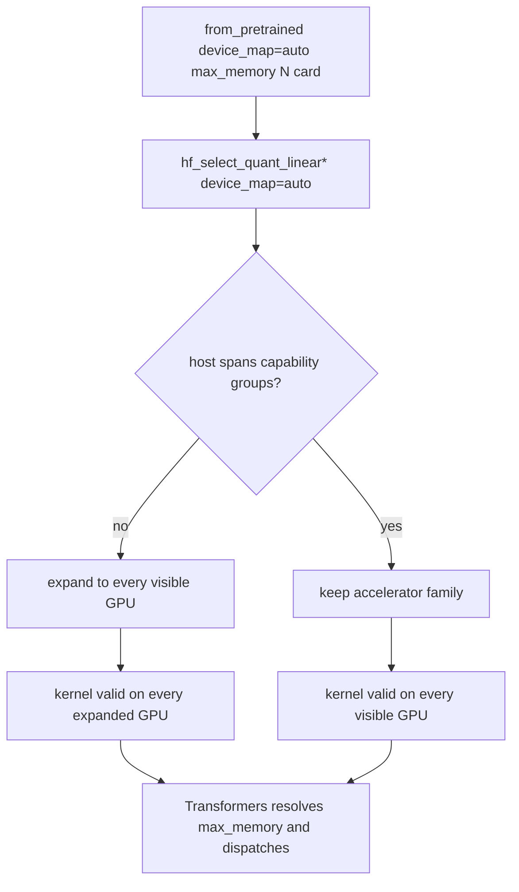

# Hugging Face interoperability

GPT-QModel checkpoints are consumed by three different loaders: its own
`GPTQModel.load`, Hugging Face Transformers (directly or through Optimum), and
vLLM/SGLang. The three disagree about module structure, key spelling, and which
modules are quantized. This page describes the contracts that keep them
consistent.

## 1. Loader contract

GPT-QModel never patches, monkeypatches or registers into Transformers or the
HF ecosystem (Optimum, OpenVINO, safetensors, `huggingface_hub`), not even
temporarily or scoped. `tests/test_transformers_unpatched.py` snapshots the
quantizer registries, the GPTQ/AWQ quantizers, Transformers' GGUF modules,
`PreTrainedModel`, `torch.nn.init` and `safetensors.torch` (plus Optimum and
OpenVINO when installed) before and after import, native load, port build and
`GPTQModel.load`, and fails on any difference.

The only coupling is in the other direction: Transformers' and Optimum's own
GPTQ/AWQ integrations import GPT-QModel and call its public entry points.

| Entry point | Module | Called by |
| --- | --- | --- |
| `hf_select_quant_linear`, `hf_select_quant_linear_v2` | `gptqmodel/utils/importer.py` | Transformers/Optimum layer replacement |
| `hf_gptqmodel_post_init` | `gptqmodel/utils/model.py` | Post-weight-load kernel init |
| `hf_convert_gptq_v1_to_v2_format`, `hf_convert_gptq_v2_to_v1_format` | `gptqmodel/utils/model.py` | GPTQ v1/v2 zero-point conversion |
| `hf_pack_layer`, `hf_repack_layer`, `hf_post_init`, `hf_check_packing_feasibility`, `hf_check_best_packing_format` | `gptqmodel/utils/packing.py` | Packing APIs |

A plain GPTQ or AWQ checkpoint without GPT-QModel-only features therefore still
loads through `AutoModelForCausalLM.from_pretrained` exactly as upstream
implements it. Those loaders replace `nn.Linear` modules only, from the
*global* quantization config, so they cannot read:

- per-module `dynamic` `bits`/`group_size` overrides;
- per-expert MoE tensors (`experts.<n>.*.qweight`), which Transformers 5 reports
  as UNEXPECTED while the fused 3-D experts stay randomly initialized;
- structural rewrites (fused or defused blocks);
- GPT-QModel-only `quant_method` names (section 5).

Load such checkpoints with `GPTQModel.load`.

The writer reports these hazards at save time through `hf_compat_warnings`
(`gptqmodel/models/writer.py`): per-expert quantized modules, `dynamic` AWQ,
`lm_head=True`, 8-bit AWQ, packed GGUF and every GPT-QModel-only
`quant_method`. Each warning names `GPTQModel.load` (or vLLM where it applies)
as the loader.

## 2. Legacy checkpoint key layouts

Transformers 4.x checkpoints of Qwen2-VL, Qwen2.5-VL, LLaVA, and similar
multimodal families store language weights under `model.layers.*` and vision
weights under `visual.*`. Transformers 5 exposes them as
`model.language_model.layers.*` and `model.visual.*`.

The LazyTurtle quantization path already applied the model's checkpoint
conversion map. The quantized load path did not, so `GPTQModel.load` rejected
the checkpoint as missing every `qweight`.

`_checkpoint_key_converter` in `gptqmodel/models/loader.py` resolves the map
from the live model (`resolve_hf_conversion_map_reversed`) unless a definition
declares `checkpoint_key_for_load` / `checkpoint_key_for_save` explicitly. The
converter is used in three places:

| Call site | Direction | Purpose |
| --- | --- | --- |
| `validate_checkpoint_qweights` | runtime to checkpoint | Accept the legacy spelling of a serialized module |
| v1 `load_checkpoint_in_model_then_tie_weights` | checkpoint to runtime | Remap legacy keys before Accelerate assigns tensors |
| non-v1 `load_checkpoint_in_model_then_tie_weights` | checkpoint to runtime | Same, for AWQ/GPTQ_V2 and other formats |

The map is idempotent: a checkpoint already written with runtime keys does not
match the checkpoint-side patterns and passes through unchanged.

## 3. AWQ group-size divisibility

AWQ reshapes the input axis into fixed-size groups during the weight mean, clip
search, pseudo-quantization, and packing. A module whose `in_features` is not a
multiple of `group_size` cannot be quantized as-is. The failure used to surface
only after the whole calibration pass.

Phi-tiny-MoE has `intermediate_size=448`. With `group_size=128` the processor
now resolves 64 (448 is 7 x 64) before calibration and records it in
`dynamic`, so the checkpoint reloads with the same layout. The warning names
each retuned module.

## 4. Saved config `auto_map`

`resolve_trust_remote_code` (`gptqmodel/utils/hf.py`) turns remote code off for
model types that the installed Transformers implements natively. The writer
then does not copy `configuration_*.py` / `modeling_*.py`. A source `auto_map`
must therefore be removed from the export; otherwise
`AutoConfig.from_pretrained(out, trust_remote_code=True)` points at files that
do not exist.

Both save paths apply the rule: `_save_model_configs_without_weights` (normal
quantized save) and `save_quantized_embeddings` (module-replacement save).

## 5. GPT-QModel-only `quant_method`

Transformers resolves a checkpoint's `quantization_config.quant_method`
through `AUTO_QUANTIZATION_CONFIG_MAPPING` / `AUTO_QUANTIZER_MAPPING`. For an
unknown name, `supports_quant_method` only warns
`Unknown quantization type, got <name> ... skip the quantization` and
`from_pretrained` then random-initializes every linear layer. GPT-QModel
publishes several layouts Transformers does not implement (`bitsandbytes`,
`exl3`, `qqq`, `paro`, `macaq`, `nf12`, `tt-blockfloat`) plus the
deliberate `gptqmodel_gguf` alias. FP8 has no alias: a loaded production FP8
checkpoint keeps its own `quant_method: "fp8"`, which Transformers implements.

GPT-QModel registers no refusing quantizer for these names: plain Transformers
keeps its own warn-and-random-init behaviour. The names live in the single
table `REFUSED_HF_QUANT_METHODS` (`gptqmodel/_quant_methods.py`), and the
writer emits an `hf_compat_warnings` entry for each one at save time, naming
`GPTQModel.load` (`refused_hf_load_remedy`) as the loader.

GPT-QModel no longer writes FP8 checkpoints: FP8 is load-only, and the
checkpoints it loads are production FP8 (`FineGrainedFP8`, DeepSeek/Qwen block
scales, NVIDIA ModelOpt, MXFP8, NVFP8) that publish the standard `fp8` name.
`_serialize_export_quant_method` therefore only has to special-case GGUF.
Transformers 5 registers `bitsandbytes_4bit` and `bitsandbytes_8bit`, not the
plain `bitsandbytes` that GPT-QModel writes, so that name is in the table like
the other GPT-QModel-only layouts. The per-format table also appears in
[the MACaQ page](macaq.md#transformers-interop).

| Situation | Behaviour |
| --- | --- |
| Checkpoint with `quant_method: exl3` in plain Transformers | warning + random Linear weights (Transformers' own behaviour) |
| Same checkpoint through `GPTQModel.load` | loads |
| `quant_method` Transformers already implements | its own quantizer |
| save of a GPT-QModel-only layout | `hf_compat_warnings` entry naming `GPTQModel.load` |

## 6. Keyword `device_map` and `max_memory`

Transformers calls the quantizer's layer replacement *before* it resolves
`device_map="auto"` from `max_memory`, and it never forwards `max_memory` to
the quantizer. `hf_select_quant_linear{,_v2}` therefore receive an unresolved
accelerate keyword, not a placement.

Previously `hf_normalize_device_device_map` expanded the keyword to every
visible GPU and validated the result, so on a host whose GPUs span
compute-capability groups the load was refused before `max_memory` was
considered, even when the budget named one card. `GPTQModel.load` resolves the
budget itself (#4632/#4747).

`hf_normalize_device_device_map` now normalizes an accelerate keyword to the
accelerator *family* (`defer_keyword_placement`) instead of a concrete ordinal
(#5084). A family selector makes kernel selection validate the candidate
against every visible device, so whichever card the budget names is served; a
homogeneous host keeps the concrete expansion, so kernel choice there is
unchanged. An explicit mixed-capability map is still refused up front.

| Situation | Behaviour |
| --- | --- |
| `device_map="auto", max_memory={1: ...}` on a mixed host | Kernel selection is not refused before the budget applies |
| Homogeneous host, any keyword | One kernel for all visible GPUs |
| Explicit `device_map={"": "cuda:0", "model.layers.1": "cuda:1"}` on a mixed host | `ValueError`, refused up front |

GPT-QModel no longer hooks the Transformers load after dispatch, so a
*resolved* mixed-capability `hf_device_map` is not refused on that path.

## Failure contract

| Condition | Behaviour |
| --- | --- |
| Native MoE / `dynamic` / GPT-QModel-only checkpoint loaded by plain Transformers | Unsupported; save-time `hf_compat_warnings` names `GPTQModel.load` |
| Legacy-layout quantized VL checkpoint | Keys remapped; checkpoint loads and runs |
| AWQ module with non-divisible `in_features` | Retuned group size before calibration |
| Native save of a source with `auto_map` | `auto_map` removed; config loads natively |
| Keyword `max_memory` budget on a mixed-capability host | Kernel selection is not refused before the budget applies |

## Tests

| Test | Invariant |
| --- | --- |
| `tests/test_transformers_unpatched.py` | Import, native load, port build and `GPTQModel.load` leave Transformers and the HF ecosystem unpatched |
| `tests/test_checkpoint_compat.py::test_hf_compat_warning_for_defused_moe_checkpoint` | Per-expert saves warn |
| `tests/test_checkpoint_compat.py::test_hf_compat_warning_for_dynamic_awq` | `dynamic` AWQ saves warn |
| `tests/test_checkpoint_compat.py::test_hf_compat_warning_for_every_gptqmodel_only_method` | Save-time warnings name every table entry |
| `tests/test_checkpoint_compat.py::test_saved_config_drops_auto_map_when_remote_code_is_not_copied` | `auto_map` is dropped only when `.py` files are not copied |
| `tests/test_legacy_vl_checkpoint_load.py` | Legacy keys convert both directions and a real legacy VL checkpoint loads |
| `tests/test_awq_dynamic_group_size.py::test_awq_retunes_group_size_before_calibration_for_non_divisible_in_features` | 448-wide AWQ module retunes to 64 before the weight-mean step |
| `tests/test_hf_bridge_mixed_capability_5084.py` | A keyword map is not validated before `max_memory`; an explicit mixed map is |
