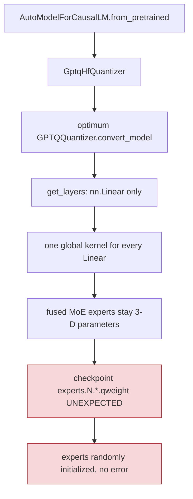
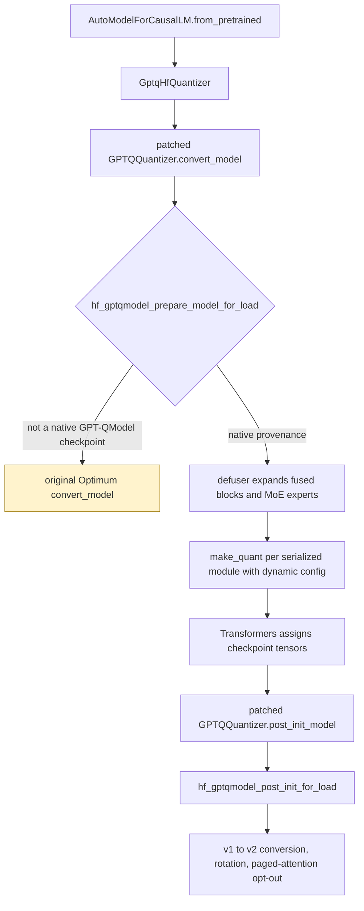
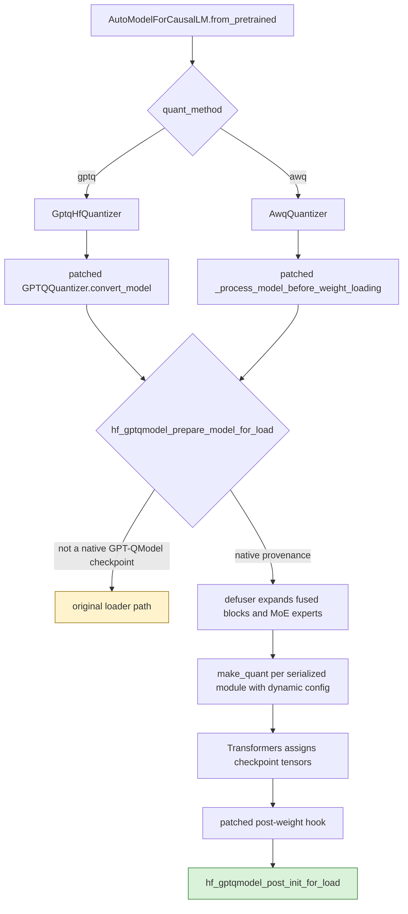
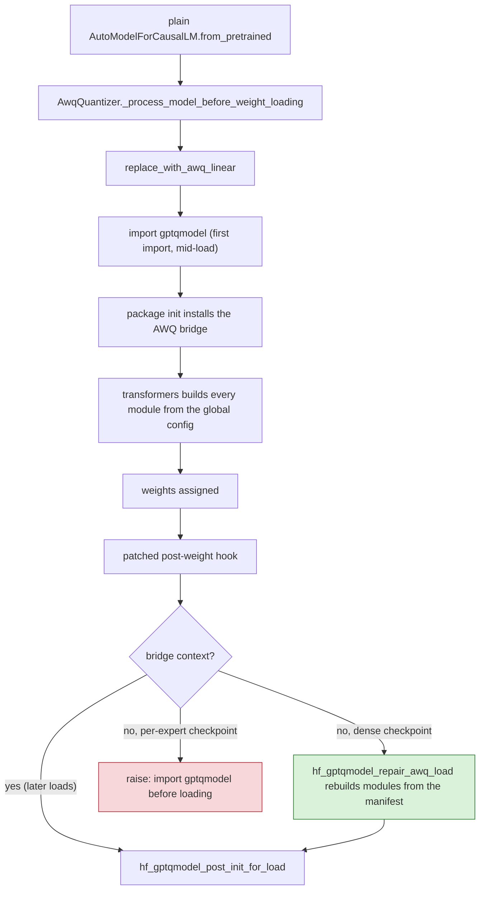
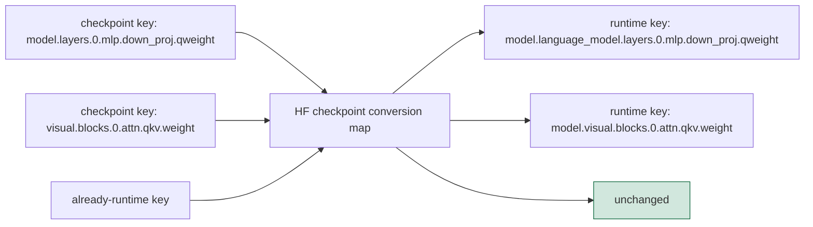
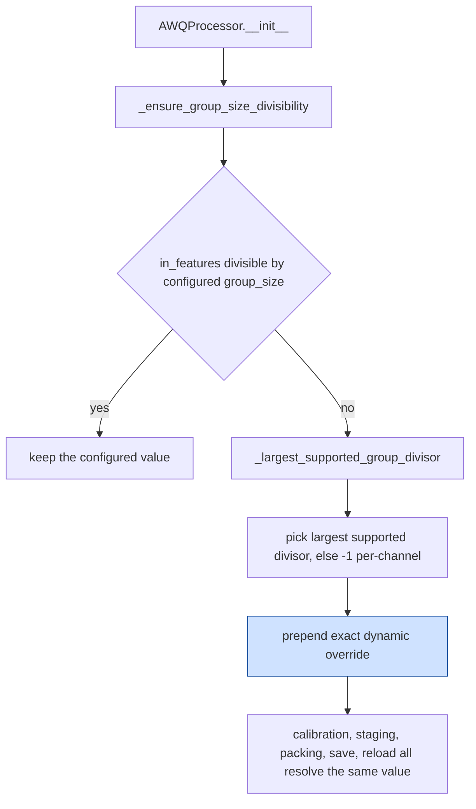
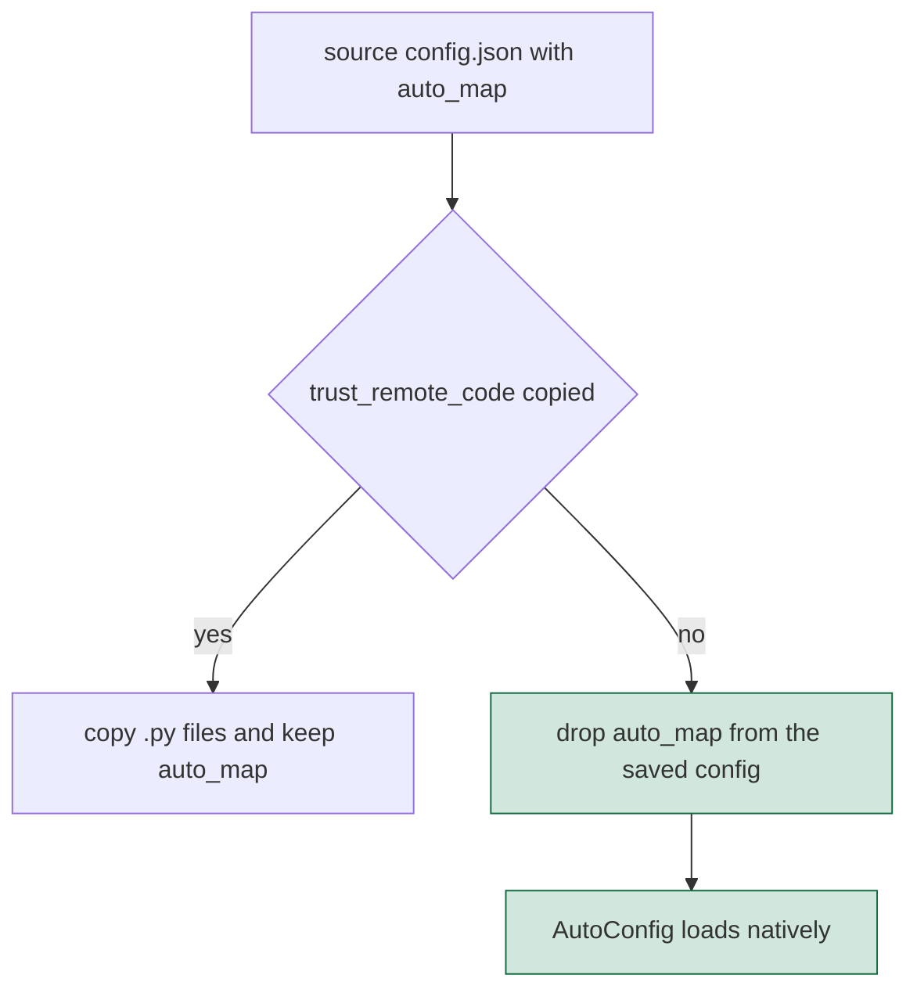
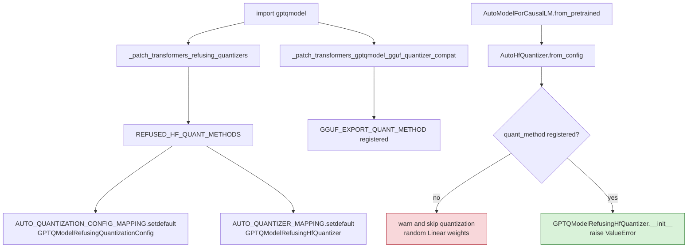

# Hugging Face interoperability

GPT-QModel checkpoints are consumed by three different loaders: its own
`GPTQModel.load`, Hugging Face Transformers through Optimum, and vLLM/SGLang.
The three disagree about module structure, key spelling, and which modules are
quantized. This page describes the contracts that keep them consistent.

Introduced by PR #4084.

## 1. The native loading bridge

Transformers delegates a pre-quantized GPTQ checkpoint to Optimum's
`GPTQQuantizer`. That loader replaces every `nn.Linear` with one kernel chosen
from the *global* quantization config. A GPT-QModel checkpoint can carry
per-module `dynamic` settings and structural rewrites (fused blocks, expanded
MoE experts), so the homogeneous replacement silently loses data.

### Before: Optimum only sees `nn.Linear`

### After: the bridge runs first

The wrapper is installed by `_patch_optimum_gptqmodel_load_bridge` in
`gptqmodel/__init__.py`. Installation is import-order independent: the eager
attempt at the end of package import can lose a race with `optimum.gptq`
importing `gptqmodel` mid-initialization, so the same idempotent install is
retried from Transformers' `GptqHfQuantizer` pre/post weight-loading hooks and
from the `hf_select_quant_linear_v2` / `hf_gptqmodel_post_init` entry points
Optimum calls. A partially initialized `optimum.gptq` is treated as "retry
later", never as "Optimum is not installed". Loading a native GPTQ checkpoint
through `AutoModelForCausalLM.from_pretrained` therefore does not require an
`import gptqmodel` first.

| Situation | Before | After |
| --- | --- | --- |
| Native GPT-QModel checkpoint | Optimum replaces attention only; experts missing | Bridge rebuilds every serialized module, then Optimum post-init is replaced |
| Optimum-owned checkpoint | Optimum path | Bridge returns `None`, original Optimum path |
| Per-module `dynamic` bits/group size | Global config wins | `QuantizeConfig.from_pretrained` manifest wins |
| Native checkpoint, plain `AutoModelForCausalLM` without `import gptqmodel` | Bridge not installed; global bits silently applied | Bridge installs from Transformers' GPTQ hooks before `convert_model` |
| Optimum not installed | ImportError from Transformers | Same; the patch is skipped |

### AWQ: the second loader Transformers owns

`quant_method: "awq"` never reaches Optimum. Transformers runs its own
`AwqQuantizer`, whose pre-weight hook calls
`integrations/awq.py::replace_with_awq_linear`; that function only swaps
`nn.Linear` modules. A GPT-QModel AWQ checkpoint that stores per-expert
`experts.<n>.*.qweight` tensors therefore kept the fused 3-D expert parameters
dense, reported every packed expert tensor as UNEXPECTED, and loaded with
randomly initialized experts and no error. GPTQ checkpoints were unaffected
because #4084 patched Optimum only.

`_patch_transformers_awq_gptqmodel_load_bridge` wraps
`AwqQuantizer._process_model_before_weight_loading` and
`_process_model_after_weight_loading` with the same contract as the Optimum
wrapper: a native checkpoint gets the manifest-driven module build, and any
other checkpoint keeps Transformers' own AWQ path because the bridge returns
`None`.

Unlike Optimum's GPTQ quantizer, `AwqQuantizer` never imports `gptqmodel`
before it starts loading. The first import happens inside
`replace_with_awq_linear`, i.e. while the prepare hook is already executing, so
the patch cannot run the prepare step for the load that triggered it (#4795).
`_ensure_transformers_awq_gptqmodel_load_bridge` therefore retries the
idempotent install from the quantizer's post-weight hook,
`hf_select_quant_linear_v2`, and the package init: every later AWQ load in the
process gets the prepare step, and the post-weight hook repairs the load that
triggered the import.

The repair is exact for a dense checkpoint: it rebuilds each
checkpoint-backed module from its serialized per-module `bits`/`group_size`
(and its kernel class) and moves the already-assigned checkpoint tensors into
it before the native post-init. Without it a `dynamic` AWQ checkpoint was built
from the global config only, so on CPU the tensors were decoded with the wrong
group size (silently wrong logits) and on CUDA the Marlin pack raised
`AWQ qzeros shape must be ...`. A checkpoint that stores per-expert
`experts.<n>.*.qweight` tensors cannot be repaired after the fact, because
Transformers already dropped those tensors as UNEXPECTED: the post hook raises
an actionable error instead of returning randomly initialized experts.

| Situation | Before | After |
| --- | --- | --- |
| Native AWQ MoE checkpoint, `import gptqmodel` first | Attention quantized; every routed expert random | Every serialized expert module rebuilt as a packed kernel |
| AWQ checkpoint written by another tool | Transformers' AWQ path | Unchanged; bridge declines it |
| Native AWQ checkpoint, no `gptqmodel` import | Random experts, no error | Actionable error naming the dropped expert tensors |
| Native AWQ attention-only checkpoint | Transformers' AWQ path | Bridge rebuilds the same modules |
| Native AWQ `dynamic` checkpoint, no `gptqmodel` import | Global group size; CPU wrong logits, CUDA qzeros error | Post hook rebuilds every module from the manifest; matches `GPTQModel.load` |
| Second AWQ load in the same process | Same as the first | Prepare hook runs before any layer is replaced |

The save path reports the same hazards loudly through `hf_compat_warnings`
(`gptqmodel/models/writer.py`). A checkpoint that stores per-expert
`experts.<n>.*.qweight` tensors emits a warning naming the missing /
unexpected tensor failure, the fact that both built-in GPTQ and AWQ loaders
only replace `nn.Linear`, and the remedy: import `gptqmodel` before
Transformers so the native bridge is installed, or load with `GPTQModel.load`.
A `dynamic` AWQ checkpoint emits a warning that a loader without the native
AWQ bridge builds every module from the global `bits`/`group_size`, which
silently changes CPU logits and raises a qzeros shape error on CUDA.

## 2. Legacy checkpoint key layouts

Transformers 4.x checkpoints of Qwen2-VL, Qwen2.5-VL, LLaVA, and similar
multimodal families store language weights under `model.layers.*` and vision
weights under `visual.*`. Transformers 5 exposes them as
`model.language_model.layers.*` and `model.visual.*`.

The LazyTurtle quantization path already applied the model's checkpoint
conversion map. The quantized load path did not, so `GPTQModel.load` rejected
the checkpoint as missing every `qweight`.

`_checkpoint_key_converter` in `gptqmodel/models/loader.py` resolves the map
from the live model (`resolve_hf_conversion_map_reversed`) unless a definition
declares `checkpoint_key_for_load` / `checkpoint_key_for_save` explicitly. The
converter is used in three places:

| Call site | Direction | Purpose |
| --- | --- | --- |
| `validate_checkpoint_qweights` | runtime to checkpoint | Accept the legacy spelling of a serialized module |
| v1 `load_checkpoint_in_model_then_tie_weights` | checkpoint to runtime | Remap legacy keys before Accelerate assigns tensors |
| non-v1 `load_checkpoint_in_model_then_tie_weights` | checkpoint to runtime | Same, for AWQ/GPTQ_V2 and other formats |

The map is idempotent: a checkpoint already written with runtime keys does not
match the checkpoint-side patterns and passes through unchanged.

## 3. AWQ group-size divisibility

AWQ reshapes the input axis into fixed-size groups during the weight mean, clip
search, pseudo-quantization, and packing. A module whose `in_features` is not a
multiple of `group_size` cannot be quantized as-is. The failure used to surface
only after the whole calibration pass.

Phi-tiny-MoE has `intermediate_size=448`. With `group_size=128` the processor
now resolves 64 (448 is 7 x 64) before calibration and records it in
`dynamic`, so the checkpoint reloads with the same layout. The warning names
each retuned module.

## 4. Saved config `auto_map`

`resolve_trust_remote_code` (`gptqmodel/utils/hf.py`) turns remote code off for
model types that the installed Transformers implements natively. The writer
then does not copy `configuration_*.py` / `modeling_*.py`. A source `auto_map`
must therefore be removed from the export; otherwise
`AutoConfig.from_pretrained(out, trust_remote_code=True)` points at files that
do not exist.

Both save paths apply the rule: `_save_model_configs_without_weights` (normal
quantized save) and `save_quantized_embeddings` (module-replacement save).

## 5. GPT-QModel-only `quant_method` refusal

Transformers resolves a checkpoint's `quantization_config.quant_method`
through `AUTO_QUANTIZATION_CONFIG_MAPPING` / `AUTO_QUANTIZER_MAPPING`. For an
unknown name, `supports_quant_method` only warns
`Unknown quantization type, got <name> ... skip the quantization` and
`from_pretrained` then random-initializes every linear layer. GPT-QModel
publishes several layouts transformers does not implement (`bitsandbytes`,
`exl3`, `qqq`, `paro`, `macaq`, `nf12`, `tt-blockfloat`) plus the
deliberate `gptqmodel_gguf` alias.

`gptqmodel/__init__.py` registers a refusing quantizer for each name from the
single table `REFUSED_HF_QUANT_METHODS` in `gptqmodel/_quant_methods.py`, using
the classes in `gptqmodel/utils/hf_refusing_quantizer.py`:

`setdefault` keeps any quantizer transformers already owns (`gptq`, `awq`,
`fp8`, and its own `vptq`), so this table only covers names transformers does
not implement. In particular transformers 5 registers `bitsandbytes_4bit` and
`bitsandbytes_8bit`, not the plain `bitsandbytes` that GPT-QModel writes, so
that name is refused like the other GPT-QModel-only layouts. The registration runs on package import, so
a process that never imports `gptqmodel` still only sees transformers'
warning. The writer emits `hf_compat_warnings` at save time for the same
table, so a checkpoint is labelled before anyone tries to load it. The
per-format table also appears in [the MACaQ page](macaq.md#transformers-interop).

| Situation | Before | After |
| --- | --- | --- |
| `gptqmodel` imported, checkpoint with `quant_method: exl3` | warning + random Linear weights | `ValueError` naming the method |
| plain `transformers`, no `gptqmodel` import | warning + random Linear weights | unchanged: only a warning |
| `quant_method` transformers already implements | its own quantizer | unchanged (`setdefault`) |
| save of a GPT-QModel-only layout | silent | `hf_compat_warnings` entry naming the method |

## Failure contract

| Condition | Before | After |
| --- | --- | --- |
| Native MoE checkpoint loaded by plain Transformers | Silent random experts, garbage output | Bridge rebuilds experts; warning at save time if it cannot |
| Legacy-layout quantized VL checkpoint | `ValueError: Missing required quantized weights` | Keys remapped; checkpoint loads and runs |
| AWQ module with non-divisible `in_features` | `ValueError` after calibration | Retuned group size before calibration |
| Native save of a source with `auto_map` | Dangling `auto_map`, `OSError` on load | `auto_map` removed; config loads natively |
| GPT-QModel-only `quant_method` in plain HF | warning + random weights | refusing quantizer raises when `gptqmodel` is imported |

## Tests

| Test | Invariant |
| --- | --- |
| `tests/test_hf_gptqmodel_load_bridge.py::test_optimum_gptq_quantizer_is_routed_through_the_native_bridge` | Optimum's hooks call the bridge |
| `tests/test_hf_optimum_bridge_import_order.py` | A fresh interpreter that never imports `gptqmodel` installs the bridge and keeps `dynamic` bit widths |
| `tests/test_checkpoint_compat.py::test_hf_compat_warning_for_defused_moe_checkpoint` | Per-expert saves warn |
| `tests/test_checkpoint_compat.py::test_saved_config_drops_auto_map_when_remote_code_is_not_copied` | `auto_map` is dropped only when `.py` files are not copied |
| `tests/test_legacy_vl_checkpoint_load.py` | Legacy keys convert both directions and a real legacy VL checkpoint loads |
| `tests/test_awq_dynamic_group_size.py::test_awq_retunes_group_size_before_calibration_for_non_divisible_in_features` | 448-wide AWQ module retunes to 64 before the weight-mean step |
| `tests/test_checkpoint_interop_4053.py::test_hf_from_pretrained_refuses_every_gptqmodel_only_method` | Every table entry raises instead of loading random weights |
| `tests/test_checkpoint_compat.py::test_every_gptqmodel_only_method_registers_a_refusing_quantizer` | The package-init guard covers the whole table |
| `tests/test_checkpoint_compat.py::test_hf_compat_warning_for_every_gptqmodel_only_method` | Save-time warnings name every table entry |
