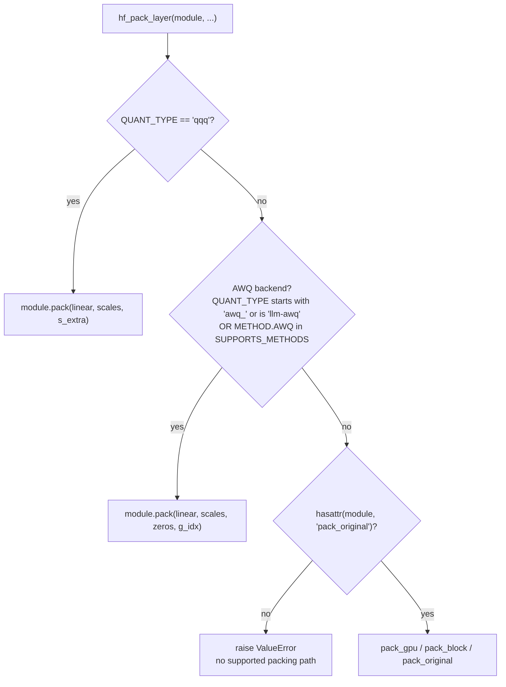
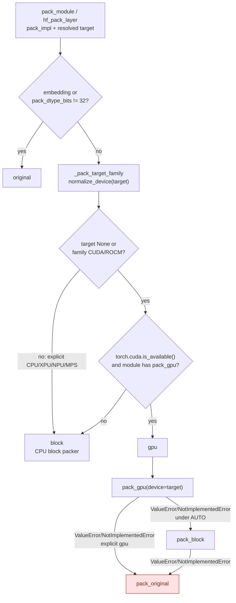
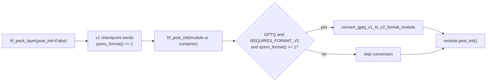
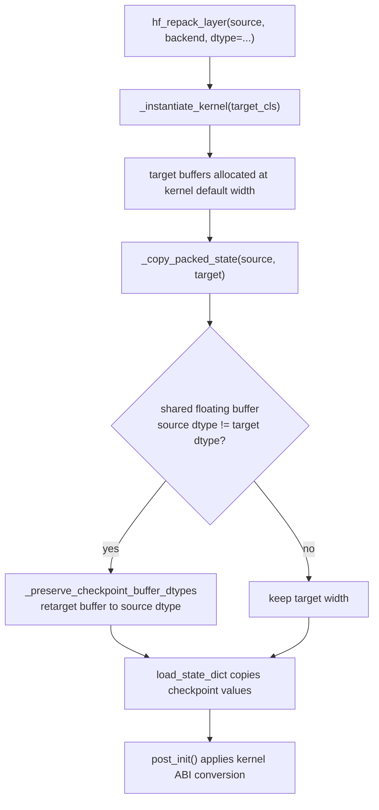

# Stable `hf_` packing API

External integrators (transformers/optimum, auto-round, ...) need a stable way
to ask which kernels can pack a quantization contract, which packing format to
target, and how to pack or repack a single layer. GPT-QModel exposes those
entry points in `gptqmodel.utils.packing`; every function carries the `hf_`
prefix and is covered by `tests/test_hf_packing_api.py`.

Anything without the `hf_` prefix (for example `pack_module`,
`select_quant_linear`) is internal and may change without notice.

## API surface

| Function | Purpose |
| --- | --- |
| `hf_check_packing_feasibility(...)` | Does a kernel exist that can pack (or repack) this contract on the target device? |
| `hf_check_best_packing_format(...)` | Which packing format has the fastest feasible kernel? |
| `hf_pack_layer(module, linear, scales, zeros, g_idx, ...)` | Pack one layer into an already-created quantized kernel. |
| `module.hf_pack(linear, scales, zeros, g_idx, ...)` | Method-level wrapper around `hf_pack_layer` for callers holding a kernel instance. |
| `hf_post_init(module)` | Run layer-level `post_init()` on a quantized layer or every quantized child of a container. |
| `hf_repack_layer(module, backend, ...)` | Repack an already-quantized layer for another kernel. |

## Checking feasibility and picking a format

```python
from gptqmodel.utils.packing import (
    hf_check_best_packing_format,
    hf_check_packing_feasibility,
)

feasible = hf_check_packing_feasibility(
    bits=4,
    group_size=128,
    desc_act=False,
    sym=False,
    backend="marlin",
    device="cuda:0",
)

best_format = hf_check_best_packing_format(
    bits=4,
    group_size=128,
    desc_act=False,
    sym=False,
    device="cuda:0",
)
```

`hf_check_packing_feasibility` accepts `in_features`/`out_features` to include
layer shape constraints, and `dynamic` to mirror per-module overrides. Invalid
argument values (unknown format/method/backend) raise `ValueError`, while an
unsupported contract simply returns `False`.

Pass `repack=True` to probe repack targets instead of raw-weight packers.
Kernels such as Marlin and ExllamaV2 have no `pack()` implementation — they
receive GPTQ-packed tensors and convert them in `post_init()` — so they answer
`True` for `repack=True` and `False` for the default packing probe.

## Packing a layer

`hf_pack_layer` follows the internal model packing path. `scales` and `zeros`
use the quantizer-native layout `[out_features, num_groups]`. For symmetric
kernels `zeros` may be omitted and `2 ** (bits - 1)` is synthesized, while
asymmetric (`sym=False`) packing requires explicit zero points.

```python
import torch
from gptqmodel.utils.importer import hf_select_quant_linear_v2
from gptqmodel.utils.packing import hf_pack_layer

kernel_cls = hf_select_quant_linear_v2(
    bits=4,
    group_size=128,
    desc_act=False,
    sym=True,
    format="gptq_v2",
    quant_method="gptq",
    backend="auto",
    device_map="cpu",
)
module = kernel_cls(
    bits=4,
    group_size=128,
    desc_act=False,
    sym=True,
    in_features=linear.in_features,
    out_features=linear.out_features,
    bias=linear.bias is not None,
)

hf_pack_layer(
    module, linear, scales, zeros=None, g_idx=g_idx,
    pack_impl="original", checkpoint_format="gptq_v2",
)
```

`pack_impl` accepts `"auto"`, `"original"`, `"block"`/`"cpu"` and `"gpu"`;
block/GPU requests fall back to the original packer when the kernel or device
does not support them. `"auto"` honours the `device` target: an explicit CPU
`device` selects the block packer even when a GPU is visible (see
[packing implementation selection](#packing-implementation-selection)). Pass
`post_init=True` to run the kernel's `post_init()` after packing, and
`post_init_kwargs={...}` to forward arguments such as the ExllamaV2 scratch
space.

Packing is a CPU-storage operation: even `pack_impl="gpu"` registers the packed
buffers on CPU (the GPU is used only as a compute accelerator), matching the
internal model packing path. Move the module to its runtime device afterwards.

### Packing dispatch

The dispatcher selects a packer from declared kernel metadata, not only from a
backend name prefix. QQQ keeps its dedicated `pack(linear, scales, s_extra)`
entry point; every other kernel that declares `METHOD.AWQ` (or keeps the
legacy `awq_`/`llm-awq` `QUANT_TYPE` label) uses the shared AWQ
`pack(linear, scales, zeros, g_idx)`; GPTQ-family kernels use
`pack_original`/`pack_block`/`pack_gpu`.



| Mechanism | Before | After |
| --- | --- | --- |
| AWQ recognition (`gptqmodel/utils/packing.py:609`) | `QUANT_TYPE` prefix `awq_` or exact `llm-awq` only | prefix **or** declared `METHOD.AWQ` in `SUPPORTS_METHODS` |
| AllSpark (`QUANT_TYPE="allspark"`, `METHOD.AWQ`) | fell through to the `pack_original` branch and raised `ValueError` | routed to its AWQ `pack()` |

### Packing implementation selection

Inside the GPTQ-family branch, `pack_impl="auto"` picks one of `pack_gpu`,
`pack_block` or `pack_original` per layer. The decision starts from the
caller's resolved target, not only from device availability: an explicit CPU
target selects the bounded CPU block packer even when a CUDA/ROCm GPU is
visible, and the reported packer names the implementation that actually
finished the layer (#5761).

`_pack_target_family` (`gptqmodel/utils/packing.py:100`) resolves the target
through `normalize_device`, so the HIP distinction stays in the family
resolver: a `cuda:N` target names `DEVICE.ROCM` on a HIP build and
`DEVICE.CUDA` on NVIDIA, and only those two families are eligible for
`pack_gpu`.



The model path resolves the concrete target first
(`resolve_pack_device`, `gptqmodel/utils/model.py:1320`) and passes it into
AUTO (`gptqmodel/utils/model.py:1448`). The layer API passes its `device`
argument (`gptqmodel/utils/packing.py:704`). `resolve_pack_device` honours an
explicit CPU `QuantizeConfig.device`; a non-CPU assigned device still
overrides the configured family, and an unspecified target stays `None` so
AUTO keeps its accelerator preference.

| Mechanism | Before | After |
| --- | --- | --- |
| AUTO decision input (`gptqmodel/utils/packing.py:99`) | `torch.cuda.is_available()` plus method presence; the target never reached the selector | `_auto_pack_impl(..., target=...)` keeps the GPU branch only for `None` or `DEVICE.CUDA`/`DEVICE.ROCM` (`gptqmodel/utils/packing.py:131-162`) |
| Model path (`gptqmodel/utils/model.py:1434`) | resolved `target_device`, then `_auto_pack_impl(module=module, linear=layer)` without it | passes `target_device` (`gptqmodel/utils/model.py:1448-1450`) |
| Layer API (`gptqmodel/utils/packing.py:639`) | `_normalize_pack_impl(pack_impl, module, linear)` | `_normalize_pack_impl(..., target=device)` (`gptqmodel/utils/packing.py:703-706`) |
| Profiling label (`gptqmodel/utils/model.py:1449-1455`) | assigned before the attempt, so a rejected `pack_gpu` still reported `module.pack_gpu` while `pack_original` ran | assigned after the fallback chain (`gptqmodel/utils/model.py:1479-1562`) |
| AUTO GPU rejection | `pack_gpu` then `pack_original` | `pack_gpu` then `pack_block`, then `pack_original` (`gptqmodel/utils/model.py:1479-1536`, `gptqmodel/utils/packing.py:717-750`) |
| Explicit `pack_impl="gpu"` with a CPU target | `pack_gpu` raised, then `pack_original` | warning and the CPU block packer when the kernel has it (`gptqmodel/utils/packing.py:194-207`, `gptqmodel/utils/model.py:1451-1464`) |

#### Failure and ambiguity paths

| Situation | Behaviour |
| --- | --- |
| Explicit CPU target and a visible GPU | `block`; `pack_gpu` is never attempted, so no CPU-target rejection and no slower original fallback |
| Unspecified target and a visible GPU | `gpu`; AUTO's accelerator preference is unchanged |
| Explicit `cuda:N` or `DEVICE.CUDA` target | `gpu`; the concrete ordinal is preserved for placement |
| `cuda:N` or `rocm` target on a HIP build | `gpu`; `normalize_device` resolves the HIP family to `DEVICE.ROCM` |
| Explicit `pack_impl="gpu"` with a CPU/XPU/NPU/MPS/XLA target | warning, then `block` when the kernel has `pack_block`, otherwise `original` |
| AUTO selected `gpu`, but the layer's geometry or word width is rejected | try `block`, then `original`; the label follows the packer that finished |
| Embedding source | `original` always (the packed words follow the vocabulary axis, #5381) |
| `pack_dtype_bits != 32` | `original` (narrow words are unsupported by the accelerated packers, #5806) |
| Explicit CPU target on a kernel without `pack_block` | `original` |

The tests pin these decisions in `tests/test_pack_auto_explicit_cpu_5761.py`:

| Invariant | Test |
| --- | --- |
| Explicit CPU resolves to `block` with a visible accelerator, with and without one | `test_explicit_cpu_target_resolves_to_block_with_visible_gpu`, `test_explicit_cpu_target_resolves_to_block_without_accelerator` |
| `pack_module` reports `module.pack_block` and never attempts `pack_gpu` | `test_pack_module_reports_block_for_explicit_cpu`, `test_explicit_cpu_with_real_gpu_packs_on_cpu` |
| `hf_pack_layer` uses the block packer for an explicit CPU target | `test_hf_pack_layer_uses_block_for_explicit_cpu` |
| AUTO with a visible GPU still selects the GPU path | `test_auto_with_visible_gpu_keeps_gpu_path`, `test_auto_with_real_gpu_packs_on_gpu` |
| AUTO GPU rejection falls back to block and relabels | `test_auto_gpu_rejection_falls_back_to_block_and_relabels` |
| Explicit GPU requests keep the GPU path for accelerator targets | `test_explicit_gpu_request_on_cpu_target_uses_cpu_packer` |
| Packed buffers are byte-identical to explicit block and original packing | `test_explicit_cpu_payload_matches_block_and_original` |


### Split pack / initialize lifecycle

`hf_pack_layer(..., post_init=False)` is the default and leaves a `gptq`
checkpoint request in the v1 export layout (stored zero point minus one). A
later `hf_post_init` restores the v2 runtime layout before running
`post_init()`, exactly like the inline `post_init=True` path, so a split
lifecycle decodes the same values.



The conversion lives in `_restore_gptq_runtime_qzeros`
(`gptqmodel/utils/packing.py:248`) and is shared by both entry points.

## Repacking a layer

`hf_repack_layer` converts an already-packed module to another backend. Kernels
with a native `repack_from_gptq`/`repack_from_awq` hook (BitBLAS) use it;
otherwise the packed tensors are copied into a target kernel that accepts the
same checkpoint format and `post_init()` performs the layout conversion.

```python
from gptqmodel.utils.packing import hf_repack_layer

marlin_module = hf_repack_layer(gptq_module, backend="marlin", device="cuda:0")
```

Kernels whose `post_init()` needs arguments (ExllamaV2 scratch space) are
repacked with `post_init=False` and initialized through `hf_post_init`:

```python
from gptqmodel.utils.exllamav2 import ScratchSpace
from gptqmodel.utils.packing import hf_post_init, hf_repack_layer

target = hf_repack_layer(source, backend="exllama_v2", device="cuda:1", post_init=False)
hf_post_init(target, scratch_space=ScratchSpace(target.scratch_space_fixed(), dev="cuda:1"))
```

`ScratchSpace` only covers per-forward temporaries: `temp_dq_size()` is `0`
by design because the kernel keeps no reconstructed dense weight, and
`ScratchSpace.get_slice()` allocates a fresh transient tensor per call rather
than slicing model-owned storage. Use `scratch_space_fixed()` (the forward
temporary size), not `temp_dq_size()`, so the value is not a stale zero.

When the requested backend is already in use, the source module is returned
unchanged. Targets that cannot consume the source layout raise
`NotImplementedError`, and unsupported backends raise `ValueError`.

Three guarantees keep copy-based repacking numerically correct:

* GPTQ v1/v2 zero-point flavors are aligned automatically. Kernels with
  `REQUIRES_FORMAT_V2` keep qzeros in the corrected v2 domain, so a copy into a
  v1-native target (Marlin, BitBLAS) runs the same conversion the loader/saver
  uses instead of copying offset zero points.
* Floating checkpoint buffers keep the source storage width. `dtype` selects
  the target kernel's activation/output dtype; it is not permission to narrow
  checkpoint storage, so `scales`/`bias` are retargeted to the source dtype
  before the copy. A BF16 or FP32 value outside the FP16 range therefore stays
  finite instead of becoming infinity or zero. The kernel's `post_init()` still
  performs any ABI conversion it needs.
* Kernels that repack their buffers into a private runtime ABI inside
  `post_init()` (Marlin, Machete, Swordfish, BitBLAS) are valid repack targets
  but are rejected as repack *sources*, because their buffers no longer hold
  the checkpoint layout. Repack from the kernel holding the checkpoint layout
  (for example a Torch kernel) instead.


