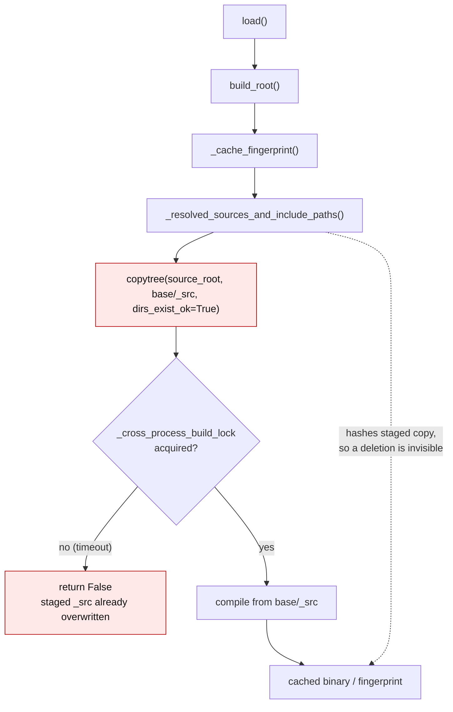
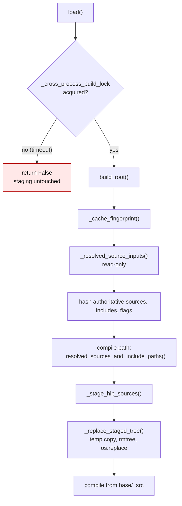
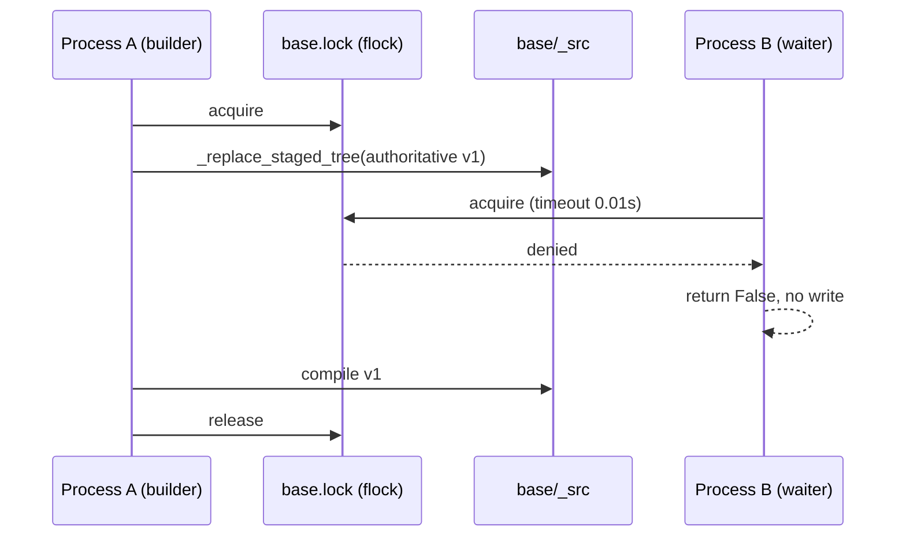

<!--
SPDX-FileCopyrightText: 2026 ModelCloud.ai
SPDX-License-Identifier: Apache-2.0
-->

# HIP JIT source staging

ROCm builds cannot hipify the shipped `gptqmodel_ext` tree in place: torch writes
`<name>_hip.{hip,cpp}` next to every input and fails on a read-only install.
`TorchOpsJitExtension._stage_hip_sources` therefore copies the tracked sources
and include roots into the writable cache (`<base_build_root>/_src`) and passes
the staged paths to torch. The staging directory is shared by every fingerprint
of one extension, so it is part of the cross-process build transaction: only the
process holding the `<base_build_root>.lock` flock may write it, and the copy
must be an exact image of the authoritative tree at the moment the fingerprint
was computed.

## Before #4487

`build_root()` was evaluated before the flock, and `_cache_fingerprint()` staged
sources as a side effect. Any process that only asked for the cache key
overwrote `_src` while the lock holder was compiling it. Staging also merged
with `shutil.copytree(..., dirs_exist_ok=True)`, so a header deleted from the
source tree stayed in `_src`; because the fingerprint hashed the staged copy,
the deletion did not change the cache key either.

Mechanisms removed:

| Old mechanism | Location on `461b42023` | Consequence |
| --- | --- | --- |
| Fingerprint stages sources | `gptqmodel/utils/cpp.py:1603-1607` | `_src` written before the flock |
| Merge copy of the source root | `gptqmodel/utils/cpp.py:1304` | Deleted files are retained |
| Merge copy of external include roots | `gptqmodel/utils/cpp.py:1332` | Deleted headers are retained |
| Build root computed before the lock | `gptqmodel/utils/cpp.py:1996-2000` | Key and compiled bytes can name different snapshots |

## After #4487

`_cache_fingerprint()` now calls `_resolved_source_inputs()`, which resolves the
callback paths without writing anything, and hashes the authoritative source
graph. `load()` computes `build_root()` only after the flock is held, then stages
inside the lock. `_replace_staged_tree()` builds the copy in a sibling temporary
directory and swaps it in, so the staged generation contains exactly the current
tree: present files refreshed, deleted files gone.

## Contracts

- `_cache_fingerprint()` is read-only. It must not create or modify `_src`,
  `build_root`, or any other on-disk cache entry.
- `_stage_hip_sources()` writes the shared staging tree only under
  `_cross_process_build_lock`; a lock timeout leaves it untouched.
- Staging replaces, never merges. A file absent from the authoritative tree is
  absent from the staged tree, and its removal changes the fingerprint through
  the `missing_include=` payload entry or the changed source graph.
- A loader that stages its own sources before returning them (NF12 HIP and TT
  blockfloat HIP) keeps that layout; the loader detects that every source is
  already inside `_staging_root` and does not copy it again.

## Failure and ambiguity

| Situation | Before | After |
| --- | --- | --- |
| Waiter times out on the build lock | `_src` already overwritten by its fingerprint | `_src` untouched; load returns `False` |
| Included header edited | Key changes only because the staged copy was refreshed | Key changes from the authoritative content |
| Included header deleted | Staged header retained; key unchanged; compiler sees obsolete definition | Staged header absent; key changes; compiler sees the fallback |
| Crash during staging | Partial merge left in `_src` | Temporary directory removed; previous `_src` swapped only on success |

Introduced by the fix for
[#4487](https://github.com/ModelCloud/GPTQModel/issues/4487).
