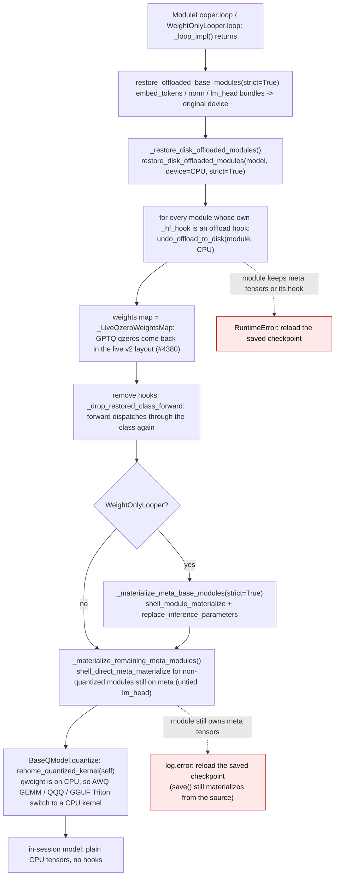

# In-session model after disk-offloaded quantization

`QuantizeConfig.offload_to_disk=True` (the default) bounds host memory while
quantization runs: every finalized packed module is written to the run's
[offload directory](offload-run-directories.md) and replaced by meta tensors
behind an accelerate `AlignDevicesHook`. That is a property of the *loop*. When
`quantize()` returns, the model must be the same model `offload_to_disk=False`
produces: packed layers in memory on CPU, no offload hooks, no meta tensors,
movable with `model.to(...)`, and independent of the run directory ([#4450]).

## Loop exit

During the loop the weight-only looper now always runs `post_quantize()` on a
finished layer. `move_module_to_cpu_pinned` leaves meta placeholders alone, so
the disk-offloaded packed modules are untouched while the layer norms move to
CPU with the rest of the model.

## Before and after

| Mechanism | Before | After |
| --- | --- | --- |
| Packed modules at loop exit | Stayed meta behind the offload hook; only base modules were restored (`gptqmodel/looper/module_looper.py:1905` at `f12b66f68`). Every forward re-read 912 tensors from the bundles | `restore_disk_offloaded_modules` materializes them on CPU and removes the hooks |
| `model.to("cuda")` | `NotImplementedError: Cannot copy out of meta tensor` | Works |
| Wrapper teardown (`del model; gc.collect()`) | The run-directory finalizer deleted bundles the HF model still read: `FileNotFoundError .../module.safetensors` | Nothing reads the bundles; the finalizer still deletes them ([#4368]) |
| Kernel rehome (AWQ/QQQ/GGUF) | `rehome_quantized_kernel` found every `qweight` on meta and returned early (`gptqmodel/models/base.py:628`); AWQ ran `gemm_forward_fp32_reduce` on CPU | `qweight` is on CPU, so the module switches to `AwqTorchLinear` / `QQQTorchLinear` / `GGUFTorchLinear` |
| Hook removal | accelerate restores `module.forward = module._old_forward`, pinning the pre-switch class's bound forward (`gptqmodel/utils/offload.py:1242` at `f12b66f68`) | `_drop_restored_class_forward` removes that instance attribute |
| Weight-only layer norms | `post_quantize()` skipped when offload was on (`gptqmodel/looper/weight_only_looper.py:1223` at `f12b66f68`): norms stayed on `cuda:0`, embeddings on CPU | `post_quantize()` always runs |
| Base modules from the lazy source | Materialized as inference tensors; `model.to()` raised `Inference tensors do not track version counter` | `replace_inference_parameters` rebinds them as ordinary parameters |
| Untied `lm_head` with the lazy shell | Stayed on meta until `save()` | `materialize_remaining_meta_modules` loads it from the source checkpoint |

Peak memory during the loop is unchanged: modules are still offloaded as they
are finalized. Only the end state changes, and it equals the
`offload_to_disk=False` end state.

## Measured (Qwen2.5-0.5B-Instruct, RTX 4090, default offload)

"Before" is `f12b66f68`, "after" is this change. In-session = the model right
after `quantize()`. CPU NLL is one 256-token wikitext-2 test segment; "reload
CPU" reloads the saved checkpoint with `BACKEND.TORCH` on CPU, the same kernel
class the in-session model uses. PPL is wikitext-2 test, 80 raw 512-token
windows, after `model.to("cuda:0")`; the reload uses the AUTO CUDA kernel.

| Method | Before: hooks / meta / first in-session failure | After: hooks / meta | In-session CPU NLL | Reload CPU NLL (max logit diff) | In-session PPL (cuda) | Reload PPL (cuda, AUTO) |
| --- | --- | --- | --- | --- | --- | --- |
| GPTQ v1 (asym) | 168 / 912 / `.to()`: cannot copy out of meta | 0 / 0 | 3.01487 | 3.01487 (0.0) | 20.0945 | 20.1028 |
| GPTQ v2 (asym) | 168 / 912 / same | 0 / 0 | 3.01487 | 3.01487 (0.0) | 20.0945 | 20.1028 |
| AWQ GEMM | 168 / 744 / `gemm_forward_fp32_reduce` on CPU | 0 / 0 | 3.15779 | 3.15779 (0.0) | 23.5629 | 23.5649 |
| FP8 | 168 / 408 / norms on `cuda:0`, rest on CPU | 0 / 0 | 2.89791 | 2.89791 (0.0) | 18.7225 | 18.7299 |
| GGUF Q4_K | 168 / 240 / norms on `cuda:0` | 0 / 0 | 2.99465 | 2.99465 (0.0) | 20.7839 | 20.7917 |
| RTN | 168 / 912 / norms on `cuda:0` | 0 / 0 | 3.27720 | 3.27720 (0.0) | 24.8144 | 24.7993 |
| QQQ (bf16) | 168 / 576 / `.to()`: cannot copy out of meta | 0 / 0 | 3.09397 | see note | 21.1721 | 21.1749 |

After the change every method also survives `del model; gc.collect()` with the
HF module kept alive: the run directory is gone and the forward is bitwise
unchanged. QQQ in-session numbers equal the `offload_to_disk=False` control
exactly (3.09397 / 21.1721); its reload differs from both by the same amount
with or without offload, so that gap is not an offload effect.

## Failure contract

| Situation | Behavior |
| --- | --- |
| A hooked module cannot be restored (bundle missing or unreadable) | `RuntimeError` telling the caller to reload the saved checkpoint |
| A non-quantized module stays on meta after source materialization | Logged as an error; `save()` still writes a correct checkpoint |
| EXL3 reference-offloaded packed modules (`offload_to_safetensors_reference`) | Not hooked, so not restored; they remain an export-only path ([reference offload](safetensors-reference-offload.md)) |
| `rehome_quantized_kernel` finds no CPU kernel for the format | Unchanged: `RuntimeError` with reload guidance |

[#4368]: https://github.com/ModelCloud/GPTQModel/issues/4368
[#4380]: https://github.com/ModelCloud/GPTQModel/issues/4380
[#4450]: https://github.com/ModelCloud/GPTQModel/issues/4450
