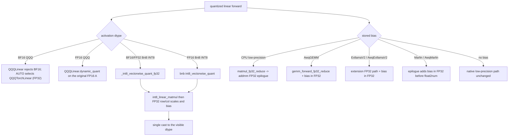
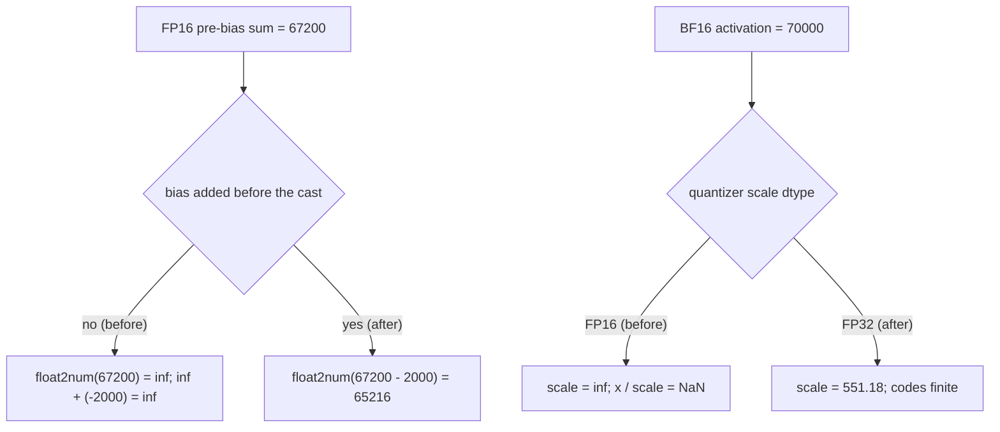

# FP16 inference overflow and bias epilogues

Several inference paths rounded a reduction to the activation dtype before a
stored bias was added. When the pre-bias sum exceeded the dtype range (for
example `128 * 12.5 * 42 = 67200` in FP16) the visible result became `inf` even
though the biased result (`65200`) was representable. Two other paths narrowed
BF16/FP32 activations to FP16 before quantizing them, so any magnitude above
65504 became `inf` or `NaN`.

This page describes the contract these paths now follow. It was introduced in
PR #4001 (issue #3977).

## Contract

1. A reduction that will receive a stored bias keeps the partial sum in FP32
   until the single visible cast. The bias is never added to an
   already-rounded value.
2. An activation quantizer derives its row scale from the source dtype in FP32.
   A BF16/FP32 activation is never narrowed to FP16 first.
3. A native kernel that can only write the activation dtype is not used with a
   stored bias when the pre-bias sum can overflow; the module asks for an FP32
   output (or the extension's FP32 path) and casts once.

## New flow

## Before / after

| Path | Before | After |
| --- | --- | --- |
| `QQQLinear.forward` | Cast `A` to FP16, then `dynamic_quant`; `SUPPORTS_DTYPES` included BF16 | BF16 rejected by the native kernel; `QQQTorchLinear` (AUTO for BF16) computes in FP32. FP16 bias added in FP32 |
| `BitsAndBytesLinear` INT8 | `int8_vectorwise_quant(x.to(float16))` and an FP16 `int8_mm_dequant`; weight packed through `weight.to(float16)` | `_int8_vectorwise_quant_fp32` for BF16/FP32, FP32 weight scale, FP32 `mm * x_stats * weight_scb / 127**2 + bias` epilogue |
| `matmul_fp32_reduce` (`_numerics.py`) | ROCm-only `_can_fuse_hip_bias`; CPU rounded before the bias | `_can_fuse_hip_bias` also covers CPU; `addmm` keeps the sum and bias in FP32 |
| CPU `TorchAten`/`TorchAtenAwq`/`TorchFusedAwq`/`AwqTorch` | `out.add_(self.bias)` after an FP16 matmul or fused op | biased layers use `matmul_fp32_reduce`; unbiased layers keep the fused kernel |
| CPU `TorchCpuAvx512Awq` train path | `out.add_(self.bias)` after the BF16 matmul | `matmul_fp32_reduce` |
| `AwqGEMMLinear` | rows > 1024 used `torch.matmul`; native path added bias after the cast | large-M uses `matmul_fp32_reduce`; native path uses `gemm_forward_fp32_reduce` + FP32 bias |
| `ExllamaV2Linear` / `AwqExllamaV2Linear` | native kernel wrote FP16, then `out.add_(self.bias)` | biased layers use the extension's FP32 path (transient weight reconstruction, no retained cache), add bias in FP32, cast once |
| `Marlin`/`AwqMarlin` epilogue (`marlin_template.h`) | `res = float2num(c)` then `__hadd2(res, bias)` | per-column scale and bias are applied in FP32 before the single `float2num` |

## Failure contract

## Tests

`tests/test_inference_fp16_overflow.py` pins the issue's `65200` repro for
`matmul_fp32_reduce`, CPU ATen/AWQ/fused paths, ExllamaV2/AwqExllamaV2,
Marlin/AwqMarlin, and both AwqGEMM row bands, plus the BF16 QQQ and
BitsAndBytes INT8 activation repros. `tests/kernels/test_marlin_fp32_schedule.py`
now compares against the FP32-before-cast epilogue.

## Trade-off

Biased ExllamaV2 layers take the extension's FP32 path, which reconstructs the
FP16 weight transiently per call; the reconstruction is not retained (see
`temp_dq_size() == 0`). Unbiased layers keep the native FP16 kernel.
