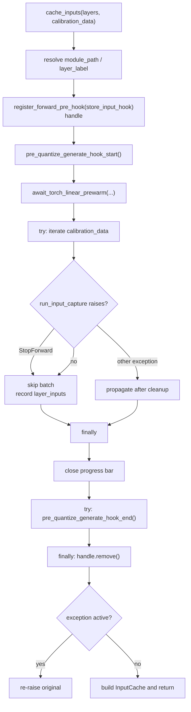

# Input capture cleanup lifecycle

`StageInputsCapture.cache_inputs()` runs one short calibration forward over the
first decoder layer to cache its inputs. That forward needs model state that the
normal quantization path does not: the multimodal side modules must be
materialized onto the forward device, and a first-layer pre-hook must be
attached to abort the forward after one layer.

Both are temporary. The model-specific hook
(`pre_quantize_generate_hook_start()` / `pre_quantize_generate_hook_end()`) owns
the module placement, and this stage owns the pre-hook handle. Whatever happens
during the calibration forward, both must be released before the call returns.

## Why the cleanup is shaped this way

The capture forward is the single place in the quantization run that
deliberately mutates model placement for a bounded window. If the release is
skipped:

- multimodal modules stay on the forward device, so later stages see a model
  that was never put back, and a resumed or retried run starts from a mutated
  model;
- the first-layer pre-hook stays registered, so the next forward through that
  layer aborts early with `StopForward` at the wrong time.

A calibration forward can raise for ordinary reasons: an unsupported input
layout, an out-of-memory condition on the chosen device, or a model-specific
`run_input_capture` override that does not handle the batch. Those failures must
not leave the model mutated, so cleanup is a `finally` obligation rather than a
success-path step.

## Current flow

The nested `try` around `pre_quantize_generate_hook_end()` keeps the two
obligations independent: a model-specific release that raises still detaches the
pre-hook, and the original calibration exception is not replaced by a cleanup
failure.

## Failure and ambiguity contract

| Situation | Before this change | After |
| --- | --- | --- |
| Calibration forward succeeds | hook end runs, handle removed | unchanged |
| Forward raises a non-`StopForward` error | hook end **skipped**, handle **leaked** | hook end and handle removal both run, original exception re-raised |
| Model-specific hook end raises | n/a (already unreachable on failure) | handle still removed, hook-end error propagates |
| `offload_to_disk=True` capture | hook end offloads modules to disk | unchanged |
| `offload_to_disk=False` capture | hook end moves modules to CPU | unchanged |

## Model-side contract

A definition that overrides `pre_quantize_generate_hook_start()` must register
the materialized modules back under their original attribute names, and its
`pre_quantize_generate_hook_end()` must release them by that name. Passing a
module object to `setattr()` raises
`TypeError: attribute name must be string, ...`, which is exactly the failure
mode that motivated the ERNIE 4.5 VL MoE fix.

Cleanup must not change checkpoint ownership: the set of `state_dict()` keys is
identical before and after the hook round trip. Tests assert this on a real
tiny model.

## Extension points

- `prepare_input_capture_layer()` lets a definition materialize the first layer
  differently when constructing its inputs does not execute the layer body.
- `begin_input_capture_example()` / `end_input_capture_example()` bracket each
  batch and are called inside the loop; they do not replace the per-capture
  start/end hooks.

## References

Introduced for the ERNIE 4.5 VL MoE offload-hook fix (PR #3750).
