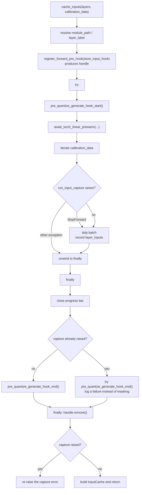

# Input capture cleanup lifecycle

`StageInputsCapture.cache_inputs()` runs one short calibration forward over the
first decoder layer to cache its inputs. That forward needs model state that the
normal quantization path does not: the multimodal side modules must be
materialized onto the forward device, and a first-layer pre-hook must be
attached to abort the forward after one layer.

Both are temporary. The model-specific hook
(`pre_quantize_generate_hook_start()` / `pre_quantize_generate_hook_end()`) owns
the module placement, and this stage owns the pre-hook handle. Whatever happens
during the calibration forward, both must be released before the call returns.

## Why the cleanup is shaped this way

The capture forward is the single place in the quantization run that
deliberately mutates model placement for a bounded window. If the release is
skipped:

- multimodal modules stay on the forward device, so later stages see a model
  that was never put back, and a resumed or retried run starts from a mutated
  model;
- the first-layer pre-hook stays registered, so the next forward through that
  layer aborts early with `StopForward` at the wrong time.

A calibration forward can raise for ordinary reasons: an unsupported input
layout, an out-of-memory condition on the chosen device, or a model-specific
`run_input_capture` override that does not handle the batch. Those failures must
not leave the model mutated, so cleanup is a `finally` obligation rather than a
success-path step.

## Current flow

Both mutations are acquired inside the same `try`: the pre-hook handle is
registered just before it, and `pre_quantize_generate_hook_start()` runs as the
first statement inside it. A start hook that raises partway through therefore
still unwinds through the `finally`, so a half-materialized model is not left
behind with a live pre-hook.

The `try`/`finally` around `pre_quantize_generate_hook_end()` keeps the two
obligations independent: a model-specific release that raises still detaches the
pre-hook.

### Capture-versus-release precedence belongs to the call, not the thread

The precedence decision ("a release failure is logged only when the capture was
already raising") is recorded by this `try` statement's own `except` clause, not
read from `sys.exc_info()` inside the `finally`. `sys.exc_info()` is thread
state: inside a caller's `except` block — a retry loop, `requantize()`, an
application handler — it reports the caller's exception even when this capture
completed successfully. Reading it there would mark a successful capture as
failed and silently swallow a real release error.

## Failure and ambiguity contract

| Situation | Before this change | After |
| --- | --- | --- |
| Calibration forward succeeds | hook end runs, handle removed | unchanged |
| Forward raises a non-`StopForward` error | hook end **skipped**, handle **leaked** | hook end and handle removal both run, the capture error propagates |
| Hook start raises partway through | handle **leaked**, model left half-materialized | handle removed, start error propagates |
| Model-specific hook end raises, nothing else in flight | n/a (unreachable on the failure path) | handle removed, the release error propagates |
| Model-specific hook end raises while the capture is already failing | n/a | handle removed, the release error is logged, the capture error propagates |
| `offload_to_disk=True` capture | hook end offloads modules to disk | unchanged |
| `offload_to_disk=False` capture | `TypeError: attribute name must be string` at hook end | unchanged (modules moved to CPU by name) |
| Partially materialized module (start hook raised mid-move) | not reachable: the start error escaped before hook end ran | materialized leaves moved to CPU, `meta` leaves left as-is, start error propagates |

## Model-side contract

A definition that overrides `pre_quantize_generate_hook_start()` must register
the materialized modules back under their original attribute names, and its
`pre_quantize_generate_hook_end()` must release them by that name. Passing a
module object to `setattr()` raises
`TypeError: attribute name must be string, ...`, which is exactly the failure
mode that motivated the ERNIE 4.5 VL MoE fix.

A release must also be *total*. Two states look alike but need different
handling:

- A module that never left the checkpoint is still entirely on `meta` with no
  Accelerate offload hook to restore it, and `move_to()` deliberately raises for
  that state. Skipping it keeps an unrelated configuration from turning into a
  cleanup error.
- A module can also be *partially* materialized: a start hook that raises
  partway through a device move (an OOM while materializing the vision tower)
  leaves already-moved leaves on the forward device next to untouched `meta`
  ones. That module also trips the `is_meta_module()` test, but it does have
  real tensors to release. Skipping it leaks them onto the accelerator for the
  rest of the run, so the release moves only its materialized leaves and leaves
  the `meta` ones in place.

A definition must handle both: never turn the all-`meta` case into an error, and
never skip the real tensors of a partially materialized module.

Cleanup must not change checkpoint ownership: the set of `state_dict()` keys is
identical before and after the hook round trip. Tests assert this on a real
tiny model.

## Extension points

- `prepare_input_capture_layer()` lets a definition materialize the first layer
  differently when constructing its inputs does not execute the layer body.
- `begin_input_capture_example()` / `end_input_capture_example()` bracket each
  batch and are called inside the loop; they do not replace the per-capture
  start/end hooks.

## References

Introduced for the ERNIE 4.5 VL MoE offload-hook fix (PR #3750).
