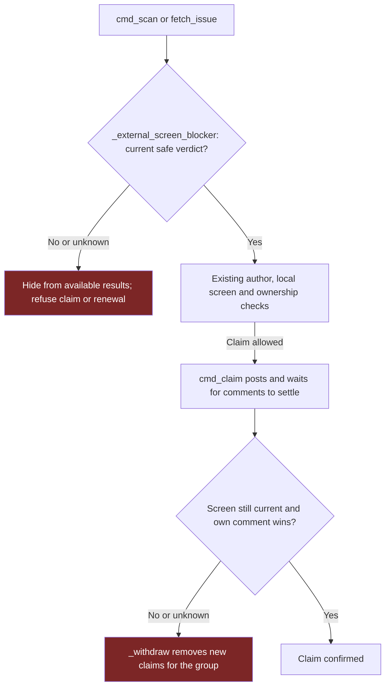

<!-- SPDX-FileCopyrightText: 2026 ModelCloud.ai
SPDX-License-Identifier: Apache-2.0 -->

# Issue-claim security gate

GPT-QModel's claim helper requires a current verdict from the **Public Repos
external issue security screen** in addition to the author policy and local
content checks. An issue's author does not get to opt out of the screen.

| Decision | Before | Now |
| --- | --- | --- |
| Offer an issue in `scan --available` | Maintainer author, local findings and claim state | Same checks, only after `_external_screen_blocker` verifies the external verdict |
| Keep a claim | Local eligibility before posting; oldest live claim wins | Screen required on every member before writing and again after comments settle; oldest live claim still wins |
| Continue or publish | Live claim owned by this session | `heartbeat` and `verify` also refuse a revoked or stale verdict; `release` still works |

Both `scanned` and `safe` must be attached, with no `unsafe`. The latest
application of each must be attributable to the security screen's GitHub App
and later than any title or body edit. If GitHub's recent timeline does not
establish that, the helper blocks the claim. The timeline identifies the app,
not which automation run used it. Reserve these labels for the external
screen; do not apply them manually. A safe verdict only covers the reviewed
title and body; it does not make links, attachments or comments safe to use.

On a public repository, anyone can read the labels. Ordinary issue reporters
cannot apply or remove them; [Triage access or higher](https://docs.github.com/en/issues/using-labels-and-milestones-to-track-work/managing-labels#applying-a-label)
or an authorized integration is required. GitHub does not make individual
labels exclusive to the screening automation.

The configured automation screens newly opened outside-author issues only.
The existing maintainer-only default for claims remains: outside-author
issues require explicit user direction even when screened, and maintainer
issues are not exempt from the external verdict. Thus the current automation
does not supply automatic claim candidates. See the
[claim workflow](../.agents/skills/gptqmodel-issue-claims/SKILL.md#workflow)
for the local checks and user-authorized exceptions.
