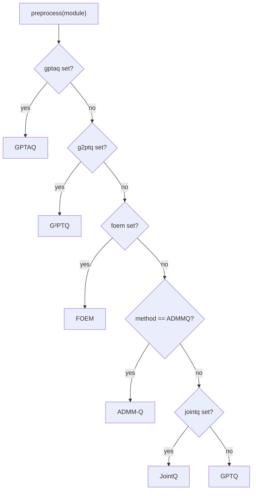
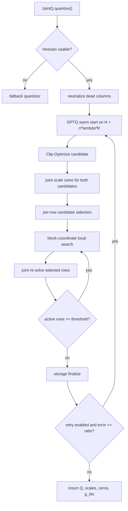

# JointQ joint scale-and-integer refinement

[Documentation index](README.md) · [Project overview](../README.md)

JointQ is an opt-in refinement of a GPTQ solution. GPTQ chooses each group
scale from the weight range before it assigns any integer in that group, and
never revisits the scale afterwards. JointQ instead treats the per-group
scales and the integer codes as coupled variables: it keeps a GPTQ warm start,
builds a clipping-based second candidate, refits every candidate's scales
jointly with its integers fixed, and then runs a block-coordinate local search
that re-scores each candidate move with the best-response scale of the affected
group.

The checkpoint layout does not change. JointQ still writes GPTQ
`qweight`/`qzeros`/`scales`/`g_idx` tensors with the fixed zero point
`2**(bits - 1)`, so the existing kernels, loaders and writers are reused. The
option is recorded in `meta.jointq`; `quant_method` remains `gptq`.

Reference: Keiji Kimura and Yuma Ichikawa, *JointQ: Joint Scale-and-Integer
Quantization for Large Language Models*, [arXiv:2611.20384](https://arxiv.org/abs/2611.20384)
(2026), Fujitsu Limited.

`gptqmodel/quantization/jointq.py` is a clean-room implementation written from
the paper. No code was copied from the authors' reference implementation in
[FujitsuResearch/OneCompression](https://github.com/FujitsuResearch/OneCompression).

## Usage

JointQ is nested inside `GPTQConfig` exactly like `foem` and `gptaq`:

```python
from gptqmodel import CalibrationConfig, GPTQConfig, GPTQModel
from gptqmodel.quantization import JointQConfig

model = GPTQModel.load(
    "Qwen/Qwen3-0.6B",
    GPTQConfig(
        bits=4,
        group_size=128,
        desc_act=False,
        damp_percent=0.01,
        jointq=JointQConfig(),
    ),
)
model.quantize(CalibrationConfig(dataset=calibration, batch_size=1))
model.save("Qwen3-0.6B-JointQ-4bit")
```

`jointq` accepts a `JointQConfig`, a plain `dict`, `True` for the defaults, or
`False`/`None` to disable it. The same shapes are accepted by `dynamic`
overrides:

```python
GPTQConfig(
    bits=4,
    group_size=128,
    jointq=JointQConfig(),
    dynamic={
        "model.layers.0.self_attn.v_proj": {
            "jointq": {"regularization": 0.15, "dtype": "float32"},
        },
    },
)
```

The option serializes to `meta.jointq` in `config.json`, reloads through both
config factories, and is re-validated after every per-module override.

## Configuration

| Field | Default | Meaning |
| --- | --- | --- |
| `regularization` | `"paper"` | Layer-type strength from the paper's Table 6, or a non-negative float. `0` disables the regularized objective. |
| `eta` | `0.5` | Exponent of the diagonal regularization weight `(h_ii / mean(h)) ** eta`. |
| `adaptive_retry` | `None` | Re-run layers whose resolved `regularization` is `0` when the relative weight error reaches `retry_ratio`. `None` follows the paper: enabled for 3-bit and above, disabled for 2-bit. |
| `retry_ratio` | `0.2` | Relative weight error that triggers the adaptive retry. |
| `retry_regularization` | `0.01` | Regularization strength used by the retry. |
| `tolerance` | `1e-12` | Strict-improvement and scale-solve acceptance tolerance. |
| `inner_stall_fraction` | `0.1` | Integer search stops when at most this fraction of rows still improves. |
| `outer_active_fraction` | `0.1` | Local search stops when fewer than this fraction of rows remain active. |
| `re_solve_low` | `0.2` | Rows whose group-change count is below `re_solve_low * T` are re-solved. |
| `re_solve_high` | `0.6` | Rows whose group-change count is above `re_solve_high * T` are re-solved. |
| `max_iterations_per_group` | `None` | Cap on best-improvement moves per group; `None` uses `10 * group_size`. |
| `max_passes` | `100` | Maximum block-coordinate passes. |
| `device` | `"auto"` | Solver device. `"auto"` follows the Hessian device; `"cpu"` is the memory escape hatch. |
| `dtype` | `"float64"` | Solver dtype, `"float64"` or `"float32"`. FP64 is probed at runtime and falls back to FP32 when the device lacks FP64 linear algebra. |

The GPTQ warm start inherits the run's `damp_percent`, `mse`, `desc_act` and
`act_group_aware` settings. A paper reproduction uses `damp_percent=0.01`,
`mse=0`, `desc_act=False` and `act_group_aware=False`; the defaults here follow
the repository's GPTQ defaults instead of silently overriding the caller.

## Algorithm

For one output row `w`, groups `G_t`, centered integers `q_j` and group scales
`s_t`, JointQ minimizes

```text
phi(s, q) = (w - sum_t s_t a_t) H~ (w - sum_t s_t a_t)^T,
```

where `a_t` is the zero-padded integer vector of group `t` and
`H~ = H + n * lambda * R` is the regularized Hessian.

1. **Warm start.** GPTQ runs first on a private FP32 copy of `H~`. Its
   reconstruction supplies the first candidate and the initial `g_idx` layout.
2. **Clip-Optimize candidate.** Each group starts from the min-max scale
   `max|w_G| / (L - 1)` and the best-improvement `+-1` integer search of
   Algorithm 2. Every candidate move is scored with the group's best-response
   scale

   ```text
   sigma = (a_t H~ r_t^T) / (a_t H~ a_t^T),
   ```

   where `r_t` is the residual left by the other groups. The search accepts
   only strict improvements, prefers `+1` on ties, and recomputes the final
   `beta`/`gamma` from the returned integers.
3. **Joint scale solve.** With the integers fixed, Theorem 3.1 gives the
   globally optimal active scales

   ```text
   s_I = w H~ A_I^T (A_I H~ A_I^T)^(-1),
   ```

   and zero for inactive groups. Singular or FP16-unrepresentable rows are
   retried with diagonal damping; a row that still fails keeps its previous
   scale. A candidate is installed only when it lowers that row's objective.
4. **Candidate selection.** Both candidates are refit with step 3 and compared
   per output row on the exact row objective. The clipping candidate wins ties.
5. **Local search (Algorithm 1).** Groups are visited in order. Each group runs
   the best-response integer search, the returned pair is installed, and the
   row is counted when either the integers or the scale changed. Rows whose
   change count falls outside `[re_solve_low, re_solve_high] * T` are re-solved
   with the full joint system. A pass ends when fewer than
   `outer_active_fraction` of the rows improved.
6. **Regularization and retry.** `R = diag((h_ii / mean(h)) ** eta)` and the
   layer-type strengths come from Table 6. Layers assigned `lambda = 0` whose
   relative weight error reaches `retry_ratio` are re-run once with
   `retry_regularization`; the paper disables this retry for 2-bit.
7. **Storage.** The integers are recovered with the packer's exact FP32
   arithmetic, `round((W + zero * scale) / scale)` clamped to the codebook, so
   replay and the checkpoint cannot disagree. Zero-scale groups pin their codes
   to the fixed zero point and install `2**-24` as the scale. Groups whose
   refined scale cannot be stored in FP16 fall back to the GPTQ candidate for
   that row and group.

Scales may be negative: the paper allows `s_t` in the reals (Section 3.1), and
the GPTQ layout stores them as FP16 and applies them multiplicatively. The
Torch, Marlin and TritonV2 kernels were exercised with a negative scale and
match the same dequantized reference as with a positive scale.

## Flow

The processor selects JointQ after GPTAQ, G²PTQ, FOEM and ADMM-Q, and before plain GPTQ:



The solver pipeline and its retry boundary:



### Before and after

| Area | Before | After (JointQ enabled) |
| --- | --- | --- |
| Processor selection | `gptaq -> g2ptq -> foem -> admmq -> gptq` | `gptaq -> g2ptq -> foem -> admmq -> jointq -> gptq` |
| Hessian capture cohort | GPTAQ, FOEM or GPTQ signature | Adds `("jointq", columns, accumulation settings)`; the cohort shares `H` only and never joins a plain GPTQ group |
| Group scales | fixed from the pre-quantization range | re-solved jointly with the integers |
| Integer assignment | one greedy column pass | warm start plus best-improvement `+-1` search |
| Reported layer loss | diagonal approximation | exact row quadratic form on the raw Hessian |
| Checkpoint metadata | `meta.foem` / `meta.gptaq` | Adds `meta.jointq` |
| Diagnostics | `foem_*` state | `state["jointq_diagnostics"]` |

## Compatibility

- **Supported:** symmetric integer GPTQ at 2–8 bits, any `group_size` the GPTQ
  layout supports (`-1` for per-channel), `desc_act` and `act_group_aware`
  on or off, dense linear projections, MoE expert linears, and adapters/EoRA
  applied after quantization.
- **Rejected with a clear error:** `sym=False`, `static_groups=True`,
  `mock_quantization`, `gptaq`, `g2ptq`, `foem`, enabled per-linear GSQ, staged GSQ
  training, embeddings, tensor-parallel padded projections, EXL3 and
  weight-only formats, and the DeepSeek V4.1 projection port.
- **Memory:** the solver keeps an FP64 `p x p` Hessian (twice the FP32 copy)
  plus FP64 `m x p` reconstruction and difference tensors. This is intended
  for 7B–14B-class layers; `device="cpu"` and `dtype="float32"` trade speed for
  memory on very wide projections.
- **Search quality:** the local search is a heuristic. It never increases a
  row's objective relative to its warm start, but it is not a global optimum of
  the integer problem. The paper's separation example (Proposition 3.5) is
  reproduced by the solver tests.

## Validation

```bash
pytest tests/qcfg/test_jointq_config.py tests/test_jointq_solver.py tests/test_jointq_e2e.py
format/check.sh
```

`tests/test_jointq_e2e.py` quantizes a tiny Llama through the full pipeline, saves
and reloads it, and checks the GPTQ layout, `meta.jointq`, reloaded logits and
greedy generation. The solver tests use independent oracles: a closed-form scale solution, the
paper's separation-instance bound, a direct objective evaluation, and the
packer's own code-recovery arithmetic.

## Citation

```bibtex
@article{kimura2026jointq,
  title   = {JointQ: Joint Scale-and-Integer Quantization for Large Language Models},
  author  = {Kimura, Keiji and Ichikawa, Yuma},
  journal = {arXiv preprint arXiv:2611.20384},
  year    = {2026}
}
```

The method was introduced by Keiji Kimura and Yuma Ichikawa at Fujitsu
Limited. This repository's implementation is independent and was written from
the paper; the authors' MIT-licensed reference implementation is the JointQ
quantizer in the [OneComp library](https://github.com/FujitsuResearch/OneCompression).
See [attributions and citations](citations.md) for the full credit list.
