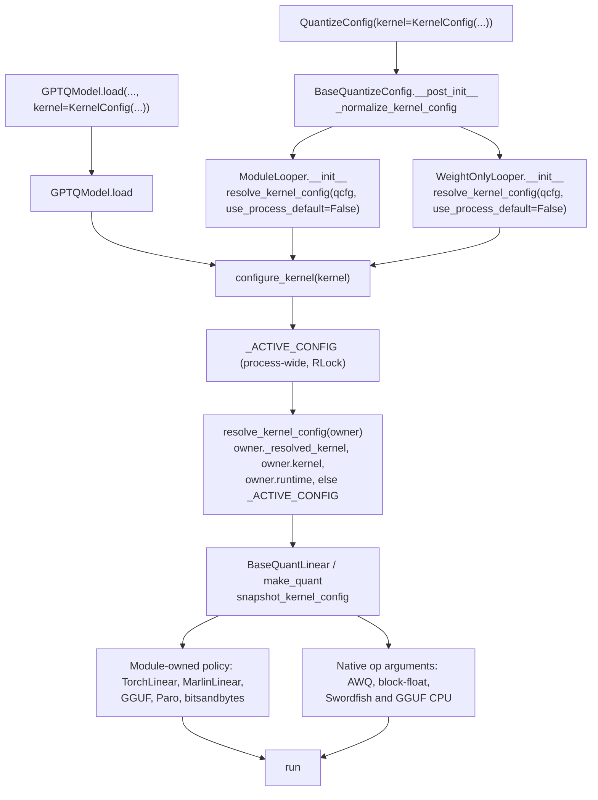
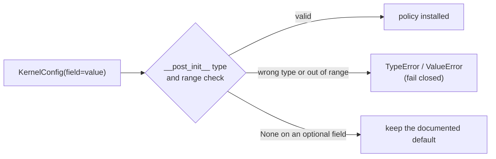
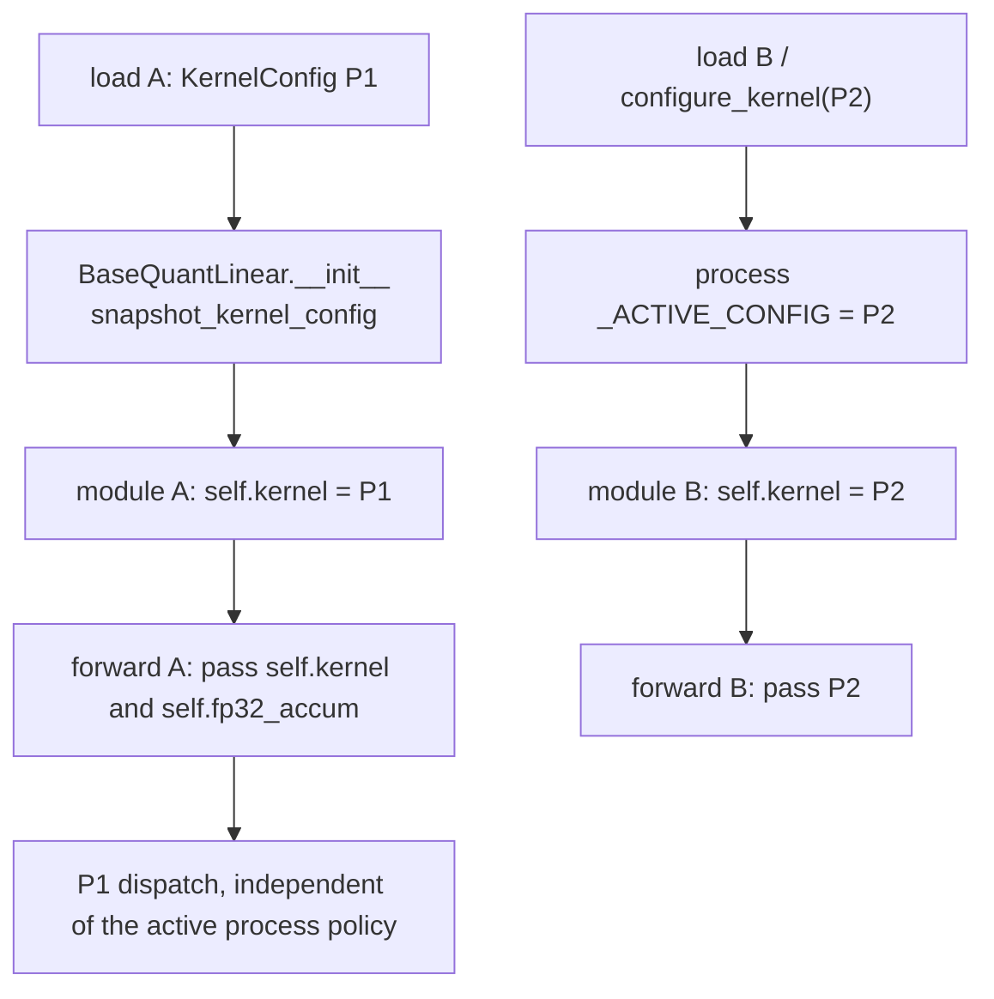

# Backend configuration and thread selection

Use `backend=` for both execution selection and backend-specific settings.
An enum/string selects defaults; a typed configuration selects its own backend
with custom settings. See [Backend selection and configuration](backend-selection.md)
for the complete API, available types, resolution diagrams and compatibility rules.

```python
from gptqmodel import GPTQModel
from gptqmodel.backend import BACKEND, MarlinConfig, RuntimeConfig
from gptqmodel.quantization import QuantizeConfig

qcfg = QuantizeConfig(
    bits=4,
    group_size=128,
    runtime=RuntimeConfig(max_packers=2),
)
model = GPTQModel.load("org/model", backend=BACKEND.MARLIN)  # Default settings
model = GPTQModel.load("org/model", backend=MarlinConfig(fp32=False))
```

`BackendConfig` is the abstract base for the concrete, immutable backend
configurations. A caller cannot give `MarlinConfig` another backend identity.
`RuntimeConfig` holds shared quantizer and host controls, and is accepted by
loaders as `runtime=` or on `QuantizeConfig` as above.

The remaining fields below describe the legacy `KernelConfig` adapter.
Existing `kernel=` calls remain supported with enum/string backend selectors:

```python
from gptqmodel import GPTQModel
from gptqmodel.utils.kernel import KernelConfig

model = GPTQModel.load(
    "org/model",
    backend=BACKEND.MARLIN,
    kernel=KernelConfig(marlin_fp32=False, torch_streaming=True),
)
```

A plain mapping with the same keys is accepted anywhere a `KernelConfig` is.
Combining a typed backend configuration or `runtime=` with legacy `kernel=`
raises `ValueError`; it would supply two competing policies. The rule is the
same whether each one is a call argument or a `QuantizeConfig.kernel` /
`QuantizeConfig.runtime` field. `configure_kernel(KernelConfig(...))` installs
a process-wide policy directly, and `None` restores the documented defaults.
Every `GPTQModel.load` and both quantization loopers install the policy their
own config resolves to, so a policy installed by hand before them does not
survive; put run settings on `QuantizeConfig.runtime` or pass them to the load.

## Legacy adapter flow

Before the explicit-policy adapter, a decision was made by reading the process environment at
the point of use: a worker thread could change it, a test could only reach it
through `monkeypatch.setenv`, and the same checkpoint could take a different
numerical path in a different process. `KernelConfig` moves the decision to a
single explicit object that the caller owns.



Two precedence rules are worth stating explicitly, because they are the
contract a reviewer has to check:

- A quantize config's own policy wins over the process policy: the policy its
  last load or `quantize()` resolved, else its `kernel`, else its `runtime`. A
  caller that holds the config never inherits another run's tuning, and the
  resolved policy is never written back to `QuantizeConfig.kernel`.
- `configure_kernel(None)` restores the documented defaults; it does not leave
  the previous policy in place.

The failure path is the important one. A value that cannot be honoured is
rejected at construction rather than clamped, so a typo cannot silently select
a different numerical path:



### Mechanism replaced

| Old mechanism | Location (before) | Replacement |
| --- | --- | --- |
| `env_flag("GPTQMODEL_DISABLE_GPTQ_CUDA")` | `quantization/gptq.py:2490`, `quantization/qqq.py:885` | `KernelConfig.gptq_fused_block_update` |
| `os.getenv("GPTQMODEL_NPU_CHOLESKY_BLOCK_SIZE")` at import | `quantization/npu_linalg.py:9` | `KernelConfig.npu_cholesky_block_size` passed per call |
| `os.environ.get("GPTQ_TORCH_*")` | `nn_modules/qlinear/torch.py:245-276` | `KernelConfig.torch_*` |
| `env_flag("GPTQMODEL_MARLIN_USE_FP32")` | `nn_modules/qlinear/marlin.py:158` | `KernelConfig.marlin_fp32` |
| `env_flag("GPTQMODEL_FP32_ACCUM")` | `gemm_awq.py:30`, `gemm_awq_triton.py:32`, `quantization/awq/**/gemm.py:28`, `quantization/paro/**/gemm.py:32` | `KernelConfig.fp32_accum` |
| `os.getenv("GPTQMODEL_AWQ_TRITON_SCHEDULE")` at import | `quantization/awq/modules/triton/scheduler.py:27` | `KernelConfig.awq_triton_schedule` |
| `GPTQMODEL_GGUF_FUSED_*`, `GGUF_CPP_NATIVE_MATMUL`, `GGUF_CPP_THREADS` | `qlinear/gguf.py:1197-1215`, `qlinear/gguf_cpp.py:445,1190` | `KernelConfig.gguf_*` |
| `GPTQMODEL_INTERNAL_GGUF_QUANTIZED_LOADER`, `..._TORCH_LOADER`, `..._DEQUANT_DEVICE`, `..._DEQUANT_MAX_BYTES` | `models/loader.py`, `utils/hf.py:699`, `utils/internal_gguf.py:281,314` | `KernelConfig.gguf_native_quantized_loader`, `gguf_torch_dequant_loader`, `gguf_dequant_device`, `gguf_dequant_chunk_bytes` |
| `GPTQMODEL_PARO_*` behaviour switches | `qlinear/paro.py:53-66`, `paro_triton.py:66-70`, `quantization/paro/**` | `KernelConfig.paro_*` |
| `GPTQMODEL_PARO_ROTATE_AUTOTUNE_*` timing knobs | `gptqmodel_ext/paro/rotation.cu` | internal constants; `KernelConfig.paro_rotate_autotune` / `_cta_m` / `_row_pad` select behaviour |
| `GPTQMODEL_BITSANDBYTES_*`, `GPTQMODEL_BNB_TRITON`, `GPTQMODEL_DISABLE_BITBLAS` | `qlinear/bitsandbytes.py:49,57`, `bitsandbytes_triton.py:109`, `bitblas.py:115` | `KernelConfig.bitsandbytes_*`, `disable_bitblas` |
| `GPTQMODEL_GSQ_DISABLE_*_RELAXATION` | `quantization/gsq_cuda_relaxation.py:400-403` | `KernelConfig.gsq_disable_*` |
| `GPTQMODEL_EXL3_*` | `exl3_lib/quantize.py:136`, `exllamav3_processor.py:127-130`, `utils/exl3_capture_*.py` | `KernelConfig.exl3_*` |
| `GPTQMODEL_ROCM_QUANT_BLAS`, `GPTQMODEL_NO_ROCM_LLC` | `utils/rocm.py`, `rocm_llc.py:414` | `KernelConfig.rocm_quant_blas`, `rocm_llc` |
| `GPTQMODEL_FLOATX_CPU_THREADS`, `GPTQMODEL_MAX_PACKERS`, `GPTQMODEL_CPU_WORKERS`, `GPTQMODEL_CUDA_WORKERS` | `dtype.py:166`, `utils/model.py:1493`, `__init__.py:394,411` | `KernelConfig.floatx_cpu_threads`, `max_packers`, `cpu_workers`, `cuda_workers` |
| `GPTQMODEL_CPU_BF16X3`, `GPTQMODEL_EXL3_CPU_BF16X3` | `utils/cpu_features.py:17,103`, `nn_modules/exllamav3_torch.py:35,46` | `KernelConfig.cpu_bf16x3_matmul` |
| `GPTQMODEL_FLOATX_CPU_DISABLE_AVX2`, `_AVX512` read inside `floatx_cpu.cpp` | `gptqmodel_ext/floatx_cpu.cpp:371-386` | `dequantize_fp8_cpu` / `dequantize_fp4_cpu` `simd_level` argument |
| `GPTQMODEL_AWQ_DISABLE_FUSED_SPLITK_REDUCE` | `gptqmodel_ext/awq/quantization/gemm_cuda_gen.cu:160` | `fused_splitk_reduce` argument on `gemm_forward` and `gemm_forward_fp32_reduce` |
| `GPTQMODEL_BLOCKFLOAT_NO_CUBLAS` | `gptqmodel_ext/tt_blockfloat_cuda/tt_blockfloat_cuda.cu:723` | `allow_cublas` argument on `blockfloat_linear` |
| `APHRODITE_SWORDFISH_DENSE_M`, `APHRODITE_SWORDFISH_DETERMINISTIC` | `gptqmodel_ext/swordfish/.../swordfish_mm.cu:84,106` | `dense_m_override`, `deterministic` arguments on `swordfish_mm` |

The retired variables are never read. GPT-QModel warns once for each one that
is set: at import, and again at `GPTQModel.load` / `from_pretrained` /
`from_quantized` for a variable exported after the import.

The three names in the last rows are why this change is not purely Python: a
native kernel cannot read a Python object, so the choice is passed as an op
argument on every call. That keeps the value visible in the dispatch site, and
it means a test can exercise both paths in one process.

## Lifetime and serialization

Quantized linear modules and block-float embedding tables own a snapshot of
their execution policy, because a tied output head consumes the table's policy
through the same block-float kernel. Later loads, `configure_kernel` calls and
mutations to the original legacy object do not change those modules. Shared
quantization and host utilities still use a process-wide fallback installed
before the loop or load starts. Concurrent quantization runs with different
shared runtime settings are not isolated.

Resolution snapshots the request as well: `resolve_backend_config` copies a
caller-supplied legacy `KernelConfig`, so mutating that object after
`resolve_quantize_backend` / `resolve_backend_config` returns does not change
`QuantizeConfig._resolved_kernel` or any module built from it (#4615).

### Forward dispatch reads the module snapshot

Two inference dispatch sites used to re-read the process-wide policy on every
forward, so a later `GPTQModel.load()` / `configure_kernel()` retuned modules
that had already been built:

- `bitsandbytes_triton.available_for` / `should_use` take the module's
  `kernel`; `BitsAndBytesLinear.forward` passes `self.kernel`.
- `paro_gemm_triton_decode` / `paro_gemm_triton_prefill` take an
  `fp32_accum` argument; `ParoTritonLinear` passes its resolved
  `self.fp32_accum`.



| Site | Before | After |
| --- | --- | --- |
| bitsandbytes Triton gate | `get_kernel_config().bitsandbytes_triton` at `qlinear/bitsandbytes_triton.py:109` | `kernel.bitsandbytes_triton` passed by `BitsAndBytesLinear.forward` |
| Paro Triton GEMM | `get_kernel_config().fp32_accum` at `quantization/paro/modules/triton/gemm.py:476,501` | `fp32_accum=self.fp32_accum` passed by `ParoTritonLinear` |

`kernel=None` / `fp32_accum=None` still falls back to the process policy for
helpers called without an owning module. Regression:
`tests/test_kernel_policy_snapshot_4555.py`.

`kernel` and `runtime` are runtime-only fields. Neither is written to the checkpoint, because
the host that loads a checkpoint is not necessarily the host that produced it.
The same applies to `compile`: a saved checkpoint carries the numerical
representation, not another machine's kernel tuning.

## Fields

### GPTQ and NPU

| Field | Default | Effect |
| --- | --- | --- |
| `gptq_fused_block_update` | `True` | Use the fused 128-column GPTQ block-update kernel. `False` forces the eager per-column path. |
| `npu_cholesky_block_size` | `64` | Blocked Cholesky panel width on Ascend NPU. |
| `blockfloat_cublas` | `True` | Tenstorrent block-float CUDA linear: use the cuBLAS prefill. `False` forces the fused dequant+MMA fallback. |
| `swordfish_deterministic` | `False` | Swordfish Blackwell decode: force the run-stable smem-reduction epilogue. |
| `swordfish_dense_m` | `0` | Swordfish dense-tier crossover row count. `0` keeps the measured per-SM heuristic. |

### FloatX CPU decode

| Field | Default | Effect |
| --- | --- | --- |
| `floatx_cpu_threads` | `None` | Native FloatX CPU thread count. `None` keeps the size-derived default. |
| `floatx_cpu_native_fp8` | `False` | Prefer the native FP8 decode path over the reference path. |
| `floatx_cpu_simd_level` | `2` | Highest SIMD path the FP8/FP4 CPU decode may use: `0` scalar, `1` AVX2/F16C, `2` AVX512. |
| `cpu_bf16x3_matmul` | `True` | Allow oneDNN BF16x3 FP32 matmul on CPU (EXL3 and generic CPU matmul). |

### Torch GPTQ kernel

| Field | Default | Effect |
| --- | --- | --- |
| `torch_streaming` | `False` | Stream dequantized tiles instead of materializing the whole weight. |
| `torch_stream_tile` | `512` | Column width of one streamed tile. |
| `torch_triton_dequant` | `None` | Triton dequantization. `None` follows availability. |
| `torch_rocm_gemv` | `True` | Allow the ROCm GEMV path. |
| `torch_rocm_gemm` | `True` | Allow the ROCm GEMM path. |
| `torch_cache_weights` | `False` | Legacy opt-in; dense caches are refused and warned about. |
| `torch_lookahead` | `False` | Legacy opt-in; the lookahead schedule is refused and warned about. |

### Marlin, Triton, AWQ

| Field | Default | Effect |
| --- | --- | --- |
| `marlin_fp32` | `True` | FP32 Marlin reduction. `False` uses the reduced-precision reduction. |
| `fp32_accum` | `True` | FP32 accumulation in the Triton AWQ/Paro GEMMs. |
| `awq_triton_schedule` | `"auto"` | AWQ Triton dispatch mode: `"auto"` or `"legacy"`. |
| `awq_fused_splitk_reduce` | `True` | Use the fused split-K reduce. `False` reduces through the eager `sum(0)`. |

### GGUF

| Field | Default | Effect |
| --- | --- | --- |
| `gguf_fused_cuda_max_rows` | `32` | Row ceiling for the fused CUDA forward. |
| `gguf_fused_cuda_min_matrix_elements` | `8388608` | Matrix-size floor for the fused CUDA forward. |
| `gguf_fused_cpu_max_rows` | `64` | Row ceiling for the fused CPU forward. |
| `gguf_fused_cpu_min_matrix_elements` | `0` | Matrix-size floor for the fused CPU forward. |
| `gguf_fused_chunk_blocks` | `0` | Explicit K-chunk block count. `0` uses the byte budget. |
| `gguf_fused_chunk_bytes` | `33554432` | Transient-memory budget for one K chunk. |
| `gguf_cpp_native_matmul` | `None` | Force the native ggml matmul on or off. `None` follows capability. |
| `gguf_cpp_threads` | `None` | Native ggml CPU thread count. `None` follows torch. |
| `gguf_native_quantized_loader` | `True` | Parse a single-layout GGUF checkpoint with the native reader instead of the dense Transformers import. |
| `gguf_torch_dequant_loader` | `None` | Dense import converts GGUF tensors straight to Torch. `None` follows `gguf_dequant_device`. |
| `gguf_dequant_device` | `None` | Torch device (`cpu` or `cuda[INDEX]`) for that conversion. `None` keeps the reference NumPy path. |
| `gguf_dequant_chunk_bytes` | `268435456` | Transient-memory budget for one sign-only NumPy conversion chunk. |

### Paro

| Field | Default | Effect |
| --- | --- | --- |
| `paro_cache_runtime_dtype` | `False` | Cache the typed runtime rotation state. |
| `paro_auto_cache_bf16_runtime_dtype` | `True` | Enable that cache automatically for BF16. |
| `paro_cache_rotation_dtype` | `False` | Cache typed rotation metadata. |
| `paro_auto_cache_bf16_rotation_dtype` | `True` | Enable that cache automatically for BF16. |
| `paro_cpu_avx512` | `True` | Allow the AVX512 BF16 CPU GEMM. |
| `paro_triton_autotune` | `True` | Autotune the Triton GEMM tiles. |
| `paro_triton_autotune_warmup` | `2` | Warmup launches per candidate. |
| `paro_triton_autotune_iters` | `4` | Timed launches per candidate. |
| `paro_triton_autotune_margin` | `0.05` | Relative margin a candidate must win by. |
| `paro_triton_decode_max_rows` | `8` | Largest row count that uses the decode tile. |
| `paro_sym_ste_triton` | `True` | Allow the symmetric Triton STE. |
| `paro_affine_ste_triton` | `True` | Allow the affine Triton STE. |
| `paro_affine_ste_triton_backward` | `False` | Use the Triton affine backward instead of the hybrid. |
| `paro_rotate_autotune` | `True` | Autotune the fused-rotation launch shape. |
| `paro_rotate_cta_m` | `None` | Pin the rotation CTA-M tile to `4`, `8` or `16`. |
| `paro_rotate_row_pad` | `None` | Pin the rotation row padding to `0` or `2`. |
| `paro_autotune_cache` | `True` | Persist rotation autotune results. |

The fused-rotation autotune measurement counts and thresholds are internal
constants in `gptqmodel_ext/paro/rotation.cu`; they are not environment
variables. Only the fields above select behaviour.

### bitsandbytes and BitBLAS

| Field | Default | Effect |
| --- | --- | --- |
| `bitsandbytes_cpu_packed` | `False` | Opt into the packed 4-bit CPU candidate. |
| `bitsandbytes_cpu_int8_dense` | `True` | Allow the tiled FP32 recompute over native INT8. |
| `bitsandbytes_triton` | `False` | Force the Triton bitsandbytes kernel where a measured tile exists. |
| `disable_bitblas` | `False` | Skip BitBLAS probing and selection. |

### GSQ

| Field | Default | Effect |
| --- | --- | --- |
| `gsq_disable_cuda_relaxation` | `False` | Force the eager GSQ relaxation path everywhere. |
| `gsq_disable_hip_relaxation` | `False` | Skip only the HIPRTC GSQ backend. |

### EXL3

| Field | Default | Effect |
| --- | --- | --- |
| `exl3_tile_batch` | `None` | Automatic EXL3 quantization slots per launch. A positive integer lowers the automatic limit. |
| `exl3_host_rss_limit_bytes` | `0` | EXL3 capture host-memory ceiling (`0` disables) |
| `exl3_cuda_allocation_limit_bytes` | `0` | EXL3 capture device-memory ceiling (`0` disables) |
| `exl3_memory_telemetry_interval_batches` | `0` | Batches between capture memory checks |
| `exl3_capture_batch_spool` | `None` | Durable batch-spool root |
| `exl3_capture_batch_checkpoint_interval` | `1` | Committed batches between spool checkpoints |
| `exl3_capture_frontier` | `None` | Durable capture-frontier root |

Automatic launch limits are 256 tiles for ordinary EXL3 integer encoding
and 128 for ordinary fractional encoding. Q4NX uses up to 512 tiles for
W2.5 and W3.0 final encoding and 1024 for scale search and W3.5 final
encoding. These Q4NX limits bound the per-launch path history to 16 MiB
and 4 MiB respectively. Set `exl3_tile_batch` to a smaller value to lower
temporary memory use.

### ROCm

| Field | Default | Effect |
| --- | --- | --- |
| `rocm_quant_blas` | `None` | `None` keeps the reproducible `rocblas` pin; `"hipblaslt"` opts into torch's default; `""`/`0`/`off`/`default` skip the pin. Any other value raises `ValueError`. |
| `rocm_llc` | `True` | Last-level-cache back-port for torch. |

`rocm_quant_blas` selects the quantization BLAS backend. `None` keeps the
reproducible `rocblas` default; `"hipblaslt"` opts into torch's hipBLASLt
default and is faster but not reproducible across processes. `rocm_llc` controls
the last-level-cache back-port for torch.

### Threads

| Field | Default | Effect |
| --- | --- | --- |
| `cpu_workers` | `None` | CPU worker count. |
| `cuda_workers` | `None` | Per-device worker count on CUDA/ROCm. |
| `max_packers` | `None` | Threads that pack completed modules after quantization. |
| `pool_intraop_threads` | `None` | Torch intra-op pool per device-pool worker. `None` splits the process pool across the pool's workers; `0` keeps the inherited pool. |

`None` keeps the platform-derived defaults. `max_packers` is the number of
threads that pack completed modules after quantization. All four are
`RuntimeConfig` fields. The device pool is built once per process; a later load
whose policy changes `cpu_workers`, `cuda_workers` or `pool_intraop_threads`
rebuilds it before the load continues.
`pool_intraop_threads` bounds each worker's OpenMP team, because libgomp gives
every pthread its own team: see
[Device thread pool intra-op budget](device-thread-pool-intraop-budget.md).

## Validation

`KernelConfig` rejects values that cannot be honoured instead of silently
clamping them: thread counts and tile sizes must be positive, the rotation tile
choices are fixed sets, `awq_triton_schedule` must be one of the two
documented modes, and `rocm_quant_blas` must be one of the documented
spellings (a typo such as `"hipblas_lt"` would otherwise pin rocBLAS). This keeps a typo from turning into a different numerical
path.

The same rule covers the kernels that used to read the environment inside
CUDA/C++ code: the FloatX SIMD level, the AWQ fused split-K reduce, the
Tenstorrent block-float cuBLAS prefill, and the Swordfish dense-tier and
deterministic decode switches are all op arguments derived from
`KernelConfig`.
