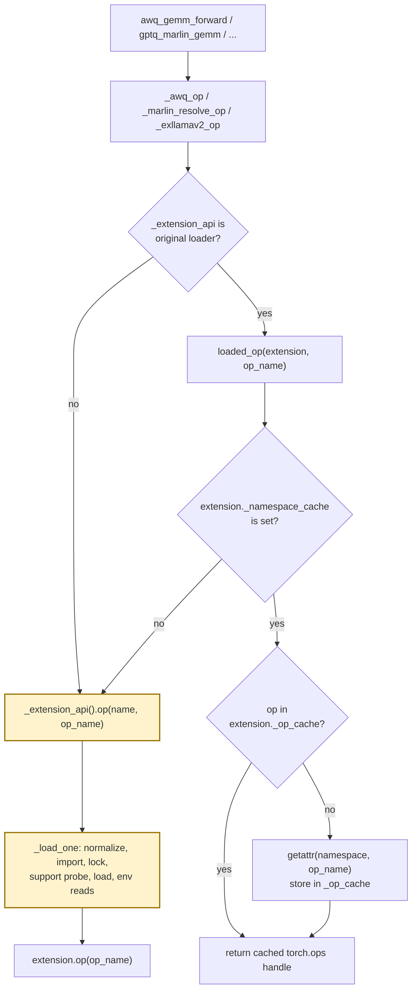
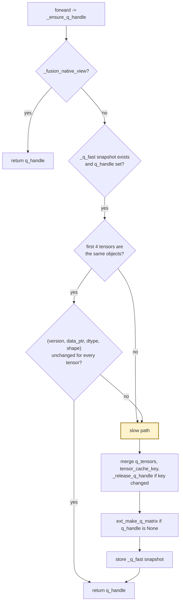
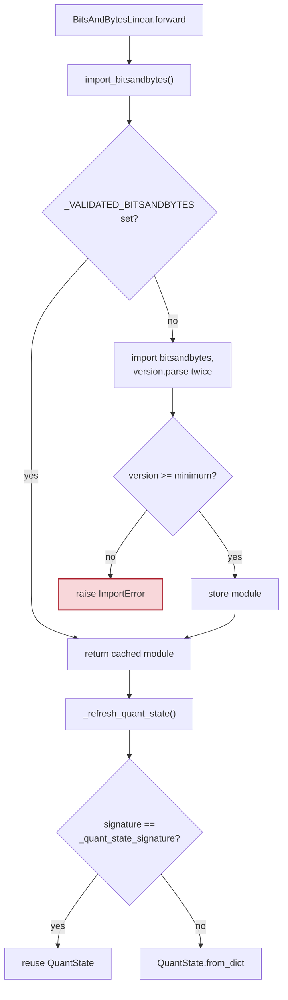
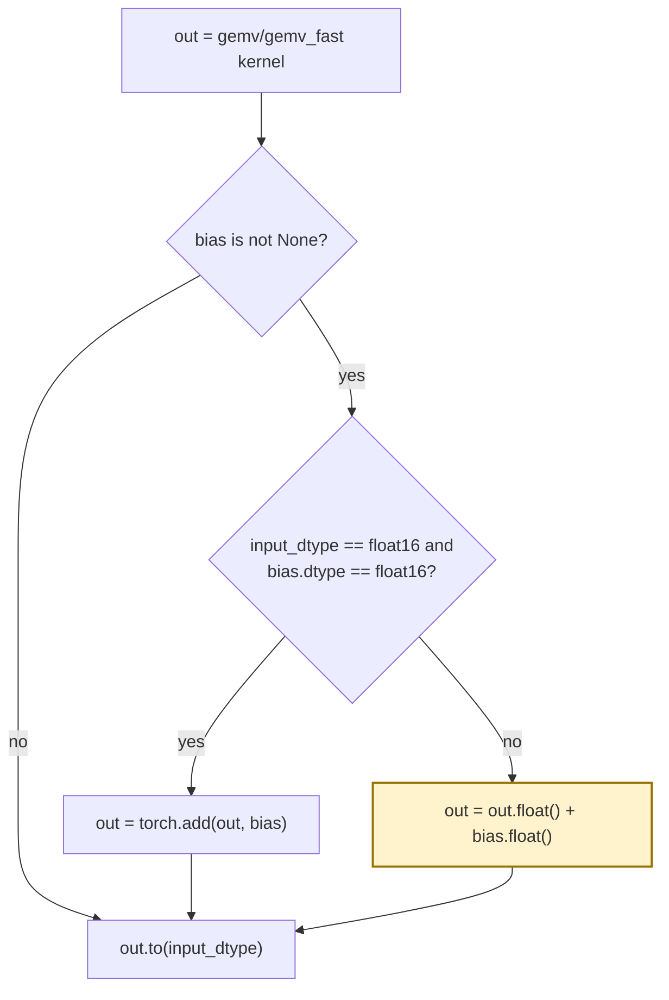

# Kernel dispatch caching

Every quantized linear forward crosses a layer of Python before the native
kernel launches. At decode batch sizes (`M = 1`) that Python work is a large
share of the per-call cost, because the GPU work is only a few microseconds.
The rule for everything on this page is: **cache only the decision, never the
result.** The same kernels receive the same arguments, so outputs stay
bitwise identical; only the host-side lookups disappear.

Introduced by the fix for issue #3983.

## 1. torch.ops handle resolution

A torch.ops handle is stable once its JIT library is loaded. Re-resolving it per
call walks the extension registry: name normalization, two `import_module`
calls, the build lock, support probes, `load()`, and the rebuild environment
reads.

`loaded_op` (`gptqmodel/utils/cpp.py:2025`) reads only the extension object's
own namespace and handle cache. `clear_cache()` resets both, so every
`clear_*_extension_cache()` invalidates the fast path.

The `_extension_api is <original>` guard exists because tests replace the
loader with a fake; a memoised handle must never shadow that fake. Each
wrapper module captures its own original loader at import time
(`_MARLIN_EXTENSION_API`, `_AWQ_EXTENSION_API`, `_EXLLAMAV2_EXTENSION_API`,
`_QQQ_EXTENSION_API`, `_MACHETE_EXTENSION_API`).

### Availability probes

`AwqGEMVFastLinear.forward` and `AwqExllamaV2Linear.forward` also resolved the
extension to answer "is the runtime available?" on every call. Each module now
records `_runtime_ok` after the first success
(`gptqmodel/nn_modules/qlinear/gemv_fast_awq.py:170`,
`gptqmodel/nn_modules/qlinear/exllamav2_awq.py:233`). A failed probe is never
memoised, so a fresh module still raises `ModuleNotFoundError`.

## 2. ExLlamaV2 q-matrix handle

`_ensure_q_handle` rebuilds a dict, merges it into `q_tensors`, and computes a
`tensor_cache_key` for every bound tensor on each forward. The native matrix
only has to be rebuilt when a packed tensor is replaced, written in place, or
swapped through `.data`.

The snapshot is refreshed only on the slow path
(`gptqmodel/nn_modules/qlinear/exllamav2.py:217`). `_release_q_handle` clears
it, so state-dict loads, `clear_weight_cache()`, and device/dtype moves all
rebuild.

Invalidation is unchanged: attribute replacement changes the object identity,
in-place writes bump `_version`, `.data =` changes `data_ptr`, and
`resize_()` bumps `_version`. Inference tensors have no version counter, which
is why the pointer and identity fields stay in the signature.

## 3. bitsandbytes validation and QuantState signature

The signature is `tuple((t.shape, t.device, t.dtype) for t in (...))`
(`gptqmodel/nn_modules/qlinear/bitsandbytes.py:597`). `torch.Size` and
`torch.device` compare by value, so this is the same predicate as the previous
`(name, shape, str(device), dtype)` tuple with one attribute lookup per tensor
instead of four. `_clear_availability_state()` clears the validated module
along with the probe and validation caches.

## 4. AWQ bias epilogue

A CUDA FP16 `add` already computes in FP32 and rounds once, so the single
kernel reproduces the widened expression exactly. BF16 inputs and mixed dtypes
keep the wide path: rounding either operand to BF16 before the add changes the
result. Implemented in `gptqmodel/nn_modules/qlinear/gemv_awq.py:231` and
`gptqmodel/nn_modules/qlinear/gemv_fast_awq.py:218`.

## Before and after

| Mechanism | origin/main | This change |
| --- | --- | --- |
| Marlin op lookup | `_extension_api().op(...)` at `utils/marlin.py:340` | `loaded_op` fast path, `utils/marlin.py:341` |
| AWQ op lookup | `_extension_api().op("awq", ...)` in every wrapper, `utils/awq.py:121-160` | `_awq_op`, `utils/awq.py:103` |
| ExLlamaV2 op lookup | `utils/exllamav2.py:256,325` | `_exllamav2_op`, `utils/exllamav2.py:194` |
| QQQ / Machete op lookup | `utils/qqq.py:115`, `utils/machete.py:797,814,838` | `_qqq_op` / `_machete_op`, `utils/qqq.py:88`, `utils/machete.py:674` |
| AWQ runtime probe | per call, `qlinear/gemv_fast_awq.py:168` | `_runtime_ok`, `qlinear/gemv_fast_awq.py:170` |
| ExLlamaV2 AWQ runtime probe | per call, `qlinear/exllamav2_awq.py:231` | `_runtime_ok`, `qlinear/exllamav2_awq.py:233` |
| ExLlamaV2 handle key | rebuild per forward, `qlinear/exllamav2.py:197` | `_q_fast` snapshot, `qlinear/exllamav2.py:217` |
| bitsandbytes version | 2 parses per forward, `qlinear/bitsandbytes.py:160` | cached module, `qlinear/bitsandbytes.py:165` |
| bitsandbytes signature | `str(device)`, 4 getattr, `qlinear/bitsandbytes.py:577` | tuple of shape/device/dtype, `qlinear/bitsandbytes.py:597` |
| AWQ bias add | 4 kernels, `qlinear/gemv_awq.py:229`, `qlinear/gemv_fast_awq.py:210` | 1 kernel for FP16, `:231` / `:218` |

## Failure and ambiguity contract

| Situation | Before | After |
| --- | --- | --- |
| Extension not loaded yet | loader builds/loads, then returns the op | `loaded_op` returns `None`, loader runs |
| `clear_*_extension_cache()` | next call reloads | next call reloads (namespace and handle cache reset) |
| Test replaces `_extension_api` | fake is used | fake is used (identity guard disables the fast path) |
| Runtime probe fails on first call | `ModuleNotFoundError` | `ModuleNotFoundError`, nothing memoised |
| Runtime probe succeeded earlier | re-probed per call | `_runtime_ok` short-circuits |
| Packed tensor replaced / written | handle rebuilt | handle rebuilt (identity / version / pointer changed) |
| `GPTQMODEL_*_FORCE_REBUILD` toggled mid-process | next `load()` rebuilds | rebuild happens on `load()` / `clear_*_extension_cache()`; cached handles are not re-validated per call |

## Measured (RTX 4090, torch 2.16.0.dev+cu130, 2000 iterations, best of 5)

| Kernel / path | before | after | change |
| --- | --- | --- | --- |
| Marlin op resolution | 5.57 us | 0.34 us | -94% |
| AWQ op resolution | 4.85 us | 0.15 us | -97% |
| ExLlamaV2 op resolution | 4.86 us | 0.16 us | -97% |
| QQQ op resolution | 4.83 us | 0.15 us | -97% |
| ExLlamaV2 `_ensure_q_handle` | 6.66 us | 2.99 us | -55% |
| bitsandbytes version check | 2.44 us | 0.08 us | -97% |
| bitsandbytes QuantState signature | 6.12 us | 1.99 us | -68% |
| AWQ GEMM 4096x4096, M=1 | 32.57 us | 23.64 us | -27% |
| AWQ GEMV 4096x4096, M=1 | 19.03 us | 12.55 us | -34% |
| AWQ GEMV_FAST 4096x4096, M=1 | 28.65 us | 16.80 us | -41% |
| AWQ bias epilogue 4096x4096 | 16.6 us | 3.9 us | -76% |

`scripts/benchmark_kernel_dispatch_overhead.py` reproduces the table on either
tree; `scripts/verify_kernel_dispatch_equivalence.py` checks the AWQ epilogue
against the pre-change expression (128 cases, 0 mismatches).

## Contracts

- The caches hold decisions, not data: a torch.ops handle, a native q-matrix
  pointer, a validated module, or a scalar signature. No dense or expanded
  weight is retained, so the quantized-storage rule is unaffected.
- Every fast path is invalidated by the same event that invalidated the slow
  path: extension `clear_cache()`, handle release, or a tensor identity /
  version / pointer change.
- When in doubt the code falls back to the loader; a missing fast-path entry is
  never an error.
