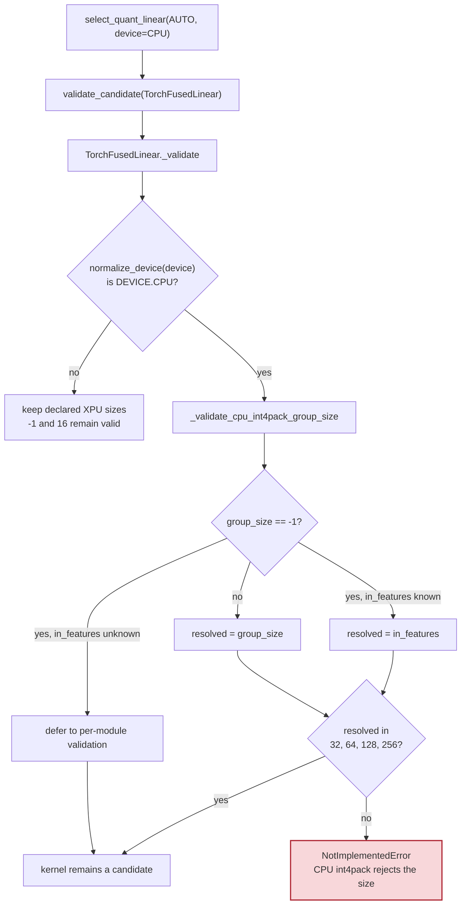
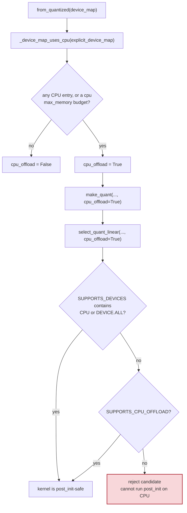
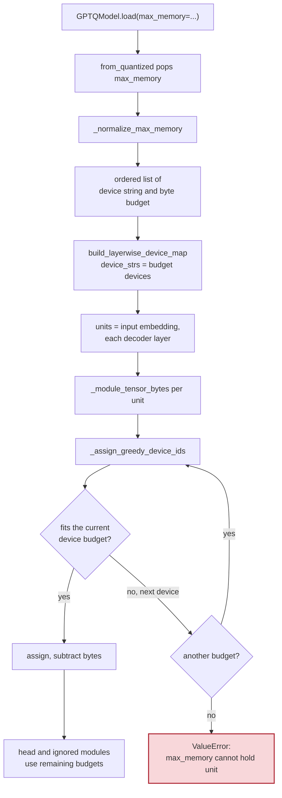
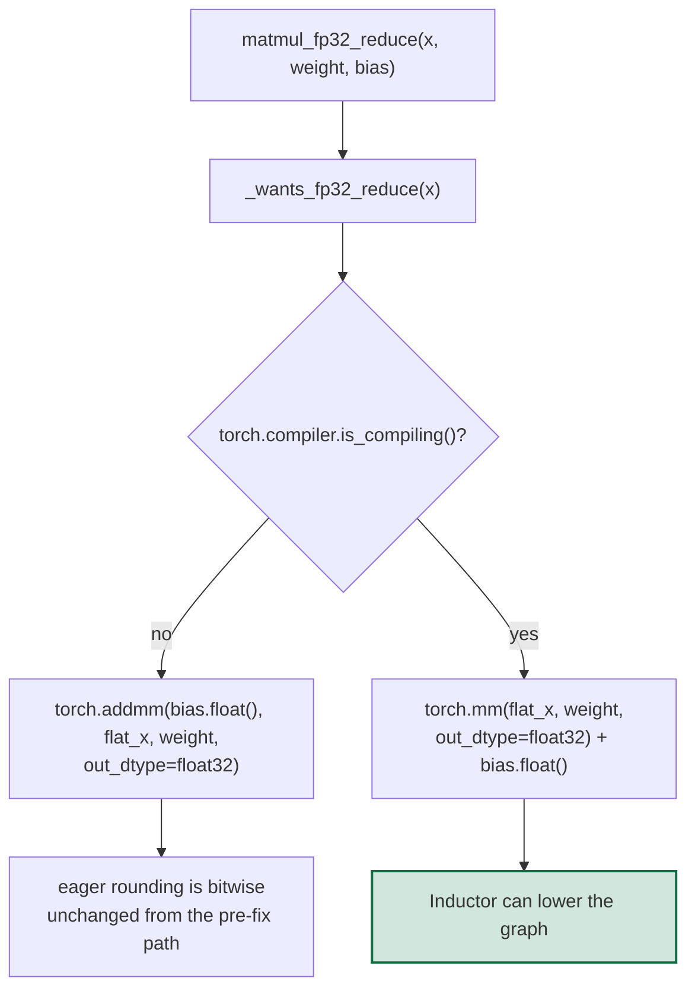

# CPU and offload kernel dispatch

This page covers the placement decisions that run before a quantized linear
executes: which CPU kernel may consume a checkpoint's group size, which kernel
may be selected when a `device_map` offloads layers to CPU, and how
`max_memory` budgets turn into a layer placement. It also records the two
`torch.compile` contracts that the same dispatch must preserve.

Introduced by the fix for issue #4054 (items 3-7). The AWQ CUDA kernels are
covered by the other half of that issue.

## 1. CPU int4pack group sizes

`TorchFusedLinear` and `TorchFusedAwqLinear` execute on CPU through
`aten::_weight_int4pack_mm_for_cpu`, which accepts only group sizes 32, 64, 128
and 256. A per-channel checkpoint (`group_size = -1`) is packed as one group per
input row, so its resolved group size is `in_features` (896 for Qwen2.5-0.5B).

The declarations used to list `[-1, 16, 32, 64, 128]` for both CPU and XPU.
`TorchAtenLinear` correctly rejected 16 and -1, so AUTO skipped it and selected
`TorchFusedLinear`; the load succeeded and the first forward raised inside the
aten op.

`select_quant_linear` then falls through to the next AUTO candidate
(`TorchCpuAvx512Linear` for g16, `TorchLinear` for a per-channel group). An
explicit `backend="gptq_torch_fused"` now fails at selection with the resolved
size instead of failing on the first forward.

## 2. CPU-offload device maps

`normalize_device_device_map` deliberately ignores CPU map entries when it picks
the accelerator family for kernel validation. The loader then runs
`gptqmodel_post_init` while the CPU-mapped layers are still on CPU; Accelerate
moves them to the execution device only for `forward`
(`simple_dispatch_model` -> `cpu_offload_with_hook`).

A CUDA-only kernel such as `MarlinLinear` or `ExllamaV2Linear` needs CUDA during
`post_init`, so it cannot serve that map. `TritonV2Linear` is CUDA-only for
execution but its `post_init` only validates `g_idx` bounds with Torch ops, so
it remains valid.

`SUPPORTS_CPU_OFFLOAD` is a separate declaration from `SUPPORTS_DEVICES`. It is
`True` on `TritonV2Linear` and `AwqGEMMTritonLinear`; the default on
`BaseQuantLinear` is `False` (fail closed). An explicit `gptq_marlin` or
`gptq_exllamav2` request with a CPU-offload map raises with the same message.

Measured on Qwen2.5-0.5B-Instruct-GPTQ-Int4 with
`model.layers.2`/`model.layers.3` mapped to `cpu`:

| Path | Kernel | Load | Logits vs explicit `gptq_triton` |
| --- | --- | --- | --- |
| AUTO, before | `MarlinLinear` | `ValueError: GPTQ Marlin requires CUDA tensors, got cpu` | n/a |
| AUTO, after | `TritonV2Linear` | loads | bitwise equal (`rel 0.0`) |

## 3. `max_memory` placement

`build_layerwise_device_map` used to be a fixed round-robin over every visible
accelerator. `max_memory` was accepted through `**kwargs` and never read, so a
cap such as `{0: "350MiB", "cpu": "8GiB"}` still put every module on `cuda:0`.

The map builder now parses the budgets, restricts the candidate devices to the
named ones, and places units in order:

Rules that the implementation pins:

* Only devices named in `max_memory` are candidates; an unlisted GPU is never
  used.
* `device_map` as a dict and `max_memory` together are rejected instead of
  silently preferring one.
* A unit that does not fit any budget raises; a memory cap is never exceeded
  silently.
* Parameterless structural modules (rotary embeddings) stay on an accelerator
  when one is budgeted, because Accelerate's offload hook reads
  `next(module.parameters())` and cannot attach to them.

Measured with Qwen2.5-0.5B-Instruct-GPTQ-Int4 on one RTX 4090:

| `max_memory` | Before | After |
| --- | --- | --- |
| `{0: "350MiB", "cpu": "8GiB"}` | 28 modules on `cuda:0`, 0 on CPU | 16 on `cuda:0`, 12 on CPU |
| `{0: "4GiB"}` | 28 on `cuda:0` | 28 on `cuda:0` |

## 4. `torch.compile` contracts

### TorchLinear / AwqTorchLinear bias

`matmul_fp32_reduce` used `torch.addmm(bias, x, w, out_dtype=torch.float32)`.
Inductor 2.15 cannot lower that form
(`tuned_addmm() takes 3 positional arguments but 4 were given`), so a 3-bit
GPTQ model crashed under `generate(cache_implementation="static")`.

The eager branch is unchanged, so the default path keeps its exact rounding.
The compiled branch is within `rtol=atol=2e-3` of eager on the tested
shapes (fp16 and bf16, 896-wide projections), and static-cache generation
matches dynamic-cache generation token for token on the Qwen checkpoint.

### W4AFP8Linear

Inductor codegens the Gluon FP8 kernel without its `gl` namespace
(`NameError: name 'gl' is not defined`), and the layout revalidation compares
data pointers, which Dynamo cannot trace. `W4AFP8Linear.forward` is therefore
decorated with `torch.compiler.disable`: the launch stays eager inside an
otherwise compiled model. This is a deliberate graph break, not a silent
fallback to a different kernel.

## 5. Test contracts

| Test | Invariant |
| --- | --- |
| `tests/kernels/test_selection.py::test_torch_fused_cpu_rejects_group_size_the_int4pack_op_cannot_consume` | CPU g16 and per-channel 896 are rejected for TorchFused |
| `tests/kernels/test_selection.py::test_torch_fused_cpu_keeps_xpu_and_resolved_per_channel_group_sizes` | XPU keeps -1/16; a per-channel group that resolves to 128 stays valid |
| `tests/kernels/test_selection.py::test_cpu_auto_does_not_select_torch_fused_for_group_size_16` | AUTO falls through to a CPU-valid kernel |
| `tests/kernels/test_selection.py::test_auto_cpu_offload_skips_a_cuda_only_post_init` | CPU-offload maps reject CUDA-only `post_init` |
| `tests/kernels/test_selection.py::test_explicit_cuda_only_backend_rejects_a_cpu_offload_map` | explicit Marlin + CPU offload fails with guidance |
| `tests/test_layerwise_device_placement.py` | budget parsing, greedy placement, overflow, CPU detection |
| `tests/kernels/test_linear_fp32_reduce.py::test_bias_path_eager_output_is_bitwise_unchanged` | eager bias rounding is bitwise unchanged |
| `tests/kernels/test_linear_fp32_reduce.py::test_compiled_bias_path_uses_a_lowerable_gemm` | the compiled graph contains no `addmm` |
| `tests/kernels/test_w4afp8_gb10.py::test_w4afp8_linear_runs_under_torch_compile` | W4A runs inside `torch.compile` |
| `tests/test_train_mode_atomicity.py` | a failed `.train()` leaves no module in training mode |
