# CPU and offload kernel dispatch

This page covers the placement decisions that run before a quantized linear
executes: which CPU kernel may consume a checkpoint's group size, which kernel
may be selected when a `device_map` offloads layers to CPU, and how
`max_memory` budgets turn into a layer placement. It also records the two
`torch.compile` contracts that the same dispatch must preserve.

Introduced by the fix for issue #4054 (items 3-7). The AWQ CUDA kernels are
covered by the other half of that issue.

## 1. CPU int4pack kernel contracts

`TorchFusedLinear` and `TorchFusedAwqLinear` execute on CPU through
`aten::_weight_int4pack_mm_for_cpu`, which accepts only group sizes 32, 64, 128
and 256. A per-channel checkpoint (`group_size = -1`) is packed as one group per
input row, so its resolved group size is `in_features` (896 for Qwen2.5-0.5B).

The declarations used to list `[-1, 16, 32, 64, 128]` for both CPU and XPU.
`TorchAtenLinear` correctly rejected 16 and -1, so AUTO skipped it and selected
`TorchFusedLinear`; the load succeeded and the first forward raised inside the
aten op.

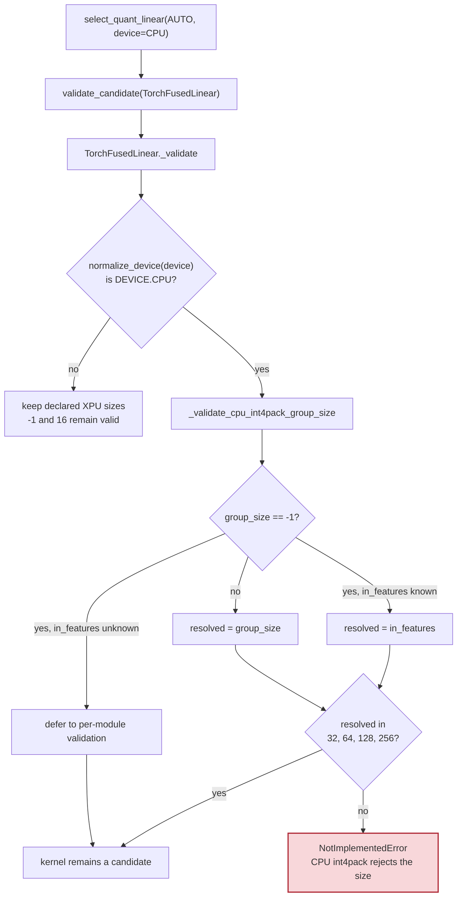

`select_quant_linear` then falls through to the next AUTO candidate
(`TorchCpuAvx512Linear` for g16, `TorchLinear` for a per-channel group). An
explicit `backend="gptq_torch_fused"` now fails at selection with the resolved
size instead of failing on the first forward.

### Output width

The same CPU op also requires the packed row width to be a multiple of 16
(`aten::_convert_weight_to_int4pack_for_cpu` rejects any other `N`).
`TorchAtenLinear` and `TorchAtenAwqLinear` are CPU-only, so they declare
`SUPPORTS_OUT_FEATURES_DIVISIBLE_BY = [16]`
(`torch_aten_kernel.py:101`). `TorchFusedLinear` and `TorchFusedAwqLinear`
also serve XPU, whose packer only needs the nibble pack factor of 8; they keep
the `[8]` declaration and apply the CPU-only 16-wide check in
`_validate_cpu_int4pack_out_features` (`torch_fused.py:45`).

### `group_size == in_features`

`GroupedQuantLinear._validate` allows `group_size == in_features` so a
per-channel checkpoint can express its resolved group without listing every
input width (`qlinear/__init__.py:1023`). That escape also let a checkpoint
with `group_size = 512` and `in_features = 512` reach the aten op, whose
contract is still only 32/64/128/256. `TorchAtenLinear._validate`
(`torch_aten_kernel.py:117`) now re-applies
`_validate_cpu_int4pack_group_size` to the resolved size, so the selector
falls through instead of loading a layer that fails on its first forward.

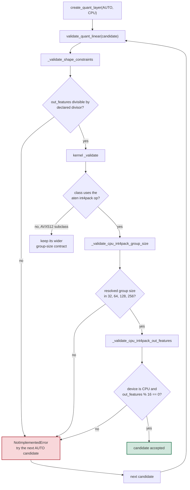

The same contracts are copied to the AWQ kernels because they execute the
same packed op (`torch_aten_kernel_awq.py`, `torch_fused_awq.py`).

| Mechanism | Before | After |
| --- | --- | --- |
| Aten output width | `SUPPORTS_OUT_FEATURES_DIVISIBLE_BY = [1]` (`torch_aten_kernel.py:82` at 6c3421c) | `[16]`, enforced before construction |
| Fused output width | `[1]` for CPU and XPU | `[8]` plus a CPU-only 16-wide check |
| `group_size == in_features` | accepted by the base escape, rejected later by ATen | rejected during selection |
| AVX512 group size | inherited from `TorchAtenLinear` | still owns `[16, 32, 64, 128, 256, 512]` |

### `dequantize_model` contract

`TorchAtenLinear.dequantize_model` and `TorchFusedLinear.dequantize_model`
used to build `nn.Parameter(module.bias)` even when the quantized layer had no
bias. `nn.Parameter(None)` is a shape-`[0]` tensor, so every bias-less layer
(all of Llama, for example) failed in forward. Both functions now pass
`bias=module.bias is not None` to `nn.Linear` and only wrap a real tensor.
They also keep the checkpoint scale dtype instead of forcing FP16, matching
`TorchLinear.dequantize_model`.

### Kernel `optimize` signature

`BaseQModel.optimize` forwards `(backend, mode, fullgraph)` to every quantized
module. `TorchAtenLinear`, `TorchFusedLinear`, `TorchFusedAwqLinear`,
`TorchAtenAwqLinear` and `TorchInt8Linear` overrode `optimize(self)` with no
parameters, so `model.optimize()` raised `TypeError` before compiling any CPU
AUTO model. The overrides now match the base signature and forward all three
options to `super().optimize(...)`.

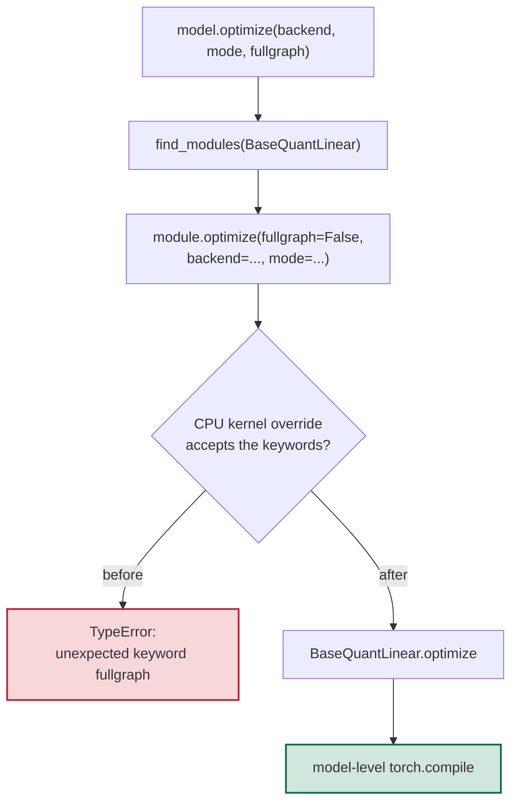

## 2. CPU-offload device maps

`normalize_device_device_map` deliberately ignores CPU map entries when it picks
the accelerator family for kernel validation. The loader then runs
`gptqmodel_post_init` while the CPU-mapped layers are still on CPU; Accelerate
moves them to the execution device only for `forward`
(`simple_dispatch_model` -> `cpu_offload_with_hook`).

A CUDA-only kernel such as `MarlinLinear` or `ExllamaV2Linear` needs CUDA during
`post_init`, so it cannot serve that map. `TritonV2Linear` is CUDA-only for
execution but its `post_init` only validates `g_idx` bounds with Torch ops, so
it remains valid.

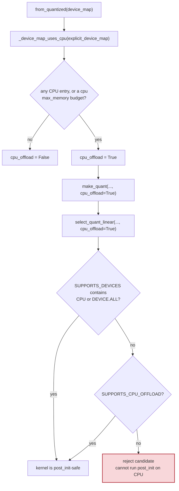

`SUPPORTS_CPU_OFFLOAD` is a separate declaration from `SUPPORTS_DEVICES`. It is
`True` on `TritonV2Linear` and `AwqGEMMTritonLinear`; the default on
`BaseQuantLinear` is `False` (fail closed). An explicit `gptq_marlin` or
`gptq_exllamav2` request with a CPU-offload map raises with the same message.

Measured on Qwen2.5-0.5B-Instruct-GPTQ-Int4 with
`model.layers.2`/`model.layers.3` mapped to `cpu`:

| Path | Kernel | Load | Logits vs explicit `gptq_triton` |
| --- | --- | --- | --- |
| AUTO, before | `MarlinLinear` | `ValueError: GPTQ Marlin requires CUDA tensors, got cpu` | n/a |
| AUTO, after | `TritonV2Linear` | loads | bitwise equal (`rel 0.0`) |

## 3. `max_memory` placement

`build_layerwise_device_map` used to be a fixed round-robin over every visible
accelerator. `max_memory` was accepted through `**kwargs` and never read, so a
cap such as `{0: "350MiB", "cpu": "8GiB"}` still put every module on `cuda:0`.

An indexed `device` (`"cuda:0"` or `torch.device("cuda:0")`) was converted to
`{"": device}` *after* the `device_map`/`max_memory` conflict check, so
`device="cuda:0", max_memory=...` took the explicit-map branch and silently
dropped the cap (#4068). `_normalize_explicit_placement` now decides both
inputs together: an indexed device becomes a full-model map only when there is
no memory budget; with `max_memory` the device selects the accelerator family
and the budgeted layer-wise map owns placement.

The map builder now parses the budgets, restricts the candidate devices to the
named ones, and places units in order:

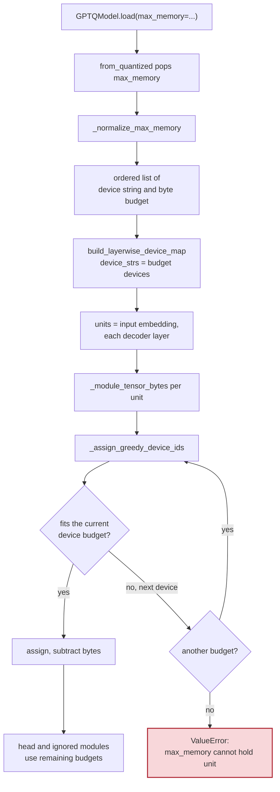

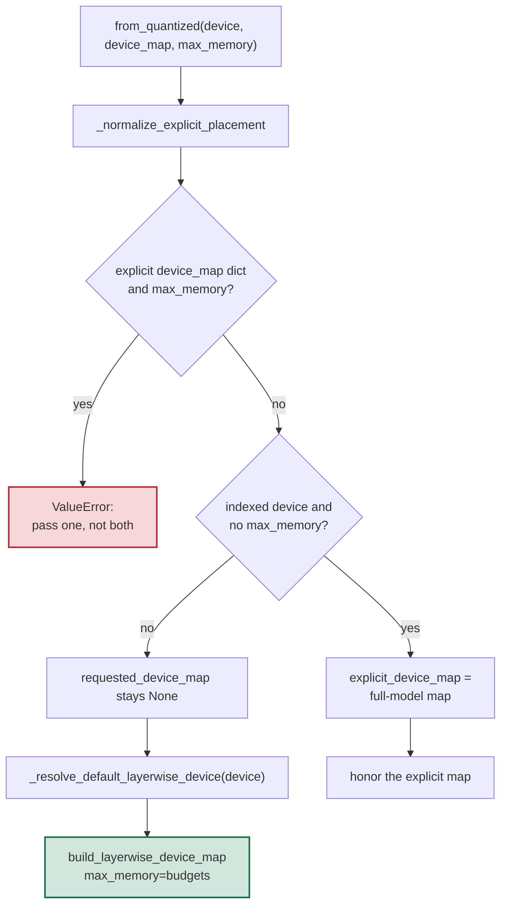

Rules that the implementation pins:

* Only devices named in `max_memory` are candidates; an unlisted GPU is never
  used.
* `device_map` as a dict and `max_memory` together are rejected instead of
  silently preferring one.
* An indexed `device` beside `max_memory` selects the accelerator family; it
  does not replace the budgeted map.
* A unit that does not fit any budget raises; a memory cap is never exceeded
  silently.
* Parameterless structural modules (rotary embeddings) stay on an accelerator
  when one is budgeted, because Accelerate's offload hook reads
  `next(module.parameters())` and cannot attach to them.

Measured with Qwen2.5-0.5B-Instruct-GPTQ-Int4 on one RTX 4090:

| `max_memory` | Before | After |
| --- | --- | --- |
| `{0: "350MiB", "cpu": "8GiB"}` | 28 modules on `cuda:0`, 0 on CPU | 16 on `cuda:0`, 12 on CPU |
| `{0: "4GiB"}` | 28 on `cuda:0` | 28 on `cuda:0` |
| `{0: "300MiB", "cpu": "20GiB"}`, `device="cuda:0"` | every module on `cuda:0` (cap dropped) | 2 modules on `cuda:0`, 18 on CPU |

## 4. `torch.compile` contracts

### TorchLinear / AwqTorchLinear bias

`matmul_fp32_reduce` used `torch.addmm(bias, x, w, out_dtype=torch.float32)`.
Inductor 2.15 cannot lower that form
(`tuned_addmm() takes 3 positional arguments but 4 were given`), so a 3-bit
GPTQ model crashed under `generate(cache_implementation="static")`.

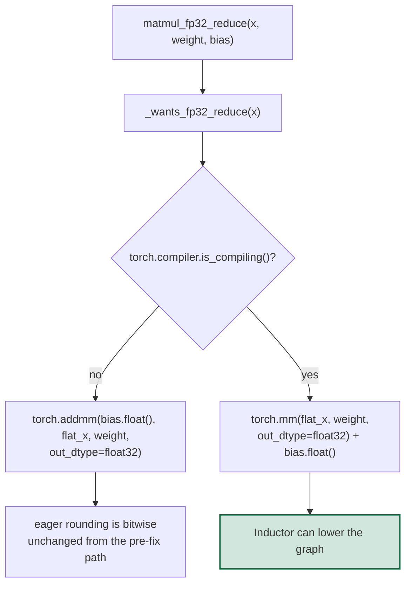

The eager branch is unchanged, so the default path keeps its exact rounding.
The compiled branch is within `rtol=atol=2e-3` of eager on the tested
shapes (fp16 and bf16, 896-wide projections), and static-cache generation
matches dynamic-cache generation token for token on the Qwen checkpoint.

### W4AFP8Linear

Inductor codegens the Gluon FP8 kernel without its `gl` namespace
(`NameError: name 'gl' is not defined`), and the layout revalidation compares
data pointers, which Dynamo cannot trace. `W4AFP8Linear.forward` is therefore
decorated with `torch.compiler.disable`: the launch stays eager inside an
otherwise compiled model. This is a deliberate graph break, not a silent
fallback to a different kernel.

### CPU int4pack under `torch.compile`

`_cpu_int4pack_mm` casts FP16/BF16 operands to FP32 and calls
`aten::_weight_int4pack_mm_for_cpu`. Inductor fused the cast into a Pointwise
node and then could not lower the int4pack op on it (`LoweringException`). The
function is now decorated with `torch.compiler.disable`, so the cast and the op
run eagerly inside an otherwise compiled model.

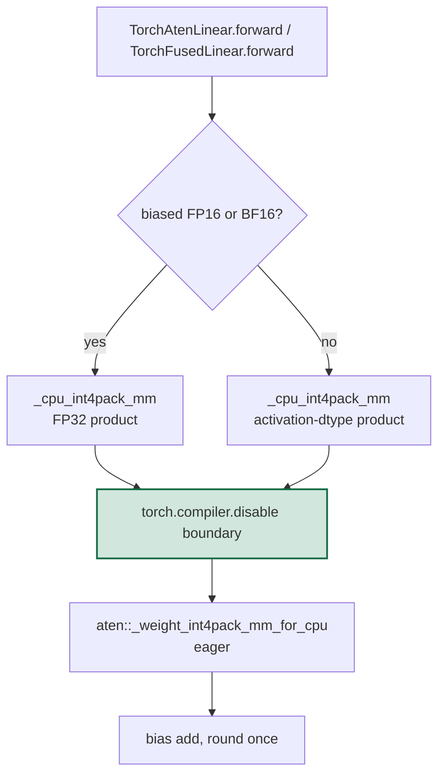

The FP32 product that #4060 added for a biased FP16 layer is unchanged: only
the tracing boundary moved. A compiled FP16+Bias and BF16 layer therefore
still returns the finite, once-rounded result of the eager path.

## 5. HIP JIT source staging

torch's ROCm loader hipifies an out-of-tree source by writing
`<name>_hip.{hip,cpp}` next to the original. Five loaders passed checkout paths
directly, so a build mutated `gptqmodel_ext/` (the names are gitignored, which
hid it) and a read-only site-packages install could not build at all.

`TorchOpsJitExtension(stage_hip_sources=True)` copies the source root into
`<base_build_root>/_src` before the fingerprint/build, rewrites the source and
include paths to that copy, and leaves the shipped tree untouched. It is used
by `allspark_hip`, `hadamard`, `gptq_cuda`, `exllamav3` and `paroquant`;
`nf12_hip` and `tt_blockfloat_hip` already stage their own sources.

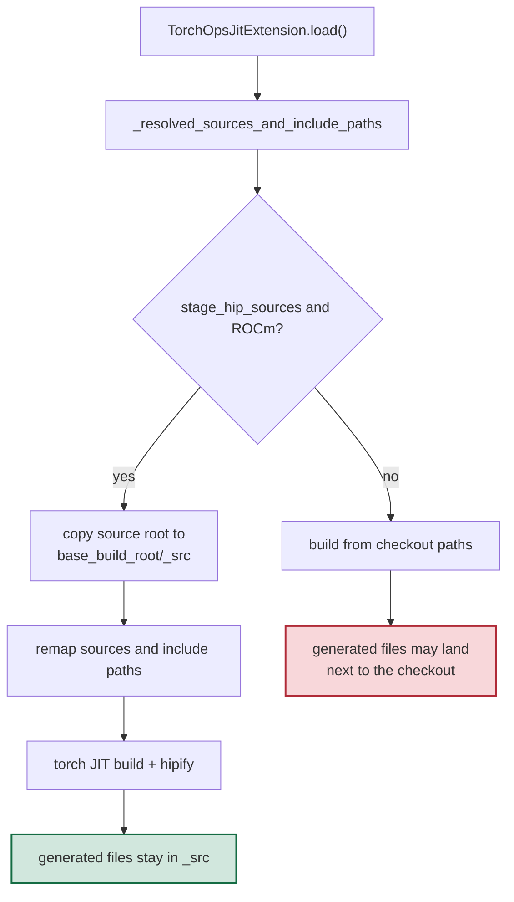

## 6. ParoQuant strided decode

`generate()` feeds `hidden_states[:, -1:, :]`, which is a strided view.
`ParoLinear.forward` packed it after #4047, but `ParoQuantTritonLinear`
overrode `forward` and passed `x.reshape(-1, K)` to the fused rotation, which
rejects non-contiguous tensors. The Triton override now calls
`.contiguous()` on the flat activation.

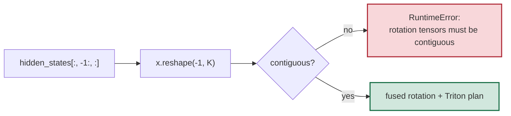

## 7. bitsandbytes and GGUF autograd gate

The bitsandbytes ROCm Triton GEMM and the fused GGUF Triton matmuls are raw
Triton launches with no backward. Both dispatch sites now check
`torch.is_grad_enabled() and x.requires_grad` (GGUF also checks a trainable
bias) and take the differentiable path instead: the vendor bitsandbytes kernel
and `GGUFTorchLinear.forward`.

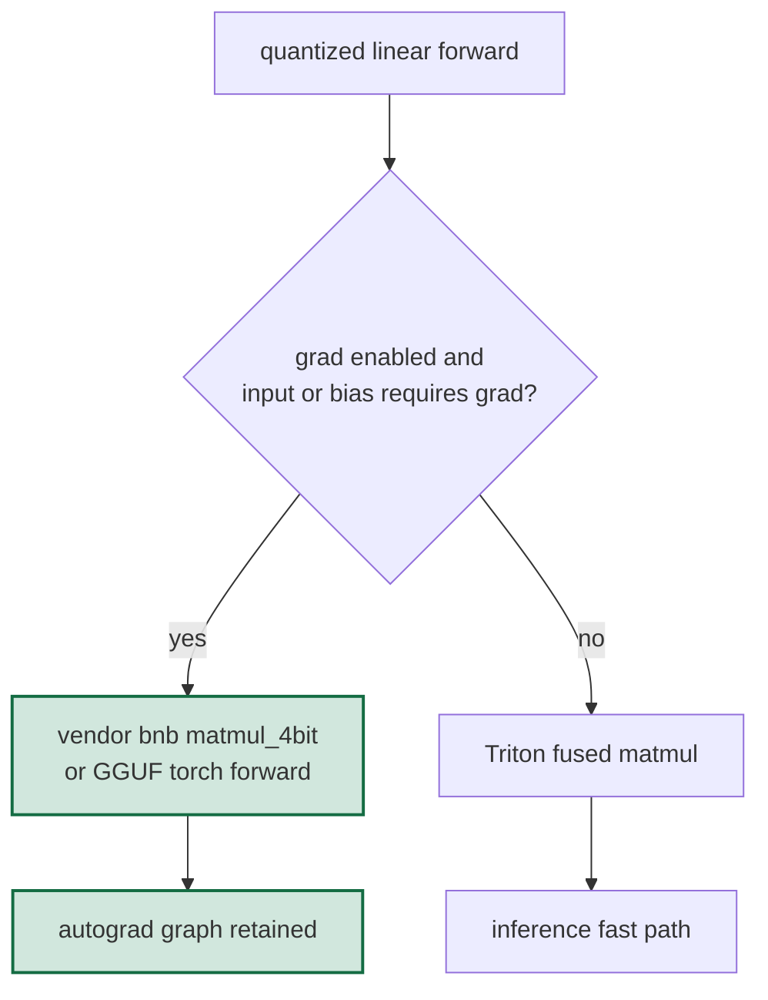

## 8. Test contracts

| Test | Invariant |
| --- | --- |
| `tests/kernels/test_selection.py::test_torch_fused_cpu_rejects_group_size_the_int4pack_op_cannot_consume` | CPU g16 and per-channel 896 are rejected for TorchFused |
| `tests/kernels/test_selection.py::test_torch_fused_cpu_keeps_xpu_and_resolved_per_channel_group_sizes` | XPU keeps -1/16; a per-channel group that resolves to 128 stays valid |
| `tests/kernels/test_selection.py::test_cpu_auto_does_not_select_torch_fused_for_group_size_16` | AUTO falls through to a CPU-valid kernel |
| `tests/kernels/test_selection.py::test_auto_cpu_offload_skips_a_cuda_only_post_init` | CPU-offload maps reject CUDA-only `post_init` |
| `tests/kernels/test_selection.py::test_explicit_cuda_only_backend_rejects_a_cpu_offload_map` | explicit Marlin + CPU offload fails with guidance |
| `tests/test_layerwise_device_placement.py` | budget parsing, greedy placement, overflow, CPU detection |
| `tests/test_layerwise_device_placement.py::test_max_memory_keeps_the_indexed_device_for_the_budgeted_map` | an indexed `device` does not displace `max_memory` |
| `tests/test_cpu_kernel_optimize.py` | `model.optimize()` reaches all five CPU kernel overrides |
| `tests/test_inference_fp16_overflow.py::test_cpu_fused_layers_compile_through_the_int4pack_path` | FP16+Bias and BF16 int4pack layers compile and stay finite |
| `tests/test_hip_jit_source_staging.py` | HIP sources are staged under the build cache; no loader writes into the checkout |
| `tests/kernels/test_paroquant.py::test_paroquant_cuda_forward_packs_a_strided_activation` | both `ParoLinear` and `ParoQuantTritonLinear` accept a strided decode slice |
| `tests/kernels/test_bitsandbytes_rocm_triton.py::test_triton_dispatch_falls_back_when_the_input_needs_grad` | M=16 grad input uses the vendor kernel |
| `tests/kernels/test_gguf_triton_bias_epilogue.py::test_grad_input_uses_the_differentiable_torch_path` | GGUF grad input uses `GGUFTorchLinear` |
| `tests/kernels/test_linear_fp32_reduce.py::test_bias_path_eager_output_is_bitwise_unchanged` | eager bias rounding is bitwise unchanged |
| `tests/kernels/test_linear_fp32_reduce.py::test_compiled_bias_path_uses_a_lowerable_gemm` | the compiled graph contains no `addmm` |
| `tests/kernels/test_w4afp8_gb10.py::test_w4afp8_linear_runs_under_torch_compile` | W4A runs inside `torch.compile` |
| `tests/test_train_mode_atomicity.py` | a failed `.train()` leaves no module in training mode |
