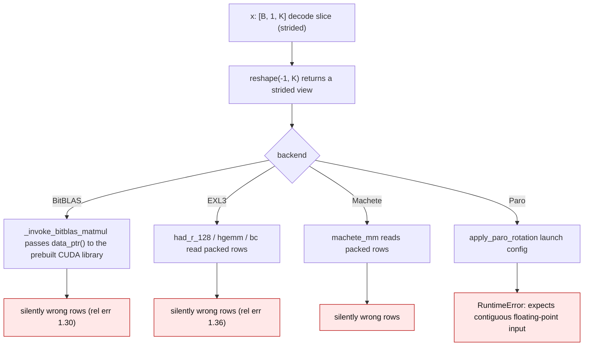
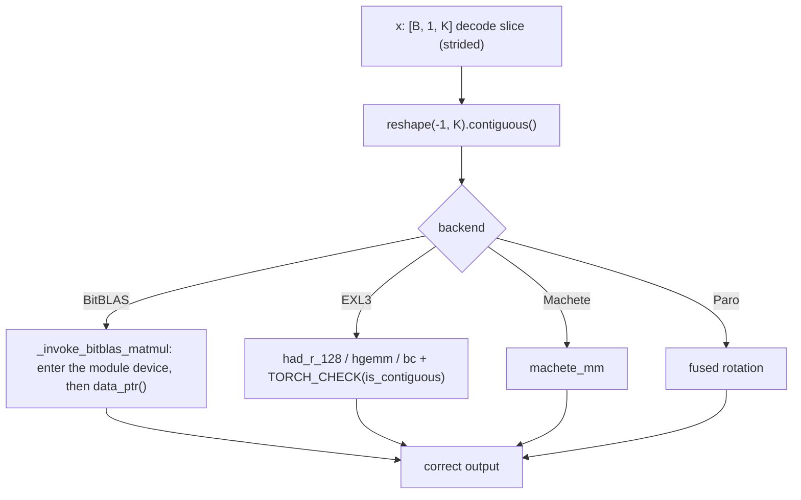
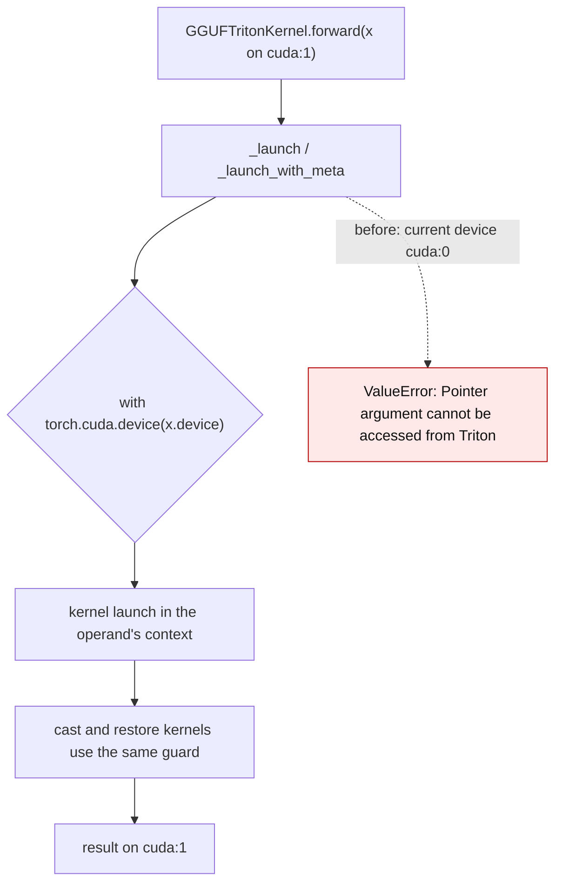
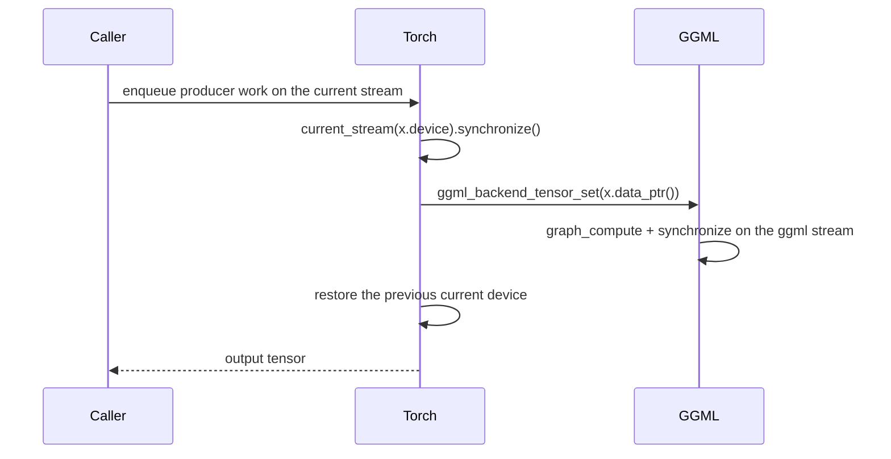
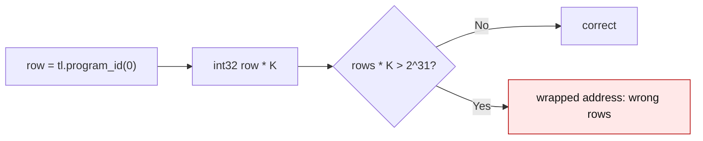
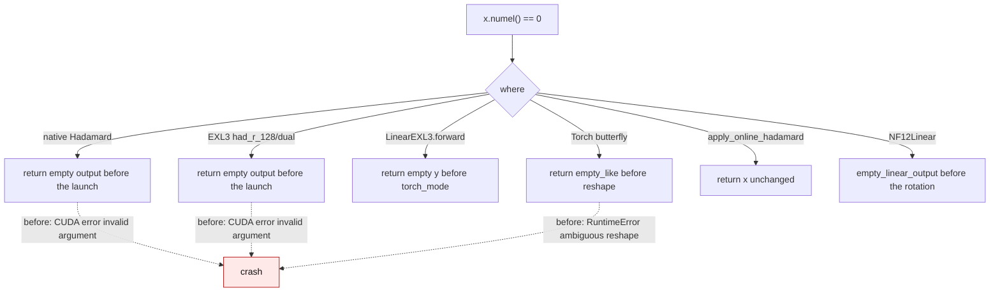
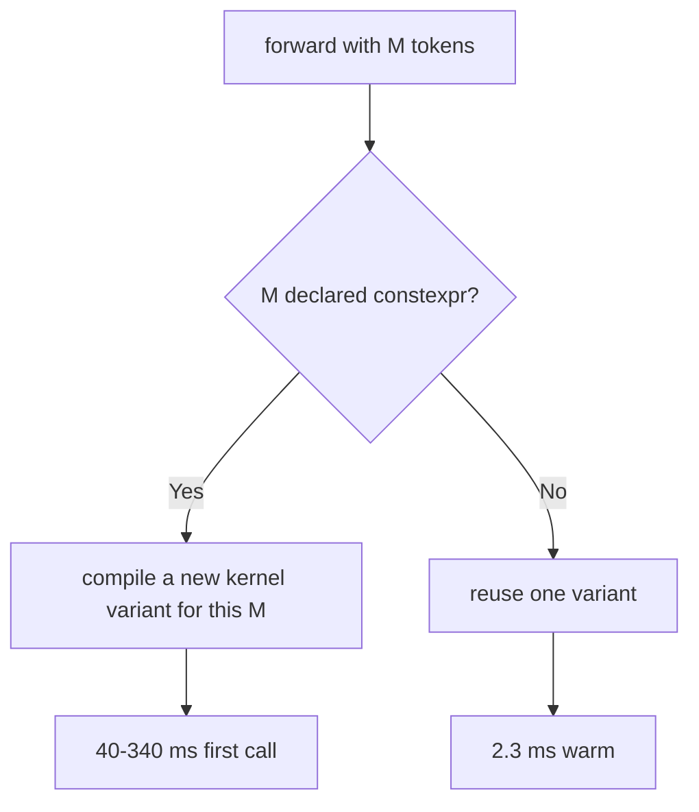

# Kernel input contiguity and launch contracts

Quantized inference kernels fall into two groups. Native and ctypes kernels
(BitBLAS, EXL3 `had_r_128`/`hgemm`/`bc`, Machete, the Paro fused rotation)
receive a raw `data_ptr()` and walk rows with a fixed `K` stride. Triton kernels
compute their own dense offsets from the same assumption. Both groups require a
packed operand, and both must launch in the CUDA context that owns that operand.

The canonical non-contiguous activation is `hidden_states[:, -1:, :]` with
batch > 1: every batched decode step produces it. `reshape(-1, K)` succeeds on
that slice and returns a strided view, so nothing raises until the kernel reads
the wrong rows (or a Triton launch rejects the pointer).

This page documents the contracts introduced by the kernel-correctness fix for
issue #4042. The flows below describe the code in that change.

## 1. Activation packing before a packed-row kernel

| Kernel path | Before | Current |
| --- | --- | --- |
| BitBLAS fp16 | `bitblas.py:865` reshaped and passed the strided view's `data_ptr()` (`bitblas.py:889-899`). | `bitblas.py:875` packs the operand; the dtype cast above already copies, so this is a no-op for bf16. |
| EXL3 fp16 | `exl3.py:135` used `x.view(-1, in_features)` and the kernels assumed packed rows. | `exl3.py:139` packs; `hadamard.cu`, `hgemm.cu`, and `libtorch/linear.cpp` now reject a strided operand. |
| Machete | `machete.py:314` / `machete_awq.py:212` passed the strided view. | `machete.py:317` / `machete_awq.py:215` pack first. |
| Paro | `paro.py:593` fed the strided view to the fused rotation. | `paro.py:595` packs first. |

The native checks are deliberate: a future caller that forgets to pack now
fails closed instead of returning wrong values.

## 2. Device binding for Triton and ggml launches

A `device_map` shards one checkpoint over several GPUs. Triton launches into the
process's *current* CUDA context, so a layer whose operands live on `cuda:1`
must enter that device first.

The ggml CUDA bridge has two extra contracts. It runs its graph on its own
stream, and its backend calls `cudaSetDevice`.

| Path | Before | Current |
| --- | --- | --- |
| GGUF Triton | `_launch` / `_launch_with_meta` and the cast/restore launches had no device guard. | `gguf_triton.py:1004`, `gguf_triton.py:1027`, and the two `forward` launches enter `torch.cuda.device(x.device)`. |
| ggml current device | A forward on `cuda:1` left `torch.cuda.current_device()` at 1. | `gguf_cpp.py:799` saves and restores the current device. |
| ggml stream order | The input copy could read memory before the caller's stream produced it. | `gguf_cpp.py:708` synchronizes the caller's stream before the copy. |

## 3. 64-bit row offsets and capped grids

`row * K` and `row * N` were 32-bit. They wrap once `rows * K` (or `rows * N`)
exceeds 2^31, so rows past the boundary read or write the wrong memory. The
row index is now cast before the multiply.

| Site | Before | Current |
| --- | --- | --- |
| QQQ `_quantize_rows` | `X + row * K` | `qqq_triton.py:15` casts the row. |
| W4A `_token_fp8_quant` | `X + row * K` | `w4a_triton.py` casts the row. |
| W4A `_grouped_fp8_gemm` | int32 row offsets | `w4a_triton.py` uses a 64-bit row index. |
| GGUF cast kernel | `row * K` | `gguf_triton.py:52` casts the row. |
| GGUF Q4_K/Q6_K fused matmuls | `offs_m * stride_xm` | `gguf_triton.py:416` and siblings cast `offs_m`. |
| NVFP4 pack/decode | int32 row and element offsets | `w4a_nvfp4_triton.py` casts them. |
| EXL3 Hadamard | `gridDim.y * 128 * blockIdx.x` in unsigned 32-bit | `hadamard.cu` uses `size_t`. |

Two launch limits are handled separately. `launch_linear_f32` and
`launch_linear_fused` in `tt_blockfloat_cuda.cu` map rows to `gridDim.y`, which
is capped at 65535; they now split large batches into row chunks and shift the
input/output pointers. The chunking preserves the weight operands, which are
indexed by column.

## 4. Empty operands

An empty batch used to reach a zero-sized grid or an ambiguous `reshape`.

The native early return is in every binding in `gptqmodel_ext/hadamard/hadamard.cpp`,
in EXL3's `had_r_128`/`had_r_128_dual` (`gptqmodel_ext/exllamav3/quant/hadamard.cu`),
and in `LinearEXL3.forward` (`gptqmodel/exllamav3/modules/quant/exl3.py`);
the Torch fallback and `apply_online_hadamard` are in
`gptqmodel/quantization/rotation/hadamard_utils.py`; `NF12Linear._forward_impl`
checks `input_rows(x) == 0` before rotating.

## 5. Per-token Triton recompiles

The token count is a runtime property of a forward, not a property of the
compiled kernel. Declaring it `tl.constexpr` (or `gl.constexpr`) compiled a new
variant for every new batch size.

| Kernel | Before | Current |
| --- | --- | --- |
| GGUF wide-output restore | `N` and `ELEMENTS` constexpr | runtime ints with `do_not_specialize` (`gguf_triton.py:68`) |
| W4A `_grouped_fp8_gemm` | `M` constexpr | runtime `M` with `do_not_specialize` (`w4a_triton.py`) |
| NVFP4 pack/decode/accumulate | `M` and `PADDED_M` constexpr | runtime ints with `do_not_specialize` (`w4a_nvfp4_triton.py`) |

## Contracts for new kernels

- A kernel that takes a pointer or computes dense row offsets requires a
  contiguous operand. Pack at the module boundary and keep a
  `TORCH_CHECK(is_contiguous())` in the native entry point.
- A Triton or ggml launch enters the device that owns its operands, and a ggml
  call restores the process's previous current device.
- Row and element offsets are 64-bit when the product can exceed 2^31.
- `gridDim.y` is capped at 65535; chunk rows instead of mapping them 1:1.
- A zero-element operand short-circuits before any launch or reshape.
- A token count is a runtime argument, never a compile-time constant.

The regression coverage lives in `tests/test_hadamard_empty_input.py`
(including EXL3's `had_r_128` and the `LinearEXL3.forward` short-circuit),
`tests/kernels/test_kernel_input_contiguity.py`,
`tests/kernels/test_gguf_triton_multi_gpu.py`,
`tests/kernels/test_triton_int32_offsets.py`, and
`tests/kernels/test_triton_per_m_recompile.py`. The EXL3 Hadamard wrap and the
block-float `gridDim.y` limit are pinned by
`tests/kernels/test_exllamav3_kernel.py` and `tests/test_tt_blockfloat_cuda.py`.

Introduced in #4042.
