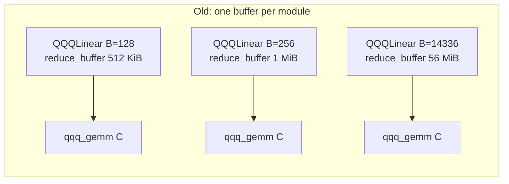
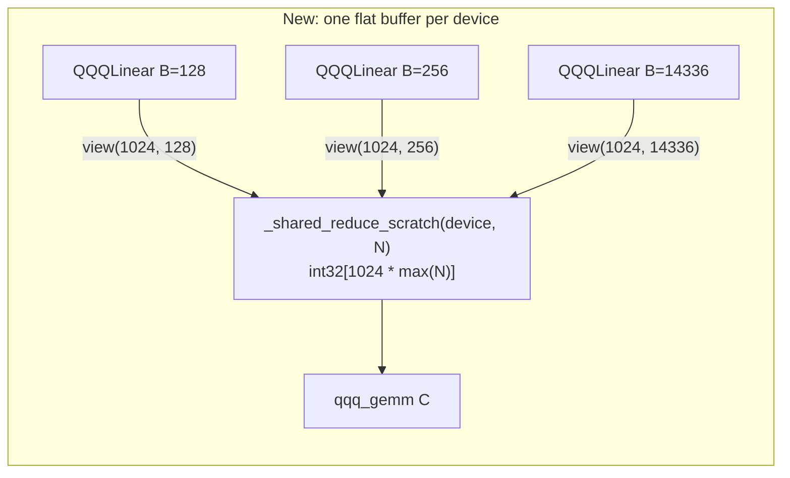
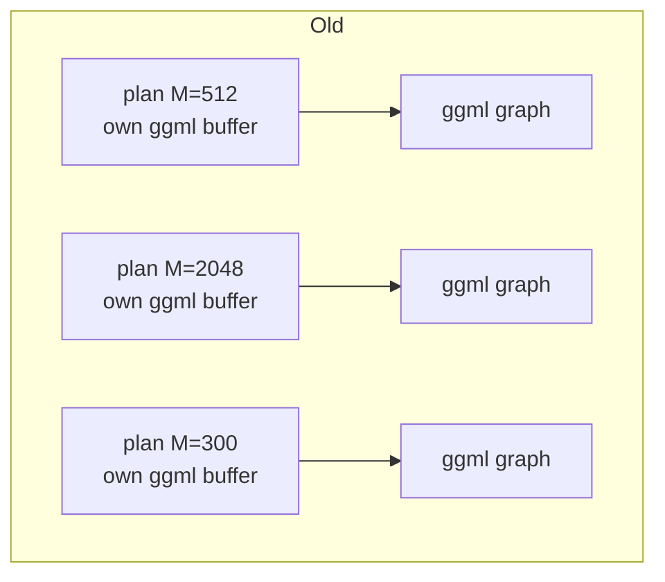
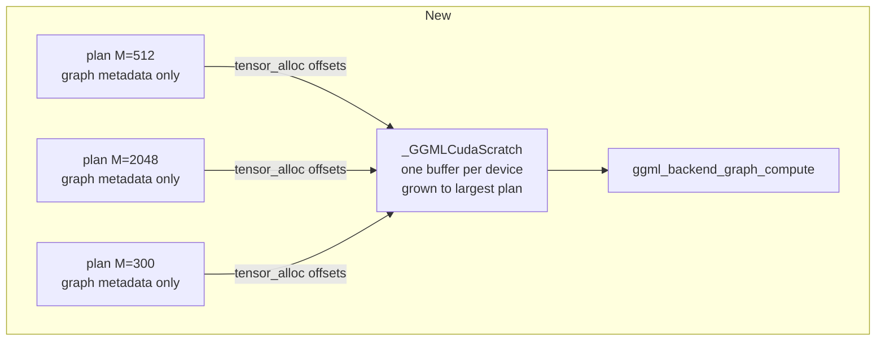

<!-- SPDX-FileCopyrightText: 2026 ModelCloud.ai -->
<!-- SPDX-License-Identifier: Apache-2.0 -->

# Kernel scratch lifecycle

Quantized inference kernels may keep their packed weights, scales, zero points,
and indexing metadata.  They may **not** keep dense or expanded weight copies,
and they should not keep per-layer scratch that is only needed for the duration
of one kernel call.  This page documents the scratch ownership introduced for
[issue #4387](https://github.com/ModelCloud/GPTQModel/issues/4387).

## QQQ reduce scratch

`qqq_gemm` writes its INT32 global reduction into the `C` argument.  Nothing in
`C` survives the call.  The old code registered a
`reduce_buffer` on every `QQQLinear`, including `QQQTorchLinear`, which never
uses it.

`QQQLinear._reduce_scratch()` returns a contiguous view into the flat buffer;
`_shared_reduce_scratch` grows the allocation when a wider layer appears.
`QQQTorchLinear` no longer registers the buffer at all.  The process-wide cache
is intentionally not used inside `torch.compile`, where it would become a graph
constant.

For an 8B QQQ model with `N = 14336` the old per-module total was 5376 MiB
(1024 rows x 14336 x 4 bytes x 96 modules); one shared buffer is 56 MiB.  The
regression tests assert the buffer count, the shared storage, and bitwise-equal
Torch outputs.

## GGUF CUDA plan scratch

`GGUFCudaKernel` builds a ggml graph per batch size.  The graph's input,
output, and intermediate tensors are scratch; `run_quantized_matmul_cuda_plan`
copies the activation in and the result out.  The old code allocated a ggml
backend buffer per plan, outside the Torch allocator.

`ggml_backend_tensor_alloc` only accepts unbound tensors, so a plan cannot be
moved to a larger arena.  `_GGMLCudaScratch.ensure` frees the old buffer and
increments `generation`; `GGUFCudaKernel.forward` compares the generation with
`_ggml_cuda_plan_generation` and closes stale plans before they are used again.
The weight itself is still uploaded once per device by `_GGMLSharedWeight`.

Measured with the CPU ggml backend as a buffer-layout stand-in for the CUDA
backend (Q8_0, `in_features=896`, `out_features=4864`, four layers, M in
1/8/32/128/512): old retained 59.85 MiB of plan buffers; new retains one 11.25
MiB arena.  The real GGML CUDA backend was not built in the validation
container, so CUDA graph execution itself was not run.

## Torch QQQ unpack temporaries

`QQQTorchLinear` used to widen the packed INT32 weights to INT64 and divide by
eight INT64 divisors on every forward.  `_unpack_uint4` now extracts each nibble
with INT32 shift/mask operations and writes a UINT8 plane.  The INT8 weight is
still built per forward and released; it is not cached, because an INT4-to-INT8
expansion is an expanded weight cache under `AGENTS.md`.

Measured on a synthetic 896x4864 BF16 layer at M=1 with
`torch.cuda.max_memory_allocated`: 108.06 MiB transient before, 52.82 MiB
after.  The CUDA QQQ extension itself was unavailable in the validation
container (`CUDA_HOME` unset), so the native `QQQLinear` kernel path was
exercised only through mocked `qqq_gemm` dispatch.

## Contracts

- Scratch is never a weight cache.  It is released or reused, never used to
  answer a later forward without recomputation.
- A QQQ reduce buffer is not part of `state_dict()`; it is non-persistent and
  rebuilt lazily.
- A GGUF plan owns graph metadata only.  Its backend memory belongs to the
  device arena, and a generation mismatch is a hard rebuild, not a silent reuse.
- FP8 checkpoint-load peak (item 3 of #4387) is not addressed by this change.
