<!-- SPDX-FileCopyrightText: 2026 ModelCloud.ai -->
<!-- SPDX-License-Identifier: Apache-2.0 -->

# Kernel scratch lifecycle

Quantized inference kernels may keep their packed weights, scales, zero points,
and indexing metadata.  They may **not** keep dense or expanded weight copies,
and they should not keep per-layer scratch that is only needed for the duration
of one kernel call.  This page documents the scratch ownership introduced for
[issue #4387](https://github.com/ModelCloud/GPTQModel/issues/4387), the
per-call QQQ reduce scratch that replaced its stream-keyed cache in
[issue #4621](https://github.com/ModelCloud/GPTQModel/issues/4621), and the
per-call EXL3 kernel scratch introduced for
[issue #4619](https://github.com/ModelCloud/GPTQModel/issues/4619).

## QQQ reduce scratch

`qqq_gemm` writes its INT32 global reduction into the `C` argument.  Nothing in
`C` survives the call, and `global_reduce` writes each column slice before it
reads that slice, so the kernel never consumes a previous call's contents.

The lifetime of `C` has been wrong twice in opposite directions:

| Design | Problem |
| --- | --- |
| One `reduce_buffer` per `QQQLinear` | 5.25 GiB of zeroed scratch on Llama-3-8B ([#4387](https://github.com/ModelCloud/GPTQModel/issues/4387)) |
| One lazily grown buffer per device | Concurrent streams aliased one writable buffer ([#4488](https://github.com/ModelCloud/GPTQModel/issues/4488)) |
| One buffer per `(device, stream handle)` | The cache was never pruned: 32 pooled streams pinned 1.75 GiB on 8B and `del model` freed none of it ([#4621](https://github.com/ModelCloud/GPTQModel/issues/4621)) |

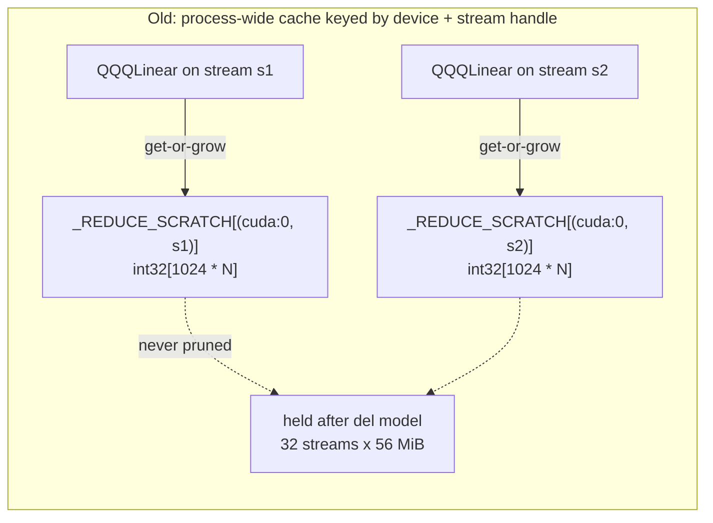

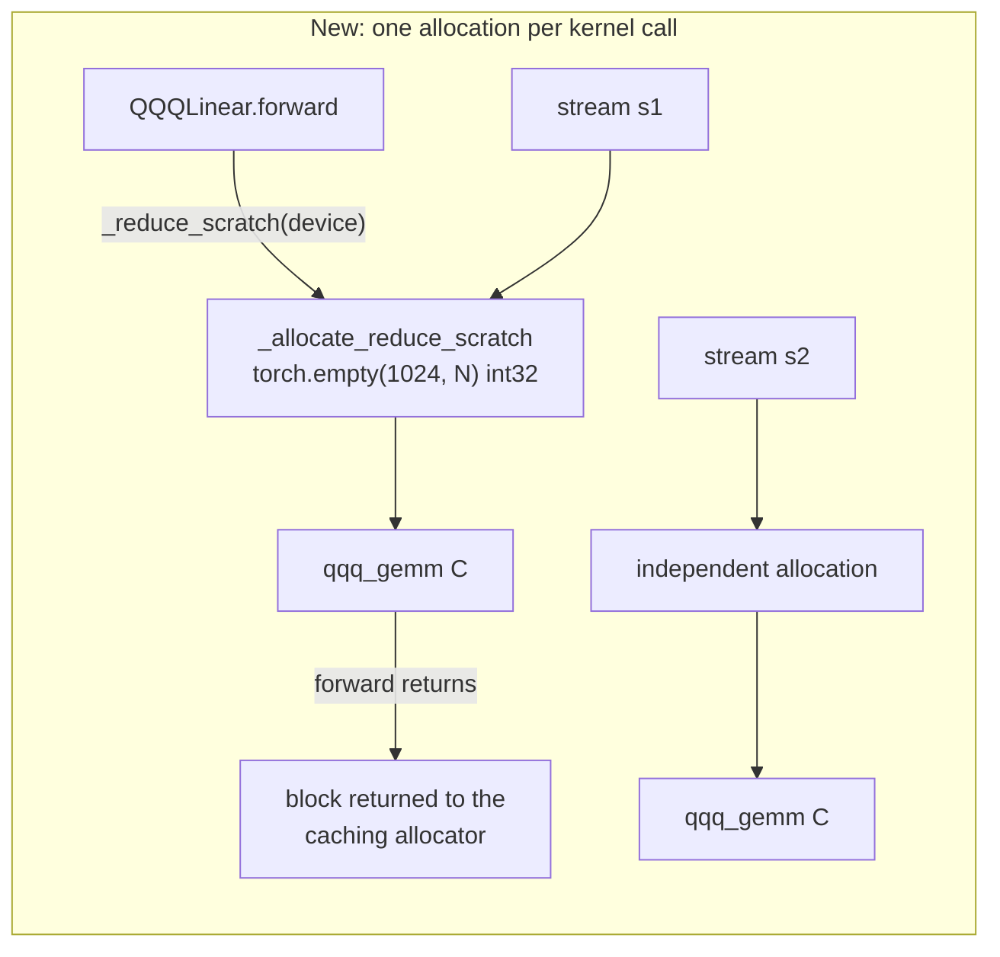

`QQQLinear._reduce_scratch()` calls `_allocate_reduce_scratch`, which returns a
fresh contiguous `(max_par * 64, out_features)` INT32 tensor.  Each call owns
its buffer, so cross-stream aliasing is impossible without a key or a lock, and
the buffer is freed when the forward drops it.  The caching allocator only
hands a freed block to work on the same stream, so same-stream reuse stays
ordered and cheap.  `QQQTorchLinear` never allocates it: the portable kernel
does not take a `C` argument.  The compiled and eager paths now share one
implementation, since a per-call allocation cannot be captured as a graph
constant.

| Before | After |
| --- | --- |
| Cache key: `(device, stream handle)` | No cache; one allocation per call |
| Entries kept for the life of the process | Freed when the forward returns |
| One max-width buffer per stream, 56 MiB on 8B | `1024 x N x 4` bytes, live for one call |
| Stream exclusivity via the cache key | Exclusivity by construction |
| Two paths: cache (eager) and `torch.zeros` (compiled) | One path: `torch.empty` for both |

Measured on Llama-3-8B shapes (`N = 14336`, 4096x14336 layers), with a
three-layer mixed-width stack in separate processes:

| Streams seen | Cached design: live / after `del model` | Per-call: live / after `del model` |
| --- | --- | --- |
| 1 | 112.0 MiB / 281.9 MiB | 0.0 MiB / 57.9 MiB |
| 8 | 896.0 MiB / 1065.9 MiB | 0.0 MiB / 57.9 MiB |
| 32 | 3584.0 MiB / 3753.9 MiB | 0.0 MiB / 57.9 MiB |

The per-call column's flat 57.9 MiB residual is the harness's allocation
baseline, not scratch: it does not depend on how many streams ran.  A dedicated
probe that loaded one layer and ran eight streams returned to `allocated 0.0
MiB, reserved 0.0 MiB` after `del` plus `empty_cache`.  Per-call allocation cost
measured 0.0-0.3 us on the
4096x14336 shapes, where one kernel call is 13.9 us; the allocator's
reservation, not the live set, absorbs the churn.  The regression tests assert
that `C`'s initial contents do not change the output (0, -1 and `INT32_MAX`
fills give bitwise-equal results), that no module-level cache symbol remains,
that two calls never share storage, and that eight streams retain less than
2 MiB after their forwards return.

## QQQ split-K lock array

`qqq_gemm` also uses its `workspace` argument as a split-K barrier: each CTA
increments a per-tile counter and resets it in `barrier_release`.  One array per
`QQQLinear` therefore let two streams serving the same module increment and
reset each other's counters and deadlock the device
([#4665](https://github.com/ModelCloud/GPTQModel/issues/4665)); the per-call
reduce scratch above did not cover this second writable buffer.

`QQQLinear._split_k_locks(device)` now allocates a zeroed
`ceil(out_features / 64) * max_par` INT32 array for each forward.  The
per-module `workspace` buffer is kept only so existing checkpoints keep
loading; it is no longer passed to the kernel.  EXL3's `exl3_gemm` takes the
same approach.

| Before | After |
| --- | --- |
| One lock array per `QQQLinear` | One zeroed array per call |
| Two streams on one module corrupt each other's counters (deadlock) | Streams cannot alias |
| Reused for every stream on every device | Allocated on the call's device |

## EXL3 kernel scratch

`LinearEXL3.forward` reaches three writable buffers, and all three are consumed
by exactly one call: the split-K lock array of the tensor-core GEMM (`bc.run` ->
`exl3_gemm`, taken when `M <= 32`), the cuBLAS workspace of `hgemm` (taken when
`M > 32`), and the Hadamard-rotated input (`A_had`/`xh`) of the `bsz == 1`
decode path.  All three used to be process-wide state, so two streams could run
two kernels into the same memory.

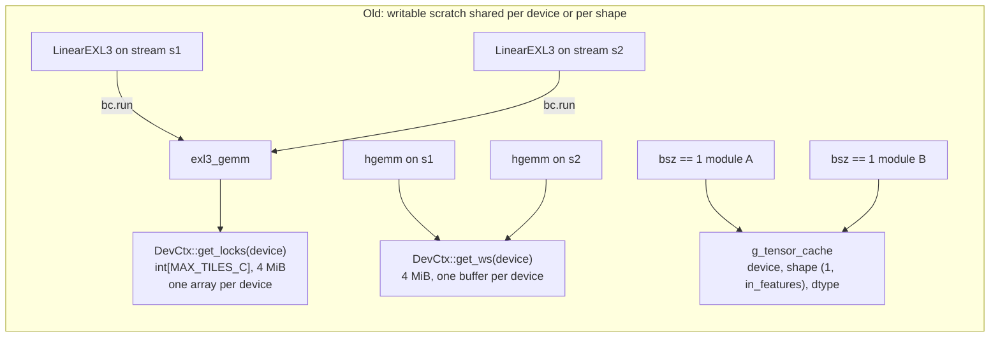

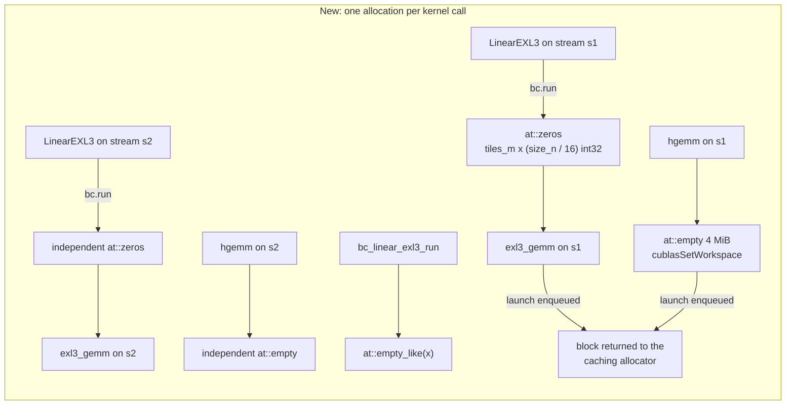

| Scratch | Before | After |
| --- | --- | --- |
| Split-K lock array | `DevCtx::get_locks(device)` returned one `cudaMalloc`ed `MAX_TILES_C` array per device (`exl3_devctx.cu:65`), shared by every stream | `exl3_gemm` allocates zeroed `tiles_m * (size_n / 16)` INT32 for the call (`exl3_gemm.cu`) |
| hgemm workspace | `DevCtx::get_ws(device)` returned one 4 MiB `cudaMalloc` per device and `hgemm` installed it on the caller's handle (`hgemm.cu:56`, `exl3_devctx.cu:52`) | `hgemm` allocates 4 MiB per call, installs it on the per-thread cuBLAS handle, and restores the handle's default workspace before the allocation is released (`hgemm.cu`) |
| bsz == 1 Hadamard input | `g_tensor_cache.get(device, (1, in_features), dtype)` shared one buffer by every module of that width (`exl3.py:80`, `linear.cpp:30`) | `bc_linear_exl3_run` allocates `at::empty_like(x)` for every batch size (`linear.cpp`) |

The split-K lock array is a barrier, not a cache: the kernel increments and
resets those counters while it runs and leaves them zeroed, and
`barrier_acquire`/`barrier_release` spin on the values.  Two co-resident
launches that share the array therefore either read a stage they never reached
(wrong output) or wait for a release that already happened (deadlock).  A
zeroed per-call allocation gives each launch its own counters, and the kernel's
own reset is no longer load-bearing.

The hgemm workspace is state on the cuBLAS handle while the GEMM runs on the
caller's stream.  ATen's cuBLAS handle is per thread, so a per-call workspace
is not observed by another thread, and setting the handle back to its default
before the tensor is released keeps a later Torch BLAS call on that thread from
inheriting a freed pointer.  `at::empty` is enough: cuBLAS does not read the
workspace's previous contents.

Every buffer is allocated and released on the stream that runs the kernel, so
the caching allocator only reuses a freed block for ordered work on that
stream.  Nothing is retained per device, per stream, or per module, so no
cleanup step is needed; `LinearEXL3.unload()` no longer has a shared buffer to
drop.

Measured on RTX 4090 (SM89) with torch 2.16.0.dev+cu130, two to four threads
each forwarding on its own stream, 2000 calls per thread, compared bitwise with
the serial output:

| Case (M, N, K) | Before | After |
| --- | --- | --- |
| 8, 512, 2048 (locks) | GPU deadlock, process killed; another run of the same case gave 0 mismatches | 0 mismatches, max rel err 0.000 |
| 4, 512, 2048 (locks) | 329-881 mismatches of 2000, max rel err 0.549; another run gave 0 | 0 mismatches, max rel err 0.000 |
| 1, 8192, 2048 (bsz-1 `xh`) | 1-25 mismatches of 2000, max rel err 1.204 | 0 mismatches, max rel err 0.000 |
| 256, 512, 2048 (hgemm) | 387-788 mismatches of 2000, max rel err 1.683 | 0 mismatches, max rel err 0.000 |

The lock-array failure is nondeterministic: whether two launches overlap
depends on whether the first one has already filled the SMs, so the same case
can deadlock, corrupt a few outputs, or pass.

Single-stream runs were bitwise identical to the serial reference in both
builds.

## GGUF CUDA plan scratch

`GGUFCudaKernel` builds a ggml graph per batch size.  The graph's input,
output, and intermediate tensors are scratch; `run_quantized_matmul_cuda_plan`
copies the activation in and the result out.  The old code allocated a ggml
backend buffer per plan, outside the Torch allocator.

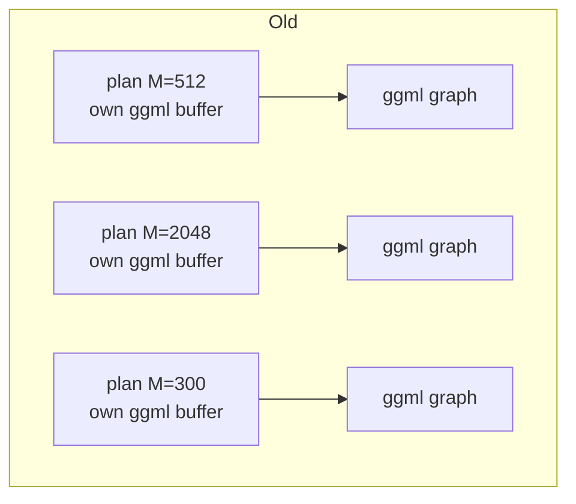

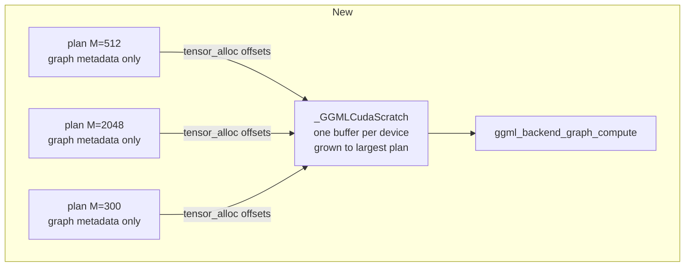

`ggml_backend_tensor_alloc` only accepts unbound tensors, so a plan cannot be
moved to a larger arena.  `_GGMLCudaScratch.ensure` frees the old buffer and
increments `generation`; `GGUFCudaKernel.forward` compares the generation with
`_ggml_cuda_plan_generation` and closes stale plans before they are used again.
The weight itself is uploaded once per device by `_GGMLSharedWeight`, and that
upload is the layer's only device copy (next section).

Measured with the CPU ggml backend as a buffer-layout stand-in for the CUDA
backend (Q8_0, `in_features=896`, `out_features=4864`, four layers, M in
1/8/32/128/512): old retained 59.85 MiB of plan buffers; new retains one 11.25
MiB arena.  The real GGML CUDA backend was not built in the validation
container, so CUDA graph execution itself was not run.

### Arena reclamation on the last unload

The arena is process-global scratch, not a weight cache, so it must not
outlive its last user.  Before #5811 the bridge kept it allocated for the life
of the process: closing a layer's plans, clearing its weight cache and
deleting the final layer freed the plan contexts and the weight, while
`_GGMLBridge._cuda_scratch` still referenced the buffer
(`gptqmodel/nn_modules/qlinear/gguf_cpp.py:497` on `43763a8e7`).  ggml
allocates that buffer outside the Torch allocator, so
`torch.cuda.empty_cache()` cannot return it.

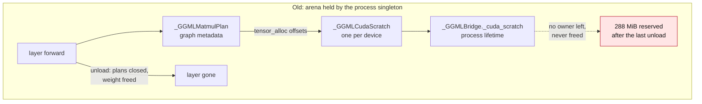

Every plan holds its `_GGMLSharedWeight`, and every weight now registers
itself in a per-device `weakref.WeakSet` on the bridge.  When the last weight
on a device is finalized, the bridge frees that device's arena under the same
process-wide lock that serializes ggml-cuda entry.  A live model keeps its
weights (the zero-copy `qweight` view included), so active inference reuses
the arena; an unloaded model leaves no owner, so the arena is returned to the
driver.  The `_GGMLCudaScratch` object itself stays in `_cuda_scratch` and its
`generation` keeps increasing, so a plan bound to the freed buffer can never
match a later allocation.

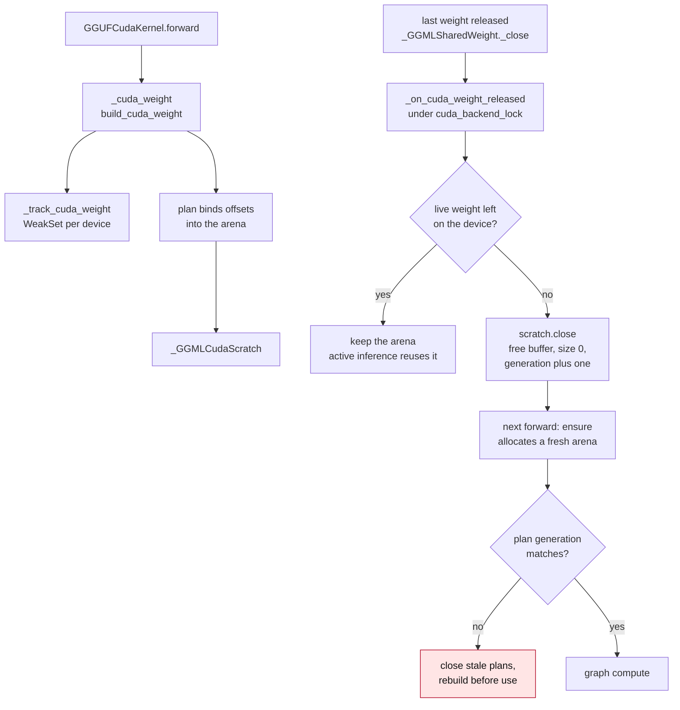

The release is fail-closed.  `_on_cuda_weight_released` only frees the arena
when the device's owner set is empty, so a second live layer keeps it
reserved.  Reclamation bumps `generation` before the next allocation; a
surviving plan that still points at the freed buffer is rejected by
`_bind_cuda_plan` ("stale ggml CUDA plan") and rebuilt by
`GGUFCudaKernel.forward`.  A backend swap now reuses the same scratch object
instead of replacing it, so the generation cannot restart at a value a stale
plan already recorded.

| Event | Before (`43763a8e7`) | After |
| --- | --- | --- |
| Arena owner | `_GGMLBridge._cuda_scratch`, process lifetime (`:497`) | Same dict, but reclaimed when its device has no live weight (`:1187`) |
| Release trigger | None; `ensure` only frees on growth (`:337`) | `_GGMLSharedWeight._close` calls the bridge hook (`:289`-`:303`) |
| Generation | Bumped only by growth (`:337`) | Bumped by growth and by reclamation (`:380`) |
| Backend swap | Replaces the scratch object (`:1124`) | Keeps the object and its generation (`:1202`) |
| Layer teardown | Plans and weight freed; arena stays (`:1852`-`:1884`) | Plans and weight freed; last weight frees the arena (`:1933`-`:1965`) |

Measured on an RTX 4090 (SM89, torch 2.15.0+cu132, llama-cpp-python with
ggml-cuda) in one process, Q4_K_M, `M=4096`, `K=14336`, `N=4096`, two full
load/forward/unload cycles.  "Reserved" is `_GGMLCudaScratch.size`; "free" is
`torch.cuda.mem_get_info()` after `torch.cuda.synchronize()` and
`empty_cache()`:

| Metric | Before | After |
| --- | --- | --- |
| Arena reserved after forward | 288.00 MiB | 288.00 MiB |
| Arena reserved after unload | 288.00 MiB | 0.00 MiB |
| Driver free after unload vs with arena | +32.00 MiB (weight only) | +320.00 MiB (arena + weight) |
| Arena reserved after the next load's forward | 288.00 MiB (never freed) | 288.00 MiB (re-allocated) |
| Arena generation across two cycles | 1 | 4 (release and allocation each bump) |

`tests/kernels/test_gguf_cuda_arena_release_5811.py` pins the zero reserved
bytes after the last unload, the re-allocation on the next load, the
multi-owner case, and the stale-plan rejection.  Its CPU half runs on the
repository's recording allocator double; the native half requires the ggml
CUDA backend.

## GGUF CUDA weight storage

The first `GGUFCudaKernel.forward` on a device uploads `qweight` into a ggml
CUDA buffer that every plan's graph reads. On `main` before this change the
Torch `qweight` stayed allocated next to it, so the packed weight was resident
twice (item 2 of #4387, left by #4436):

- `gptqmodel/nn_modules/qlinear/gguf_cpp.py:847` `build_cuda_weight` copied
  `qweight` into `ggml_backend_alloc_ctx_tensors` memory with
  `ggml_backend_tensor_set` (`:888`);
- `:1644` `_cuda_weight` cached that upload under
  `tensor_cache_key(self.qweight)` and left `self.qweight` untouched;
- `:1621` `_release_cuda_weight` closed the upload on every
  `clear_weight_cache()` (`post_init`, `_apply`, `load_state_dict`, `train`).

ggml cannot read the Torch allocation instead: when a row is not a multiple
of 512 columns, ggml-cuda reserves zero-filled padding past `ggml_nbytes`
(`ggml_backend_buft_get_alloc_size`, e.g. 2,101,392 vs 2,101,320 bytes for a
Q4_K 896x4864 weight) for its row over-read. So ownership is inverted: the
ggml buffer becomes the storage of `qweight`.

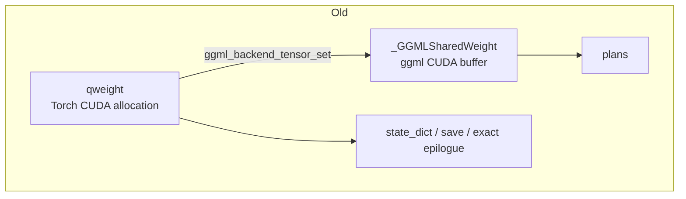

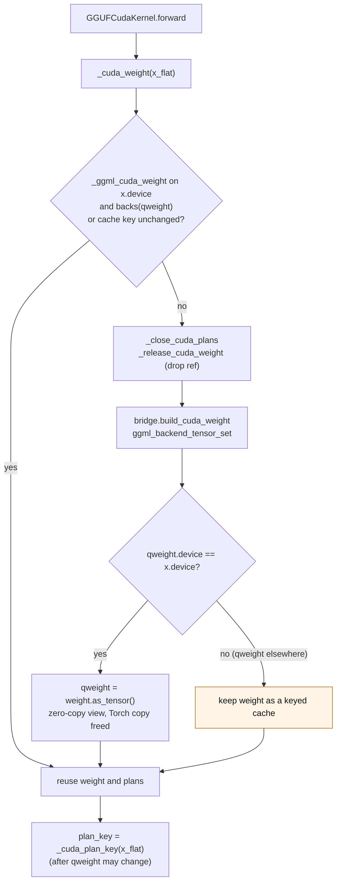

Lifetime is reference counted. `_GGMLWeightView` exports the buffer through
`__cuda_array_interface__`; `torch.as_tensor` keeps the exporter, and the
exporter keeps the `_GGMLSharedWeight`, alive while any tensor shares the
memory. Plans hold the weight too. `_release_cuda_weight` only drops the
kernel's reference, and the last reference frees the buffer under the
process-wide ggml-cuda lock (after a device synchronize, since Torch kernels
may still read the view).

| Event | Old | New |
| --- | --- | --- |
| First forward on the device | Torch `qweight` + ggml copy | ggml buffer only; `qweight` is its view |
| `clear_weight_cache()` (`post_init`, `train`, `load_state_dict`) | upload closed, re-uploaded next forward | plans closed; a weight that backs `qweight` is kept |
| `load_state_dict` (copy) | bytes copied into Torch `qweight`, re-upload | bytes copied straight into the ggml buffer, no re-upload |
| `load_state_dict(assign=True)` / new `qweight` | re-upload | re-upload, then adopt |
| `.to("cpu")` | Torch copy moves, ggml copy closed | view copied to CPU, ggml buffer freed when the last view goes |
| `.to("cuda")` again | upload on next forward | upload and adopt on next forward |
| `state_dict()` tensor outlives the model | Torch tensor | keeps the ggml buffer alive, freed with the last tensor |
| `copy.deepcopy` / pickle | copied the raw ggml handles (double free) | `__getstate__` drops them; the copy re-uploads its own |

Measured with per-process counters on an RTX 4090 (`torch.cuda.memory_allocated`
and the process's `nvidia-smi --query-compute-apps` entry after
`empty_cache()`), after prefill of 1/7/128/512 tokens:

| Model (q4_k_m) | Torch-owned `qweight` on CUDA | `memory_allocated` | process VRAM |
| --- | --- | --- | --- |
| Qwen2.5-0.5B, old | 211.4 MiB (+211.4 ggml) | 471.2 MiB | 1328 MiB |
| Qwen2.5-0.5B, new | 0 (211.4 ggml) | 259.9 MiB | 1104 MiB |
| Llama-3.2-1B, old | 522.0 MiB (+522.0 ggml) | 1023.1 MiB | 2218 MiB |
| Llama-3.2-1B, new | 0 (522.0 ggml) | 501.1 MiB | 1702 MiB |

Logits are bitwise equal to the old path, `state_dict()` qweights equal the
checkpoint, and `save()` writes a byte-identical `model.safetensors`.
`tests/kernels/test_gguf_cuda_weight_storage_4387.py` asserts the released
Torch bytes, the shared pointer, the state-dict round trip, write-through
`load_state_dict`, `.cpu()`/`.cuda()`, view lifetime and `deepcopy`.

## Torch QQQ unpack temporaries

`QQQTorchLinear` used to widen the packed INT32 weights to INT64 and divide by
eight INT64 divisors on every forward.  `_unpack_uint4` now extracts each nibble
with INT32 shift/mask operations and writes a UINT8 plane.  The INT8 weight is
still built per forward and released; it is not cached, because an INT4-to-INT8
expansion is an expanded weight cache under `AGENTS.md`.

Measured on a synthetic 896x4864 BF16 layer at M=1 with
`torch.cuda.max_memory_allocated`: 108.06 MiB transient before, 52.82 MiB
after.  The CUDA QQQ extension itself was unavailable in the validation
container (`CUDA_HOME` unset), so the native `QQQLinear` kernel path was
exercised only through mocked `qqq_gemm` dispatch.

## EXL3 quantization stream and tile scratch

EXL3 quantizes each projection as a serial chain of small tile launches, and it
runs that chain on a stream of its own so it can be ordered against the caller
without leaving a wait event on the device-shared default stream. That stream
used to be thread-local: every worker in the device pool got its own, and the
tile scratch was keyed by stream.

A stream is an allocator pool. A block freed on worker A's stream is never
handed to an allocation on worker B's stream, so the per-worker design stranded
one free-block cache per worker. The tile scratch pair
(`_allocate_temp_buffers`, 512 MiB at `K=4`, 2 GiB at `K=2`, with the default
tile batch) was copied once per worker as well. The device quantize lock
already serialized the kernels, so those extra streams bought no overlap.

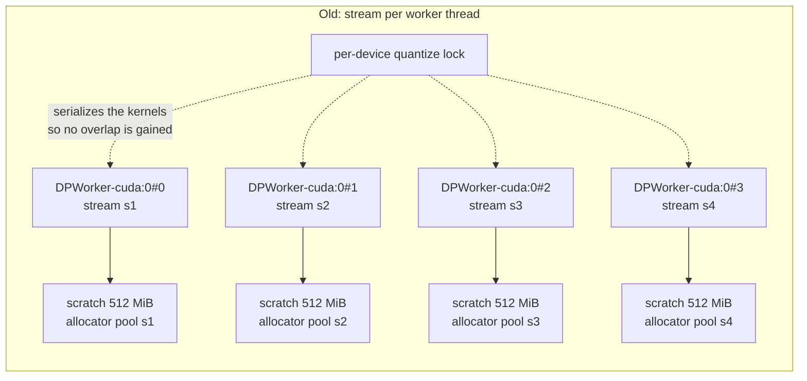

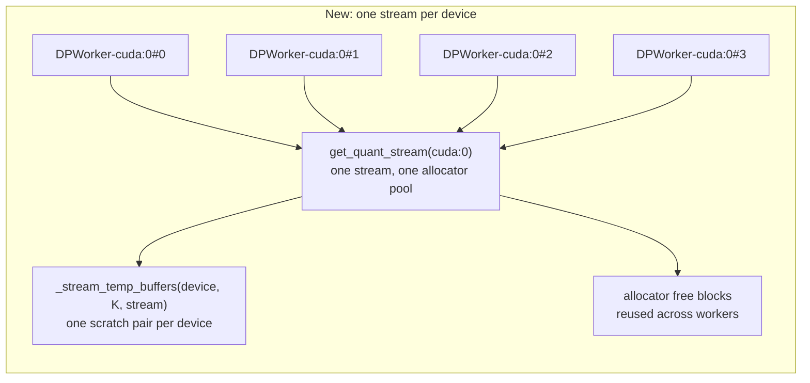

`get_quant_stream` keeps one stream per `torch.device` behind a lock; the light
read path takes no lock. Work enqueued to one stream from several host threads
is still ordered by the device, and every launch that reads the scratch runs on
that stream, so two callers cannot observe each other's scratch. The device
quantize lock stays where it was; it is no longer needed to protect the scratch,
but it still keeps the kernels serialized per device.

| Before | After |
| --- | --- |
| Cache key `(device, K, stream, batch)` with one stream per thread | Same key shape, one stream per device |
| Scratch: 512 MiB x worker count per device at `K=4` | Scratch: 512 MiB per device at `K=4` |
| Allocator pool per worker thread | Allocator pool per device |
| `_quant_stream_tls = threading.local()` | `_quant_streams` dict plus `_quant_streams_lock` |

Measured on Qwen2.5-0.5B-Instruct, `EXL3Config(bits=4)`, with the default device
pool. `streams` and `scratch sets` count what one quantization run allocated:

| Streams | Scope | Peak allocated | Peak reserved | Reserved after run | Scratch sets | Wall |
| --- | --- | --- | --- | --- | --- | --- |
| per worker (4 per device) | first 4 layers | 2.95 GiB | 4.23 GiB | 4.23 GiB | 8 | 31.6 s |
| one per device | first 4 layers | 1.44 GiB | 1.77 GiB | 1.77 GiB | 2 | 29.3 s |
| per worker (4 per device) | all 24 layers | 2.95 GiB | 5.74 GiB | 2.38 GiB | 8 | 125.2 s |
| one per device | all 24 layers | 1.44 GiB | 1.77 GiB | 0.85 GiB | 2 | 122.0 s |

Reserved grows layer over layer on the old code until every worker stream has
reached its own peak; the new code plateaus at the first layer's high-water
mark. The quantized `state_dict()` is bit-identical between the two full runs
(795 tensors, same SHA-256). `tests/test_exl3_workspace.py` pins the
one-stream/one-scratch allocation count and the concurrent packed-result
parity.

## Contracts

- Scratch is never a weight cache.  It is released or reused, never used to
  answer a later forward without recomputation.
- A QQQ reduce buffer is not part of `state_dict()`; it is non-persistent and
  rebuilt lazily.
- A QQQ reduce buffer is owned by one `(device, stream)`: calls on that stream
  reuse it in stream order, and a different stream never sees it.
- A GGUF plan owns graph metadata only.  Its backend memory belongs to the
  device arena, and a generation mismatch is a hard rebuild, not a silent reuse.
- A GGUF CUDA scratch arena is owned by the device's live weights.  The last
  weight release frees it and bumps its generation; the generation never
  restarts, so a stale plan cannot be reused.  A device with a live weight
  keeps its arena.
- A GGUF CUDA layer has one device copy of its packed weight.  Once uploaded
  from a same-device `qweight`, the ggml buffer is `qweight`'s storage and is
  freed only when no kernel, plan, or Torch tensor references it.
- An EXL3 quantization stream is process-wide per device. The tile scratch is
  keyed by that stream, so one device never holds more than one scratch pair.
- FP8 checkpoint-load peak (item 3 of #4387) is not addressed by this change.
