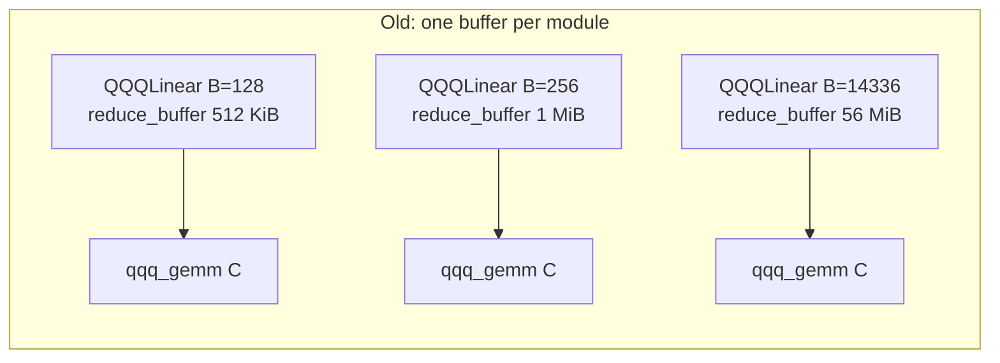
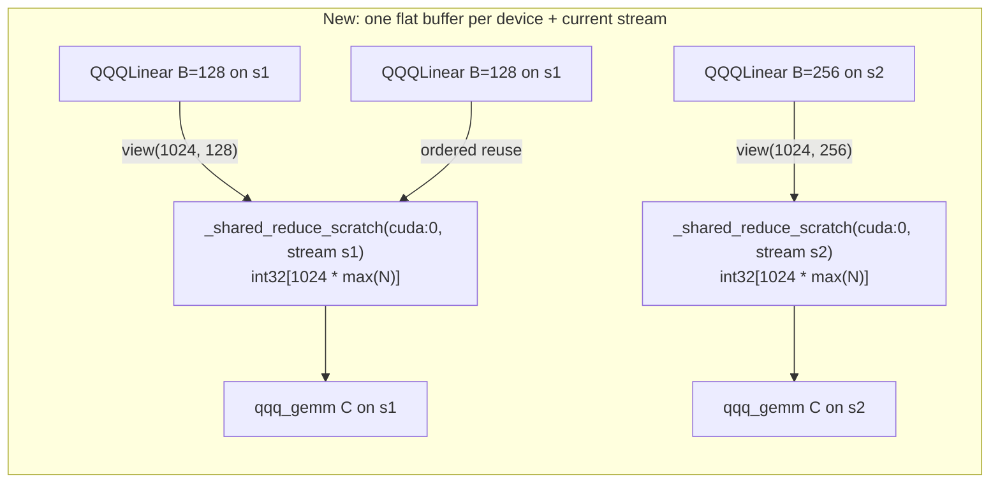
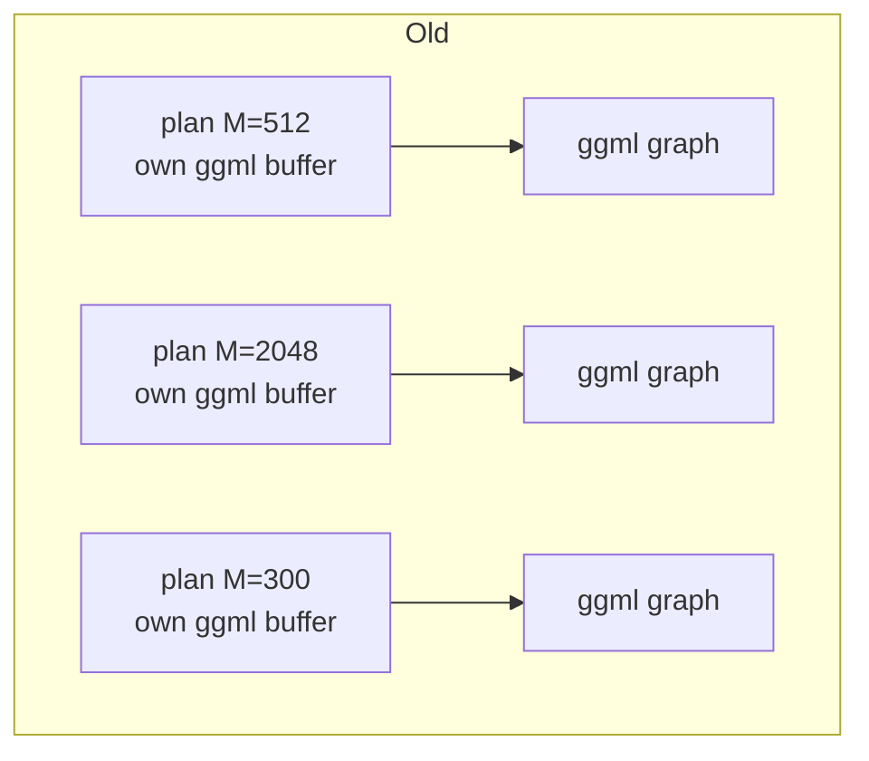
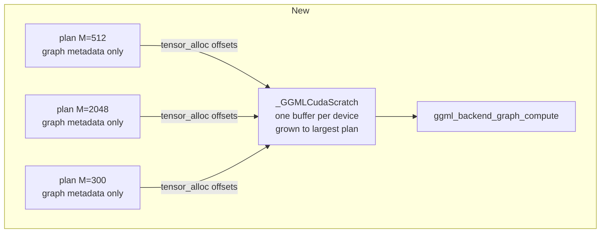
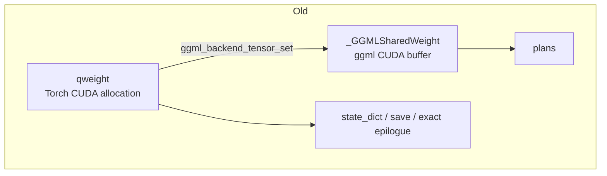
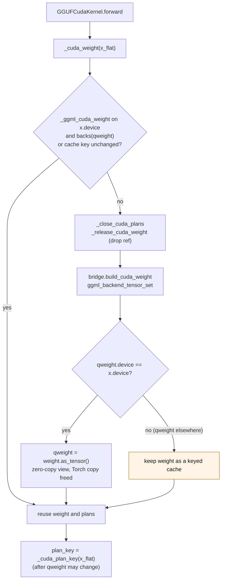

<!-- SPDX-FileCopyrightText: 2026 ModelCloud.ai -->
<!-- SPDX-License-Identifier: Apache-2.0 -->

# Kernel scratch lifecycle

Quantized inference kernels may keep their packed weights, scales, zero points,
and indexing metadata.  They may **not** keep dense or expanded weight copies,
and they should not keep per-layer scratch that is only needed for the duration
of one kernel call.  This page documents the scratch ownership introduced for
[issue #4387](https://github.com/ModelCloud/GPTQModel/issues/4387).

## QQQ reduce scratch

`qqq_gemm` writes its INT32 global reduction into the `C` argument.  Nothing in
`C` survives the call.  The old code registered a
`reduce_buffer` on every `QQQLinear`, including `QQQTorchLinear`, which never
uses it.

`QQQLinear._reduce_scratch()` returns a contiguous view into the buffer owned
by the call's current CUDA stream; `_shared_reduce_scratch` grows it when a
wider layer appears.  Calls on one stream are ordered by that stream, so they
may reuse its buffer.  Distinct streams get distinct buffers, because the
kernel reads and writes `C` for the whole call and the allocation mutex is not
a scratch-use lease ([issue
#4488](https://github.com/ModelCloud/GPTQModel/issues/4488)).  CPU devices have
no streams and keep one buffer, which is safe because the CPU path is
synchronous and the native kernel is CUDA-only.  `QQQTorchLinear` no longer
registers the buffer at all.  The process-wide cache is intentionally not used
inside `torch.compile`, where it would become a graph constant.

| Before | After |
| --- | --- |
| Cache key: `device` | Cache key: `(device, stream identity)` |
| Two modules on different streams share `C` | Each stream has its own `C` |
| Mutex only guards allocation | Stream ordering guards same-stream reuse |
| — | CPU/no-stream callers keep one device buffer |

For an 8B QQQ model with `N = 14336` the old per-module total was 5376 MiB
(1024 rows x 14336 x 4 bytes x 96 modules); one shared buffer per stream is
56 MiB, and the default single-stream case is unchanged.  The regression tests
assert stream exclusivity, same-stream reuse, the shared CPU storage, and
bitwise-equal Torch outputs.

## GGUF CUDA plan scratch

`GGUFCudaKernel` builds a ggml graph per batch size.  The graph's input,
output, and intermediate tensors are scratch; `run_quantized_matmul_cuda_plan`
copies the activation in and the result out.  The old code allocated a ggml
backend buffer per plan, outside the Torch allocator.

`ggml_backend_tensor_alloc` only accepts unbound tensors, so a plan cannot be
moved to a larger arena.  `_GGMLCudaScratch.ensure` frees the old buffer and
increments `generation`; `GGUFCudaKernel.forward` compares the generation with
`_ggml_cuda_plan_generation` and closes stale plans before they are used again.
The weight itself is uploaded once per device by `_GGMLSharedWeight`, and that
upload is the layer's only device copy (next section).

Measured with the CPU ggml backend as a buffer-layout stand-in for the CUDA
backend (Q8_0, `in_features=896`, `out_features=4864`, four layers, M in
1/8/32/128/512): old retained 59.85 MiB of plan buffers; new retains one 11.25
MiB arena.  The real GGML CUDA backend was not built in the validation
container, so CUDA graph execution itself was not run.

## GGUF CUDA weight storage

The first `GGUFCudaKernel.forward` on a device uploads `qweight` into a ggml
CUDA buffer that every plan's graph reads. On `main` before this change the
Torch `qweight` stayed allocated next to it, so the packed weight was resident
twice (item 2 of #4387, left by #4436):

- `gptqmodel/nn_modules/qlinear/gguf_cpp.py:847` `build_cuda_weight` copied
  `qweight` into `ggml_backend_alloc_ctx_tensors` memory with
  `ggml_backend_tensor_set` (`:888`);
- `:1644` `_cuda_weight` cached that upload under
  `tensor_cache_key(self.qweight)` and left `self.qweight` untouched;
- `:1621` `_release_cuda_weight` closed the upload on every
  `clear_weight_cache()` (`post_init`, `_apply`, `load_state_dict`, `train`).

ggml cannot read the Torch allocation instead: when a row is not a multiple
of 512 columns, ggml-cuda reserves zero-filled padding past `ggml_nbytes`
(`ggml_backend_buft_get_alloc_size`, e.g. 2,101,392 vs 2,101,320 bytes for a
Q4_K 896x4864 weight) for its row over-read. So ownership is inverted: the
ggml buffer becomes the storage of `qweight`.

Lifetime is reference counted. `_GGMLWeightView` exports the buffer through
`__cuda_array_interface__`; `torch.as_tensor` keeps the exporter, and the
exporter keeps the `_GGMLSharedWeight`, alive while any tensor shares the
memory. Plans hold the weight too. `_release_cuda_weight` only drops the
kernel's reference, and the last reference frees the buffer under the
process-wide ggml-cuda lock (after a device synchronize, since Torch kernels
may still read the view).

| Event | Old | New |
| --- | --- | --- |
| First forward on the device | Torch `qweight` + ggml copy | ggml buffer only; `qweight` is its view |
| `clear_weight_cache()` (`post_init`, `train`, `load_state_dict`) | upload closed, re-uploaded next forward | plans closed; a weight that backs `qweight` is kept |
| `load_state_dict` (copy) | bytes copied into Torch `qweight`, re-upload | bytes copied straight into the ggml buffer, no re-upload |
| `load_state_dict(assign=True)` / new `qweight` | re-upload | re-upload, then adopt |
| `.to("cpu")` | Torch copy moves, ggml copy closed | view copied to CPU, ggml buffer freed when the last view goes |
| `.to("cuda")` again | upload on next forward | upload and adopt on next forward |
| `state_dict()` tensor outlives the model | Torch tensor | keeps the ggml buffer alive, freed with the last tensor |
| `copy.deepcopy` / pickle | copied the raw ggml handles (double free) | `__getstate__` drops them; the copy re-uploads its own |

Measured with per-process counters on an RTX 4090 (`torch.cuda.memory_allocated`
and the process's `nvidia-smi --query-compute-apps` entry after
`empty_cache()`), after prefill of 1/7/128/512 tokens:

| Model (q4_k_m) | Torch-owned `qweight` on CUDA | `memory_allocated` | process VRAM |
| --- | --- | --- | --- |
| Qwen2.5-0.5B, old | 211.4 MiB (+211.4 ggml) | 471.2 MiB | 1328 MiB |
| Qwen2.5-0.5B, new | 0 (211.4 ggml) | 259.9 MiB | 1104 MiB |
| Llama-3.2-1B, old | 522.0 MiB (+522.0 ggml) | 1023.1 MiB | 2218 MiB |
| Llama-3.2-1B, new | 0 (522.0 ggml) | 501.1 MiB | 1702 MiB |

Logits are bitwise equal to the old path, `state_dict()` qweights equal the
checkpoint, and `save()` writes a byte-identical `model.safetensors`.
`tests/kernels/test_gguf_cuda_weight_storage_4387.py` asserts the released
Torch bytes, the shared pointer, the state-dict round trip, write-through
`load_state_dict`, `.cpu()`/`.cuda()`, view lifetime and `deepcopy`.

## Torch QQQ unpack temporaries

`QQQTorchLinear` used to widen the packed INT32 weights to INT64 and divide by
eight INT64 divisors on every forward.  `_unpack_uint4` now extracts each nibble
with INT32 shift/mask operations and writes a UINT8 plane.  The INT8 weight is
still built per forward and released; it is not cached, because an INT4-to-INT8
expansion is an expanded weight cache under `AGENTS.md`.

Measured on a synthetic 896x4864 BF16 layer at M=1 with
`torch.cuda.max_memory_allocated`: 108.06 MiB transient before, 52.82 MiB
after.  The CUDA QQQ extension itself was unavailable in the validation
container (`CUDA_HOME` unset), so the native `QQQLinear` kernel path was
exercised only through mocked `qqq_gemm` dispatch.

## Contracts

- Scratch is never a weight cache.  It is released or reused, never used to
  answer a later forward without recomputation.
- A QQQ reduce buffer is not part of `state_dict()`; it is non-persistent and
  rebuilt lazily.
- A QQQ reduce buffer is owned by one `(device, stream)`: calls on that stream
  reuse it in stream order, and a different stream never sees it.
- A GGUF plan owns graph metadata only.  Its backend memory belongs to the
  device arena, and a generation mismatch is a hard rebuild, not a silent reuse.
- A GGUF CUDA layer has one device copy of its packed weight.  Once uploaded
  from a same-device `qweight`, the ggml buffer is `qweight`'s storage and is
  freed only when no kernel, plan, or Torch tensor references it.
- FP8 checkpoint-load peak (item 3 of #4387) is not addressed by this change.
