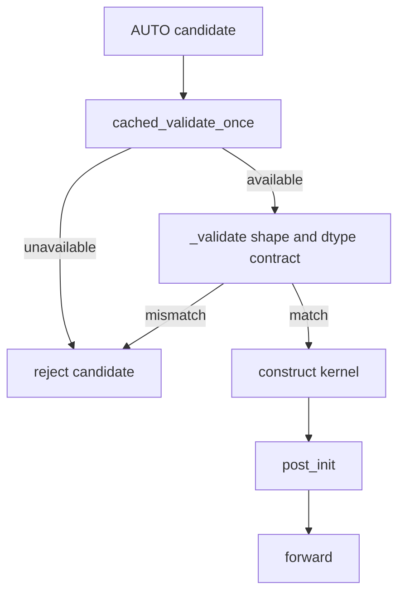
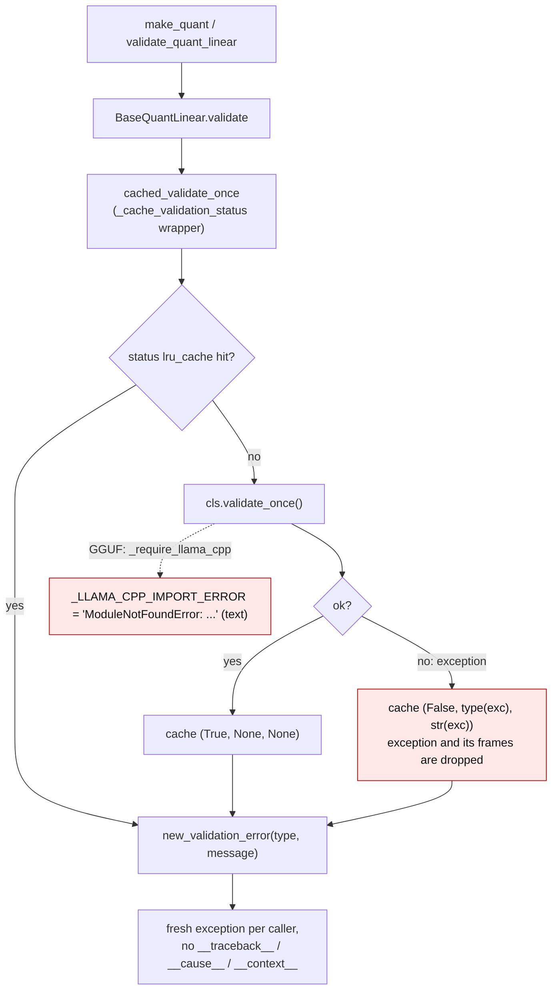
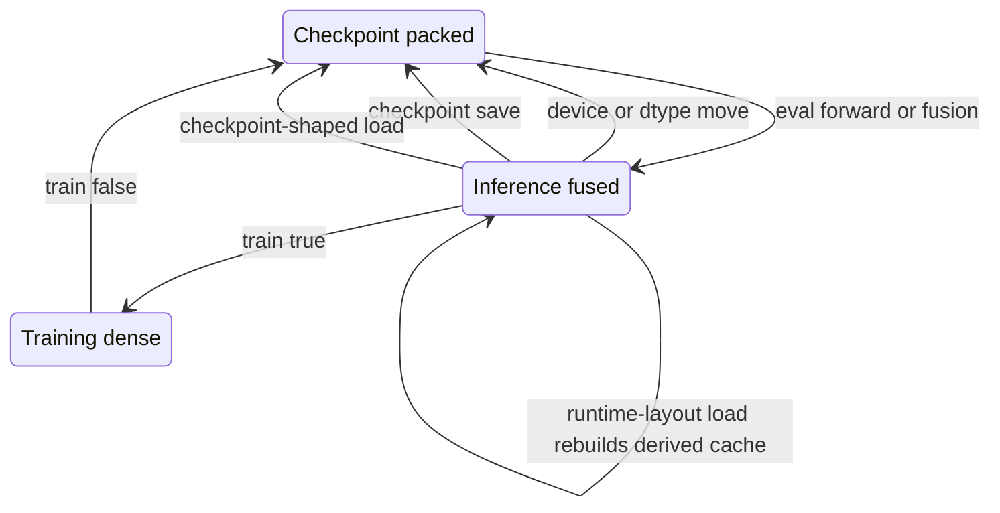
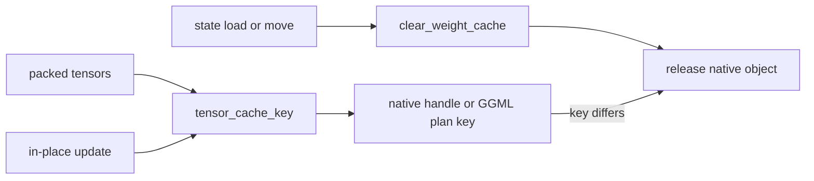

<!--
SPDX-FileCopyrightText: 2026 ModelCloud.ai
SPDX-License-Identifier: Apache-2.0
-->

# Kernel validation and cache lifecycle

GPT-QModel validates a backend's runtime availability and shape contract before
AUTO selects it. Inference-derived caches are keyed by the packed tensors they
consume and are released when those tensors move, load, or change. CPU fused
layers retain one packed checkpoint snapshot while inference has transformed
their runtime layout; returning to training restores that snapshot before the
dense training path runs.

## Backend selection

The old flow let Machete call `_validate` without checking
`validate_once`. It also advertised AWQ and GEMV-fast widths wider than their
packers and native launch tiles accepted. AWQ GEMM now normalizes `-1` to the
layer's input width before checking its native group contract. GEMV-fast
requires group size 128 and output widths divisible by its 128-column prefill
tile. The current flow fails during selection, so AUTO can continue to the next
compatible backend.

### Cached validation failures hold text, not exceptions

`cached_validate_once` caches a kernel's runtime probe for the process. It used
to cache the exception object `validate_once` returned and call
`with_traceback(None)` on it (`gptqmodel/nn_modules/qlinear/__init__.py:592-601`
before #4465). That cleared only the outer traceback. The chained `__cause__`
kept its frames, and each frame's `f_back` kept every caller, including the
loader frames that held the model being loaded. A caller that later ran
`raise err` (`make_quant`, `BaseQuantLinear.__init__`) attached a new traceback
to the cached object. GGUF had a second root: `gguf_cpp._LLAMA_CPP_IMPORT_ERROR`
kept the `ModuleNotFoundError` from `import llama_cpp` in a module global
(`gguf_cpp.py:73`), and `_GGMLBridge._ggml_cuda_error` kept the `ggml-cuda`
load failure on the bridge singleton (`gguf_cpp.py:289`).

`new_validation_error` is the same rebuild `validate_quant_linear` already used
for its device-aware cache; a type whose constructor rejects one message
argument becomes `ValueError(message)`. The error text survives, but the chained
cause does not: the GGUF message now includes the import failure inline
("GGUFCppKernel requires `llama-cpp-python` to be installed (import failed with
ModuleNotFoundError: No module named 'llama_cpp').").

| Case | Before | After |
| --- | --- | --- |
| Qwen2.5-0.5B GGUF `q4_k_m` load without llama-cpp-python, `del` + `gc.collect()` | 471.2 MiB CUDA still allocated | 0.0 MiB |
| Raising the returned error, then calling again | same object, now carrying the raiser's traceback | new object without traceback |

`tests/test_cached_validate_once_lifetime_4465.py` holds a weak reference to a
model in the validating frame and requires it to be collectable after a
chained failure, after raising the returned error, and after a GGUF probe with
`llama_cpp` unavailable.

## Fused CPU training transition

`capture_fused_train_state` stores only the checkpoint's packed `qweight`,
`qzeros`, and `scales`; the AVX512 kernels also keep the `bias` they widen to
FP32. It runs from an inference forward and from `FusionKernelSpec.prepare()`,
because fusion finalizes sources without going through their `forward`.
`restore_fused_train_state` restores those tensors when training resumes, a
device/dtype move reaches `clear_weight_cache`, or an export restores the
checkpoint layout. The snapshot is registered as non-persistent buffers so it
follows the same move and dtype conversion, contains packed state, and never
appears in `state_dict()`.

The int4pack runtime layout shares the checkpoint's keys but not its shapes, so
the checkpoint could not be serialized or reloaded while a layer was
transformed. `get_state_dict_for_save()` therefore restores every transformed
module before collecting tensors, and `_load_from_state_dict()` restores first
when the incoming tensors match the checkpoint shapes. A state dict that
matches the live int4pack operands is the model's own runtime dict; it keeps the
existing self-round-trip behavior and only rebuilds derived caches.

## Derived cache invalidation

ExLlamaV2 rebuilds its native handle when packed tensor identity or version
changes. GGUF keeps at most eight CUDA plans in an LRU and closes an evicted
plan immediately. These caches contain packed weights and execution metadata;
they do not retain reconstructed dense weights.

## Wide activation inputs

Native EXL3 requires FP16 activations. `ExllamaV3Linear.forward` routes BF16 and
FP32 activations to the bounded `ExllamaV3TorchLinear` FP32 reconstruction path
before either native GEMM branch; see [EXL3 wide activation dispatch](exl3-wide-activation-dispatch.md).
GGUF CUDA has its own FP32 input normalization for BF16 callers. The visible
output is cast back to the caller's dtype once.

## Failure contract

| Situation | Result |
| --- | --- |
| Native extension unavailable | reject during validation |
| Width or group violates native tile | reject during validation |
| Packed tensor changes | release and rebuild the derived handle or plan |
| Wrong GGUF input width | raise before padding or launch |
| EXL3 BF16 value exceeds FP16 range | route to bounded Torch FP32 reconstruction |
| Eval-to-train transition | restore packed checkpoint state before training |
| 3-bit GPTQ with narrow pack words | reject; require `torch.int32` |
