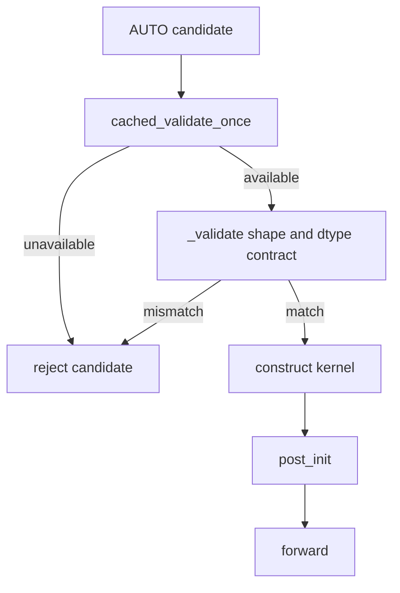
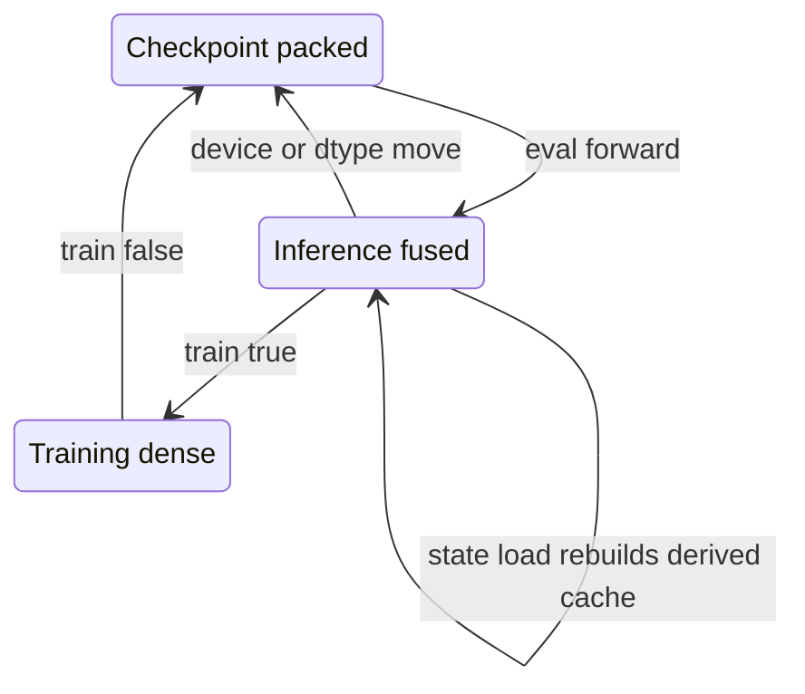
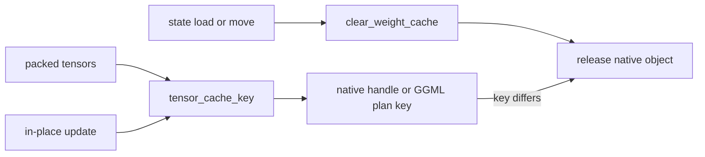

<!--
SPDX-FileCopyrightText: 2026 ModelCloud.ai
SPDX-License-Identifier: Apache-2.0
-->

# Kernel validation and cache lifecycle

GPT-QModel validates a backend's runtime availability and shape contract before
AUTO selects it. Inference-derived caches are keyed by the packed tensors they
consume and are released when those tensors move, load, or change. CPU fused
layers retain one packed checkpoint snapshot while inference has transformed
their runtime layout; returning to training restores that snapshot before the
dense training path runs.

## Backend selection

The old flow let Machete call `_validate` without checking
`validate_once`. It also advertised AWQ and GEMV-fast widths wider than their
packers and native launch tiles accepted. AWQ GEMM now normalizes `-1` to the
layer's input width before checking its native group contract. GEMV-fast
requires group size 128 and output widths divisible by its 128-column prefill
tile. The current flow fails during selection, so AUTO can continue to the next
compatible backend.

## Fused CPU training transition

`capture_fused_train_state` stores only the checkpoint's packed `qweight`,
`qzeros`, and `scales`. `restore_fused_train_state` restores those tensors when
training resumes or a device/dtype move reaches `clear_weight_cache`. The
snapshot is registered as non-persistent buffers so it follows the same move
and dtype conversion, contains packed state, and is discarded after restoration
or before a state-dict load.

## Derived cache invalidation

ExLlamaV2 rebuilds its native handle when packed tensor identity or version
changes. GGUF keeps at most eight CUDA plans in an LRU and closes an evicted
plan immediately. These caches contain packed weights and execution metadata;
they do not retain reconstructed dense weights.

## Wide activation inputs

Native EXL3 requires FP16 activations. `ExllamaV3Linear.forward` routes BF16 and
FP32 activations to the bounded `ExllamaV3TorchLinear` FP32 reconstruction path
before either native GEMM branch; see [EXL3 wide activation dispatch](exl3-wide-activation-dispatch.md).
GGUF CUDA has its own FP32 input normalization for BF16 callers. The visible
output is cast back to the caller's dtype once.

## Failure contract

| Situation | Result |
| --- | --- |
| Native extension unavailable | reject during validation |
| Width or group violates native tile | reject during validation |
| Packed tensor changes | release and rebuild the derived handle or plan |
| Wrong GGUF input width | raise before padding or launch |
| EXL3 BF16 value exceeds FP16 range | route to bounded Torch FP32 reconstruction |
| Eval-to-train transition | restore packed checkpoint state before training |
| 3-bit GPTQ with narrow pack words | reject; require `torch.int32` |
