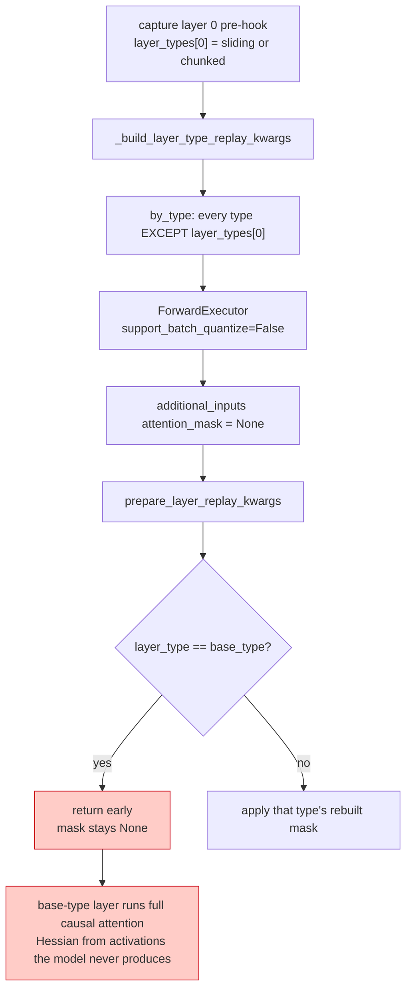
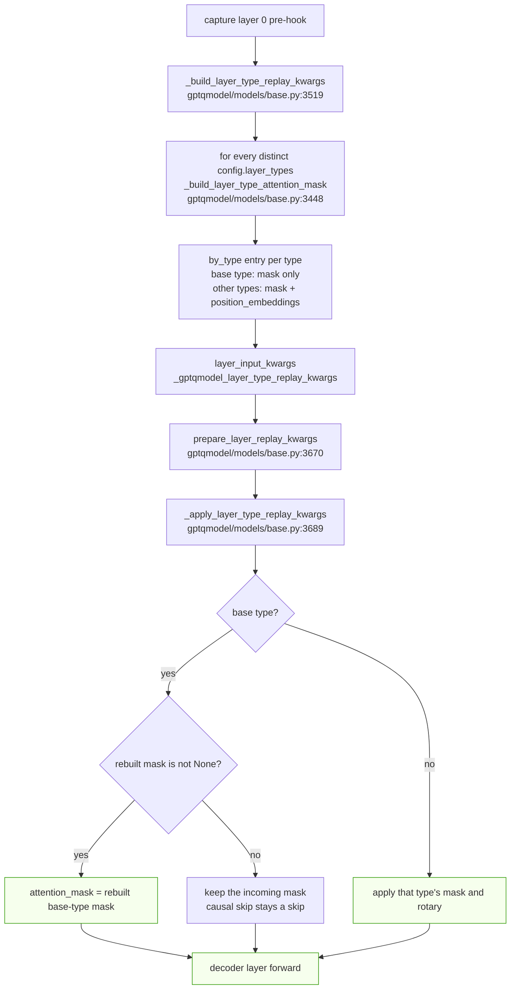
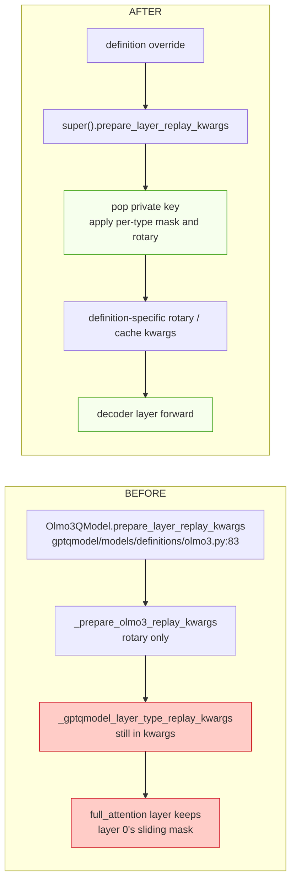
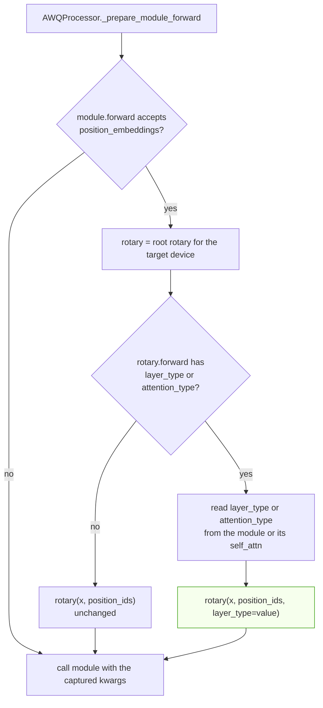

# Layer-type replay masks

Calibration replay runs each decoder layer in isolation, so the kwargs handed to
that layer must match what the model's own forward would have passed at that
depth. `transformers` 5 builds one attention mask per declared
`config.layer_types` entry and hands each decoder layer the entry for its own
type. The capture hook fires on layer 0 only, so the replay path must rebuild the
mask for **every** declared type, including `layer_types[0]`.

This page covers the mask half of that contract. The rotary half and the capture
stage are described in [calibration layer replay](calibration-replay.md).
Introduced by the fix for issue #4038, a follow-up to #4004 / #4019 / #4024.

## The old flow: the base type was never rebuilt

`_build_layer_type_replay_kwargs` iterated over
`sorted(set(layer_types) - {base_type})`, and
`_apply_layer_type_replay_kwargs` returned early when the layer's type equalled
`base_type`. That was safe while `support_batch_quantize=True` replayed the
captured layer-0 mask. It is wrong for the 23 definitions that set
`support_batch_quantize=False`: the forward executor
(`gptqmodel/looper/forward_executor.py:375` and
`gptqmodel/utils/looper_helpers.py:699`) forces `attention_mask=None` for every
layer, and nothing rebuilt the base type's mask.



## The new flow: rebuild the base type too

`_build_layer_type_replay_kwargs` now builds an entry for every distinct declared
type. The base type gets its mask; it keeps the captured layer-0 rotary tuple
instead of rebuilding it. `_apply_layer_type_replay_kwargs` applies a non-`None`
base-type mask even when the incoming mask is `None`, and still applies the
non-base types as before.



The mask builder is `LAYER_PATTERN_TO_MASK_FUNCTION_MAPPING` from
`transformers.masking_utils`, so sliding, chunked, causal, recurrent, and the
Gemma bidirectional overlay all come from the same table the model uses. A type
whose builder is missing or is a `hybrid` dict keeps the incoming kwargs.

## Definition overrides must call the base hook first

`BaseQModel.prepare_layer_replay_kwargs` is where the private capture key is
popped and the per-type mask/rotary is applied. Five definitions overrode the
method without calling `super()`, so
`_gptqmodel_layer_type_replay_kwargs` leaked into the decoder-layer call and the
per-type mask was never applied.



The fixed overrides are `Olmo3QModel` (`gptqmodel/models/definitions/olmo3.py:83`),
both Gemma 4 text and composite classes
(`gptqmodel/models/definitions/gemma4.py:218` and `:287`), both Gemma 4 unified
classes (`gptqmodel/models/definitions/gemma4_unified.py:106` and `:138`), both
Gemma 3n classes (`gptqmodel/models/definitions/gemma3n.py:259` and `:311`), and
`Raon1MiniQModel` (`gptqmodel/models/definitions/raon1_mini.py:46`).

## AWQ needs the same per-layer-type rotary

The AWQ scale search calls the model's rotary module directly in
`AWQProcessor._prepare_module_forward`
(`gptqmodel/looper/awq_processor.py:2731`). Gemma 3/4 and OLMo 3 rotary
embeddings take a required `layer_type` / `attention_type` argument, so the old
`rotary(x, position_ids)` call raised
`TypeError: Gemma3RotaryEmbedding.forward() missing 1 required positional
argument: 'layer_type'` for every Gemma 3 text model.
`_rotary_layer_type_kwargs` (`gptqmodel/looper/awq_processor.py:2835`) inspects
the rotary signature and supplies the attention module's declared type. Rotaries
without that parameter are called exactly as before.



## Calibration batches keep their padding mask

For `support_batch_quantize=False`, `prepare_calibration_dataset` emitted only
`input_ids` (`gptqmodel/utils/calibration.py:680`). A padded tail block from
`calibration_dataset_concat_size`, and any user row that already carried padding,
therefore entered the Hessian as real activations. The non-batched branch now
keeps the normalized `attention_mask`
(`gptqmodel/utils/calibration.py:684`). Batch size stays 1; downstream capture
already reads `kwargs["attention_mask"]`.

## Contracts

| Situation | Behaviour |
| --- | --- |
| base type's rebuilt mask is a tensor | applied even when `support_batch_quantize=False` supplied `None` |
| base type's rebuilt mask is `None` (causal skip) | incoming mask is kept, so a real captured mask is not cleared |
| non-base type's rebuilt mask is `None` but the incoming mask is a tensor | the incoming mask is cleared, because the model passes `None` for that type |
| type maps to no single builder (`hybrid`, unknown) | that type keeps the incoming kwargs |
| `config.layer_types` missing, empty, or one distinct value | no per-type capture; unchanged layer-0 replay |
| rotary forward has no `layer_type` / `attention_type` | AWQ calls it with two arguments as before |
| definition overrides `prepare_layer_replay_kwargs` | must call `super()` first so the private key is consumed |

## Measured before / after

Tiny 2-layer models, sequence length 6, `sliding_window=2` (Gemma 3, OLMo 3) and
`attention_chunk_size=2` (Llama 4), no padding. `drop=True` reproduces
`support_batch_quantize=False` replay; `drop=False` is the batched path. Each row
compares the mask the model's own forward passed to the layer with the mask the
replay hook produced.

Before (`origin/main` @ `e6b19c5f8`):

```text
== gemma3 drop_captured_mask=True
L0 sliding_attention  native=(1, 1, 6, 6):torch.bool replay=None                 match=False leaked_key=False
L1 full_attention     native=None                 replay=None                 match=True leaked_key=False
== olmo3 drop_captured_mask=True
L0 sliding_attention  native=(1, 1, 6, 6):torch.bool replay=None                 match=False leaked_key=True
L1 full_attention     native=None                 replay=None                 match=True leaked_key=True
== olmo3 drop_captured_mask=False
L0 sliding_attention  native=(1, 1, 6, 6):torch.bool replay=(1, 1, 6, 6):torch.bool match=True leaked_key=True
L1 full_attention     native=None                 replay=(1, 1, 6, 6):torch.bool match=False leaked_key=True
== llama4 drop_captured_mask=True
L0 chunked_attention  native=(1, 1, 6, 6):torch.bool replay=None                 match=False leaked_key=False
L1 full_attention     native=None                 replay=None                 match=True leaked_key=False
```

After:

```text
== gemma3 drop_captured_mask=True
L0 sliding_attention  native=(1, 1, 6, 6):torch.bool replay=(1, 1, 6, 6):torch.bool match=True leaked_key=False
L1 full_attention     native=None                 replay=None                 match=True leaked_key=False
== olmo3 drop_captured_mask=True
L0 sliding_attention  native=(1, 1, 6, 6):torch.bool replay=(1, 1, 6, 6):torch.bool match=True leaked_key=False
L1 full_attention     native=None                 replay=None                 match=True leaked_key=False
== olmo3 drop_captured_mask=False
L0 sliding_attention  native=(1, 1, 6, 6):torch.bool replay=(1, 1, 6, 6):torch.bool match=True leaked_key=False
L1 full_attention     native=None                 replay=None                 match=True leaked_key=False
== llama4 drop_captured_mask=True
L0 chunked_attention  native=(1, 1, 6, 6):torch.bool replay=(1, 1, 6, 6):torch.bool match=True leaked_key=False
L1 full_attention     native=None                 replay=None                 match=True leaked_key=False
```

Every `match=True` row compares the replay mask with the native mask using
`torch.equal`, so the two are bit-identical
(`tests/test_layer_type_replay.py::test_base_layer_type_mask_survives_support_batch_quantize_false`
and `::test_replay_kwargs_match_native_layer_type`).

## Tests

| Test | Invariant |
| --- | --- |
| `test_base_layer_type_mask_survives_support_batch_quantize_false` | base-type layer gets the native sliding/chunked mask when replay is handed `None` |
| `test_replay_kwargs_match_native_layer_type` | every layer's mask and rotary equal the model's own forward |
| `test_model_override_consumes_private_layer_type_capture_key` | no `_gptqmodel_*` key leaks from the eight fixed overrides |
| `test_module_forward_passes_layer_type_to_typed_rotary` | AWQ passes `layer_type` to a typed rotary |
| `test_module_forward_passes_attention_type_to_typed_rotary` | AWQ passes OLMo 3's `attention_type` |
| `test_module_forward_reads_layer_type_from_nested_self_attn` | a later AWQ group that passes the decoder layer still resolves the attention type |
| `test_support_batch_quantize_false_keeps_user_attention_mask` | non-batched calibration keeps a user padding mask |
| `test_support_batch_quantize_false_keeps_concat_tail_padding` | the concat tail's pad tokens stay masked |

## Not in scope

- `stage_subset.py:1341` removes hooks outside a `finally`; a failed quantization
  already leaves the model unusable, so this is unchanged.
- `calibration_data_min_length` still checks the padded length of the first row.
