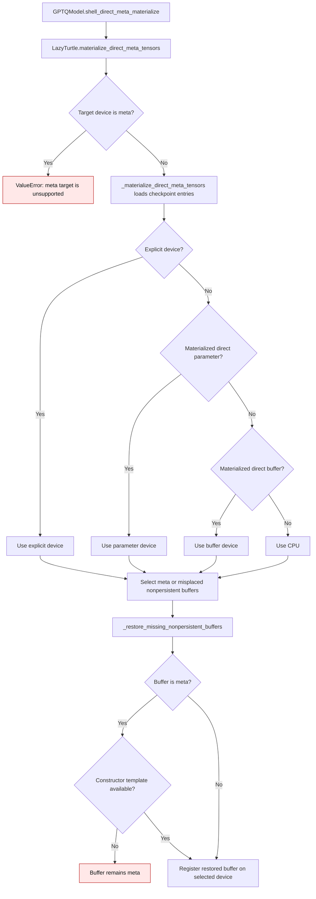

# Lazy checkpoint materialization

`GPTQModel.shell_direct_meta_materialize()` asks `LazyTurtle` to fill a module's
direct meta tensors from its checkpoint. Constructor-owned nonpersistent
buffers, such as rotary frequencies, have no checkpoint entry and must be
restored separately. An explicit `device` controls their destination. When the
caller leaves `device=None`, a materialized direct parameter establishes the
module's device; an existing direct buffer is the next choice, followed by CPU.

The earlier default-device branch at `gptqmodel/utils/structure.py:1179-1189`
looked only at direct buffers and chose CPU when they were all meta. The
current branch at `gptqmodel/utils/structure.py:1179-1200` checks materialized
direct parameters first. The restored-buffer selection and call remain at
`gptqmodel/utils/structure.py:1201-1214`.

| `device=None` module state | Earlier restored-buffer device | Current device |
| --- | --- | --- |
| CUDA parameter, meta nonpersistent buffer | CPU | CUDA parameter's device |
| CUDA parameter, CPU nonpersistent buffer | CPU buffer left in place | CUDA parameter's device |
| No direct parameter, materialized direct buffer | Buffer's device | Buffer's device |
| No materialized direct tensor | CPU | CPU |

An explicit device remains authoritative for restored nonpersistent buffers.
If a meta buffer cannot be reconstructed from its module constructor, the
restoration helper leaves it meta; callers must handle that module's custom
initialization requirements.

See [PR #3617](https://github.com/ModelCloud/GPTQModel/pull/3617) for the
CUDA reproducer and change rationale.
