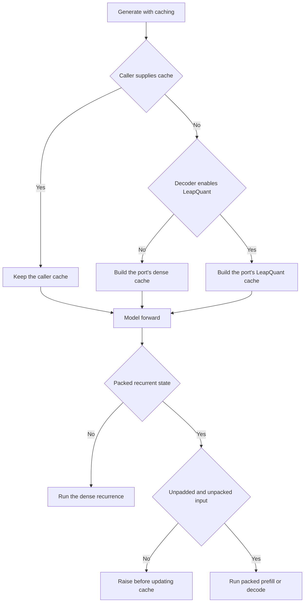
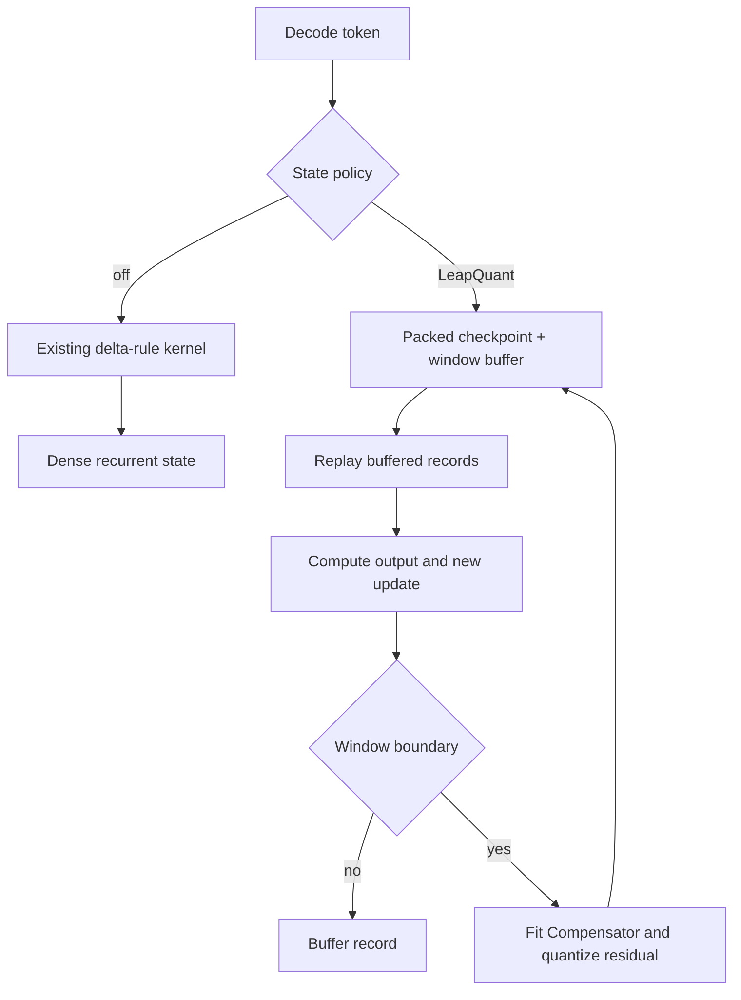
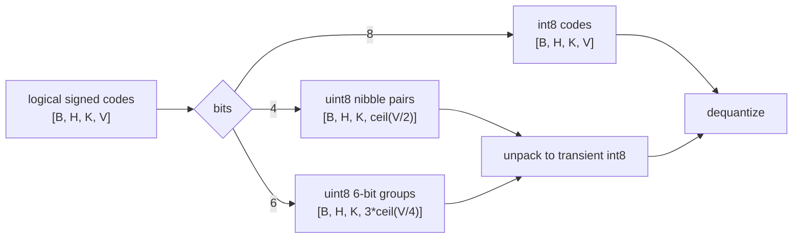

# LeapQuant recurrent-state quantization

[Documentation index](README.md) · [Project overview](../README.md)

LeapQuant is an opt-in runtime quantizer for the fixed-size recurrent state of
delta-rule linear attention. It is **not** a weight format: model weights,
checkpoints, and `quant_method` are unchanged. LeapQuant composes with weight
quantization in the supported GPT-QModel ports.

Reference: *LeapQuant: Efficient Linear Attention with Accurate Recurrent State
Quantization*, [arXiv:2609.38166](https://arxiv.org/abs/2609.38166).

## Why the state

A Gated DeltaNet (GDN) or Kimi Delta Attention (KDA) layer compresses the
context into a state matrix `S` of shape `[key_dim, value_dim]`. Every decoded
token reads that matrix, applies a diagonal decay and one rank-one delta-rule
update, and writes it back. The state is both a memory cost and a per-token
traffic cost, so weight-only quantization does not address it.

LeapQuant uses three training-free mechanisms:

1. **Per-window quantization.** The packed checkpoint stays fixed for a window
   of tokens. Each token's `(decay, key, update)` record is buffered in higher
   precision, and the state is re-quantized only at the window boundary.
2. **Compensator Tokens.** A rank-`R` high-precision outer-product term captures
   the state's dominant structure. Only the residual is quantized, and the term
   is replayed additively at readout.
3. **Residual smoothing.** Key rows are rescaled by the square root of their
   mean residual magnitude before symmetric quantization, then rescaled back at
   readout.

## Usage

```python
from gptqmodel import GPTQModel, LeapQuantConfig

model = GPTQModel.load(
    "Kimi/Kimi-K3",
    state_quant=LeapQuantConfig(bits=8, window=16, rank=4),
)
out = model.generate("...", max_new_tokens=128)
```

The option is off by default. It can be enabled or disabled after loading, but
the policy must be set before the first forward; an existing recurrent-state
cache keeps the policy it was created with.

```python
model.enable_state_quant(LeapQuantConfig(bits=8))
model.enable_state_quant(None)  # use the unquantized path for new caches
```

| Field | Default | Meaning |
| --- | --- | --- |
| `bits` | `8` | Symmetric code width: `4`, `6`, or `8`. 4/6-bit codes are bit-packed; 8-bit is the production accuracy point. |
| `window` | `16` | Tokens between state quantizations. `1` is per-token quantization. |
| `rank` | `4` | Compensator Tokens. `0` disables them; `6` is recommended for 4/6-bit. |
| `smooth` | `True` | Key-row residual smoothing. |
| `buffer_dtype` | `bfloat16` | In-window key/update buffer dtype (`float16`, `bfloat16`, or `float32`). |
| `lowrank_iters` | `2` | Power iterations for the randomized Compensator fit. |
| `lowrank_oversample` | `4` | Oversampling columns for that fit. |

## Supported ports

| Family | Port | Status |
| --- | --- | --- |
| Kimi K3 with KDA layers | `models/ports/kimi_k3` | Supported |
| Qwen3.5 dense (GDN) | `models/ports/native/qwen3_5` | Supported |
| Qwen3.5-MoE (GDN) | `models/ports/native/qwen3_5_moe` | Supported |
| Qwen3-Next (GDN) | `models/ports/native/qwen3_next` | Supported |
| GLM-5.3 (KDA) | `models/ports/native/glm5_next` | Supported |

The quantizer applies to the delta-rule family whose update is a diagonal decay
followed by one rank-one correction. It does not apply to softmax attention or
to Mamba-style selective SSMs.

GDN permits fewer key heads than value heads. The quantizer repeats each key
head across its value-head group in the same order as the port's delta-rule
kernel, and each value head keeps an independent packed state.

## Flow

`generate()` prepares the cache before the first forward. Qwen3.5, Qwen3.5-MoE,
Qwen3-Next and GLM-5.3 resolve the decoder policy in
`LeapQuantGenerationMixin`. The Kimi K3 port creates its own cache in
`KimiLinearModel.forward`. A caller-provided cache retains the policy selected
when it was created.





### Before and after

| Area | Before | After (LeapQuant enabled) |
| --- | --- | --- |
| Generation cache | The generation framework creates the default dense cache for Qwen3.5, Qwen3.5-MoE, Qwen3-Next and GLM-5.3. | The decoder's LeapQuant policy selects a packed recurrent cache before the first forward. |
| Decode state | `KimiDeltaAttention`, `Qwen3_5GatedDeltaNet`, `Qwen3_5MoeGatedDeltaNet`, `Qwen3NextGatedDeltaNet`, and `Glm5NextTextLinearAttention` read and rewrite a dense recurrent tensor through the cache layer. | The cache layer owns a `LeapQuantState`; decode replays the packed checkpoint and buffered records, then re-quantizes at the window boundary. |
| Cache ownership | A Transformers `LinearAttentionLayer` or `KimiDeltaCacheLayer` stores the dense recurrent tensor. | `LeapQuantLinearAttentionLayer` or `KimiDeltaCacheLayer(state_quant=...)` stores packed codes, scales, Compensator factors, and the window buffer; the dense slot stays empty. |
| Prefill | The port kernel writes the final dense state. | The same dense kernel runs, then `LeapQuantState.quantize_` checkpoints the final state and clears the window. |
| Invalid cache inputs | Ports process input masks and cache operations for their dense recurrence. | The packed path rejects padding, packed sequence boundaries, crop, live batch expansion, and a changed state shape before updating the cache. |
| Default | Dense FP32 recurrent state. | Unchanged: `state_quant=None` returns the original cache and kernel path. |

Prefill uses the port's existing FP32 delta-rule kernel: the packed checkpoint
is materialized for the call, the prompt runs in the model dtype, and the final
state is checkpointed and the window reset. Decode uses the packed path above.
The portable decode path replays the buffered window into a transient dense
FP32 state for each step and releases it immediately; it is never retained.
No dense state is retained after the call.

`LeapQuantState.prefill()` processes a prompt on a temporary copy of the packed
checkpoint and window buffer. It commits that copy once all outputs are ready.
If a later token fails, the caller can correct the prompt and retry it against
the original state. The model ports use their own prefill kernels.

## Storage

The persistent representation is:

| Component | Stored layout |
| --- | --- |
| 8-bit codes | `int8 [B, H, K, V]` |
| 4-bit codes | `uint8 [B, H, K, ceil(V/2)]`, two signed nibbles per byte |
| 6-bit codes | `uint8 [B, H, K, 3*ceil(V/4)]`, four signed 6-bit codes per three bytes |
| key scale | `float32 [B, H, K]` |
| value scale | `float32 [B, H, V]` |
| compensator factors | `float16 [B, H, K, R]` and `float16 [B, H, V, R]` |
| window keys/updates | `[B, H, L, K/V]` in the configured buffer dtype |
| window decay records | `[B, H, L, K]` for KDA or `[B, H, L, 1]` for GDN, FP32 |

The packed widths use the same symmetric integer grid as 8-bit:
`code = round(residual / scale)`, clamped to `[-qmax, qmax]` with
`qmax = 2^(bits-1) - 1`. The negative endpoint `-2^(bits-1)` is unused, so
every stored code fits the symmetric range and the packer never needs an
out-of-range sentinel.

For 4-bit rows, the first code occupies the low nibble and the second the high
nibble. For 6-bit rows, four codes form one 24-bit little-endian group: code 0
is bits 0-5, code 1 is bits 6-11, code 2 is bits 12-17, and code 3 is bits
18-23. Codes use two's-complement representation, so unpacking sign-extends
each field. A row whose `V` is not a whole number of groups is padded with
zero codes; the padding is not part of the logical state and is discarded when
the row is unpacked.

For `K=V=128`, `L=16`, `R=4`, the checkpoint is about 0.69 bytes per state
element at 4-bit, 0.94 at 6-bit, and 1.19 at 8-bit before the window buffer.
The buffer adds about 8 KiB per head for GDN and about 16 KiB per head for
KDA. The buffer is part of `storage_bytes()` and is never omitted from memory
accounting.



| Area | Before | After |
| --- | --- | --- |
| 4-bit code storage | `int8 [B, H, K, V]`, 1 B/elem | `uint8` nibble pairs, 0.5 B/elem |
| 6-bit code storage | `int8 [B, H, K, V]`, 1 B/elem | `uint8` 4-in-3 groups, 0.75 B/elem |
| 8-bit code storage | `int8 [B, H, K, V]` | unchanged |
| `checkpoint_bytes()` | identical for 4/6/8-bit | decreases with `bits` |
| `packed_state()` | format version 1, int8 codes | format version 2, `code_container` plus packed codes |
| Dequantize | reads int8 codes directly | unpacks to a transient int8 tensor, then dequantizes |

`packed_state()` now reports format version 2 and the `code_container` field.
Version 1 snapshots stored one int8 element per code and are rejected on
restore.

Unpacking is transient: the logical `int8` tensor is consumed by the current
dequantization and is never retained as a second persistent copy. 8-bit remains
the recommended accuracy point, and 4/6-bit now reduce checkpoint storage as
well as code width.

## Constraints

The implementation fails closed instead of silently degrading:

- Use unpadded input with an optional 2D all-ones mask. The ports check this
  before masking or changing the cache, including during single-token decode.
- The packed path rejects `cu_seqlens` and other packed sequence boundaries.
- Use the default dynamic cache for generation with LeapQuant. A cache can
  reorder live sequences at the same batch size. A live cache rejects
  expansion: `batch_repeat_interleave` raises, and a forward whose batch size
  or state geometry differs from the existing packed state raises instead of
  rebuilding it. Device moves keep the packed state.
- The packed cache supports ordinary generation and cached continuation.
  Operations that require recurrent-state rollback raise.
- Training and autograd are not supported.
- The prefill path uses a transient dense state; it is not a memory-saving
  claim.

## Validation

The tests are:

```bash
python -m pytest tests/test_leapquant_state.py tests/test_leapquant_models.py -q
```

`test_leapquant_state.py` compares the quantizer against a hand-written FP32
delta-rule recurrence, covers 4/6/8-bit, window boundaries, Compensator rank,
smoothing, packed-container bit layout, every representable code, partial rows,
storage accounting, reorder, and non-finite rejection. `test_leapquant_models.py`
checks Kimi K3, Qwen3.5, Qwen3.5-MoE, Qwen3-Next, and GLM-5.3 prefill/decode
parity, packed-code cache ownership, cache-layer selection, padded-mask and
`cu_seqlens` rejection, and the public toggle. The regressions also cover
`generate()`, cache continuation after offload and reorder, and retries after an
invalid packed restore or a quantization failure.

The portable Torch path is a correctness and memory baseline, not a
throughput-optimized kernel. Measure it with:

```bash
python scripts/benchmark_leapquant_state.py --device cuda
```

Pass `--bits 4` or `--bits 6` to measure the packed decode path; the script
also prints the checkpoint bytes for the selected width.

On one accelerator, with `K=V=128`, 8 heads, `window=16`, `rank=4`, 8-bit, and
model-shaped inputs:

| Step | Time |
| --- | ---: |
| Dense FP32 delta-rule step | 64-70 µs |
| LeapQuant decode step | 724 µs |
| Compensator fit (once per window) | 1175 µs |

Decode is about 10x the dense step, and the fit dominates the per-token cost
through its one-per-window amortization. Two costs remain structural:

- The step is dispatch-bound. Roughly 40 small eager kernels per token, plus
  one host synchronization for the finiteness check, cost more than the
  arithmetic.
- The fit is limited by the accelerator linear-algebra drivers. The current
  form uses a Cholesky-factor orthonormalization and a Gram-matrix
  eigendecomposition because a batched QR plus a wide SVD of the sketch cost
  several times more on the same hardware.

The paper's speedups come from specialized kernels. A native kernel is a
separate follow-up and is not claimed here.
