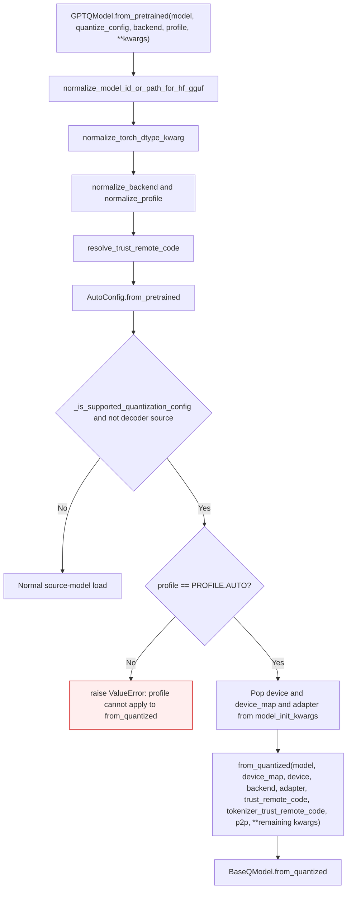
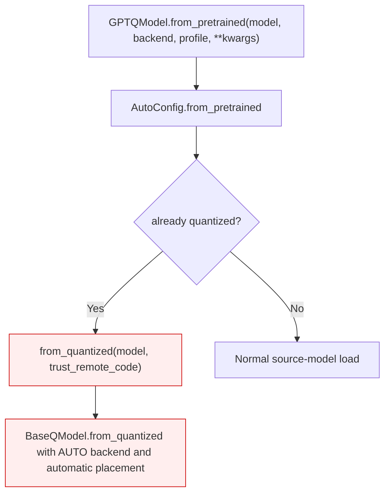

<!-- SPDX-FileCopyrightText: 2026 ModelCloud.ai -->
<!-- SPDX-License-Identifier: Apache-2.0 -->

# Quantized-checkpoint redirect

`GPTQModel.from_pretrained` is the source-model entry point, but a path whose
`AutoConfig` already carries a supported quantization config cannot be
quantized again. The loader detects that case and redirects the call to
`from_quantized`. The redirect exists so that a single call site works for both
dense and already-quantized checkpoints; it must not change what the caller
asked for.

## New flow

`quantize_config` is a target-quantization request. It is not forwarded because
`from_quantized` cannot apply it; the warn message already tells the caller to
pass an unquantized source when quantization is intended.

## Previous flow

| Mechanism | Previous behavior | New behavior |
| --- | --- | --- |
| Redirect call site (`gptqmodel/models/auto.py:936` before this change) | `from_quantized(model_id_or_path, trust_remote_code=trust_remote_code)` | Forwards every applicable explicit option |
| Backend | Silently reset to `BACKEND.AUTO` | Forwarded from the caller |
| Device and device map | Silently recomputed by automatic placement | Forwarded |
| dtype, fuse, revision, adapter, p2p | Dropped | Forwarded (adapter/device/device_map extracted, the rest pass through) |
| Tokenizer trust | Dropped | Forwarded as `tokenizer_trust_remote_code` |
| `profile` | Dropped | Rejected with `ValueError`; `from_quantized` has no profile stage |
| `quantize_config` | Dropped | Still dropped: it describes a new quantization, not a load option |

## Failure and ambiguity contract

| Situation | Before | After |
| --- | --- | --- |
| Caller asks for `BACKEND.TORCH` on a quantized checkpoint | Loaded with `BACKEND.AUTO` | Loaded with `BACKEND.TORCH` |
| Caller pins `device="cpu"` | Placement decided automatically | `device="cpu"` reaches `from_quantized` |
| Caller passes `profile=PROFILE.FAST` | Silently ignored | `ValueError` naming the profile |
| Caller passes `quantize_config` with an auto module decoder | Dropped | Dropped; the decoder path still loads the quantized source |

The redirect stays fail-closed for options that have no meaning on
`from_quantized`; it never substitutes a default for an explicit request.

## Validation

| Command | Result |
| --- | --- |
| `pytest tests/test_local_model_paths.py -q` | 29 passed |
| `pytest tests/test_local_model_paths.py -k redirect -q` before the fix | 2 failed (the new redirect tests) |
| `pytest tests/test_local_model_paths.py -k redirect -q` after the fix | 4 passed |

The redirect regression asserts that `backend`, `device`, `device_map`, `dtype`,
`fuse`, `revision`, and `tokenizer_trust_remote_code` all arrive at
`from_quantized`, and that a non-`AUTO` profile raises.
