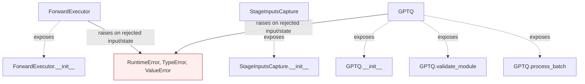

# Carry causal replay and durable recovery callbacks

Carry the existing layer/subset replay integration: input-capture hooks, output consumers, disk-backed boundaries, committed-batch callbacks, route recovery phases, bounded release, and shared Hessian ownership. Preserve the working control flow without a new looper abstraction.

This page describes the shipped API and conditional calls carried from the working fork. It is a structural call map, with no invented execution ordering between public entry points. Solid edges name calls present in the source; dashed edges expose class entry points. Rejected states and propagated failures are marked separately.

| Before this extraction layer | Carried implementation |
|---|---|
| Previous stack layer: `gptqmodel/looper/forward_executor.py:36` | `gptqmodel/looper/forward_executor.py:36`: `ForwardExecutor` |
| Previous stack layer: `gptqmodel/looper/stage_inputs_capture.py:47` | `gptqmodel/looper/stage_inputs_capture.py:47`: `StageInputsCapture` |
| Previous stack layer: `gptqmodel/quantization/gptq.py:292` | `gptqmodel/quantization/gptq.py:328`: `GPTQ` |

The previous stack layer supplies dependencies. Standalone store/policy APIs are connected by the later processor, looper and model layers rather than being enabled implicitly here.

Validation for this extraction is limited to Python parsing, dependency inspection and whitespace checks. Existing regression/oracle tests are carried with the feature; no new model quantization, accelerator work, hardware benchmark or broad runtime revalidation was performed. The author reports successful prior use in the fork. This draft seeks initial feedback on value and scope before further refactoring or validation.
