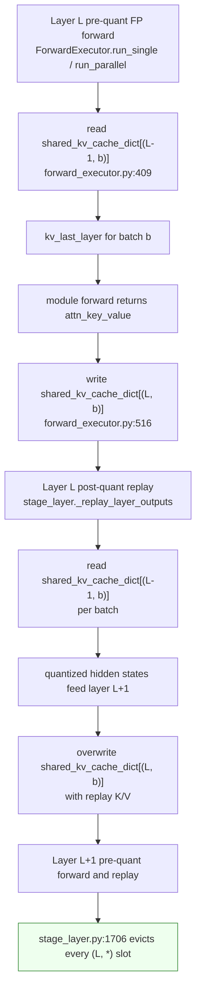

# Cross-layer shared KV cache

Some decoder stacks let a layer reuse the previous layer's attention K/V
instead of projecting its own. Hymba is the motivating model: a layer is
constructed with `reuse_kv=True`, receives `kv_last_layer` in its forward
signature, and feeds those tensors straight into attention. The producing layer
does not need to consume `kv_last_layer`; the model definition opts in with
`write_shared_kv_cache = True` (`gptqmodel/models/definitions/hymba.py`).

The quantization loop therefore has to carry two tensors between adjacent
layers for every calibration batch:

- the hidden-state activation that feeds the next layer, and
- the `attn_key_value` tuple that the next `reuse_kv` layer consumes.

`shared_kv_cache_dict` carries the second one. It is created once per run in
`ModuleLooper._loop_impl` and threaded through `run_layer_stage`,
`run_subset_stage`, and `ForwardExecutor`.

## Why the cache is keyed by batch

A calibration run walks batches 0..N-1 through every layer. A `reuse_kv` layer's
batch `b` must observe exactly the K/V that batch `b` produced in the previous
layer. Keying the cache by layer alone serves batch 0's tensors to every later
batch. That silently corrupts the Hessian for batches 1..N-1, and it fails
outright when the batches have different sequence shapes.

## Why the replay pass must overwrite

Each decoder layer runs forward twice:

1. the pre-quant (FP) forward, which captures the inputs the quantizer needs, and
2. the post-quant replay (`_replay_layer_outputs`), which produces the quantized
   hidden states that feed the next layer (`ForwardProcessor.forward.replay_after_process`).

Both passes publish K/V for the same `(layer, batch)`. Only the replay's K/V is
paired with the quantized hidden states the next layer consumes, so the cache
write must overwrite, not fill only when empty. An `is None` guard pins the
stale FP capture for the rest of the run.

## Shipped flow

`ForwardExecutor._shared_kv_key` (`forward_executor.py:122`) is the single place
that builds the `(layer_index, batch_idx)` tuple. The serial path reads the
previous layer's slot inside its batch loop (`forward_executor.py:409`) and
publishes unconditionally (`forward_executor.py:516`). The data-parallel path
reads the slot when it submits each batch (`forward_executor.py:787`) and
publishes when it resolves that batch's future (`forward_executor.py:848`).

## Before / after

| Old mechanism | New mechanism |
| --- | --- |
| `shared_kv_cache_dict[layer_index]` written only when `is None` (`forward_executor.py:447`, `:749` on the parent commit) | Keyed by `(layer_index, batch_idx)` and overwritten on every publish (`forward_executor.py:516`, `:848`) |
| `prev_kv` read once before the batch loop (`forward_executor.py:324`, `:624` on the parent commit) | Read per batch inside the loop (`forward_executor.py:409`, `:787`) |
| `shared_kv_cache_dict.pop(layer_index - 1, None)` (`stage_layer.py:1680` on the parent commit) | Evict every `(layer_index - 1, *)` slot (`stage_layer.py:1706`) |

## Failure and ambiguity paths

- **Missing predecessor KV.** If batch `b` has no slot for layer `L-1`,
  `prev_kv` is `None` and `kv_last_layer` is not added to the forward kwargs.
  Hymba's attention asserts `kv_last_layer is not None`, so the run fails
  loudly. It no longer substitutes another batch's tensors.
- **Early-stopped batch.** `StopForward` is a normal MoE early-stop outcome and
  produces no activation. The executor keeps the batch's positional slot as an
  empty list (`ForwardExecutor._store_missing_output`, `_pad_output_slots`) and
  does not forward an empty batch, so later batches stay aligned with their own
  `layer_input_kwargs`, attention mask, and `position_ids`.
- **Eviction.** The cache only holds the immediately preceding layer's slots.
  After layer `L` finishes, every `(L-1, *)` entry is removed; the cache size is
  bounded by `2 * batch_count` regardless of model depth.

## Not in scope

The cache is calibration-time scratch state. It is not serialized in a
checkpoint, and it is not used by inference kernels.
