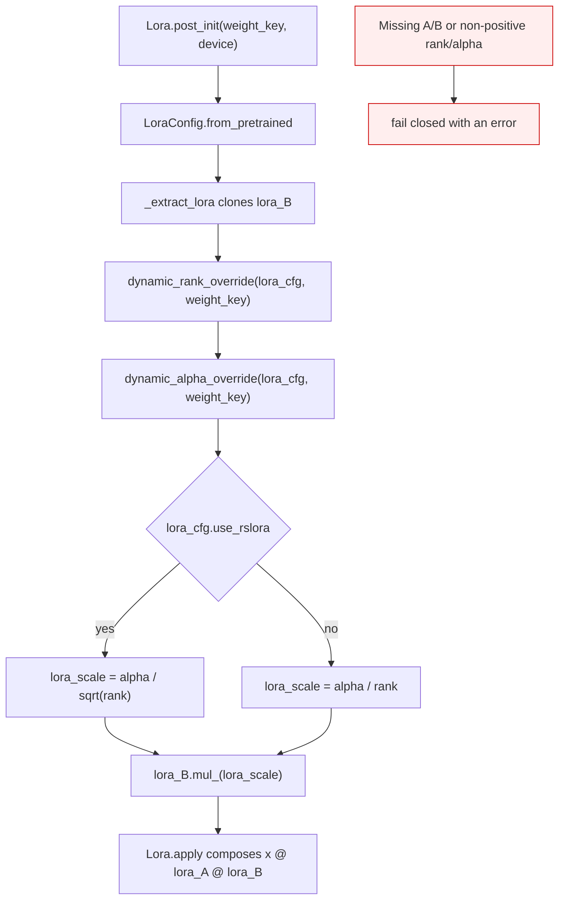
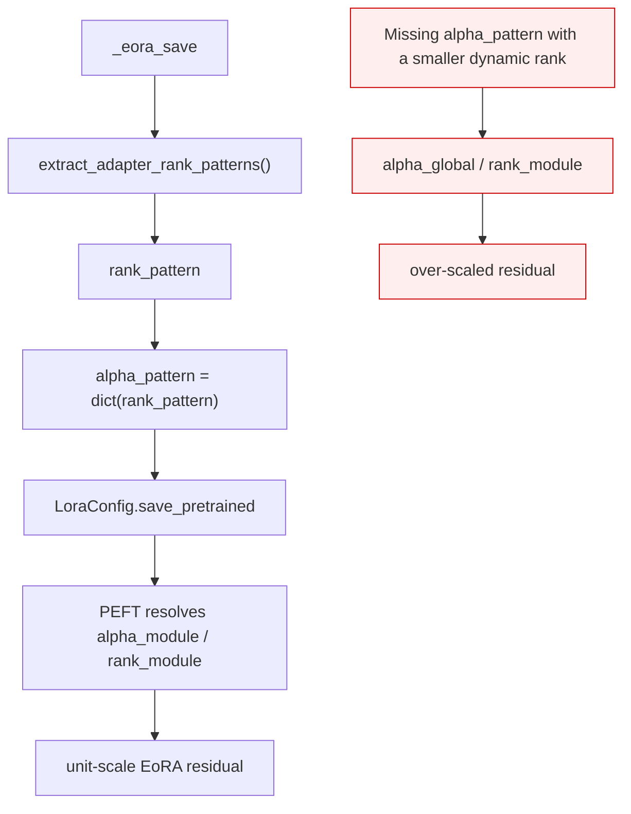
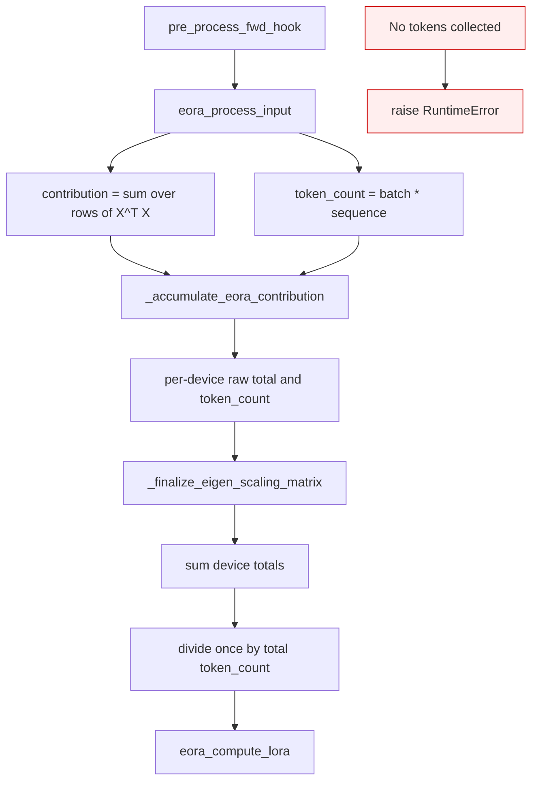

<!-- SPDX-FileCopyrightText: 2026 ModelCloud.ai -->
<!-- SPDX-License-Identifier: Apache-2.0 -->

# LoRA and EoRA scaling semantics

GPT-QModel applies PEFT adapter scales when it binds a saved adapter to a
quantized module. The scale depends on that module's effective rank and alpha,
so `rank_pattern` and `alpha_pattern` are resolved before the first forward.
EoRA exports use the same contract: every generated adapter carries metadata
that keeps its correction at unit scale.

EoRA calibration uses a second, separate lifecycle. `eora_process_input`
computes an unnormalized `XᵀX` contribution and returns its token count.
`EoraProcessor` keeps raw sums on each participating device, then
`_finalize_eigen_scaling_matrix` sums those sums and divides once by the total
token count. This gives every calibration token the same weight.

## Saved LoRA loading

The scale is folded into the private contiguous `lora_B` clone once during
`Lora.post_init`. `Lora.apply` remains a single adapter multiply, and the
immutable tensors in `AdapterCache` stay unscaled. An exported PEFT adapter
therefore retains its original `lora_A` and `lora_B` values.

## EoRA export

EoRA's low-rank factorization already targets the quantized residual at scale
one. Mirroring each dynamic rank into `alpha_pattern` preserves that target
when the same directory is loaded by GPT-QModel, PEFT, or vLLM.

## EoRA covariance accumulation

Per-device raw totals preserve the existing multi-device concurrency boundary.
They are not normalized until all device segments are combined, so batch order
and the number of calibration batches cannot change a token's weight.

## Before and after

| Mechanism at `origin/main` (`00163850`) | Old location | New location | Failure removed |
| --- | --- | --- | --- |
| `Lora.apply` used the adapter delta at implicit scale 1 | `gptqmodel/adapter/adapter.py:203-227` | `gptqmodel/adapter/adapter.py:328-357` resolves alpha/rank and folds the scale once | Global alpha, `alpha_pattern`, and rsLoRA were ignored |
| `_eora_save` wrote `rank_pattern` without matching alphas | `gptqmodel/models/writer.py:1565-1578` | `gptqmodel/models/writer.py:1565-1579` mirrors ranks into `alpha_pattern` | PEFT applied `global_alpha / module_rank` |
| `eora_process_input` divided by `sample_size` and returned a geometric decay factor | `gptqmodel/eora/eora.py:28-56` | `gptqmodel/eora/eora.py:26-51` returns raw `XᵀX` and token count | Earlier batches decayed exponentially |
| `_accumulate_eora_contribution` rescaled the running total by `N / (N + batch)` | `gptqmodel/looper/eora_processor.py:170-227` | `gptqmodel/looper/eora_processor.py:167-203` adds raw sums and token counts | Effective use of only the last batches |
| `merge_eora_segments` combined scaled segment products | `gptqmodel/eora/eora.py:59-80` and `gptqmodel/looper/eora_processor.py:229-257` | `_finalize_eigen_scaling_matrix` at `gptqmodel/looper/eora_processor.py:205-237` normalizes the total once | Segment order became numerically significant |

## Failure and ambiguity contract

| Situation | Before | After |
| --- | --- | --- |
| `lora_alpha=32`, rank 8 | delta at scale 1 | delta at scale 4 |
| `use_rslora=True`, alpha 32, rank 8 | delta at scale 1 | delta at scale `32 / sqrt(8)` |
| Dynamic rank 4 in a global-rank-16 EoRA export | PEFT scale 4 | PEFT scale 1 |
| Sixteen unequal calibration batches | Earlier batches decay geometrically | Every token has weight `1 / total_tokens` |
| Missing adapter A/B tensors | assertion | assertion, unchanged |
| Invalid non-positive rank or alpha | undefined or implicit | `ValueError` |
| No activation tokens at finalization | scaled empty/ambiguous state | `RuntimeError` |

## Validation

The regressions compare against explicit Torch arithmetic that reads only the
original A/B tensors, not the loader's intermediates.

| Test | Invariant |
| --- | --- |
| `tests/test_adapter_scaling.py::test_loaded_lora_uses_global_alpha_scale` | Base `lora_alpha / rank` and rsLoRA scaling |
| `tests/test_adapter_scaling.py::test_loaded_lora_uses_per_module_peft_scale` | `rank_pattern` and `alpha_pattern` precedence |
| `tests/test_adapter_scaling.py::test_eora_dynamic_rank_export_round_trips_at_unit_scale` | Dynamic-rank EoRA export and load preserve scale 1 |
| `tests/test_eora_merge.py::test_eora_covariance_weights_every_batch_uniformly` | Hook and finalization equal a uniform token covariance |

On unmodified `origin/main`, the final regression files reported 7 failures and
1 skip. The global-alpha standard and rsLoRA output errors were 25.2 and 86.635
absolute; the patterned adapter errors were 0.705357 and 1.410714 absolute. The
covariance differed from the independent uniform oracle by 1.241275 absolute and
38.7263 relative. After the fix, the combined CUDA run passed 23 tests with the
optional PEFT check skipped because PEFT is not installed in that environment.
