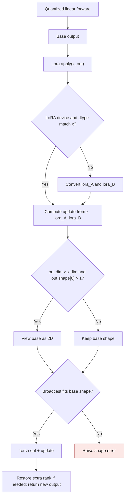

# Runtime LoRA output composition

GPT-QModel's built-in `Lora` adapter combines a quantized layer's base output
with a low-rank update. CUDA quantized layers can return inference tensors or
views produced by custom autograd Functions. `Lora.apply` returns a new sum so
those outputs remain valid and the base and adapter gradients can both flow.

| Mechanism | Before | After |
| --- | --- | --- |
| Normal output | `gptqmodel/adapter/adapter.py:180` called `out.add_`, modifying the base output | `Lora.apply` uses `out + update` and returns a new tensor |
| Extra output rank | `gptqmodel/adapter/adapter.py:175` viewed and modified the base tensor in place | The same view/restore shape rule applies to a new sum |
| Custom autograd view | In-place addition raised when the base came from `_CudaWideMatmul` or another custom Function | The base Function's gradient path and the LoRA matrices' gradient paths remain connected |

The adapter still stores only its two low-rank matrices. The out-of-place sum
adds one transient output-sized tensor; it is not a dense weight cache. The
base output is never modified by `Lora.apply`. This applies to both the normal
rank and the extra-rank branch. Incompatible broadcasting or a result that
would expand the base output raises a shape error before addition.

This flow was introduced in [PR #3678](https://github.com/ModelCloud/GPTQModel/pull/3678).
