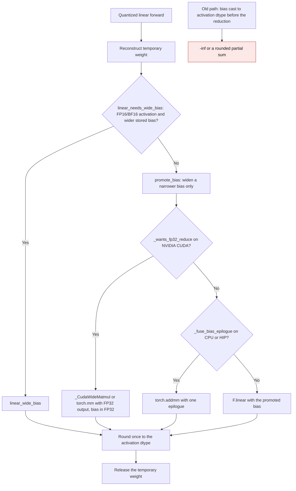
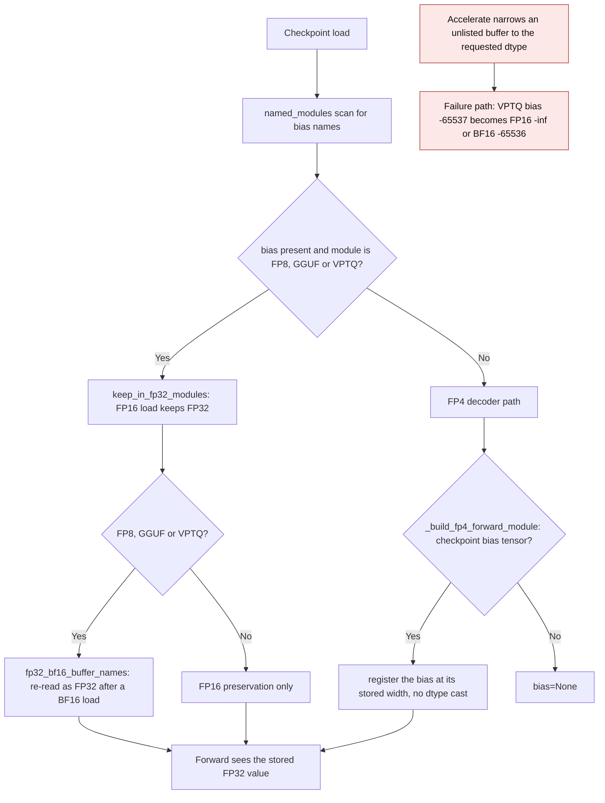
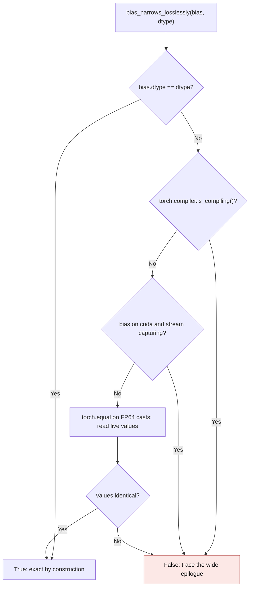

<!-- SPDX-FileCopyrightText: 2026 ModelCloud.ai
SPDX-License-Identifier: Apache-2.0 -->

# Low-precision bias epilogues

Quantized linear layers reconstruct a weight for one call, multiply the
activation, add the stored bias, and round the result to the activation dtype.
The bias must enter that sum before the rounding. If a caller narrows the bias
to the activation dtype first, two different failures appear:

- a stored FP32 bias outside the activation dtype's finite range becomes
  infinite (`-65536` is `-inf` as FP16);
- a finite partial sum that only the bias brings back inside the range is
  rounded (or overflowed) before the bias cancels it.

This page describes the shared contract that the portable quantized backends,
FP4, VPTQ, FP8, GGUF, and NF12 use, introduced for FP4 and VPTQ in
[PR #3753](https://github.com/ModelCloud/GPTQModel/pull/3753).

## Flow

Two control flows decide whether the wide path is available at all, and each
needs its own view.

FP4 does not use those loader lists. `_build_fp4_forward_module`
(`models/base.py:3831`) registers the checkpoint bias at its stored width when
it builds `TorchFP4Linear` (`models/base.py:3871`), so the forward can still
choose the wide epilogue. The loader lists cover the quantized-module path only.

`linear_wide_bias` keeps the multiply and the bias in FP32 and rounds once.
On NVIDIA CUDA it requests an FP32 output from `torch.mm` (`out_dtype`), so the
tensor-core operands stay FP16/BF16 and no expanded FP32 weight copy is
retained. HIP accepts `out_dtype` too, but `_WIDE_REDUCE_DEVICES` deliberately
keeps that request CUDA-only: HIP already accumulates these operands in FP32, so
the extra request measured bitwise identical while costing latency and
transient memory. CPU has no `out_dtype` for `torch.mm`, so it multiplies FP32
operands instead: that path costs a transient FP32 weight copy, measured at
`12.4`-`14.7 ms` for one 4096x4096 FP16 decode against `0.10`-`0.14 ms` for the
fused low-precision epilogue.
When autograd is active the FP32 operand path is used as well, because the
FP32-output CUDA ops have no autograd derivative.

## Before and after

The line references below point at the mechanism's location in the shipped code
on this branch; the "Before" column quotes what that location did before
PR #3753.

| Mechanism | Before | After |
| --- | --- | --- |
| FP4 CPU forward, `nn_modules/qlinear/fp4.py:90-102` | `bias.to(dtype=x.dtype)` before `F.linear` | `linear_wide_bias`, then round once |
| FP4 accelerator forward, `nn_modules/qlinear/fp4.py:104-122` | `bias.to(dtype=x.dtype)` before the torchao wrapper | Dequantize for the call and use `linear_wide_bias` |
| VPTQ Torch forward, `nn_modules/qlinear/vptq_torch.py:568-580` | `bias.to(dtype=x.dtype)` before `linear_fp32_reduce` | Bias promoted only when the cast is exact |
| VPTQ CUDA dense path, `nn_modules/qlinear/vptq_cuda.py:153-157` | `bias.to(dtype=x.dtype)` before the GEMM | Bias promoted only when the cast is exact |
| VPTQ CUDA fused path, `nn_modules/qlinear/vptq_cuda.py:119-127` | Sent a wide bias to a kernel that requires the output dtype | The fused kernel is used unless a stored value is not representable in the activation dtype |
| VPTQ bias buffer, `nn_modules/qlinear/vptq_torch.py:264-276` | Allocated at `codebook_dtype` | Allocated FP32 so the checkpoint range survives |
| VPTQ packed bias copy, `nn_modules/qlinear/vptq_torch.py:463-474` | `.to(dtype=self.bias.dtype)` | FP32 copy with an exactness check |
| VPTQ checkpoint reload, `models/loader.py` | Requested FP16/BF16 dtype could narrow the saved FP32 bias | Keep the bias FP32 during load and restore it from the checkpoint if Accelerate narrows BF16 buffers |
| FP4 checkpoint decoder (`_build_fp4_forward_module`), `models/base.py:3871` | `bias.to(device=device, dtype=target_dtype)` before PR #3753 | Bias kept at its stored width, so the forward can still go wide |

## Dtype promotion contract

`promote_bias` is the inverse of the removed narrowing. A bias in a strictly
narrower floating dtype (`float16`/`bfloat16` into `float32`, or either into
`float64`) is widened, which cannot lose a value. A bias in a wider or
incomparable dtype is returned unchanged, and the caller must add it after the
reduction. FP16 and BF16 are treated as equally wide because neither dtype
contains the other: BF16 has the exponent range and FP16 has the mantissa.

## Failure and ambiguity paths

| Situation | Behaviour |
| --- | --- |
| Stored bias wider than the activation | `linear_needs_wide_bias` is true; the wide epilogue runs unless the exact cast is proven |
| VPTQ CUDA fused kernel with a wide bias | Skipped only when a stored value is not representable in FP16/BF16; representable buffers are narrowed losslessly for the kernel |
| Wide buffer with representable values | `bias_narrows_losslessly` proves the exact cast and the cheap narrow epilogue runs; no FP32 weight operand copy |
| In-place bias write (`.data.copy_`, `.data.fill_`) | The representability check is recomputed per call; version counters do not see `.data` writes, so a cached answer would go stale |
| VPTQ CUDA representability gate | Recomputed per forward; it compares live device values, so `.data` writes are always honoured |
| CUDA graph capture or `torch.compile` | The value check would synchronize or create a data-dependent graph break; use the wide epilogue, which reads the live bias on every replay |
| Captured/compiled layer with a representable FP32 bias | The gate cannot prove exactness while capturing or tracing, so it stays wide even though eager would take the cheap epilogue. The result is bitwise identical to eager; only the kernel changes (torchao NVFP4 becomes a per-call dequantize plus `linear_wide_bias`). Measured on a 4096x4096 layer: `2.02 ms` eager NVFP4 against `2.11 ms` wide, with a `1.99 ms` graph replay, and an eight-layer capture held `7.5 MiB` more private-pool memory per layer |
| Autocast active | The wide helper disables autocast for its own GEMM so the product is not re-narrowed |
| Bias needs broadcasting beyond the flattened output | `_fuse_bias_epilogue` declines; `linear_wide_bias` reshapes before adding, so type promotion and the broadcast shape are preserved |
| Bias cannot be stored exactly in the FP32 buffer | `load_quant_result` raises instead of rounding silently |
| Temporary dense weight after forward | Released with the call; no dense cache is installed |

## Validation

The regression constructs a unit weight, sixteen 4096 FP16 activations, and an
FP32 `-65536` bias. The independent FP64 oracle is zero; the pre-fix FP4 and
VPTQ CPU forwards returned `-inf`. After the fix both CPython and accelerator
paths return zero for FP16 and BF16, and a bias one unit below the cancelling
value (which neither dtype can hold) is proven to leave the VPTQ CUDA fused
kernel. Tests live in `tests/kernels/test_fp4_cpu.py`,
`tests/kernels/test_linear_fp32_reduce.py`, and `tests/test_vptq.py`.

The same gate is shared by the FP4 accelerator wrapper, which is covered with an
FP32 `0.1` bias: that value is inexact in both FP16 and BF16, so both
parameterizations take the wide epilogue and the capture/`fullgraph=True`
escape hatch is pinned for each. A `-65536` fixture would not have tested BF16,
because BF16 holds that value exactly and the forward would use the stock
torchao `F.linear` instead. The replay also rewrites the bias through `.data`
between replays, so a graph that baked in the captured value — or cached the
representability answer, which the version counter cannot see — is caught. FP4
is deliberately not advertised on ROCm, so that test exercises the portable
dequantize-plus-`linear_wide_bias` branch on HIP.

A 4096x4096 layer with a representable FP32 bias was measured with resident
inputs. Keying the epilogue off the buffer dtype alone opened the FP32 path for
every checkpoint bias, because the buffer is FP32 by construction: on CPU, one
VPTQ BF16 decode took `22.7 ms` wide against `4.9 ms` with the exact-cast gate,
and the FP4 CPU forward took `33.6 ms` against `21.6 ms`. With the gate, a
representable bias costs `24.4 ms` (FP4 CPU) and `4.8 ms` (VPTQ CPU), within
noise of the `21.6 ms` / `4.9 ms` narrow baselines; an out-of-range value still
pays the wide path. The wide path itself costs that transient FP32 weight copy
on CPU — `12.4`-`14.7 ms` for one 4096x4096 FP16 decode against `0.10`-`0.14 ms`
when the bias can enter the fused low-precision epilogue — so it is for
correctness, not decode throughput.
