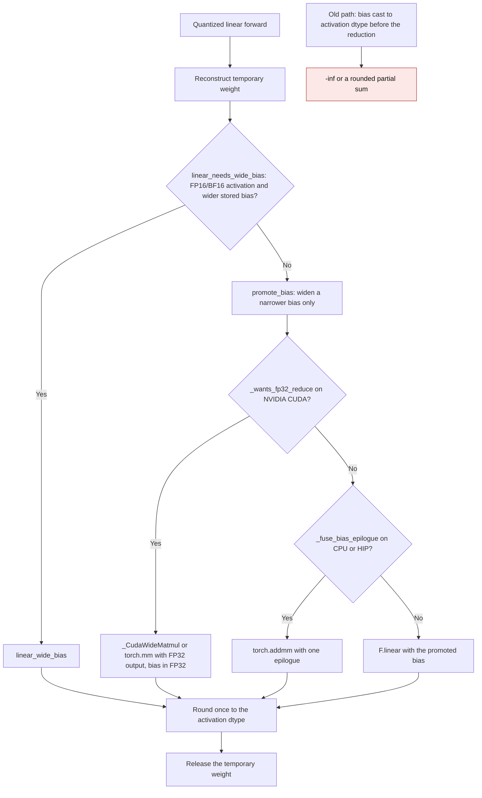

<!-- SPDX-FileCopyrightText: 2026 ModelCloud.ai
SPDX-License-Identifier: Apache-2.0 -->

# Low-precision bias epilogues

Quantized linear layers reconstruct a weight for one call, multiply the
activation, add the stored bias, and round the result to the activation dtype.
The bias must enter that sum before the rounding. If a caller narrows the bias
to the activation dtype first, two different failures appear:

- a stored FP32 bias outside the activation dtype's finite range becomes
  infinite (`-65536` is `-inf` as FP16);
- a finite partial sum that only the bias brings back inside the range is
  rounded (or overflowed) before the bias cancels it.

This page describes the shared contract that the portable quantized backends,
FP4, VPTQ, FP8, GGUF, and NF12 use, introduced for FP4 and VPTQ in
[PR #3753](https://github.com/ModelCloud/GPTQModel/pull/3753).

## Flow

`linear_wide_bias` keeps the multiply and the bias in FP32 and rounds once.
On NVIDIA CUDA it requests an FP32 output from `torch.mm`, so the tensor-core
operands stay FP16/BF16 and no expanded FP32 weight copy is retained. CPU and
HIP multiply in FP32 because those backends cannot otherwise keep the
reduction wide in all layouts. When autograd is active it uses the FP32 operand
path as well, because the FP32-output CUDA ops have no autograd derivative.

## Before and after

| Mechanism | Before | After |
| --- | --- | --- |
| FP4 CPU forward, `nn_modules/qlinear/fp4.py:71-83` | `bias.to(dtype=x.dtype)` before `F.linear` | `linear_wide_bias`, then round once |
| FP4 accelerator forward, `nn_modules/qlinear/fp4.py:79-83` | `bias.to(dtype=x.dtype)` before the torchao wrapper | Dequantize for the call and use `linear_wide_bias` |
| VPTQ Torch forward, `nn_modules/qlinear/vptq_torch.py:536-539` | `bias.to(dtype=x.dtype)` before `linear_fp32_reduce` | Bias passed at its stored width |
| VPTQ CUDA dense path, `nn_modules/qlinear/vptq_cuda.py:150-152` | `bias.to(dtype=x.dtype)` before the GEMM | Bias passed at its stored width |
| VPTQ CUDA fused path, `nn_modules/qlinear/vptq_cuda.py:117-120` | Sent a wide bias to a kernel that requires the output dtype | The wide-bias request skips the fused kernel |
| VPTQ bias buffer, `nn_modules/qlinear/vptq_torch.py:264-267` | Allocated at `codebook_dtype` | Allocated FP32 so the checkpoint range survives |
| VPTQ packed bias copy, `nn_modules/qlinear/vptq_torch.py:433-438` | `.to(dtype=self.bias.dtype)` | FP32 copy with an exactness check |

## Dtype promotion contract

`promote_bias` is the inverse of the removed narrowing. A bias in a strictly
narrower floating dtype (`float16`/`bfloat16` into `float32`, or either into
`float64`) is widened, which cannot lose a value. A bias in a wider or
incomparable dtype is returned unchanged, and the caller must add it after the
reduction. FP16 and BF16 are treated as equally wide because neither dtype
contains the other: BF16 has the exponent range and FP16 has the mantissa.

## Failure and ambiguity paths

| Situation | Behaviour |
| --- | --- |
| Stored bias wider than the activation | `linear_needs_wide_bias` is true; the wide epilogue runs |
| VPTQ CUDA fused kernel with a wide bias | The fused kernel is skipped, avoiding its dtype rejection |
| Autocast active | The wide helper disables autocast for its own GEMM so the product is not re-narrowed |
| Bias needs broadcasting beyond the flattened output | `_fuse_bias_epilogue` declines; the standalone expression keeps type promotion |
| Bias cannot be stored exactly in the FP32 buffer | `load_quant_result` raises instead of rounding silently |
| Temporary dense weight after forward | Released with the call; no dense cache is installed |

## Validation

The regression constructs a unit weight, sixteen 4096 FP16 activations, and an
FP32 `-65536` bias. The independent FP64 oracle is zero; the pre-fix FP4 and
VPTQ CPU forwards returned `-inf`. After the fix both CPython and accelerator
paths return zero for FP16 and BF16, and the VPTQ CUDA fused kernel is proven
unused for the wide-bias case. Tests live in
`tests/kernels/test_fp4_cpu.py`, `tests/kernels/test_linear_fp32_reduce.py`,
and `tests/test_vptq.py`.
