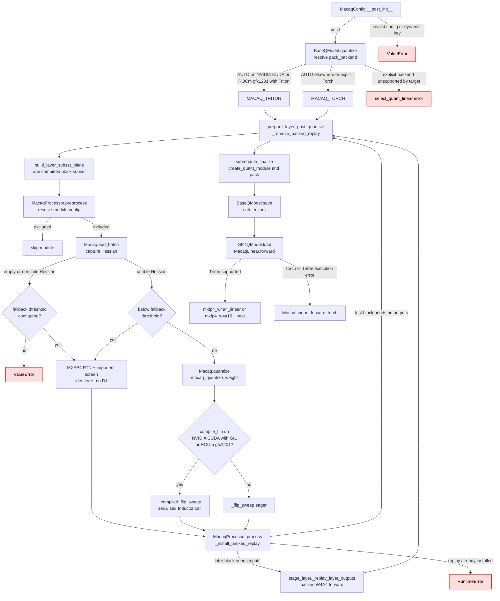
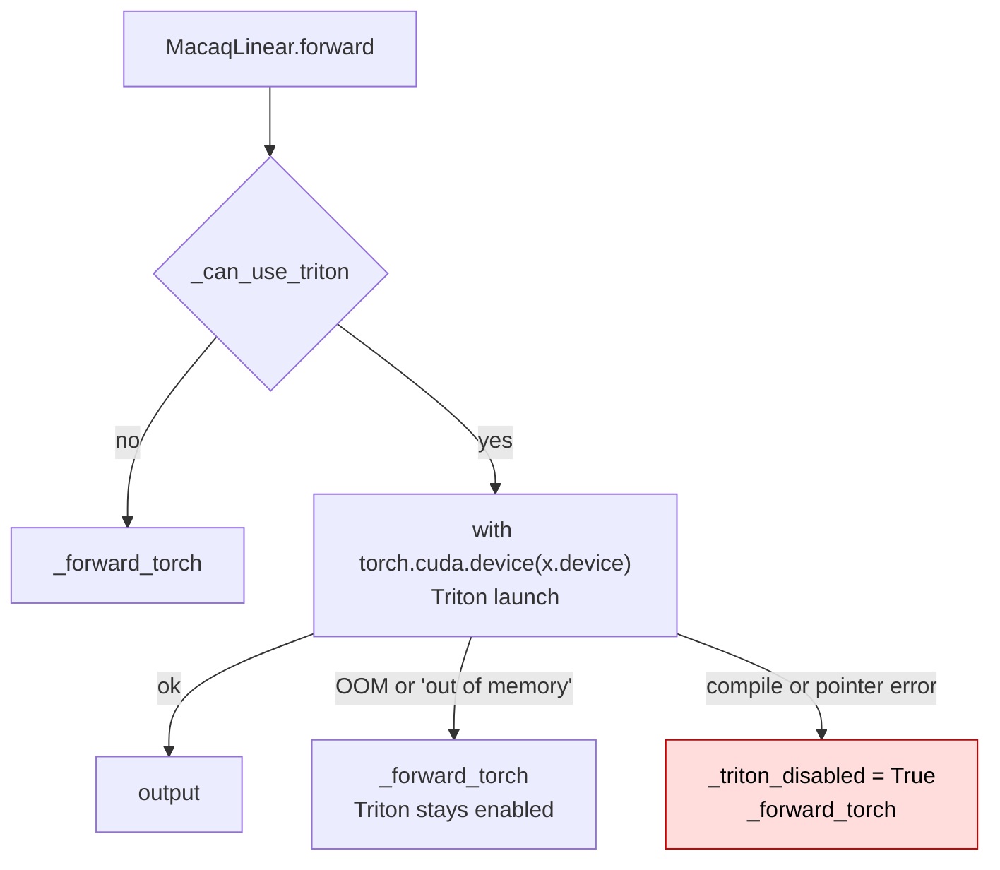

<!-- SPDX-FileCopyrightText: 2026 ModelCloud.ai -->
<!-- SPDX-License-Identifier: Apache-2.0 -->

# MACaQ (MXFP4 W4A4)

GPT-QModel includes a native port of **MACaQ**, Huawei CSL's model-agnostic
calibrated quantizer for low-precision weights and activations.

- Upstream: <https://github.com/huawei-csl/MACaQ> (Apache License 2.0)
- Paper: [MACaQ: Fast, Model Agnostic Calibrated Quantization for Low-Precision
  Weights and Activations](https://arxiv.org/abs/2611.10649), Muller et al., 2026
- Ported files: `gptqmodel/quantization/macaq.py`,
  `gptqmodel/utils/macaq_triton.py`,
  `gptqmodel/nn_modules/qlinear/macaq.py`, and
  `gptqmodel/looper/macaq_processor.py`

## What it does

MACaQ quantizes each Linear weight to OCP **MXFP4**: E2M1 values with one E8M0
scale per 32-element block. At inference the same transform is applied to the
activation, so both GEMM operands are 4-bit and the kernel is a native
block-scaled E2M1 matmul.

The per-Linear recipe is:

1. **D1 activation-aware diagonal pre-scale.** With the calibration Hessian
   `H = sum(x^T x)`, compute
   `p_j = w_std_j^alpha / act_rms_j^(1 - alpha)`, where
   `act_rms_j = sqrt(H_jj / T)`. Fold `p` into the input and `1/p` into the
   weight; it cancels in the GEMM.
2. **Block-Hadamard rotation.** Right-multiply the scaled weight by a
   block-diagonal Hadamard matrix whose block is the MXFP4 group (32 by
   default). Rotating `H` by the same transform gives the metric used below.
   `block_hadamard=False` skips this step (see
   [Rotation-free weight-only MXFP4](#rotation-free-weight-only-mxfp4)).
3. **OCP MXFP4 round-to-nearest.** Per 32-value block, set the E8M0 exponent to
   `floor(log2(amax)) - 2 + offset` and round each value to the nearest E2M1
   level.
4. **Hessian-weighted exponent screen.** Evaluate a small set of exponent
   offsets (default `(1, 0, -1)`) and keep, per `(row, block)`, the one with the
   lowest diagonal-Hessian-weighted squared error.
5. **Greedy flip refinement.** With the exponents frozen, repeatedly apply the
   best single-level E2M1 move per row. For a code change `c`, the objective
   changes by `c^2 H_jj - 2 c g_j` with `g = H (w_target - w_current)`.

The packed artifact is `W_packed` (`uint8`, two E2M1 nibbles per byte),
`W_scales` (E8M0 bytes, one per 32 values), the pre-scale vector, and the shared
block-Hadamard. The W4A4 Triton GEMM reads packed tiles directly. The Torch
fallback and W4A16 path reconstruct a temporary dense weight for the current
forward and release it afterward; no dense weight cache is retained.

The W4A4 Triton path also ports Huawei's fused activation transform, native
`tl.dot_scaled` GEMM, decode-aware launch tiles, and fused bias/output cast.
It uses separately measured launch tiles on the Radeon AI PRO R9700 (RDNA4
`gfx1201`) and keeps only packed weights and E8M0 scales between forwards.

### MXFP4 values and MACaQ checkpoint format

[OCP MXFP4](https://www.opencompute.org/documents/ocp-microscaling-formats-mx-v1-0-spec-final-pdf)
defines E2M1 elements with one E8M0 scale per 32 values. Those numerical
values and scales are generic; MACaQ does not define a new 4-bit number system.

`FORMAT.MXFP4_MACAQ` names GPT-QModel's native **checkpoint contract** for the
MACaQ-transformed Linear. In addition to the MXFP4 weight codes and scales,
the checkpoint stores `pre_scale` and `BH`; its quantization config records
`activation_precision` and the transform settings. The tensor names, nibble
packing, and transform metadata are part of this implementation's layout.
A generic MXFP4 checkpoint cannot be loaded as `FORMAT.MXFP4_MACAQ` without
converting that layout and supplying the required transform state.

## Quantization and runtime flow

The backend is resolved once during preflight. `MACAQ_TORCH` remains selected
when explicitly requested. Automatic selection uses the configured
quantization device: NVIDIA CUDA or a ROCm `gfx1201` target with Triton selects
`MACAQ_TRITON`; other targets select `MACAQ_TORCH`. Explicit Triton selection
checks the selected GPU, including its ordinal. The module's winning `dynamic`
rule is captured before calibration and reused for packing.



| Stage | GPTQ flow | MACaQ flow |
|---|---|---|
| Method plan | GPTQ step | MACaQ step in `quantization_run_plan.py` |
| Capture grouping | grouped subsets | combined block subset in `macaq_processor.py` |
| Replay | `gptq_processor.py` | packed W4A4 in `macaq_processor.py` |
| Inference | GPTQ kernel selector | W4A4 in `nn_modules/qlinear/macaq.py` |

The diagram and table describe the flow introduced in
[PR #4066](https://github.com/ModelCloud/GPTQModel/pull/4066).

Each calibration chunk traverses the current block once while hooks capture
all selected projections. A temporary packed child then supplies the W4A4
forward for block replay. `prepare_layer_post_quantize` removes that child
before the final checkpoint module is created.

## Runtime and edge-case contracts

### Activation row offsets are 64-bit

`_quant_mxfp4_kernel`, `_rot_scale_quant_kernel`, and
`_dequant_w4_to_bf16_kernel` compute the row offset in int64
(`row = tl.program_id(0).to(tl.int64)`). One large prefill can exceed
`2**31` elements for a wide projection: with `K=18944` the boundary is
113,359 tokens. The previous int32 offset wrapped, silently reading a
different row on CUDA and faulting the HIP context on ROCm. The dense GEMM
already widened its row indices; the three row-indexed helper kernels now
match it.

### Triton launches bind the operand device

Every MACaQ launch enters `torch.cuda.device(<operand>.device)` first, the
same guard GGUF Triton and the W4A kernels use. A layer placed on `cuda:1`
by a `device_map` previously launched into the current `cuda:0` context,
raised `ValueError: Pointer argument cannot be accessed from Triton`, and
then latched `_triton_disabled` for the process. Only a permanent failure
latches; a transient allocation failure does not poison the module.



### K tiles are at least 64 wide

`_pick_tiles` no longer falls back to `BLOCK_K=32`. On Blackwell (`sm_120`)
`tl.dot_scaled` lowers to the native `mma.sync` MXFP4 instruction, which
requires a K tile of at least 64; a 32-wide tile fails to compile and the
module silently stays on Torch. The GEMM's `kb_mask`/`ks_mask` K-tail masks
already make a non-divisor tile correct, so `_pick_tiles` keeps the largest
measured tile and the public entry point shrinks it only down to 64.
The `sm_120` compile path itself was not re-verified on the hardware used
for this change; correctness on the K tails was verified on `sm_89` and
`gfx1201`.

### Calibration fallback for unrouted experts

A MoE expert that never receives a calibration token has no Hessian. When
the configured `fallback` threshold matches — the default `Fallback()` is
RTN at `0.5%` — MACaQ runs data-independent MXFP4 RTN with an identity
metric and no D1 pre-scale instead of raising. Without a fallback threshold
the module still raises the actionable error. `Macaq.quantize` records
`fallback=True` in the result stats.

The exponent screen (when `exp_screen=True`) still runs on this path, under
the identity metric, so each block keeps the exponent with the lowest plain
squared error. The OCP exponent `floor(log2(amax)) - 2` maps a block's amax to
`[4, 8)` and clips it to 6 whenever the amax mantissa exceeds 1.5; the
non-clipping exponent `ceil(log2(amax / 6))` is always offset `0` or `+1`, so
the default `(1, 0, -1)` screen covers both rules and never does worse than
either. Flip refinement stays off: under the identity metric RTN is already
the per-element optimum for frozen exponents.

### Activation exponent rule on MLX

Torch and Triton quantize activations with the OCP exponent, matching
calibration replay. MLX's `mx.quantize(mode="mxfp4")` and `mx.qqmm` pick the
non-clipping exponent `ceil(log2(amax / 6))` instead, so MLX W4A4 activations
can land one exponent above the other backends on blocks whose amax mantissa
exceeds 1.5. The weight bytes are unaffected. On synthetic block-rotated
activations the two rules are within 2% relative MSE for Gaussian and
heavy-tailed rows, and the non-clipping rule is lower when outlier channels
are present, so the MLX difference does not cost activation accuracy.

### Single exponent offsets and `dynamic` exclusions

- A one-element `exp_offsets=(n,)` now applies offset `n` on the RTN path
  instead of silently using `0`.
- `dynamic={pattern: False}`, the documented exclusion form, is translated
  to the base `-:pattern` rule before shared normalization, so it no longer
  crashes `MacaqConfig`.

### Transformers interop

Transformers 5.x only warns `Unknown quantization type` and then loads a
plain model whose packed tensors were randomly initialized. GPT-QModel
registers a refusing quantizer for every packed format transformers does
not implement. The names live in one table
(`gptqmodel/_quant_methods.py:REFUSED_HF_QUANT_METHODS`) so another format
extends the same registration.

| `quant_method` | Checkpoint | Transformers loader |
|---|---|---|
| `gptqmodel_gguf` | packed GGUF | `GPTQModelGGUFHfQuantizer` refuses |
| `exl3` | EXL3 trellis | `GPTQModelRefusingHfQuantizer` refuses |
| `macaq` | MACaQ MXFP4 | `GPTQModelRefusingHfQuantizer` refuses |
| `paroquant` | ParoQuant | `GPTQModelRefusingHfQuantizer` refuses |
| `qqq` | QQQ | `GPTQModelRefusingHfQuantizer` refuses |
| `nf12` | NF12 | `GPTQModelRefusingHfQuantizer` refuses |
| `tt-blockfloat` | Tenstorrent block-float | `GPTQModelRefusingHfQuantizer` refuses |

Each refusal names `GPTQModel.load` and vLLM as the supported loaders.

## Relationship to GPTQ

MACaQ shares GPTQ's calibration input (`H = sum(x^T x)`) and per-Linear
lifecycle, but it is **not** a GPTQ variant:

| | GPTQ | MACaQ |
|---|---|---|
| Weight grid | affine INT4 group scales/zeros | E2M1 + E8M0 per-32 block scale |
| Error compensation | sequential inverse-Hessian column updates | rotation + exponent screen + greedy local flips |
| Activation quantization | none (W4A16) | MXFP4 W4A4 |
| Extra transform | optional act ordering | D1 diagonal + block-Hadamard |
| Storage | int32-packed affine weights | nibble-packed E2M1 + E8M0 bytes |

Because the stored grid, the solve, and the runtime are different, the
implementation is a standalone `Macaq` quantizer and `MacaqConfig` rather than a
`GPTQ` subclass. It reuses the shared Hessian-capture and processor
infrastructure.

## Forward replay and quantization speed

MACaQ's per-Linear optimizer needs only that Linear's weight and input Hessian.
Full-model streaming still uses forward replay: upstream `streaming_quantize`
captures Hessians from the current block, replaces its Linear layers, then
re-forwards the now-quantized block to generate inputs for the next block.
GPT-QModel sets `all_modules_in_single_pass=True` so each calibration chunk
captures every selected projection's Hessian in one block traversal before
any projection is quantized. It then uses
`MacaqProcessor.lifecycle.forward.replay_after_process` and
`stage_layer._replay_layer_outputs` for block propagation. Its temporary
packed module makes W4A4 activation quantization part of that replay.

The paper's quantization-time advantage comes from the local D1 and
block-Hadamard transforms, screening three exponent candidates, and a
row-parallel flip sweep that updates its Hessian gradient using one column per
accepted move. It avoids GPTQ's inverse-Hessian factorization and sequential
column compensation. The upstream implementation compiles repeated flip
sweeps and reuses the same `X.T @ X` result for projections sharing an input.
`MacaqConfig`, `macaq_quantize_weight`, and `flip_refine_levels` default to
`compile_flip=True`. GPT-QModel compiles the sweep on NVIDIA CUDA when the
Python GIL is enabled and on ROCm `gfx1201`, including free-threaded Python.
Compiled calls are serialized so Inductor first use and autotuning cannot
race between quantization workers. `compile_flip=False` selects the eager
sweep; CPU, other ROCm architectures, and free-threaded NVIDIA Python also
use eager sweeps. GPT-QModel still accumulates each projection's Hessian
separately.

The paper's **11x quantization-time** result compares MACaQ against MR-GPTQ
and DuQuant++ at matched W4A4 quality on Llama-3-8B. It does not compare
against plain GPTQ W4A16. The reported Qwen3.5 122B run uses 32 flips and
512K calibration tokens; the Llama-3-8B comparison uses 128 flips and 200K
tokens. See the [paper](https://arxiv.org/html/2611.10649v2) and
[reference implementation](https://github.com/huawei-csl/MACaQ/blob/main/quantize/macaq_mxfp4.py).

### Local quantization timing

The repository includes `scripts/benchmark_macaq_quantization.py` to time
the full calibration, replay, solve, and pack workflow. The A/B runs below
used the same PR code revision and local Llama-3.2-1B-Instruct checkpoint,
64 calibration messages (28,672 padded tokens), BF16 source weights, eager
attention, a 2048-token concat size, batch size 1, 128 flips,
`pre_alpha=0.75`, and an RTX 4090 with Torch 2.15.0+cu132. Both used
`cudaMallocAsync`; the only configuration change was `compile_flip`.

| MACaQ W4A4 mode | Full quantization | Peak allocated | Peak reserved |
|---|---:|---:|---:|
| Eager sweep | 89.10 s | 6.06 GiB | 7.38 GiB |
| Compiled sweep, including first use | 45.47 s | 4.89 GiB | 5.53 GiB |

The compiled run was 1.96 times faster end to end. Each mode was measured
once, so this is an exploratory local result. It is also a different
comparison from the paper's matched-quality MR-GPTQ/DuQuant++ benchmark.
The script records the allocator backend and config in every result line.
Set `PYTORCH_ALLOC_CONF=backend:cudaMallocAsync` and use
`--compile-flip` or `--no-compile-flip` to repeat the A/B measurement.

The same full workflow was also measured on one Radeon AI PRO R9700
(`gfx1201`) with Python 3.14.10t, `PYTHON_GIL=0`, Torch
2.16.0.dev20261025+rocm10.1, ROCm 10.1, and the native allocator. Both
runs used the same Llama-3.2-1B-Instruct checkpoint, 64 calibration rows,
2048-token concat, BF16 weights, batch size 1, eager attention, 64 flip
sweeps, `pre_alpha=0.75`, and all 112 Linear projections. The benchmark
script's default compiled mode was compared with `--no-compile-flip`:

| R9700 W4A4 mode | Full quantization | Peak allocated | Peak reserved |
|---|---:|---:|---:|
| Eager sweep | 121.18 s | 5.97 GiB | 9.04 GiB |
| Compiled sweep, including first use | 81.56 s | 4.99 GiB | 7.62 GiB |

The compiled run was 1.49 times faster end to end in this single-run A/B.
It includes calibration, packed block replay, solve, and packing, rather
than only timing the sweep kernel. The result is exploratory; run multiple
alternating rounds for a narrower performance estimate.

The unmodified Huawei reference was also timed on the same 1B checkpoint and
RTX 4090 model, using FP16 weights, 25,532 raw-text calibration tokens, 128
flips, and its active-set refinement. Its own timing splits show the cost of
the required block replay and the effect of compiling the repeated flip step:

| Huawei reference | Full quantization | Hessian capture | Weight quantization | Block replay |
|---|---:|---:|---:|---:|
| `--compile_flip` | 29.9 s | 1.3 s | 25.4 s | 2.2 s |
| `--no-compile_flip` | 66.6 s | 1.2 s | 62.8 s | 1.3 s |

Compilation cut this reference run's total time by 2.23 times despite its
first-use compilation cost. The reference timings are indicative, not a direct
port comparison: it uses FP16 and a single raw-text token stream, whereas the
GPT-QModel workflow above uses BF16 and 28,672 padded chat tokens.

### Local inference kernel timing

The port's earlier fixed 64×128×256 W4A4 GEMM with a separate bias addition
and output cast was compared against the decode-aware and fused epilogue path
on an RTX 4090. Inputs were resident BF16 activations, packed MXFP4 weights,
an identity 32×32 block transform, unit pre-scale, and a BF16 bias. Each
measurement includes activation packing and GEMM, using
`triton.testing.do_bench_cudagraph(..., rep=250)`; it excludes the rest of
the model.

| M × N × K | Earlier port | Tuned port | Kernel-call speedup |
|---|---:|---:|---:|
| 1 × 2048 × 2048 | 41.20 µs | 18.40 µs | 2.24× |
| 1 × 8192 × 2048 | 42.47 µs | 18.99 µs | 2.24× |
| 16 × 2048 × 2048 | 40.71 µs | 19.66 µs | 2.07× |
| 64 × 8192 × 2048 | 45.69 µs | 41.17 µs | 1.11× |
| 128 × 2048 × 2048 | 42.96 µs | 39.01 µs | 1.10× |
| 256 × 8192 × 2048 | 116.60 µs | 105.57 µs | 1.10× |

Huawei's vLLM plugin supplied the skinny decode tiles and fused output
epilogue. The M=64 threshold is 32 in this port: a local M=64 tile A/B on
the same GPU measured 47.60 µs for the skinny tile versus 41.10 µs for
the larger tile.

### RDNA4 inference kernel timing

The same packed W4A4 path runs on the Radeon AI PRO R9700 (`gfx1201`) with
ROCm 10.1 / HIP 7.16, PyTorch 2.16.0.dev20261025+rocm10.1, and Triton 3.9.
The R9700 launch plan uses 16×64×128 tiles through M=16 and 32×64×128 above
that. These tiles were measured on this GPU; other ROCm architectures retain
the Torch path. With resident BF16 activations, packed MXFP4 weights, an
identity 32×32 block transform, unit pre-scale, and BF16 bias, the timing
includes activation packing and GEMM. `triton.testing.do_bench_cudagraph`
used `rep=100`. The comparison uses the earlier NVIDIA-oriented launch tiles
on the same R9700 and the same kernel implementation.

| M × N × K | Earlier tiles | R9700 tiles | Kernel-call speedup |
|---|---:|---:|---:|
| 1 × 2048 × 2048 | 46.12 µs | 17.39 µs | 2.65× |
| 1 × 8192 × 2048 | 77.88 µs | 32.15 µs | 2.42× |
| 16 × 2048 × 2048 | 46.80 µs | 17.86 µs | 2.62× |
| 64 × 8192 × 2048 | 104.39 µs | 83.93 µs | 1.24× |
| 128 × 2048 × 2048 | 86.08 µs | 56.57 µs | 1.52× |
| 256 × 8192 × 2048 | 344.40 µs | 306.47 µs | 1.12× |

These are Linear kernel-call timings, not full-model generation latency.

```bash
python scripts/benchmark_macaq_quantization.py \
  --model /monster/data/model/Llama-3.2-1B-Instruct \
  --calibration /monster/data/model/dataset/nm-calibration/llm.parquet \
  --rows 64 --order gptq,macaq --rounds 2
```

## Usage

```python
import torch
from gptqmodel import BACKEND, GPTQModel
from gptqmodel.quantization.config import MacaqConfig

model = GPTQModel.load(
    "meta-llama/Llama-3.2-1B-Instruct",
    quantize_config=MacaqConfig(
        n_flip_iters=256,
        had_block=32,
        pre_alpha=0.75,
        activation_precision="w4a4",
    ),
    device="cuda:0",
    dtype=torch.bfloat16,
)
model.quantize(calibration_texts, batch_size=1, backend=BACKEND.AUTO)
model.save("./llama-3.2-1b-macaq")

quantized = GPTQModel.load("./llama-3.2-1b-macaq", backend=BACKEND.MACAQ_TRITON)
```

`activation_precision="w4a16"` keeps full-precision activations and stores only the
4-bit weights. The portable Torch path (`BACKEND.MACAQ_TORCH`) runs on CPU,
ROCm, XPU, and MPS; `BACKEND.MACAQ_TRITON` uses the native `tl.dot_scaled`
E2M1 GEMM on NVIDIA CUDA and ROCm `gfx1201` for W4A4. Other ROCm
architectures use Torch until their numerical behavior and launch plan are
validated.

`dynamic` may exclude modules with `False` or override `had_block`, `block_hadamard`, `do_flip`,
`n_flip_iters`, `fast_flip`, `compile_flip`, `ridge`, `pre_mode`, `pre_alpha`, `exp_screen`,
`exp_offsets`, and `activation_precision` per module. The MXFP4 block size,
bit width, and symmetric format remain fixed.

### Rotation-free weight-only MXFP4

```python
MacaqConfig(block_hadamard=False, pre_mode="none", activation_precision="w4a16")
```

This keeps the calibrated parts of the recipe — the Hessian-weighted exponent
screen and flip refinement — and drops both online activation transforms. The
quantizer works in the original weight frame and stores an identity `BH` and a
unit `pre_scale`, so the checkpoint layout is unchanged and older loaders
still run it correctly. `MacaqLinear` (Torch and Triton W4A16) detects the
identity transforms at load and skips them, which is exact, so the forward is
a plain MXFP4 dequantize-matmul with no extra activation pass. Torch W4A4
skips them too; Triton W4A4 keeps its fused rotate+quantize kernel, which is
cheaper than the unfused path even with an identity `BH`.

On MLX such a W4A16 layer is exactly a stock
`mlx.nn.QuantizedLinear(mode="mxfp4", group_size=32, bits=4)`: the packed
words and E8M0 bytes transfer unchanged, without requantization by MLX's own
RTN. `GPTQModel.load(..., backend="mlx")` builds that stock layer, and
`GPTQModel.export(..., format="mlx")` writes a checkpoint that stock
`mlx_lm.load` reads, which rotated MACaQ checkpoints cannot do. Layers that
keep the D1 pre-scale or use W4A4 stay on the custom `MlxMACaQLinear`, which
skips the pre-rotate dispatch when `BH` is the identity.

Llama-3.2-1B-Instruct, W4A16, 128 Wikitext-2 training chunks of 1,024
tokens for calibration, 256 flip sweeps, perplexity over 64 contiguous
Wikitext-2 test chunks of 512 tokens (32,704 predicted tokens):

| Model | Perplexity | Delta |
|---|---:|---:|
| BF16 | 19.39 | — |
| MXFP4 RTN, no rotation (`exp_screen=False`, `do_flip=False`) | 23.68 | +22.1% |
| MACaQ, rotation-free (`block_hadamard=False`, `pre_mode="none"`) | 21.27 | +9.7% |
| MACaQ, default (D1 + block Hadamard) | 20.46 | +5.5% |

The calibrated screen and flips alone close 56% of the RTN-to-BF16 gap with
no runtime transform; the rotation and D1 close 75%.

Use it when the runtime cost of the rotation matters more than the accuracy
the rotation buys, or when the checkpoint must load in a stock MXFP4 runtime. For W4A4 the rotation is what tames activation outliers, so
`block_hadamard=False` is mainly useful with `w4a16`. `pre_mode="balance"`
can be kept with `block_hadamard=False`; the forward then applies only the
diagonal pre-scale.

### Configuration

| Field | Default | Meaning |
|---|---:|---|
| `bits` | 4 | MXFP4 only |
| `block_size` / `group_size` | 32 | OCP MXFP4 scale group |
| `had_block` | 32 | block-Hadamard width (power of two, >= 32) |
| `block_hadamard` | `True` | rotate by the block Hadamard; `False` stores an identity `BH` |
| `do_flip` | `True` | enable greedy level refinement |
| `n_flip_iters` | 256 | maximum flip sweeps |
| `fast_flip` | `True` | active-set sweep (bit-identical to the dense sweep) |
| `compile_flip` | `True` | fuse sweeps on NVIDIA CUDA with GIL or ROCm `gfx1201`; eager elsewhere |
| `ridge` | 1.0 | uniform ridge added to the flip Hessian diagonal |
| `pre_mode` | `"balance"` | `"none"` or D1 activation-aware balancing |
| `pre_alpha` | 0.75 | D1 exponent (0.5 symmetric, 1.0 weight-std only) |
| `exp_screen` | `True` | enable the H-weighted exponent screen |
| `exp_offsets` | `(1, 0, -1)` | exponent offsets to screen |
| `activation_precision` | `"w4a4"` | `"w4a4"` or `"w4a16"` |

## Validation (Llama-3.2-1B-Instruct)

Calibration: 128 Wikitext-2 training chunks (115,325 tokens), 128 flip
sweeps, 32-wide blocks, `pre_alpha=0.75`, Triton W4A4 runtime, and all 112
Linear projections packed. Perplexity on 16 contiguous Wikitext-2 test
chunks of 512 tokens:

| Model | Perplexity | Delta |
|---|---:|---:|
| BF16 | 20.50 | — |
| MACaQ W4A16 (same weights) | 21.81 | +6.4% |
| MACaQ W4A4 (Triton) | 24.34 | +18.7% |

These numbers are a smoke/regression baseline, not a tuned recipe: the upstream
paper's Llama-3-8B comparison uses 200K calibration tokens and reports W4A4
perplexity much closer to BF16 on larger models. W4A16 isolates the weight
error from the activation error and is the better choice when activation
accuracy matters more than the W4A4 speedup.

The automated `tests/models/test_llama3_2_macaq.py` default fast mode
quantizes the last two of 16 decoder layers and checks ARC-Challenge after a
safetensors save/reload. During the reloaded evaluation it also asserts that
the native Triton W4A4 GEMM and 4-bit activation packer run, every packed
projection is exercised, and no projection falls back to Torch. The independent
activation test checks exact E2M1 packed bytes for FP16 and BF16 inputs. The
fast run is a lifecycle smoke test; the full-model perplexity measurements
above use all 112 packed projections. The full checkpoint also reloads with
both Torch and Triton backends.

The same fast e2e test passed twice on R9700 with `PYTHON_GIL=0` and the
ROCm runtime above. ARC-Challenge accuracy was 0.3438 and 0.3516;
normalized accuracy was 0.3281 in both runs. It verifies that the default
flip path compiled during quantization; its reloaded projections used the
native W4A4 packer and GEMM.
The 43 MACaQ unit tests also passed on R9700, including FP16/BF16/FP32
numerical comparisons, K tails, and repeated forwards. For a 7×128
activation and 64×128 weight, all 448 visible outputs matched the
independent Torch reference exactly at each of FP16, BF16, and FP32
with output scale 1.0 or 0.5 (six cases). The 64×128 weight stays in
4096 packed data bytes and 256 E8M0 bytes, with no dense weight cache.
A separate two-R9700 free-threaded probe passed three processes with eight
threads × four calls each after serial kernel prewarm. It does not qualify
concurrent cold JIT compilation.
The compiled flip probe passed three more two-R9700 free-threaded processes
with eight threads × four calls each, including serialized first-use
compilation and exact packed-code comparison to eager sweeps.
On fixed 128×512 and 256×2048 weight/Hessian fixtures with 64 flip sweeps,
compiled and eager paths produced zero differing E2M1 codes and identical
Hessian-weighted objectives.

## Port scope

This port covers the native GPT-QModel safetensors path and the dense kernels
that path needs:

- the Torch quantizer (D1, block-Hadamard, MXFP4 RTN, exponent screen, flip
  refinement) in `gptqmodel/quantization/macaq.py`
- the Triton activation quantizer, fused rotate+quantize kernel, native
  `tl.dot_scaled` W4A4 GEMM, and W4A16 dequant GEMM in
  `gptqmodel/utils/macaq_triton.py`
- the portable Torch and CUDA/ROCm module paths in
  `gptqmodel/nn_modules/qlinear/macaq.py`

The upstream repository's MoE-specific kernels, W4A8 FP8 path, cuDNN/CUTLASS
backend, Diffusers/PyTorch TTS pipelines, GGUF writer/refinement tooling, and
the vLLM plugin are not ported here. They remain available upstream; use the
Huawei CSL repository when you need those deployment targets.

## Credits

The algorithm, reference recipe, and kernel structure are from Huawei CSL's
MACaQ project. The port keeps the upstream numerical conventions and is
distributed under the same Apache-2.0 terms; see `CREDITS.md` and the file
headers for the per-file attribution.

```bibtex
@misc{muller2026macaq,
  title         = {{MACaQ}: Fast, Model Agnostic Calibrated Quantization for Low-Precision Weights and Activations},
  author        = {Muller, Lorenz K. and Bich, Philippe and Boretti, Chiara and Chang, Hyun-Min and Zhuang, Jiawei and Cavigelli, Lukas},
  year          = {2026},
  eprint        = {2611.10649},
  archivePrefix = {arXiv},
  primaryClass  = {cs.LG},
  url           = {https://arxiv.org/abs/2611.10649}
}
```
