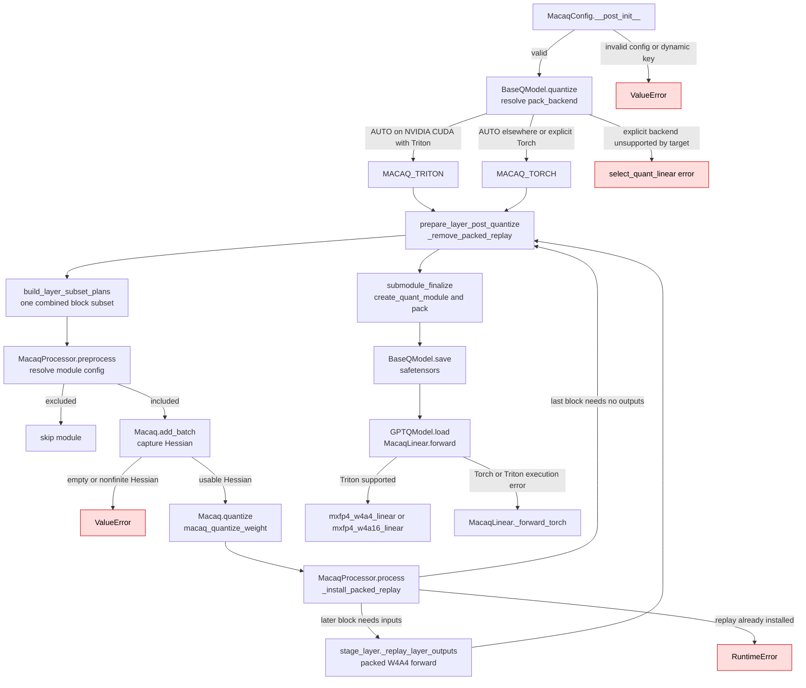

<!-- SPDX-FileCopyrightText: 2026 ModelCloud.ai -->
<!-- SPDX-License-Identifier: Apache-2.0 -->

# MACaQ (MXFP4 W4A4)

GPT-QModel includes a native port of **MACaQ**, Huawei CSL's model-agnostic
calibrated quantizer for low-precision weights and activations.

- Upstream: <https://github.com/huawei-csl/MACaQ> (Apache License 2.0)
- Paper: [MACaQ: Fast, Model Agnostic Calibrated Quantization for Low-Precision
  Weights and Activations](https://arxiv.org/abs/2611.10649), Muller et al., 2026
- Ported files: `gptqmodel/quantization/macaq.py`,
  `gptqmodel/utils/macaq_triton.py`,
  `gptqmodel/nn_modules/qlinear/macaq.py`, and
  `gptqmodel/looper/macaq_processor.py`

## What it does

MACaQ quantizes each Linear weight to OCP **MXFP4**: E2M1 values with one E8M0
scale per 32-element block. At inference the same transform is applied to the
activation, so both GEMM operands are 4-bit and the kernel is a native
block-scaled E2M1 matmul.

The per-Linear recipe is:

1. **D1 activation-aware diagonal pre-scale.** With the calibration Hessian
   `H = sum(x^T x)`, compute
   `p_j = w_std_j^alpha / act_rms_j^(1 - alpha)`, where
   `act_rms_j = sqrt(H_jj / T)`. Fold `p` into the input and `1/p` into the
   weight; it cancels in the GEMM.
2. **Block-Hadamard rotation.** Right-multiply the scaled weight by a
   block-diagonal Hadamard matrix whose block is the MXFP4 group (32 by
   default). Rotating `H` by the same transform gives the metric used below.
3. **OCP MXFP4 round-to-nearest.** Per 32-value block, set the E8M0 exponent to
   `floor(log2(amax)) - 2 + offset` and round each value to the nearest E2M1
   level.
4. **Hessian-weighted exponent screen.** Evaluate a small set of exponent
   offsets (default `(1, 0, -1)`) and keep, per `(row, block)`, the one with the
   lowest diagonal-Hessian-weighted squared error.
5. **Greedy flip refinement.** With the exponents frozen, repeatedly apply the
   best single-level E2M1 move per row. For a code change `c`, the objective
   changes by `c^2 H_jj - 2 c g_j` with `g = H (w_target - w_current)`.

The packed artifact is `W_packed` (`uint8`, two E2M1 nibbles per byte),
`W_scales` (E8M0 bytes, one per 32 values), the pre-scale vector, and the shared
block-Hadamard. The W4A4 Triton GEMM reads packed tiles directly. The Torch
fallback and W4A16 path reconstruct a temporary dense weight for the current
forward and release it afterward; no dense weight cache is retained.

## Quantization and runtime flow

The backend is resolved once during preflight. `MACAQ_TORCH` remains selected
when explicitly requested, including on a CUDA host. Automatic selection uses
the configured quantization device, and only a CUDA target on a non-ROCm host
with Triton selects `MACAQ_TRITON`. The module's winning `dynamic` rule is
captured before calibration and reused for packing.



| Mechanism | Before (`origin/main`) | With MACaQ |
|---|---|---|
| Method | absent at `config.py:161` | `config.py:6079` |
| AUTO backend | GPTQ fallback at `base.py:1954` | `base.py:1944` |
| Processor | no entry at `quantization_run_plan.py:36` | `quantization_run_plan.py:41` |
| Payload | no MACaQ layout | `macaq_processor.py:272,305` |

The diagram and table describe the flow introduced in
[PR #4066](https://github.com/ModelCloud/GPTQModel/pull/4066).

The replay path was corrected after the first port: previously
`MacaqProcessor.process` installed a dense reconstructed weight into the
original `nn.Linear`, so downstream Hessians missed W4A4 activation rounding.
The temporary packed child now supplies the same activation precision selected
for inference and is removed before the layer is offloaded.

| Replay step | Earlier port | Current implementation |
|---|---|---|
| Hessian capture | one forward per module group | `all_modules_in_single_pass` merges groups (`macaq_processor.py:69`, `stage_subset.py:668`) |
| Forward target | original `nn.Linear` with `replay_weight` (`macaq_processor.py:217` at `a8b7b14`) | `_packed_replay_forward` calls the temporary `MacaqLinear` (`macaq_processor.py:154`) |
| End of layer | no temporary runtime module | `prepare_layer_post_quantize` removes the child before `post_quantize` (`macaq_processor.py:207`) |

## Relationship to GPTQ

MACaQ shares GPTQ's calibration input (`H = sum(x^T x)`) and per-Linear
lifecycle, but it is **not** a GPTQ variant:

| | GPTQ | MACaQ |
|---|---|---|
| Weight grid | affine INT4 group scales/zeros | E2M1 + E8M0 per-32 block scale |
| Error compensation | sequential inverse-Hessian column updates | rotation + exponent screen + greedy local flips |
| Activation quantization | none (W4A16) | MXFP4 W4A4 |
| Extra transform | optional act ordering | D1 diagonal + block-Hadamard |
| Storage | int32-packed affine weights | nibble-packed E2M1 + E8M0 bytes |

Because the stored grid, the solve, and the runtime are different, the
implementation is a standalone `Macaq` quantizer and `MacaqConfig` rather than a
`GPTQ` subclass. It reuses the shared Hessian-capture and processor
infrastructure.

## Forward replay and quantization speed

MACaQ's per-Linear optimizer needs only that Linear's weight and input Hessian.
Full-model streaming still uses forward replay: upstream `streaming_quantize`
captures Hessians from the current block, replaces its Linear layers, then
re-forwards the now-quantized block to generate inputs for the next block.
GPT-QModel sets `all_modules_in_single_pass=True` so every projection's Hessian
is captured in one block forward before any projection is quantized. It then
uses `MacaqProcessor.lifecycle.forward.replay_after_process` and
`stage_layer._replay_layer_outputs` for block propagation. Its temporary
packed module makes W4A4 activation quantization part of that replay.

The paper's quantization-time advantage comes from the local D1 and
block-Hadamard transforms, screening three exponent candidates, and a
row-parallel flip sweep that updates its Hessian gradient using one column per
accepted move. It avoids GPTQ's inverse-Hessian factorization and sequential
column compensation. The upstream implementation can compile repeated flip
sweeps and reuses the same `X.T @ X` result for projections sharing an input.
This GPT-QModel port currently executes eager flip sweeps and accumulates each
projection's Hessian separately; these are performance gaps relative to the
paper's implementation.

The paper's **11x quantization-time** result compares MACaQ against MR-GPTQ
and DuQuant++ at matched W4A4 quality on Llama-3-8B. It does not compare
against plain GPTQ W4A16. The reported Qwen3.5 122B run uses 32 flips and
512K calibration tokens; the Llama-3-8B comparison uses 128 flips and 200K
tokens. See the [paper](https://arxiv.org/html/2611.10649v2) and
[reference implementation](https://github.com/huawei-csl/MACaQ/blob/main/quantize/macaq_mxfp4.py).

### Local quantization timing

The repository includes `scripts/benchmark_macaq_quantization.py` to time
the full calibration, replay, solve, and pack workflow. Two exploratory
rounds, with method order reversed between rounds, used the local
Llama-3.2-1B-Instruct checkpoint, 64 calibration messages
(28,672 tokens after padding), BF16 source weights, eager attention, 2048-token
concat size, batch size 1, group size 32, and an RTX 4090 with Torch
2.15.0+cu132. MACaQ used 128 flips and `pre_alpha=0.75`.

| Method | Activation | Round 1 | Round 2 | Median | Peak allocated |
|---|---|---:|---:|---:|---:|
| GPTQ Triton | W4A16 | 25.35 s | 23.18 s | 24.26 s | 2.07 GiB |
| MACaQ Triton | W4A4 | 94.86 s | 98.18 s | 96.52 s | 6.08 GiB |

The current eager MACaQ port took 3.98 times as long as plain GPTQ by
median in this setup. The summed module times were 6.32 s for GPTQ and
271.53 s for MACaQ; these sums exceed wall time when workers run in parallel.
PyTorch reserved about 46.9 GiB in both methods, mostly allocator cache rather
than live tensors, and emitted memory-mapping retries. These two rounds are
exploratory, compare different activation precisions, and do not reproduce
the paper's matched-quality MR-GPTQ/DuQuant++ benchmark. Use `--rounds 4`
or more for a stronger local comparison.

The unmodified Huawei reference was also timed on the same 1B checkpoint and
RTX 4090 model, using FP16 weights, 25,532 raw-text calibration tokens, 128
flips, and its active-set refinement. Its own timing splits show the cost of
the required block replay and the effect of compiling the repeated flip step:

| Huawei reference | Full quantization | Hessian capture | Weight quantization | Block replay |
|---|---:|---:|---:|---:|
| `--compile_flip` | 29.9 s | 1.3 s | 25.4 s | 2.2 s |
| `--no-compile_flip` | 66.6 s | 1.2 s | 62.8 s | 1.3 s |

Compilation cut this reference run's total time by 2.23 times despite its
first-use compilation cost. The reference timings are indicative, not a direct
port comparison: it uses FP16 and a single raw-text token stream, whereas the
GPT-QModel workflow above uses BF16 and 28,672 padded chat tokens.

```bash
python scripts/benchmark_macaq_quantization.py \
  --model /monster/data/model/Llama-3.2-1B-Instruct \
  --calibration /monster/data/model/dataset/nm-calibration/llm.parquet \
  --rows 64 --order gptq,macaq --rounds 2
```

## Usage

```python
import torch
from gptqmodel import BACKEND, GPTQModel
from gptqmodel.quantization.config import MacaqConfig

model = GPTQModel.load(
    "meta-llama/Llama-3.2-1B-Instruct",
    quantize_config=MacaqConfig(
        n_flip_iters=256,
        had_block=32,
        pre_alpha=0.5,
        activation_precision="w4a4",
    ),
    device="cuda:0",
    dtype=torch.bfloat16,
)
model.quantize(calibration_texts, batch_size=1, backend=BACKEND.AUTO)
model.save("./llama-3.2-1b-macaq")

quantized = GPTQModel.load("./llama-3.2-1b-macaq", backend=BACKEND.MACAQ_TRITON)
```

`activation_precision="w4a16"` keeps full-precision activations and stores only the
4-bit weights. The portable Torch path (`BACKEND.MACAQ_TORCH`) runs on CPU,
ROCm, XPU, and MPS; `BACKEND.MACAQ_TRITON` uses the native `tl.dot_scaled`
E2M1 GEMM on CUDA for W4A4.

`dynamic` may exclude modules with `False` or override `had_block`, `do_flip`,
`n_flip_iters`, `fast_flip`, `ridge`, `pre_mode`, `pre_alpha`, `exp_screen`,
`exp_offsets`, and `activation_precision` per module. The MXFP4 block size,
bit width, and symmetric format remain fixed.

### Configuration

| Field | Default | Meaning |
|---|---:|---|
| `bits` | 4 | MXFP4 only |
| `block_size` / `group_size` | 32 | OCP MXFP4 scale group |
| `had_block` | 32 | block-Hadamard width (power of two, >= 32) |
| `do_flip` | `True` | enable greedy level refinement |
| `n_flip_iters` | 256 | maximum flip sweeps |
| `fast_flip` | `True` | active-set sweep (bit-identical to the dense sweep) |
| `ridge` | 1.0 | uniform ridge added to the flip Hessian diagonal |
| `pre_mode` | `"balance"` | `"none"` or D1 activation-aware balancing |
| `pre_alpha` | 0.5 | D1 exponent (0.5 symmetric, 1.0 weight-std only) |
| `exp_screen` | `True` | enable the H-weighted exponent screen |
| `exp_offsets` | `(1, 0, -1)` | exponent offsets to screen |
| `activation_precision` | `"w4a4"` | `"w4a4"` or `"w4a16"` |

## Validation (Llama-3.2-1B-Instruct)

Calibration: 128 Wikitext-2 training chunks (115,325 tokens), 128 flip
sweeps, 32-wide blocks, `pre_alpha=0.75`, Triton W4A4 runtime, and all 112
Linear projections packed. Perplexity on 16 contiguous Wikitext-2 test
chunks of 512 tokens:

| Model | Perplexity | Delta |
|---|---:|---:|
| BF16 | 20.50 | — |
| MACaQ W4A16 (same weights) | 21.81 | +6.4% |
| MACaQ W4A4 (Triton) | 24.34 | +18.7% |

These numbers are a smoke/regression baseline, not a tuned recipe: the upstream
paper's Llama-3-8B comparison uses 200K calibration tokens and reports W4A4
perplexity much closer to BF16 on larger models. W4A16 isolates the weight
error from the activation error and is the better choice when activation
accuracy matters more than the W4A4 speedup.

The automated `tests/models/test_llama3_2_macaq.py` default fast mode
quantizes the last two of 16 decoder layers and checks ARC-Challenge after a
safetensors save/reload. It is a lifecycle smoke test; the full-model
perplexity measurements above use all 112 packed projections. The full
checkpoint also reloads with both Torch and Triton backends.

## Port scope

This port covers the native GPT-QModel safetensors path and the dense kernels
that path needs:

- the Torch quantizer (D1, block-Hadamard, MXFP4 RTN, exponent screen, flip
  refinement) in `gptqmodel/quantization/macaq.py`
- the Triton activation quantizer, fused rotate+quantize kernel, native
  `tl.dot_scaled` W4A4 GEMM, and W4A16 dequant GEMM in
  `gptqmodel/utils/macaq_triton.py`
- the portable Torch and CUDA module paths in
  `gptqmodel/nn_modules/qlinear/macaq.py`

The upstream repository's MoE-specific kernels, W4A8 FP8 path, cuDNN/CUTLASS
backend, Diffusers/PyTorch TTS pipelines, GGUF writer/refinement tooling, and
the vLLM plugin are not ported here. They remain available upstream; use the
Huawei CSL repository when you need those deployment targets.

## Credits

The algorithm, reference recipe, and kernel structure are from Huawei CSL's
MACaQ project. The port keeps the upstream numerical conventions and is
distributed under the same Apache-2.0 terms; see `CREDITS.md` and the file
headers for the per-file attribution.

```bibtex
@misc{muller2026macaq,
  title         = {{MACaQ}: Fast, Model Agnostic Calibrated Quantization for Low-Precision Weights and Activations},
  author        = {Muller, Lorenz K. and Bich, Philippe and Boretti, Chiara and Chang, Hyun-Min and Zhuang, Jiawei and Cavigelli, Lukas},
  year          = {2026},
  eprint        = {2611.10649},
  archivePrefix = {arXiv},
  primaryClass  = {cs.LG},
  url           = {https://arxiv.org/abs/2611.10649}
}
```
