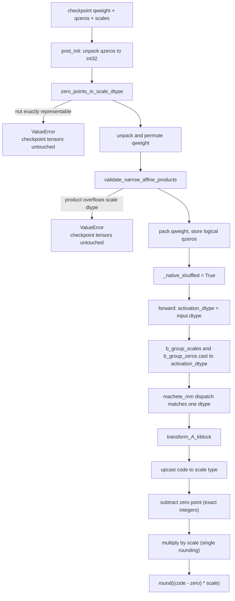
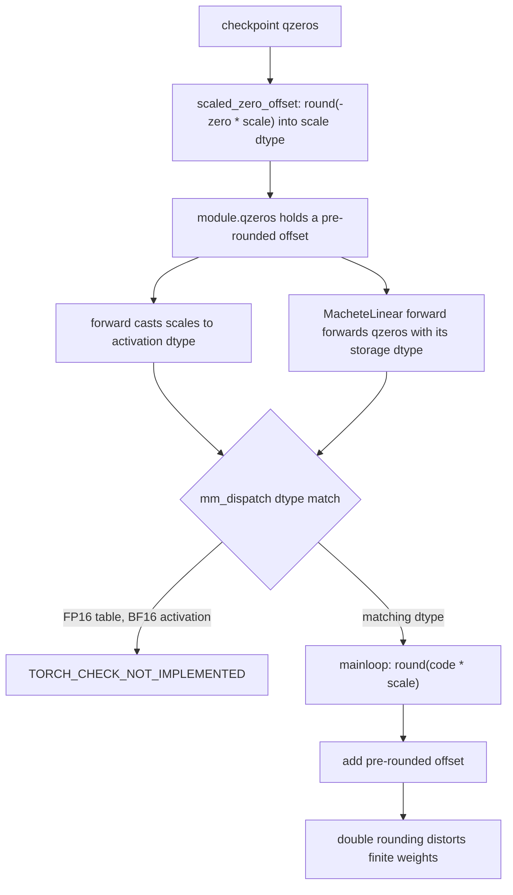

<!-- SPDX-FileCopyrightText: 2026 ModelCloud.ai
SPDX-License-Identifier: Apache-2.0 -->

# Machete asymmetric zero points: one dtype, one rounding step

Asymmetric Machete layers load GPTQ or AWQ checkpoints whose weights are
`(code - zero) * scale`. Two things have to hold for the native kernel to
produce that value:

1. `forward` must pass the activation, group scale and group zero point with
   the same dtype. The generated kernels declare
   `b_group_zeropoint` equal to the activation type
   (`gptqmodel_ext/machete/generate.py:634`), and `mm_dispatch` matches the
   signature exactly (`generate.py:116-158`); any other combination ends in
   `TORCH_CHECK_NOT_IMPLEMENTED`.
2. The mainloop must round once, after subtracting the integer zero point and
   multiplying by the scale. A pre-rounded `-zero * scale` offset added after
   the multiply rounds twice and can move a finite weight by one storage step.

This page documents the operand and rounding contract that both
`MacheteLinear` and `AwqMacheteLinear` now share, and the fail-closed checks
that run before the checkpoint layout is replaced.

## Contract

| Surface | Value | Owner |
| --- | --- | --- |
| Checkpoint `qzeros` | packed integer words (GPTQ: packed along `in_features`; AWQ: packed along `out_features`, interleaved) | checkpoint |
| `module.qzeros` after `post_init()` | **logical** zero points in the scale dtype, shape `(num_groups, out_features)` | `zero_points_in_scale_dtype` (`gptqmodel/utils/packing_math.py:42`) |
| `b_group_scales` / `b_group_zeros` at launch | activation dtype, derived per call; storage is not mutated | `MacheteLinear.forward` (`gptqmodel/nn_modules/qlinear/machete.py:352`), `AwqMacheteLinear.forward` (`machete_awq.py:240`) |
| Dequantized weight | `round((code - zero) * scale)` in the scale dtype | `transform_A_kblock` (`gptqmodel_ext/machete/machete_mainloop.cuh:1365`) |
| Symmetric layer | `qzeros` emptied, `has_zero_points = False`, zero path not compiled into the kernel | `MacheteLinear.post_init` |

`module.qzeros` is a runtime table, not a checkpoint round trip: `post_init()`
also sets `_native_shuffled = True` because `qweight` is Machete-prepacked.

## New flow

## Before the fix

`AwqMacheteLinear.forward` already cast both operands, so the AWQ path only
had the double-rounding defect.

The issue fixtures show both failures: on the GPTQ path a BF16 activation with
an FP16 zero table is rejected by dispatch, and a same-dtype FP16 layer decodes
`code = 14`, `zero = 10`, `scale = 5000` to `inf` because `code * scale`
overflows before the offset is added. The new order stays finite at `20000`.

## Failure paths

| Situation | Before | After |
| --- | --- | --- |
| Activation dtype differs from the stored zero table | native dispatch error at first forward | operands cast per call; kernel sees one dtype |
| Zero point not exactly representable in the scale dtype | silently rounded into the offset | `ValueError("Zero points cannot be stored exactly ...")` in `post_init` |
| `(code - zero) * scale` outside the scale dtype range | `inf` in the decoded weight, or an `inf` offset rejected later | `ValueError("Scaled zero-point product is not finite ...")` before any registered tensor is rewritten |
| Symmetric checkpoint | `qzeros` discarded | unchanged |

Both validations run before `machete_prepack_B`, `scales`, `qweight` or
`qzeros` are replaced, so a rejected load leaves the checkpoint layout intact
(`tests/test_packing_numeric_boundaries.py::test_machete_rejects_affine_overflow_before_repacking`).

## Evidence and limits

CPU tests pin the Python launch contract, the runtime representation and a CPU
mirror of the new operand order:
`tests/test_machete_asymmetric_zero_point_5800.py`. Native Machete kernels are
Hopper-only, so the C++ ordering change in `transform_A_kblock` is not executed
on non-SM90 hosts; the SM90 real-model comparison remains
`tests/kernels/test_asymmetric_real_models.py` (skipped off SM90). Treat the
native numeric delta as unmeasured until that test runs on Hopper hardware.

Introduced in [PR #5914](https://github.com/ModelCloud/GPTQModel/pull/5914) for issue #5800.
