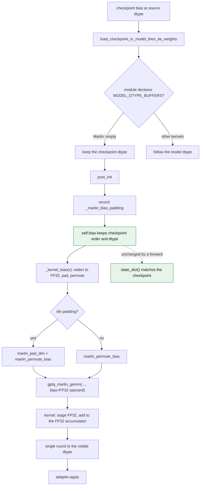

<!-- SPDX-FileCopyrightText: 2026 ModelCloud.ai
SPDX-License-Identifier: Apache-2.0 -->

# Marlin bias epilogue and storage

A Marlin layer holds two kinds of floating tensor. `scales` and `qzeros` are
quantization operands: the native kernel multiplies the packed INT4/INT8 codes
by them. The non-quantized `bias` is not an operand. The kernel adds it to the
FP32 accumulator inside `write_result`, then converts the sum to the visible
output dtype once.

`MarlinLinear` and `AwqMarlinLinear` nevertheless used to rewrite the buffer
twice, before that epilogue could run:

* `post_init` replaced `self.bias` with the padded, Marlin-permuted copy
  (`marlin_awq.py:352`, `marlin.py:478` before this change), so `state_dict()`
  and a save carried a runtime layout instead of the checkpoint tensor.
* `forward` assigned `self.bias.data = self.bias.data.to(x.dtype)`
  (`marlin_awq.py:388`, `marlin.py:511` before this change), so the first
  FP16 forward narrowed an FP32 `-65536` to `-inf` permanently.
* both modules inherited `MODEL_DTYPE_BUFFERS = ("bias",)`, so the loader also
  narrowed a wide checkpoint bias to the requested model dtype on load.

The kernel itself never needed either conversion. It reads `b_bias` through the
`scalar_t` of the compute dtype, but the value it adds is FP32 already.

## Current flow

The derivation is per launch, so nothing widened or permuted is retained. The
registered buffer is the checkpoint value; a repeated forward, a dtype switch,
and a re-save all see the same tensor.

## Kernel change

`marlin_template.h` staged the bias with the 16-bit `scalar_t` and added
`Dtype::num2float(...)` values to the accumulator. The stage is now FP32:

| Stage | Before | After |
| --- | --- | --- |
| shared-memory extent (`sh_bias_size`) | `thread_n_blocks * 16 / 8` int4 | `thread_n_blocks * 16 / 4` int4 |
| fetch | one `cp_async4` of 8 columns | two `cp_async4` of 4 FP32 columns each |
| register fragment | `FragS frag_bias[2][4]` of `half2` | `Vec<float, 2> frag_bias[2][4]` |
| epilogue add | `Dtype::num2float(scalar_t)` | the FP32 value directly |

`gptq_marlin.cu` widens a half/bfloat16 `b_bias` to FP32 once per call and
records that temporary on the stream, so an existing caller that still passes a
16-bit bias keeps working without a narrowing step. An FP32 operand is used as
is.

## Fusion

A fused Marlin executor concatenates the padded N tiles of its sources. Each
source contributes its own padded bias slice, so `_FusionGroup` pads each term
before concatenating and records `_marlin_bias_padding = (numel, numel)` on the
fused view. `_share_operands` publishes those already-padded slices, and both
paths then only run the permutation. `remove()` restores the checkpoint-order
buffer and re-reports the padded width, so a later standalone forward pads
exactly once.

## Failure and ambiguity contract

| Situation | Before | After |
| --- | --- | --- |
| FP32 bias `-65536`, FP16 forward | buffer rewritten to `-inf`; output `-inf` | FP32 value kept; output is the finite cancellation |
| FP32 bias `65520` (FP16 overflow midpoint) | `inf` | preserved |
| FP32 bias `-1e-45` (FP16 underflow) | `0` | preserved |
| checkpoint at FP32, loaded with FP16 model dtype | narrowed by the loader | kept, and the launch operand is FP32 |
| save after a forward | published the permuted runtime buffer | publishes the checkpoint tensor |
| tile-misaligned N (`288 -> 320`) | padding baked into the buffer | padding applied only to the launch operand |
| layer without a bias | no `bias` buffer | no `bias` buffer, `_kernel_bias` returns `None` |

Not verified here: a Machete or Swordfish bias, which reads `output.add_(bias)`
after the kernel already rounded the product. Those kernels keep the activation
width for the bias intentionally and are outside this change.

## Validation

`tests/kernels/test_marlin_bias_epilogue.py` covers, for `MarlinLinear` and
`AwqMarlinLinear`, FP32 and BF16 sources at `-65536`, `-65520`, `65504`,
`65520`, `-100000`, `-1e-45` and `0`:

* `post_init` keeps the source dtype, order and value;
* `forward` cancels `-65536` against `128 * 512` in FP16 with a finite result
  and leaves the stored buffer bit-identical;
* the derived operand is the padded Marlin permutation for aligned and
  tile-misaligned shapes;
* the derivation is call-local.

`tests/test_marlin_jit.py` pins the storage and launch dtypes, and
`tests/module_tree/test_fusion_kernel_backends.py` keeps the fused path equal to
the unfused one.
